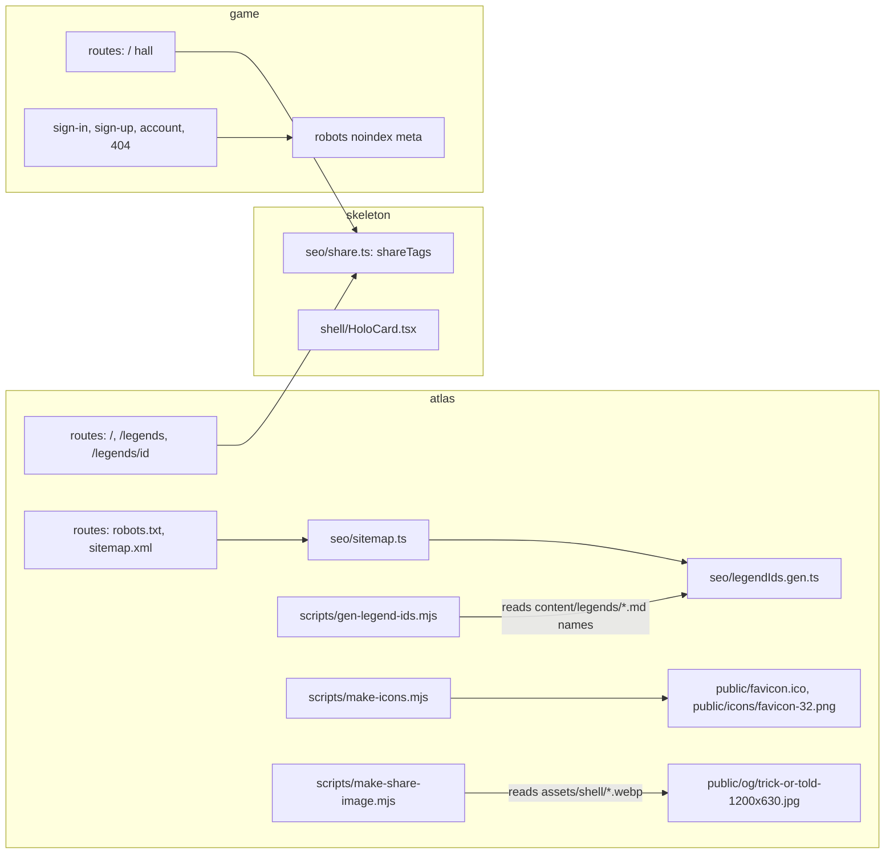

# Design Document

## Overview

Language: TypeScript (strict), React 19, TanStack Start, plain CSS with logical properties and the shared tokens. No new dependency: `sharp` is already in the atlas, and the ICO is assembled by hand (an ICO file is a small header plus PNG images).

The change has two parts.

- **Part 1 (owner fixes)**: remove the desktop-only list rules so the Legend_List is the image-card grid it was before 3ff7d64, and put it under the map; make a click on the Back_Face (outside the link) turn the card back and delete the "Turn back" button; delete the link row on the Entry_Page; reword the tagline, description and hints.
- **Part 2 (discoverability)**: favicon files and links, one share image with one shared tag builder, `robots.txt` and `sitemap.xml` as atlas server routes, canonical links, `noindex` on private and 404 pages.

Research done in the repo (no web research needed):

- `08bbff5:apps/atlas/src/components/LegendList.tsx` and `styles.css` show the earlier look: the same `legend-cards` grid (`repeat(auto-fill, minmax(min(16rem, 100%), 1fr))`) in a plain section below the map. The current `LegendList.tsx` still renders the image and the hook line; only CSS hides them (`styles.css`, two `@layer utilities` blocks at 64rem, plus `.home-list-scroll` in the 64rem media query of `@layer` for `.home-split`).
- `motion.ts` already swallows the click that follows a drag or grab (`onClickCapture`, `swallowClick`), on the whole scene and in the capture phase. A React `onClick` on the Back_Face is therefore never called after a drag. That makes the drag threshold shared with the front without new code.
- Atlas static files in `apps/atlas/public/` (icons, `world-land.svg`) are served at the root by Nitro on Vercel and by the Start server locally; `/media/*` is the only path `vite.media.ts` handles. `vercelRules.ts` forwards only `/game` and `/game/**`, so root files need no rule.
- `/manifest.webmanifest` is already a server route (`routes/manifest[.]webmanifest.ts`), which is the pattern for `robots.txt` and `sitemap.xml`, because both need `PUBLIC_ORIGIN` at request time.
- The root loader (`getShell`) returns `publicOrigin` for the atlas. The game's `getShell` returns `mediaBase`, which is `getEnv().atlasOrigin` (`ATLAS_ORIGIN`), the same domain, so the game head needs no server change.

## Architecture



Production: the atlas serves `/favicon.ico`, `/icons/*`, `/og/*` as static files and `/robots.txt`, `/sitemap.xml` from its server. The game's head links to the atlas root files, so `/game/favicon.ico` is never requested by a browser that reads the tags.

## Components and Interfaces

### Legend_List layout (Requirement 1)

- `HomeView.tsx`: drop the `home-list-scroll` wrapper (and its `tabIndex`, `role="region"`, `aria-label`). `LegendList` renders directly inside the section. The Catalog key `home.listRegion` is deleted.
- `styles.css`:
  - Delete both `@layer utilities` blocks that start with "Home list rows on desktop" and "List rows", and the `.home-list-scroll` rule in the 64rem media query. Keep a `minmax(0, 1fr)` track: `.legend-cards { grid-template-columns: repeat(1, minmax(0, 1fr)) }`, `repeat(2, minmax(0, 1fr))` from `40rem`, `repeat(3, minmax(0, 1fr))` from `64rem`; add `min-inline-size: 0` on `.legend-card` and `.legend-card-body`, and `overflow: hidden; text-overflow: ellipsis; white-space: nowrap` on the region line only (the first `p` of the body), so a long region ends with an ellipsis. The name, hook and meta lines wrap.
  - `.home-split` stays a single column at every width (delete its 64rem grid). The map section is capped so it keeps the size it has today (the 2fr column of a 72rem container, about 46rem): `.home-map { max-inline-size: 46rem; margin-inline: auto; inline-size: 100% }`. Verify measures this at 1280 and adjusts the one number if the map moved.
- `LegendList.tsx`: `CARD_SIZES` becomes `(min-width: 64rem) 22rem, (min-width: 40rem) 50vw, 100vw`, so the browser picks the right ImageKit copy for 3, 2 and 1 columns. Images stay `loading="lazy"` and keep `widthCopies` and `cardImage()`.
- Target size: the card link's `::after` covers the whole card (existing), so the hit area is the card.

### Back-face click (Requirement 2)

In `HoloCard.tsx`:

- Add `onClick` to the `.holo-back` element:

```tsx
const onBackClick = (event: MouseEvent<HTMLDivElement>): void => {
  if ((event.target as Element).closest('a')) return; // the link follows itself and does not flip
  motionRef.current?.turnBy(-1);
};
```

- The click after a drag never reaches this handler, because `onClickCapture` in `motion.ts` stops it in the capture phase on the scene (the same 8 px threshold the front uses; `DRAG_THRESHOLD_PX` is not duplicated).
- Delete the `turnBack` button, `strings.turnBack` and the `turnBack` field of `HoloCardStrings`. `skeleton/src/shell/index.ts` re-exports the type by name, so it needs no edit; the field disappears with the interface.
- `holoCard.css`: delete `.holo-back-actions .btn` and keep `.holo-back-actions` for the link; add `cursor: pointer` on `.holo-back`. Escape keeps working through the existing `onKeyDown`. No hidden button: the back face is a mouse and touch convenience, and Escape is the keyboard path (Tab reaches only the link; `inert` still hides the front).
- Callers: `routes/index.tsx` drops the two `turnBack` props.
- A flip with `reduced` set still works: `turnBy` handles the crossfade path.

### Entry page (Requirements 3, 4)

- `routes/index.tsx`: delete the `<nav className="shell-links">` and the now unused `Link` import.
- `styles.css`: delete `.shell-links` and `.shell-link` rules; remove `--shell-links` from `.shell-page` and from the `calc` in the side-by-side `--shell-card`, so the cards use the freed height (the cards grow slightly; Verify checks they still fit with the hint at 667x375, 1024x768 and 1280x800).
- `en.ts`: new tagline, description and hints (exact text from the requirements); delete `shell.entry.links`, `shell.card.turnBack`, `home.listRegion`. `nav.home` and `nav.playShort` stay because the site header uses them. `ar.ts` falls back to English; it is checked for the deleted keys and edited only if they appear.

### Share tags (Requirements 6, 7)

One function in the skeleton, used by both apps (shared logic goes in the skeleton):

```ts
// skeleton/src/seo/share.ts, exported from skeleton/src/client.ts
export const SHARE_IMAGE_PATH = '/og/trick-or-told-1200x630.jpg';
export const SHARE_IMAGE_SIZE = { width: 1200, height: 630 } as const;
export interface ShareInput { origin: string; title: string; description: string; imageAlt: string; siteName: string }
export type MetaTag = { property: string; content: string } | { name: string; content: string };
export function shareTags(input: ShareInput): MetaTag[];
```

`shareTags` always returns `og:type` (`website`), `og:site_name`, `twitter:card` (`summary_large_image`), `twitter:title` and `twitter:description`. When `origin` is non-empty it also returns `og:image`, `og:image:width`, `og:image:height`, `og:image:alt`, `twitter:image` (absolute, `origin + SHARE_IMAGE_PATH`). It never builds a relative image URL. `og:title` and `og:description` stay in each route, as today, so each page keeps its own text.

Use:

- Atlas `/`, `/legends`, `/legends/$legendId` (legend and keeper's note branches): spread `shareTags(...)` into `meta`. The legend route drops its hero `og:image` line, so the single tag is the Share_Image. `imageAlt` comes from the new Catalog key `share.image.alt`; `siteName` is `app.title`.
- Game hall (`apps/game/src/routes/index.tsx`): `head: ({ matches }) =>` reads `matches[0].loaderData.mediaBase` as the origin. New game Catalog keys `hall.description` and `share.image.alt`. The title is the game's `app.title`. Canonical is `${origin}/game/`; with no origin, `/game/`.
- Not added to the root heads: the root has no per-page title or description, and a 404 or a sign-in page should not be shared with the card.

Reading `matches[0]` for the origin follows the pattern already in `routes/index.tsx` and `legends.index.tsx`.

### Favicon and Share_Image scripts (Requirements 5, 6)

- `apps/atlas/scripts/make-icons.mjs`: reads `public/icons/icon-512.png`, resizes with sharp to 16, 32, 48 (PNG, `fit: 'contain'`, transparent or the icon's own background), writes `public/icons/favicon-32.png`, and writes `public/favicon.ico` by hand: a 6-byte ICONDIR, three 16-byte ICONDIRENTRY records, then the three PNG blobs (PNG-in-ICO, supported by every current browser). Output is committed.
- `apps/atlas/scripts/make-share-image.mjs`: composites onto a 1200x630 canvas filled with `#0E0B10`: the two cards, each flattened from `assets/shell/shell-card-{told|true}-bg-01.webp`, `…-subject-01.webp` and `shell-card-frame-01.webp` (sharp `composite`, in that order, each resized to the same card height), placed side by side with an even gap; then "Trick or Told" in the display font above them. Reads `assets/`, writes only `public/og/trick-or-told-1200x630.jpg` (`mozjpeg`, quality stepped down from 82 until the file is under 200 KB; the script exits non-zero if it cannot get there).
- Text: sharp renders text with Pango. The script first tries `sharp({ text: { text, font: 'IM Fell English SC', fontfile } })` with the font file from `@fontsource/im-fell-english-sc` (FreeType reads WOFF). If sharp cannot load that file, the script falls back to drawing the title in headless Chrome (already used by `book-check.mjs`) to a transparent PNG with the page font and composites that. The choice is noted in the handover.
- Both scripts are run once by their task; the images are committed assets in `public/`, not build steps.

### Robots, sitemap (Requirements 8, 9, 11)

- `apps/atlas/scripts/gen-legend-ids.mjs`: lists `content/legends/*.md` (read only), writes `apps/atlas/src/seo/legendIds.gen.ts` with a sorted `export const LEGEND_IDS = [...] as const`. The Keeper's Note is not in `content/legends/`, so it is not listed. The atlas `build` script becomes `node scripts/gen-legend-ids.mjs && vite build`, so a new legend file appears in the next build. The generated file is committed (as `routeTree.gen.ts` is).
- `apps/atlas/src/seo/sitemap.ts`: pure functions `sitemapPaths(ids): string[]` (`/`, `/legends`, each `/legends/<id>`, `/game/`), `buildSitemap(origin, paths): string` (XML with `urlset`, one `<url><loc>` per path, XML-escaped) and `buildRobots(origin): string`.
- `routes/robots[.]txt.ts` and `routes/sitemap[.]xml.ts`: `createFileRoute` server GET handlers like the manifest route. They read `getEnv().publicOrigin` inside the handler (never at module scope, per `env.ts`). Robots: `text/plain; charset=utf-8`, `User-agent: *`, `Allow: /`, no `Disallow` line, then `Sitemap: <origin>/sitemap.xml` only when the origin is set. Sitemap: `application/xml; charset=utf-8`, 404 with an empty body when the origin is unset. Cache header `public, max-age=3600`, as the manifest has.
- `routeTree.gen.ts` is regenerated by the build; it is not edited by hand.
- Route rules: unchanged. `/**` security headers already apply; the CSP `img-src 'self'` covers the share image because crawlers fetch it directly and pages do not display it. Verify confirms no `vercelRules.ts` or `vercel.json` change is needed and `git.deploymentEnabled` is intact.

### Head: favicon, canonical, noindex (Requirements 5, 10)

- Atlas `__root.tsx`: add `{ rel: 'icon', href: '/favicon.ico', sizes: '48x48' }` and `{ rel: 'icon', type: 'image/png', sizes: '32x32', href: '/icons/favicon-32.png' }` to `links`. The `ErrorPage` document uses the same `head` through `HeadContent`, so it gets them too.
- Atlas 404: `NotFound.tsx` renders `<meta name="robots" content="noindex" />`. React 19 hoists a `meta` rendered in the body into the head during SSR and on the client, so the atlas root head needs no 404 awareness. Verify reads it from `document.head` of a missing URL; if the hoist does not happen, the fallback is to read the router's `notFound` status in the root `head` and add the tag there.
- Atlas legend pages: add `{ rel: 'canonical', href: `${origin}${legendUrl(legend.id)}` }` to `links` (both branches, with `keepers-note` using `legendUrl('keepers-note')`).
- Game `__root.tsx`: add the same two icon links as absolute root paths (`/favicon.ico`, `/icons/favicon-32.png`: these are atlas files on the same domain). The game's own `NotFound` renders the same `noindex` meta. Game `sign-in.tsx`, `sign-up.tsx`, `account.tsx` get `head: () => ({ meta: [{ name: 'robots', content: 'noindex' }] })`.
- `robots.txt` has no `Disallow` lines, so a crawler can fetch the three game pages and read their `noindex`. The `noindex` meta alone keeps them out of search.

### Game_App files in scope

`apps/game/src/routes/__root.tsx`, `routes/index.tsx`, `routes/sign-in.tsx`, `routes/sign-up.tsx`, `routes/account.tsx` and `i18n/en.ts` only. No `server/`, `lib/`, play, generator or component logic file changes.

## Data Models

No database or content change. The only new data is:

- `LEGEND_IDS: readonly string[]` in `apps/atlas/src/seo/legendIds.gen.ts`, derived from the file names in `content/legends/`.
- `ShareInput` and `MetaTag` types in the skeleton (above).

## Error Handling

- `PUBLIC_ORIGIN` unset: share image tags, the `Sitemap:` line and the Legend canonical origin are omitted or relative as in the requirements; `/sitemap.xml` answers 404. `getEnv()` still throws its fixed `EnvError` for an invalid value, which the route turns into a 500 with no body (no variable name in the response).
- `make-share-image.mjs` fails with a clear message when a source layer is missing or the size cannot get under 200 KB; it never writes a partial file (writes to a temp path, then renames).
- `make-icons.mjs` fails when `icon-512.png` is missing.
- Back-face click: a click whose target is inside the link returns before `turnBy`; `turnBy` is a no-op during a drag (`turnTo` returns when `spin.mode === 'drag'`).
- The generator `gen-legend-ids.mjs` exits non-zero when it finds no legend files, so a bad checkout cannot publish an empty sitemap.

## Testing Strategy

Property-based testing does not apply: the work is CSS layout, a click handler, head tags, static file generation and two document routes, none of which has a meaningful "for all inputs" property that is not already covered. The design therefore has no Correctness Properties section, and no new test file is added (owner rule).

- Existing tests are updated, not extended: any pin on the "Turn back" button, the link row, the old tagline, description or hint lines, the `legend-card` list-row layout (`apps/atlas/test/home.test.tsx` and similar) and the hero `og:image` pin in `apps/atlas/scripts/smoke.ts`. They are found with a repository search in task 10 and listed in the handover.
- The one Verify task runs `pnpm -r typecheck`, `pnpm -r test` and the book browser check, then the throwaway Playwright script in `.debug/batch-c/` for layout, flip behaviour, tab order, file responses, head tags and links. The sitemap is checked by parsing it and comparing its `<loc>` list to the expected 15 URLs.
- Share image: Verify checks size, dimensions, content type and looks at it; the handover shows it.
