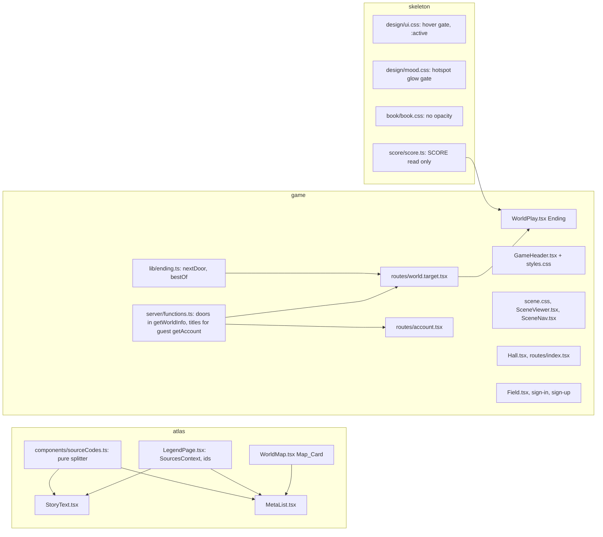

# Design Document

## Overview

Language: TypeScript (strict), React 19, TanStack Start, plain CSS with logical properties and the shared tokens. No new dependency. The batch is presentation only: it changes components, CSS, the two catalogs and, for two items, the read-only data a server function returns (titles and open flags that the Hall already shows). It does not touch game logic, scoring, the generator, the RNG, the play engine, `content/`, `assets/` or the database.

Research done in the repo (no web research needed). Each item below was re-read in the code and against its review entry in `../kiroween-review-2026-11-24/`.

| Item | Review IDs | State today | Evidence |
|---|---|---|---|
| D1 Source codes link | US-01 | Open | `MetaList.tsx` prints `legend.region` and `legend.era` raw; `StoryText.tsx` renders plain text; `Sources` in `LegendPage.tsx` has no ids on its `li`. `content/legends/baba-yaga.md` line 12 holds `(S1, S8)` and `(see ch-2)`. Seven legends carry codes in `era`. |
| D1.4 Cards strip codes | US-01 | Partly applies | `LegendList.tsx` cards show region, hook and meta only, and no region or hook in `content/` holds a code. The Map_Card (`WorldMap.tsx`) renders `MetaList` with `era`, so it does show the codes. Strip them there. |
| D2 Ending extras | GS-03, GS-12 | Open (overlay part of GS-03 already fixed) | The win screen is already an overlay (`hall-ending world-overlay`, focus trap). It still offers only "Hall" and "Read the full legend", prints "Score: n" and the seed, no best score, no score explanation. |
| D3 Header menu | UX-12 | Open | No `hidePopover` in `apps/game/src`. `.nav-menu:popover-open` uses `--app-header-h` (3.5rem = 56 px) while the game header is about 45 px. |
| D4 Pan easing | AM-02 | Open | `.scene-stage` has `will-change: transform` and no `transition`. |
| D5 Hall layout, padlocks | HD-06, UX-05, HM-08 | Open | `routes/index.tsx` renders `h1` "Trick or True", intro, greeting and notice above the scene; `.hall-scene { --scene-h: min(52dvh, 28rem) }`; `.scene-hotspot-badge` is a 28x22 px accent block on every locked door; section titles are `text-xl`. |
| D6 Auth forms | HD-10, UX-10 | Open | `Field.tsx` uses Tailwind `rounded border bg-surface`; `buttonClass` mixes `.btn` with `bg-accent` and `hover:bg-glow`; no per-form focus move; no password toggle. |
| D7 Touch feedback | EM-04 | Open | Plain `:hover` in `ui.css` (primary, secondary, ghost, `.link`, `.nav-item`) and `.mood-hotspot-glow:hover` in `mood.css`; press is `translateY(1px)` only. |
| D8 One disabled look | EM-05, HM-10 | Open | `scene.css` `.scene-button:disabled` sets `opacity: 0.5`; `book.css` `.book-controls button[aria-disabled='true']` sets `opacity: 0.45` (unlayered, so it beats `ui`). `ui.css` already styles `.btn[aria-disabled='true']` as the Disabled_Look. |
| D9.1 Scene box minimum | EM-09 | Already fixed by Phase 7 (confirm and skip) | `.scene-screen` in `scene.css` has `min-block-size: 0`; no `30rem` minimum remains (the only `30rem` hits are `max-height: 30rem` media queries). The task confirms it at 667x375 and changes nothing. |
| D9.2 Long names | EM-10 | Open | `SceneNav.tsx` tab text is the full name, no truncation; Hall door chips are `.btn btn-ghost` with no wrapping rule; `.scene-title` has no wrap rule outside the world grid. |
| D10 Account page | UX-09 | Open | `account.tsx` guest rows use `title: r.legendId`; the guest note has no link; the Run_Table has four columns with no narrow layout. |

No item needs a change inside the boundaries, so no blocker is recorded today. Two assumptions are listed under Error Handling and Decisions.

## Architecture



File ownership keeps tasks conflict-free: each file below is edited by one task only.

## Components and Interfaces

### D1. Source codes (Atlas_App)

New pure module `apps/atlas/src/components/sourceCodes.ts`:

```ts
export type CodeSegment =
  | { kind: 'text'; text: string }
  | { kind: 'source'; code: string; id: string }   // code "S1", id "source-s1"
  | { kind: 'chapter'; code: string; anchor: string };
export interface CodeIndex { sources: ReadonlyMap<string, string>; chapterAnchors: ReadonlySet<string>; legendId: string }
export function splitCodes(text: string, index: CodeIndex | null): CodeSegment[];
export function stripCodes(text: string): string;
```

- A code group is a parenthetical run that contains `S<n>` or `ch-<n>`, plus the closing-only case that appears in the Draugr text (`..., S8)`): `S<n>` is linkable when a `)` follows it in the same text with no `(` between them, or when it sits inside `( ... )`. The match is `\bS(\d+)\b` and `\bch-(\d+)\b`; the brackets, commas and spaces stay in `text` segments.
- `splitCodes` returns `source` for a code whose lower-cased id (`s1`) is a key of `index.sources`, `chapter` when `${legendId}--ch-${n}` is in `chapterAnchors`, and `text` otherwise. With `index === null` it returns the whole input as one `text` segment.
- `stripCodes` removes whole groups that hold only codes and references (` (S1, S8)`, ` (see ch-2)`) and, from mixed groups, the codes with their separators; it then collapses doubled spaces and a space before `;`, `,` or `.`. It is used where there is no Sources list.
- `StoryText.tsx`: a React context `SourceCodesContext` (value `CodeIndex | null`, default `null`). `Tokens` passes each `text` token through `splitCodes` and renders `source` segments as `<a href="#source-s1" className="source-code link" aria-label={t('legend.sourceCodeName', { n, title })}>S1</a>` and `chapter` segments as `<a href="#<anchor>" className="source-code link">`. Visible text is unchanged. `em` tokens are left as they are.
- `LegendPage.tsx`: wraps its tree in `SourceCodesContext.Provider` built from `legend.sources` (id to title, with `stripMarks`) and `legend.chapters[].anchor`; adds `id={`source-${s.id.toLowerCase()}`}` and `className="source-entry"` to each Source_Entry `li`.
- `MetaList.tsx`: renders `region` and `era` through `InlineText`, so the context supplies the links on a Legend_Page; with no provider (the Map_Card) it renders `stripCodes(value)` instead. `MetaList` reads the context itself, so `WorldMap.tsx` needs no edit.
- `styles.css` (atlas): `.source-entry:target` gets an accent outline (not colour alone: an inline-start border) and `scroll-margin-block-start: calc(var(--app-header-h) + var(--space-3))`; `.source-code` keeps a target of at least 24 px high through `min-block-size` and inline padding (the existing Requirement 30 rule); no hover-only styling.
- The book: `Book.tsx` lands on a hash only at mount (`hashTarget`). A click on `#source-s1` in the paged view must turn to the page that holds the entry. The task checks this in the browser first; if the page does not turn, it adds a `hashchange` listener in `skeleton/src/book/Book.tsx` that sets `hashRef.current = true` and re-measures, as the mount path does. That is the only skeleton edit D1 may make, and it is presentation.
- Catalog: `legend.sourceCodeName`: "Source {n}: {title}" in `apps/atlas/src/i18n/en.ts`.

### D2. Ending (Game_App)

Data, read only, no logic:

- `getWorldInfo` (`server/functions.ts`) also returns `doors: { id: string; title: string; open: boolean }[]` built exactly as `getHall` builds its `doors` (catalogue order, `canEnter`). It adds no answer or role field. `getAccount` already returns `completed[].bestScore` for a user.
- `lib/ending.ts` (new, pure): `nextDoor(doors, currentId, signedIn)` returns `{ kind: 'world', legendId, title } | { kind: 'signin', title } | null` (next in order, wrapping; `null` when there is no other door; `signin` when the next door is not open, which is the guest case); `bestOf(runs, legendId)` returns the highest `score` among entries with `status === 'won'` for that legend, or `null`.
- `routes/world.$target.tsx`: when `state.view?.ended?.status === 'won'`, it reads the best score once: signed-in via `getAccount()` (`completed.find(legendId).bestScore`); guest via `bestOf(readGuestRuns(window.localStorage), id)` in an effect (storage exists only in the browser). Both are stored in state and passed to `WorldPlay` as `best: number | null` and `next: EndingNext | null`, with `onNext`. A failed read leaves `best` null.
- `WorldPlay.tsx` `Ending`: new optional props `next`, `best`, `onNext`. Under the score line it shows `account.bestScore` when `best !== null`, then `world.score.how`, a catalog string with `{slot}`, `{curse}`, `{hint}`, `{wrong}` filled from `SCORE`. Actions in order: Hall (primary, auto-focused), Next legend (secondary) when `next` is not null, Read the full legend (ghost). The trap cycles an ordered list of the rendered controls (Tab forward, Shift+Tab back). Props stay optional so the existing win-screen pin renders without them.
- Catalog (`apps/game/src/i18n/en.ts`): `world.next` "Next legend" and `world.score.how` "Score: {slot} per solved puzzle, {curse} for breaking the curse, minus {hint} per Hint 2 and {wrong} per wrong answer." `account.bestScore` is reused.
- Guest path: `/sign-in` with `search: { reason: 'world' }`, the same search the world route uses on redirect. The Hall's own sign-in door navigates without a reason; this is an assumption recorded below.

### D3. Header menu

- `GameHeader.tsx`: a ref on `header`; `useLayoutEffect` measures `getBoundingClientRect().height` into the CSS variable `--game-header-h` on `document.documentElement`, with a `ResizeObserver` for later changes (guarded for environments without it). The App_Menu container gets `onClick={(e) => { if ((e.target as Element).closest('a, button')) menuRef.current?.hidePopover?.(); }}`. Sign-out also closes it.
- `styles.css`: `.nav-menu:popover-open { inset-block-start: var(--game-header-h, var(--app-header-h)); }`.
- `--app-header-h` itself is not changed: it is shared (atlas 61 px, book height, world root). That mismatch (UX-06) stays out of scope and is listed as weak in the handover.

### D4. Pan easing

- `scene.css`: `.scene-stage { transition: transform calc(var(--motion) * 250ms) ease-out; }` and `.scene-viewport[data-dragging='true'] > .scene-stage { transition: none; }`.
- `SceneViewer.tsx`: `const [dragging, setDragging] = useState(false)`; set true when `d.active` becomes true in `onPointerMove`, false in `endDrag`; `data-dragging={dragging || undefined}` on the viewport. No change to pan math, `clampPan`, `buttonPan` or `keyPan`.
- `--motion` is 0 under `prefers-reduced-motion` and `html[data-motion='reduce']` (`ui.css`), so the duration is 0 ms in both cases. The existing `will-change: transform` stays.

### D5. Hall

- `routes/index.tsx`: the `h1` becomes `t('hall.heading')` and sits in one `.hall-bar` row with the start button (`HallView` renders the button; the bar is composed in `Hall.tsx`, see below). The "Trick or True" `h1` is removed because the header already names the game. The intro, greeting and notice lines collapse into one `.hall-lines` block of at most two short lines (`text-sm`); the intro keeps its catalog string.
- `Hall.tsx`: the scene's own heading (`headingId="hall-heading"`) stays for focus and region naming but is visually hidden with the same clip rule `.scene-screen .scene-heading` uses; the visible `h1` is `hall.heading`. The start button moves into the top bar. The doors `h2` uses `var(--type-h2)`; the section `nav` follows the scene directly.
- `scene.css`: `.hall-scene { --scene-h: clamp(18rem, 64dvh, 40rem); }`. `.scene-hotspot-badge[data-kind='lock']` becomes 18x14 px with `background: color-mix(in oklab, var(--color-accent) 40%, var(--color-bg))`, no ring shadow; its shackle scales to match. `free` and `signin` badges keep their size and colour so the open door is the one strong mark. The lock state is not colour alone: it stays in the accessible door name and the panel text.
- The Hall does not become a fit-to-screen grid in this batch (UX-05 and HD-06 suggest it); the requirement is a larger scene and a sooner list.

### D6. Auth forms

- `Field.tsx`: input gets `className="field"` plus `inline-size: 100%` through a small class; `buttonClass` and `secondaryButtonClass` are replaced by constants `'btn btn-primary'` and `'btn btn-secondary'` (exports kept so both routes compile; callers are only the two routes). A `type="password"` field renders a sibling `button.btn.btn-ghost.btn-icon` with `aria-pressed`, `aria-controls` the input id and `aria-label` from `form.showPassword` or `form.hidePassword`; it flips the input between `password` and `text`. The component accepts an optional `inputRef` so a route can focus it, and drops the unused `required` attribute (forms use `noValidate`).
- `sign-in.tsx` and `sign-up.tsx`: the section becomes a `.panel` with the `page-narrow` width; errors are per field (`{ email?, password?, form? }`); `focusFirstError` runs in an effect keyed on a submit counter and focuses the first element with `aria-invalid="true"`, else the form error element (`tabIndex={-1}`, `role="alert"`). Sign-in checks empty email (`error.emailInvalid`) and empty password (new `error.passwordRequired`) before calling the server; a server rejection sets the form error. The Google button is `btn btn-secondary`; the switch link is `link`.
- Catalog: `form.showPassword`, `form.hidePassword`, `error.passwordRequired`.

### D7. Touch and press feedback

- `ui.css`: every `:hover` rule moves inside `@media (hover: hover) and (pointer: fine) { ... }` (`.btn-primary`, `.btn-secondary`, `.btn-ghost`, `.link`, `.nav-item`). `.btn:active:not(:disabled):not([aria-disabled='true'])` gets `transform: translateY(1px) scale(0.97)`; each variant keeps its tint (ghost gains `background: color-mix(in oklab, var(--color-ink) 10%, transparent)`). The existing variant `:active` rules stay and are adjusted so disabled controls never match them. `.btn` gets `-webkit-tap-highlight-color: transparent` now that a press state exists. The transition already uses `calc(var(--motion) * 80ms)`.
- `mood.css`: `.mood-hotspot-glow:hover` moves inside the same media query; `.mood-hotspot-glow:active` gets the same glow so a tap on a hotspot shows a press without a stuck hover.

### D8. One disabled look

- `scene.css`: `.scene-button:disabled, .scene-button[aria-disabled='true']` keeps `cursor: not-allowed` only (the `opacity` line goes; `.btn` already supplies the look because every `.scene-button` also has `btn`).
- `book.css`: the rule `.book-controls button[aria-disabled='true']` is deleted; the buttons are `.btn`, so `ui.css` styles them.
- Busy buttons already carry `aria-disabled` and pending text (`HintArea.tsx`, `WorldPlay.tsx`); with the opacity overrides gone they take the Disabled_Look.

### D9. Short screens and long names

- D9.1: confirm at 667x375; no edit.
- `SceneNav.tsx`: each tab renders `<span className="scene-tab-name">{stripMarks(name)}</span>` and `title={stripMarks(name)}`.
- `scene.css`: `.scene-tab { max-inline-size: 14rem; }`, `.scene-tab-name { min-inline-size: 0; overflow: hidden; text-overflow: ellipsis; white-space: nowrap; }`; `.scene-title { min-inline-size: 0; overflow-wrap: anywhere; }`; `.hall-door-link { max-inline-size: 100%; min-inline-size: 0; overflow-wrap: anywhere; text-align: start; }` plus `.hall-door-link` inside a `min-inline-size: 0` list item. World and tutorial `h1` get `title` of the full title (in `WorldPlay.tsx`/`TutorialRoom.tsx` only if the title can be cut; wrap is the default so `title` is added where truncation applies, which is the tabs and the Hall chips).
- `Hall.tsx`: door chips use `className="btn btn-ghost hall-door-link"` and `title={d.title}`.
- `world.css` and `scene.css` are not given a minimum block size.

### D10. Account page

- `server/functions.ts` `getAccount` guest branch returns `{ signedIn: false, titles: Record<string, string> }` from `getCatalogue()` (read only, same data `getHall` serves to guests).
- `routes/account.tsx`: `GuestProgress` maps `title: titles[r.legendId] ?? r.legendId`; the note is followed by `<Link to="/sign-in" className="btn btn-primary">{t('nav.signIn')}</Link>`; `RunTable` cells carry `data-label` from the existing `account.col*` strings and the table gets `className="run-table"`.
- `styles.css`: in `@layer components`, below `40rem`, `.run-table thead` is visually hidden, `.run-table tr` is a block with `display: grid`, the first cell spans the row and the others render `td::before { content: attr(data-label) }` with a muted label. From `40rem` the table is as today. No fixed widths, so no horizontal scroll at 390 px.

## Data Models

```ts
// lib/ending.ts
export interface EndingDoor { id: string; title: string; open: boolean }
export type EndingNext = { kind: 'world'; legendId: string; title: string } | { kind: 'signin'; title: string };
// getWorldInfo adds: doors: EndingDoor[]
// getAccount (guest) adds: titles: Record<string, string>
// sourceCodes.ts: CodeIndex, CodeSegment as above
```

No database column, content field or stored value changes.

## Error Handling

- D1: a code with no matching entry, a chapter with no anchor, or text with no provider renders as plain text; the splitter never throws on any input string.
- D2: if `getAccount()` or storage read fails, `best` stays `null` and the line is omitted; the Ending still renders. If `doors` is missing or holds one door, "Next legend" is omitted. A guest whose next door is closed gets the sign-in path.
- D3: with no `ResizeObserver` or `hidePopover` (old browser) the code skips them and the CSS falls back to `--app-header-h`.
- D6: a thrown sign-in call is treated as the whole-form error; a Google failure sets the form error and focuses it.
- D10: a missing title falls back to the id, so the table never shows an empty cell.

Decisions and assumptions (also written in the handover):

1. "Next legend" for a guest uses `/sign-in?reason=world`, because the world route's own redirect uses that reason; the Hall's sign-in door passes none.
2. Signed-in "Next legend" is the next door in Hall_Order with wrap, because every door is open to a signed-in player.
3. Best_Score shows even when it equals the score just earned, since "known" is all the requirement asks for.
4. The two server-function edits return public catalogue data only; they are not game logic and not a blocker.

## Testing Strategy

Correctness Properties are omitted: this batch is CSS, markup and wiring of existing values, with no new algorithm that has a universal property worth 100 generated cases. The one pure helper set (`splitCodes`, `stripCodes`, `nextDoor`, `bestOf`) is covered by the browser checks and by the existing atlas render tests; the owner asked for no new tests.

- No new test file. Existing tests that pinned something this batch changes are updated in task 11 and listed in the handover. Likely pins, to be confirmed by search: `apps/game/test/win-screen.test.tsx` (Ending props and actions), `header.test.tsx` (menu CSS), `hall.test.ts` and `hall.property.test.tsx` (the Hall `h1`), `viewer.test.ts` and `pan-media.test.ts` (stage CSS), `logical-css.test.ts` (new rules), `ui-import.test.ts`, `apps/atlas/test/legend-render.test.tsx`, `sources-tap.test.tsx`, `anchors-once.test.tsx`, `home.test.tsx` and `world-map.test.tsx` (meta text, source `li` ids), `i18n.test.ts` (new keys), `server.test.ts` (shape of `getWorldInfo`).
- The Verify task runs once: `pnpm -r typecheck`, `pnpm -r test`, the atlas book browser check, and the game browser check if it exists. It loads `.env` into the shell only and never prints or writes a value.
- Verify_Script (throwaway, `.debug/batch-d/`), screenshots at 390x844, 667x375 and 1280x800 of: a legend page with linked source codes and the Sources list after a click; the win overlay (reach it as earlier phases did, or render it with a test world); the Hall; sign-in with a field error; the account page as a guest; the world scene at 667x375; the open header menu and the same page after choosing a link in it. Before and after captures for D5 and D7 where cheap (taken from `git stash`-free copies of the current build before the change is made, or from the last production build).
- Browser-only checks: a temporary 60-character scene name, door title and scene title set through the DOM at 320 and 390 px with no horizontal scroll; the Scene_Stage computed `transition-duration` is `0s` under `prefers-reduced-motion: reduce` and about `0.25s` otherwise, and `0s` while dragging; `hover: none` emulation shows no hover style; the menu closes after a link and its top matches the header's bottom edge; tab order and focus after a failed submit on sign-in.
- Final checks with `rg`/`git diff`: no change in `content/`, `assets/`, `skeleton/src/score/`, `skeleton/src/generator/`, `skeleton/src/play/`, `skeleton/src/db/`; no physical CSS properties added; no `opacity` on disabled rules.
