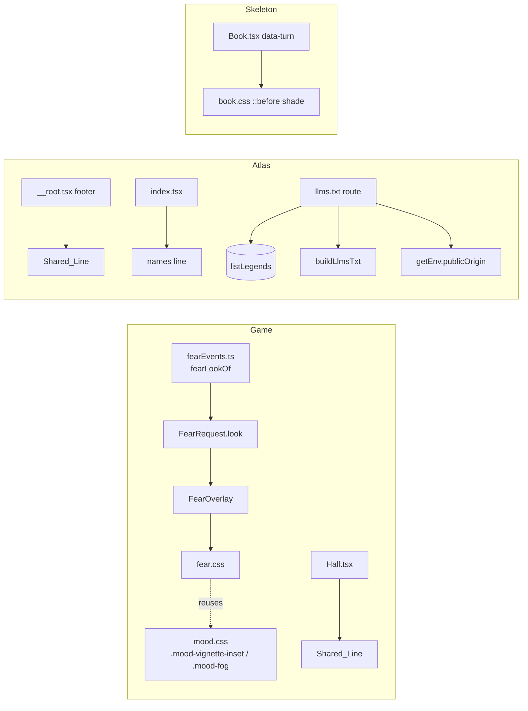

# Design Document

## Overview

Batch E changes copy, CSS and one small route. It touches no game rules, scoring, fear amounts, pacing limits, hint charging, generator, play engine, `content/`, `assets/` or database.

| Item | Change | Main files |
|---|---|---|
| E1 names (R1) | Remove the placeholder comment. Add one line under the entry tagline. | `apps/atlas/src/i18n/en.ts`, `apps/atlas/src/routes/index.tsx` |
| E2 hook (R2) | New `hall.intro`. Shared_Line in the atlas footer and at the bottom of the Hall, with the Engine_Link. | both `en.ts`, `apps/atlas/src/routes/__root.tsx`, `apps/game/src/components/Hall.tsx` |
| E3 fear looks (R3) | A stable event-to-look rule. Three looks drawn by `FearOverlay`. Caption without the opaque box. | `apps/game/src/layout/fearEvents.ts`, `FearOverlay.tsx`, `fear.css`, `TutorialRoom.tsx`, `world.$target.tsx` |
| E4 page turn (R4) | A Turn_Shade on `.book-viewport::before`, started by a `data-turn` attribute. | `skeleton/src/book/book.css`, `skeleton/src/book/Book.tsx` |
| E5 llms.txt (R5) | A pure builder plus a route. | `apps/atlas/src/seo/llms.ts`, `apps/atlas/src/routes/llms[.]txt.ts` |

Research was done in the repository only (no external sources needed). Findings that shaped the design:

- `SceneViewer.tsx` already mounts both reusable layers: `.mood-vignette-inset` is on `.scene-viewport` and `<MoodFog />` sits in `.scene-stage` (lines 190 and 249). Both are static decoration.
- `FearOverlay` is a sibling of `SceneViewer` in both consumers (`TutorialRoom.tsx` line 146, `world.$target.tsx` line 189), not a child. It cannot toggle state on those layers without editing `SceneViewer`.
- The atlas already has an external-link treatment for sources in `LegendPage.tsx` (lines 203 to 213): classes `link source-link`, `rel="noopener noreferrer"`, a `↗` marker and an sr-only text from `legend.sourceExternal`. The `link` class is in the shared `skeleton/src/design/ui.css`, so the game can use it too.
- `buildRobots` and `buildSitemap` in `apps/atlas/src/seo/sitemap.ts` are the model for a pure text builder. `apps/atlas/src/routes/robots[.]txt.ts` is the model for the route.
- Legend titles and hooks reach the atlas only through Neon (`listLegends(database())` returns `AtlasSummary` with `title` and `oneLineHook`). `legendIds.gen.ts` holds ids only.
- `apps/game/test/fear-ui.test.ts` pins a keyframe named `fear-flash` (one `animation: fear-flash <n>ms ... 1` declaration, at most 3 peaks per second, opacity stops first). The design keeps that name and shape.
- `apps/atlas/test/anchors-once.test.tsx` pins `--book-turn-ms: 300ms` and the exact text of the reduced-motion block that disables `.book-flow` transition. The design leaves both untouched.

## Architecture



## Settled design points

### D1. Are `.mood-vignette-inset` and `.mood-fog` mounted in the game scene stage?

Yes, already, and nothing is added to `SceneViewer`. Both are mounted by `SceneViewer.tsx` for every scene in the tutorial and in every world: the vignette on `.scene-viewport`, the fog in `.scene-stage` after the image and before the hotspots.

They are not driven by Fear_Events. Because `FearOverlay` is a sibling of `SceneViewer`, the overlay mounts its own short-lived layers that reuse the same CSS classes:

- Cold_Vignette: a child element with class `mood-vignette-inset`. The class gives the corner gradient on `::after`. A `fear-look-cold::before` adds a cold-tinted gradient (`color-mix` of `--color-cold`). The element animates opacity and a scale from 1.08 to 1.
- Fog_Surge: a `<MoodFog />` (from `@kiroween/skeleton/mood`) inside a wrapper. The wrapper animates opacity and a translate of 1rem to 0. The fog's own 60 s drift keeps running and is already switched off under Reduced_Motion by `mood.css`. The wrapper sets `inset-block-end: 3.5rem` on the fog so it stays above the pan buttons, the same offset `.spirit-corner` uses.
- Scene_Dim: a plain black layer (`rgb(0 0 0 / 0.55)` at peak) covering the stage. The overlay is `z-index: 40`, above the hotspots, so the dim darkens their glow as well. No change to hotspot CSS is needed.

Rejected: toggling classes on the existing `SceneViewer` layers. It needs new props or context on a component outside this batch, and the static vignette would change for the rest of the room.

Specificity note: `.mood-vignette-inset` sets `position: relative`. The look layer overrides it with `.fear-overlay .fear-look-layer { position: absolute; inset: 0 }` (two classes beat one).

### D2. Stable rule: Fear_Event to Fear_Look

Rule, in `apps/game/src/layout/fearEvents.ts`, using no randomness:

```ts
export type FearLook = 'cold' | 'fog' | 'dim';
const LOOKS: readonly FearLook[] = ['cold', 'fog', 'dim'];
const LEGEND_ORDER = Object.keys(FEAR_EVENTS); // alphabetical, as declared
/** Same legend and event id always give the same look. `null` (the tutorial) uses offset 0. */
export function fearLookOf(legendId: string | null, id: FearEventId): FearLook {
  const offset = legendId === null ? 0 : Math.max(0, LEGEND_ORDER.indexOf(legendId));
  return LOOKS[(offset + Number(id.slice(3)) - 1) % 3]!;
}
```

Why this rule:

- Total and pure: it depends only on the legend's position in `FEAR_EVENTS` and the event number. No `Math.random`, no RNG, no clock.
- Event numbers 1 to 5 map to consecutive positions in the cycle, so within a legend no two numerically adjacent events share a look, and all three looks appear in each legend. Events 4 and 5 repeat the looks of 1 and 2.
- The legend offset makes different legends start on different looks, so the first event is not always the same look.
- The tutorial mirror (`MIRROR_EVENT`, `fe-1`) gets Cold_Vignette.
- New legends append to `FEAR_EVENTS`, so existing legends keep their looks. Reordering the object would change looks; the comment says so.

Plumbing: `FearRequest` gains `look: FearLook`. The two producers set it: `world.$target.tsx` calls `fearLookOf(info.id, entry.id)` and `TutorialRoom.tsx` calls `fearLookOf(null, MIRROR_EVENT.id)`. `FearEventEntry`, `chooseFearEvent`, `fear.ts` and `fearTable.ts` are unchanged.

### D3. External-link markup (Engine_Link)

The atlas already has a treatment (see research), so Requirement 2.6 applies and the Atlas uses it. The game uses the same markup, so both apps look the same.

```tsx
<a href={ENGINE_URL} rel="noopener noreferrer" className="link">
  {t('shared.line.engine')}
  <span aria-hidden="true"> ↗</span>
  <span className="sr-only">{` (${t(<external key>)})`}</span>
</a>
```

- No `target`: it opens in the same tab (Requirement 2.5). `rel` is kept for consistency with the source links.
- `source-link` is not used. It is an atlas-only tap-target helper for chapter source lists. The footer and Hall lines need a 24 px target, so the link sits in a `<p>` with `min-block-size: 1.5rem` through the existing footer link styling (`inline-flex min-h-11 items-center` as used by the Keeper's Note link in the same footer).
- Atlas sr-only text reuses `legend.sourceExternal`. The game adds the same sentence as `shared.line.external`.

Shared_Line is held as four keys in each `en.ts`, so the sentence can carry the link and still be identical in both apps:

| Key | Value |
|---|---|
| `shared.line.before` | `Two apps, one skeleton: the atlas and the game are built from ` |
| `shared.line.engine` | `the same engine` |
| `shared.line.after` | `.` |
| `shared.line.href` | `https://github.com/Hany-R-Mahmoud/kiroween-2026#how-it-fits-together` |

Concatenating before, engine and after gives exactly the Shared_Line. Each app holds its own copy (shared logic rule: this is copy, not game logic). Placement: atlas footer gets a fourth `<p>` in `__root.tsx`; the Hall gets one muted `<p>` after the doors in `Hall.tsx`. No `/about` route and no new footer component.

Entry_Page line (Requirement 1): key `shell.entry.names` = `Told is the atlas. True is the game.`, a `<p>` directly after `.shell-tagline` in `index.tsx`, small and muted, allowed to wrap. The 390x844 check is made in the Verify_Task; if the cards fall below the fold, the line's block margins shrink first. The placeholder comment on line 3 of `apps/atlas/src/i18n/en.ts` is deleted.

### D4. How `/llms.txt` is built

Builder, pure, in `apps/atlas/src/seo/llms.ts` (next to `sitemap.ts`):

```ts
export interface LlmsLegend { id: string; title: string; oneLineHook: string }
export function buildLlmsTxt(origin: string, legends: readonly LlmsLegend[]): string
```

- `origin` is `getEnv().publicOrigin`, which is `''` when `PUBLIC_ORIGIN` is unset. A local helper `url = (path) => origin + path` writes absolute URLs when set and the bare path when empty, so Requirements 5.7 and 5.8 are one code path. The origin is never read from the request.
- Body, in order:
  1. `# Trick or Told`
  2. A blank line and one paragraph (fixed text in the builder, no legend data): the atlas tells twelve scary legends from around the world in documentary style; the game is a point-and-click investigation; the game cannot be solved without the atlas, because puzzle answers exist only in the legend chapters. The count is `legends.length`, not a literal, so the text follows the content.
  3. `## Legends`, then one line per legend: `- [Title](${url('/legends/' + id)}): hook`.
  4. `## Game`, then `- [Trick or True](${url('/game/')}): ...` and `- [Tutorial](${url('/game/tutorial')}): ...`.
- Text hygiene, because titles and hooks come from the database: whitespace runs (including newlines) in a hook collapse to one space, and `[` and `]` in a title are escaped, so each legend stays on one line.
- Route `apps/atlas/src/routes/llms[.]txt.ts`, shaped like `robots[.]txt.ts`:

```ts
GET: async () => {
  const legends = await listLegends(database());          // request time, from Neon
  return new Response(buildLlmsTxt(getEnv().publicOrigin, legends), {
    headers: { 'content-type': 'text/plain; charset=utf-8', 'cache-control': 'public, max-age=3600' },
  });
}
```

  If the database call throws, the handler returns status 503 with `text/plain` and the body `Unavailable`, with no error detail. The route tree file regenerates on build.
- Not added to `sitemapPaths`, the sitemap or any list (Requirement 5.10). Request-time reading keeps `content/` untouched and matches how every other atlas page gets its text.

### E3 and E4 details

**Fear_Overlay (`FearOverlay.tsx`, `fear.css`).**

- Markup inside the existing keyed wrapper, rendered only when `reduced` is false:

```tsx
<div key={shown.id}>
  {!reduced && <div className={`fear-look fear-look-${look}`} aria-hidden="true">{layer}</div>}
  <p className="fear-overlay-caption">...</p>
</div>
```

  `layer` is the vignette element, `<MoodFog />`, or an empty dim element. The old `.fear-overlay-flash` element and rule are removed. The wrapper keeps `aria-live="polite"` and `pointer-events: none`.
- Timing: every look runs 3000 ms (equal to `EVENT_SHOW_MS`) with `fear-flash`, which stays an opacity-only envelope: `0%` 0, `14%` 1, `45%` 1, `100%` 0. That is one rise (about 420 ms) and one fall, so at most one luminance change in any one-second window (Requirement 3.10). The name and shape keep the existing keyframe test valid. Cold and Fog add a second animation for movement (`fear-tighten`: transform scale; `fear-rise`: transform translate). Scene_Dim uses opacity only.
- Caption order (3.7): the caption animation gets `animation-delay: 400ms` and a 2600 ms duration, so it starts after the look has begun and still ends at 3000 ms, when the component clears it. The keyframes `fear-caption-full` are unchanged.
- Caption box (3.8): `background: var(--color-surface)` is replaced by a scrim, `radial-gradient(ellipse at center, rgb(0 0 0 / 0.8) 0 60%, transparent 100%)`, with extra inline padding so the text sits in the 0.8 core, plus a dark `text-shadow`. Worst case is a white scene behind the scrim: the effective background is about `#333`, so the ratio is checked against the actual `--color-cold` and `--caption-ink` values in the Verify_Task (4.5:1 needed). If a value fails, the core alpha rises; the colours do not change.
- Reduced_Motion (3.12, 3.13): look layers are not rendered, and CSS also hides `.fear-look` under `prefers-reduced-motion` and `html[data-motion='reduce']`. The caption keeps its existing `fear-fade` path and the existing static `opacity: 1` rules, so the Batch A fix stays. The scrim is static and stays.
- Gate (3.9): `fearPlayer.ts`, `MIN_EVENT_GAP_MS` and `EVENT_SHOW_MS` are untouched.

**Turn_Shade (`book.css`, `Book.tsx`).**

- `.book-viewport::before` is unused today (`::after` is the two-page gutter shadow), so the shade does not disturb the gutter and works in one-page and two-page mode. The viewport already has `contain: paint` and `clip-path: inset(0)`, so the shade cannot paint outside the page box.
- Pseudo-element: `position: absolute; inset: 0; z-index: 1; pointer-events: none; opacity: 0`. Background is two layers: a uniform slight dim (`rgb(40 25 10 / 0.07)`) and an edge shadow, `linear-gradient(90deg, rgb(40 25 10 / 0.3), transparent 35%)`, which sits at the edge the leaving page travels toward.
- Direction: `Book.tsx` sets `data-turn="next"` or `"prev"` on the viewport. CSS sets `--turn-flip` to `var(--book-sign)` for next and `calc(var(--book-sign) * -1)` for prev. The animation uses `transform: scaleX(var(--turn-flip)) translateX(...)`, so the shade mirrors for previous turns and for RTL without separate gradients.
- Animation: `animation: book-turn-shade var(--book-turn-ms) ease-out 1`, keyframes with opacity and transform only (opacity 0, then 1 at 40%, then 0). Duration follows the existing 300 ms variable, so `--book-turn-ms` is not changed.
- Trigger in `Book.tsx`: inside `goTo`, when `byReader` is true, the target page differs from `pageRef.current` and the book is paged, set a `turnDir` state (`'next' | 'prev' | null`). A timer clears it after the duration read from `--book-turn-ms` (fallback 300), plus 50 ms. The timer is cleared on unmount and reset on the next turn. `turn()` is used by buttons, keyboard and swipe, and focus-driven turns also pass `byReader`, so all of Requirement 4.4 to 4.6 is covered with one hook. Hash landings and reflows (`byReader` false, or `show` called directly) never show a shade. The attribute is `undefined` when idle, so server markup and existing markup tests are unchanged and no residual shade remains (4.8).
- Reduced_Motion (4.7): a new, separate block `@media (prefers-reduced-motion: reduce) { html[data-book='on'] .book-viewport::before { content: none } }` plus the `html[data-motion='reduce']` twin. It is a new block, placed after the existing one, so the pinned text of the existing `.book-flow { transition: none }` block is not altered.
- Print: the shade has no content outside `[data-turn]`, and the rule is added to the existing print hide list only if the build shows it printing (it cannot, as opacity is 0 at rest).

## Components and Interfaces

| Unit | Interface |
|---|---|
| `fearLookOf(legendId: string \| null, id: FearEventId): FearLook` | New, pure, in `fearEvents.ts`. |
| `FearRequest` | Adds `look: FearLook`. |
| `FearOverlay({ request, reduced })` | Props unchanged. Reads `request.look`. |
| `Book` | Props unchanged. New internal `turnDir` state and `data-turn` attribute. |
| `buildLlmsTxt(origin, legends): string` | New, pure, in `apps/atlas/src/seo/llms.ts`. |
| Route `/llms.txt` | `GET` only. Reads `getEnv().publicOrigin` and `listLegends(database())`. |
| i18n keys | Atlas: `shell.entry.names`, `shared.line.*`. Game: `hall.intro` (new text), `shared.line.*`, `shared.line.external`. |

## Data Models

No schema, content or database change. New types: `FearLook` (union of three strings), `LlmsLegend` (a subset of `AtlasSummary`: `id`, `title`, `oneLineHook`). `TurnDir` is `'next' | 'prev' | null` and local to `Book.tsx`.

## Error Handling

- Unknown legend id passed to `fearLookOf`: `indexOf` returns -1, clamped to offset 0, so the function never throws and always returns one of three looks.
- `/llms.txt` with a database failure: 503, `text/plain`, body `Unavailable`, no error text, no connection detail.
- Empty `PUBLIC_ORIGIN`: relative paths, status 200.
- A legend hook or title with newlines or brackets: normalised in the builder.
- `--book-turn-ms` unreadable: the timer falls back to 300 ms.
- Reduced_Motion: no look layers and no shade; the caption still shows (Requirement 3.13).

## Testing Strategy

Property-based testing is not used for this batch, so the Correctness Properties section is left out and the prework tool was not run. Requirement 6 limits the batch to exactly one new test, and most of the work is copy, CSS and layout, which are checked by screenshots and examples. The two pure functions (`fearLookOf`, `buildLlmsTxt`) could carry properties, but extra tests are out of scope. The existing fast-check tests for the generator, RNG and lead logic are not touched, and none of that code changes, so they do not need to be rerun beyond the normal `pnpm -r test`.

**The one new test**, `apps/atlas/test/llms.test.ts` (Vitest, example based): build the text from the 12 ids in `LEGEND_IDS` with fake titles and hooks, with a set origin, and assert it contains a `- [Title](<origin>/legends/<id>): hook` line for each of the 12 (Requirement 6.1). It makes no network or database call.

**Existing pins** (Requirement 6.2). Expected to stay green without edits, to be confirmed by running them:

- `apps/game/test/fear-ui.test.ts`: the `fear-flash` keyframe, `animation: fear-flash <n>ms ... 1`, at most 3 peaks per second, and the `fear-fade` reduced path. The design keeps these names and shapes.
- `apps/atlas/test/anchors-once.test.tsx`: `--book-turn-ms: 300ms`, the print rule and the existing reduced-motion block. Kept.
- `apps/atlas/test/book-component.test.tsx`: markup contains `book-controls`, `book-flow` and `book-frontispiece`. The new attribute is absent at rest.

Pins likely to need an update, each to be listed in `docs/batch-e-handover.md` if changed: any test that reads `hall.intro`, `shell.entry.*` or the footer text, any test that builds a `FearRequest` without `look`, and any snapshot of the old caption box.

**Browser checks** (Verify_Task, throwaway Playwright script in `.debug/batch-e/`, no committed test):

- Screenshots at 390x844 and 1280x800 of the Entry_Page, atlas footer, Hall bottom line, and the Book mid-turn for next and previous.
- The three looks in the tutorial. The tutorial plays only `fe-1` (Cold_Vignette), so the script sets `data-look` and the look class on the live overlay for Fog_Surge and Scene_Dim, or plays a world scene whose events map to them. Frames at 0, 400, 1200 and 2600 ms.
- Reduced motion on: no look layer, no shade, caption visible.
- Caption contrast computed from the real token values against a white scene backdrop.
- `/llms.txt` from the local build: status, content type, line count, and a check that it is absent from `/sitemap.xml`.

Commands: `pnpm -r typecheck`, `pnpm -r test` (single run), then the existing atlas book browser check and the Game browser check if one exists.
