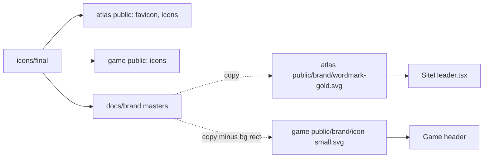

# Design Document

## Overview

This batch swaps static art and changes two header components. It touches no game logic, play engine, `content/`, `assets/`, database, manifest or link tag. Research was done in the repository only; the files named below are to be read at execution time.

| Item | Change | Main files |
|---|---|---|
| Icons (R1) | Overwrite same-named files with the Final_Icons | `apps/atlas/public/favicon.ico`, `apps/atlas/public/icons/*`, `apps/game/public/icons/*` |
| Masters (R2) | Copy `svg/` and add a README | `docs/brand/` |
| Atlas header (R3) | Image link in place of the text title | `apps/atlas/src/components/SiteHeader.tsx`, `apps/atlas/public/brand/wordmark-gold.svg` |
| Game header (R4) | Small_Icon before the text title | Game header component, `apps/game/public/brand/` |
| Checks (R6) | Manual reproduction, then fix app or check | `apps/game/scripts/browser-check.mjs` |
| Verify (R7) | Typecheck, tests, screenshots, fetches, docs | `.debug/brand-logo/`, `docs/brand-logo-handover.md`, `docs/kiro-usage.md` |

## Architecture

## Components and Interfaces

### Icon files

Plain file copies, byte for byte. The game copy of `favicon-32.png` is made only if a game link tag points at `/icons/favicon-32.png` locally. The execution step lists the game's current icon files and replaces exactly those. A byte comparison (checksum) against the source confirms each copy.

### Atlas_Header

The home link keeps its element and class. The text title node is replaced by an ``. The `alt` text is the `app.title` value "Trick or Told", so the accessible name is unchanged. The image gets a fixed height of 2rem to 2.25rem (32 to 36 px) and `width: auto`. The height is chosen to fit inside the current header content height, so the header does not grow; the before and after header heights are measured in the browser. Focus styling stays on the link, so the existing `:focus-visible` rule applies. If the header grows, the image height is reduced to 32 px before any header CSS is changed.

### Game_Header

The header keeps the text title "Trick or True". A decorative `` about 20 px high is placed before it. `apps/game/public/brand/icon-small.svg` is a copy of `docs/brand/icon-small.svg` with the background rect removed and nothing else changed. The game is served under the `/game` path on the shared domain, so the image URL follows the way the game already references its other public files (the existing icon link tags show the form).

### Brand README

`docs/brand/README.md` lists the nine files with one line each: the wordmark variants (gold transparent for dark headers, gold on dark tile, black, white), the icon variants (any, rounded, maskable, small, black), the two colours, and the rule "do not stretch, recolour outside these files, or redraw".

### Tutorial checks (R6)

For each failing check the decision is made from a manual run in a real browser at 390x844 with touch emulation (tap the candle hotspot; keyboard-only from the Hall into the tutorial). Outcomes:

1. App works: update `browser-check.mjs` (selector, wait target or route expectation) and record the change.
2. App wrong in presentation code (for example a hotspot size or overlay that eats the tap): the smallest change in that code.
3. Cause is in game logic, the play engine, `content/` or the database: stop and report.

The Hall height (540 vs 576) and reduced motion checks are only judged, not changed.

## Data Models

No data model changes. Nothing is added to the database or to `content/`.

## Error Handling

- IF a source file is missing in `icons/final/`, THEN execution stops and reports which file.
- IF a copied file differs from its source by checksum, THEN the copy is repeated once and a second mismatch is reported.
- IF the header height grows after the wordmark is placed, THEN the image height drops toward 32 px and the result is reported.
- IF a fix for a failing check would touch protected areas, THEN execution stops and reports.

## Testing Strategy

Property-based testing does not apply. The work is static file replacement, markup and CSS in two headers, and a browser check update. No pure function with a wide input space is added or changed. The Correctness Properties section is therefore omitted.

- Existing unit tests: `pnpm -r typecheck` and `pnpm -r test` run once. Any test that pins the header title markup is updated and listed.
- Browser checks: the Browser_Check runs once for the groups keyboard, touch and motion and is compared with the last run (23 passed, 4 failed).
- Screenshots at 390x844 and 1280x800 of both headers and a 32 px tab icon crop, saved in `.debug/brand-logo/`.
- HTTP fetches of the favicon, icons and the two `brand/` SVGs from the local build, recording status and content type.
- Local servers use ports other than 3305 and 3306 (for example 3500 and 3501) and are stopped afterwards.
