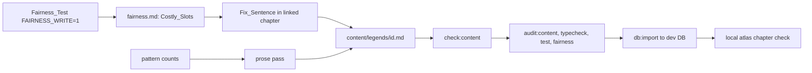

# Design Document

## Overview

This batch edits story text in Markdown. It changes no code. Research was done in the repository only; files named below are read at execution time.

| Item | Change | Main files |
|---|---|---|
| Baseline (R1) | Fairness run and pattern counts | `docs/phase-4-notes/fairness.md`, `.debug/content-pass/` |
| Fair answers (R2) | One Fix_Sentence per Costly_Slot | `content/legends/<id>.md` (8 legends) |
| Known_Findings (R2.7) | Remove legends that win 40 of 40 | `skeleton/test/play-atlas-player.property.test.ts` |
| Prose pass (R3) | Edit five patterns in chapter text | `content/legends/*.md` (12 legends) |
| Gates and checks (R4, R5) | `check:content` per legend, final run, dev import | repo scripts |
| Handover (R6) | Report and usage entry | `docs/content-pass-handover.md`, `docs/kiro-usage.md` |

## Architecture

## Components and Interfaces

### Baseline

Run the Fairness_Test with `FAIRNESS_WRITE=1`. Read `docs/phase-4-notes/fairness.md` to list, per legend, the slots that cost a wrong answer and their type. Count the five patterns per legend with `grep -c` style searches over chapter text and `Hook:` lines only: `is not .*\. It is`, `Notice what`, `strange`, `quietly`, `^Here is|^That is the` (sentence start), and question Hooks (a `Hook:` line ending in `?`). Save counts and the fairness result as files in `.debug/content-pass/` (`before.md`).

### Fix_Sentence rules

For each Costly_Slot, find the fact in the legend's fact pool (its anchor, answer and wrong answers) and read the linked chapter.

- `true-or-told`: add one sentence stating that the claim is documented (and by whom, citing a source already in the chapter's `sources:`) or only told. The words match the puzzle options (for example "documented" and "told"). `[R]` facts never fill `true-or-told`, so none is changed to that.
- `date-or-number`, `original-name`, `who-said-it`, `object-match`: write the date, name, speaker or object in the form the fact states it, as one plain sentence in the chapter.
- The sentence goes into the chapter of the fact anchor, before the `Hook:` line. If the chapter already holds the fact in other words, reword that sentence instead of adding one.
- Quotes are paraphrases of cited testimony. No new claim, no new source, no change to tables, anchors or IDs.

Stop condition: if the player or matcher cannot see the answer even with the sentence present (a generator, player, fear constant or matcher issue), the slot is recorded as not fixed in the Handover and no code is touched.

### Prose pass rules

| Pattern | Rule |
|---|---|
| "X is not A. It is B." | Keep B as a plain statement; drop "not A" unless A is a version someone told |
| "Notice what ..." | Cut the lead-in, keep the point |
| "strange", "quietly" | Cut, or use a precise word; at most one "strange" per legend |
| "Here is ...", "That is the ..." | Direct statement |
| `Hook:` questions | At most one in three is a question; the rest state the open fact plainly |

Every fact, number, name, quote and source code stays. Answer_Text sentences stay word for word; the Content_Audit and Content_Check show a break. A chapter loses at most two sentences.

### Per-legend loop

For each legend in order: apply the Fix_Sentences (the eight known legends), apply the prose pass, run `pnpm check:content`, then fix and rerun until it passes. After the eight known legends are done, rerun the Fairness_Test to see which can leave Known_Findings. The four others (the legends not in Known_Findings) get the prose pass only.

### Known_Findings edit

After the last fairness run, remove from `KNOWN_CONTENT_FINDINGS` exactly the legends with 40 of 40 seeds won. Players, seeds and budget stay as they are.

### Dev import and atlas check

Load `.env` into the shell only. Run `pnpm --filter @kiroween/skeleton db:import` against the Dev_Database, build the atlas, serve it on port 3500, open one changed chapter by its anchor and confirm the new sentence shows. Stop every server afterwards. The production database is not touched.

## Data Models

No data model changes. Legend tables, fact data, version lists and IDs are unchanged.

## Error Handling

- IF `check:content` fails for a legend, THEN the last edit is fixed before the next legend starts.
- IF a Costly_Slot cannot be fixed by text alone, THEN it is recorded as not fixed with the reason, and no code is edited.
- IF the Content_Audit shows a gap, THEN the edit that caused it is reverted or repaired and the audit rerun.
- IF a sentence cannot be made true to the cited sources, THEN it is not added and the slot is reported.
- IF the Dev_Database is not clearly the dev one, THEN the import is not run and the blocker is reported.

## Testing Strategy

Property-based testing does not apply to the new work. The work is prose edits to Markdown, with no pure function added or changed, so the Correctness Properties section is omitted. The existing fast-check properties in `skeleton/test/` are the gate: the Fairness_Test measures the effect of the edits, and the other property tests run unchanged in `pnpm -r test`.

- `pnpm check:content` after each legend.
- At the end, once: Content_Audit (all zeros in the gaps table), `pnpm -r typecheck`, `pnpm -r test`, Fairness_Test with `FAIRNESS_WRITE=1`.
- A before and after table per legend: seeds won of 40 and the five pattern counts.
- Manual check in the local atlas of one changed chapter after the dev import, on a port other than 3305 and 3306.
