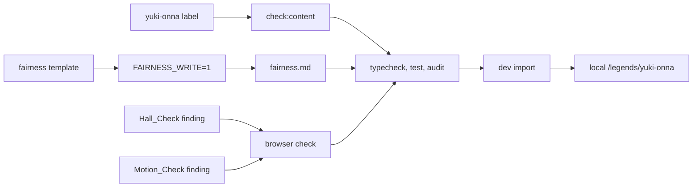

# Design Document

## Overview

A small batch: one Markdown label, one test-template change, two browser-check findings, final checks and a handover. Files named below are read at execution time. Nothing a viewer sees on the Protected_Surfaces changes.

| Item | Change | Main files |
|---|---|---|
| Label (R2) | `[Dramatization]` at the start of the Yuki-onna cold open | `content/legends/yuki-onna.md` |
| Fairness text (R3) | Result-aware "Reading of the findings" | `skeleton/test/play-atlas-player.property.test.ts` (~line 145), `docs/phase-4-notes/fairness.md` |
| Hall_Check (R4) | Find when the Hall height rule changed; update the check or report | `apps/game/scripts/browser-check.mjs` (~line 668), `scene.css` |
| Motion_Check (R5) | List running animations under reduced motion; update the check or fix | `apps/game/scripts/browser-check.mjs` (~line 772), reduced-motion CSS block |
| Checks (R6) | Typecheck, tests, audit, browser run, dev import | repo scripts |
| Handover (R7) | Report and usage entry | `docs/final-polish-handover.md`, `docs/kiro-usage.md` |

## Architecture

## Components and Interfaces

### Label

Read `content/legends/banshee.md` line 19 for the exact form (label, spacing, italics or not). Read the Cold_Open of the Yuki_Onna_File and insert the same label at the start of its paragraph. Change nothing else. Run `pnpm check:content` for yuki-onna.

### Fairness template

In the Fairness_Test, find the code that writes "Reading of the findings". Branch on `KNOWN_CONTENT_FINDINGS.length`: empty writes one line, "All legends win every seed. The slot table lists only wrong answers the player recovered from."; non-empty keeps the current lines. No change to the player, seeds, budget or assertions. Run the test with `FAIRNESS_WRITE=1` to regenerate the report, then confirm the three stale phrases are gone.

### Hall_Check

1. Read the Hall rule in `scene.css` (`clamp(18rem, 64dvh, 40rem)`) and the check's expected rule (`min(70dvh, 36rem)`, measured 540, expected 576).
2. Use `git log -S` on the rule and the Batch A to D handovers in `docs/` to date the change and find whether it was intended.
3. If intended: change only the expected rule in the check, computing the expected height from the clamp at the check's viewport. If the app seems wrong: change nothing and report.
4. Confirm in a real browser at the check's viewport that the measured height matches the new rule.

### Motion_Check

1. Open the game in a real browser at the check's viewport with `prefers-reduced-motion: reduce` emulated. Read `document.getAnimations()` and list the running animation names, with the properties each keyframe changes.
2. If every animation changes only opacity or colour: update the check to assert that no movement or scale animation runs and only opacity or colour changes.
3. If any animation moves or scales: make the smallest change inside the reduced-motion CSS block. If that would alter normal motion on a Protected_Surface, change nothing and report.

### Dev import

Load `.env` into the shell only. Confirm the database target is the dev branch without printing values (compare the branch or host label to the production marker named in the docs). If confirmed, run `pnpm --filter @kiroween/skeleton db:import`, serve the atlas locally and open `/legends/yuki-onna`.

## Data Models

No data model changes.

## Error Handling

- IF `check:content` fails for yuki-onna, THEN the label is repaired before any other task starts.
- IF the Fairness_Test fails after the template change, THEN the template change is reverted and repaired; assertions are never edited.
- IF a fix needs a change to a Protected_Surface, THEN it is not made and the finding is reported.
- IF the database target is not clearly dev, THEN the import is not run.
- IF a port in use is 3305 or 3306, THEN another port is chosen; servers are stopped at the end.

## Testing Strategy

Property-based testing does not apply to the new work. The changes are one Markdown label, a string branch in a report template, and a browser-check expectation, so no pure function with a meaningful input space is added. The Correctness Properties section is omitted. The existing fast-check properties in `skeleton/test/` run unchanged as a gate, and the Fairness_Test is run with `FAIRNESS_WRITE=1` once after the template change.

- `pnpm check:content` for yuki-onna after the label.
- The Fairness_Test and `pnpm -r test` after the template change.
- The Browser_Check groups keyboard, touch, motion and the Hall group, once, in a real browser.
- A manual look at `/legends/yuki-onna` after the dev import.
