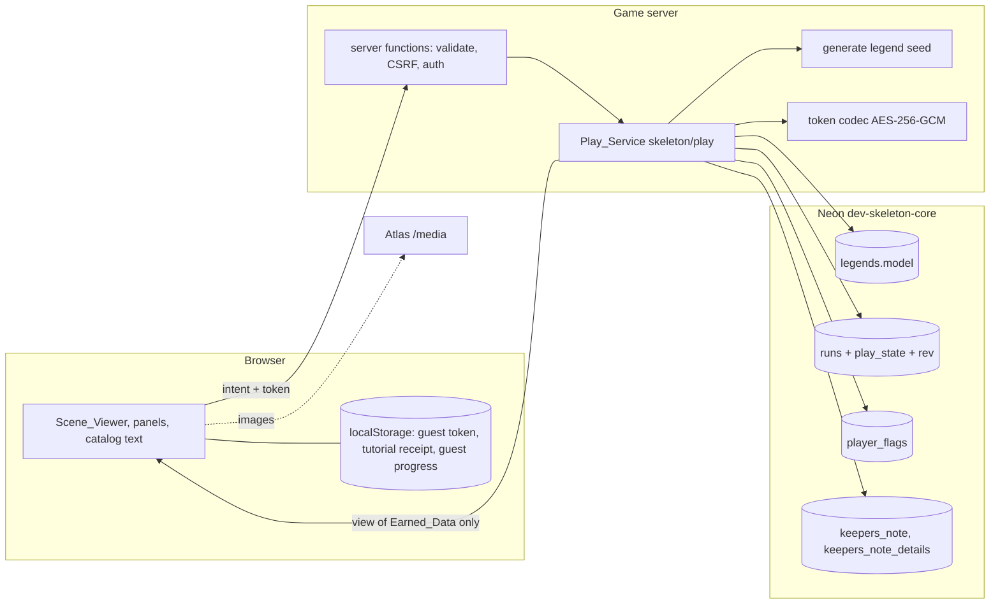
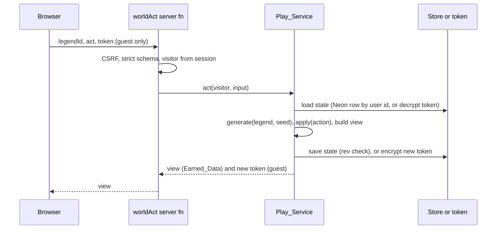

# Design Document

## Overview

Phase 4 makes `apps/game` playable: the hall, the tutorial room, twelve legend worlds, a server that keeps every secret, a Keeper's Note page in the atlas, and the tests that prove it. This document follows `requirements.md` (approved). It adds the seven approved additions and the proposed values the requirements left to the design.

Nothing in this design changes code, the database, `content/` or `assets/`. The owner has approved the schema change, the `GAME_TOKEN_KEY` secret (already set in `.env`) and the Keeper's Note import (see "Stops that this design triggers"), with the conditions stated there.

### Decisions confirmed by the owner

| Item | Confirmed handling |
|---|---|
| Owner decisions 1 to 6 | All defaults. Final slot is `isFinal`, else the last slot in file order. Win needs every slot solved and the true lead followed. A dead end raises fear and is not a wrong answer. The Seed is shown only after a Run ends. Hint 2 counts once per slot. A signed-in player resumes a Run. |
| Content gaps G1 to G15 | All default handling. |
| Addition 1 | Scene navigation between a World's scenes and back to the Hall: see "Scene navigation". |
| Addition 2 | Hall and Tutorial_Room use the hub palette and fonts, with the atlas AA checks: see "Hub theme". |
| Addition 3 | G6 table of fear changes as named constants: see "Fear amounts". |
| Addition 4 | The scripted player picks the option that matches the fact's statement in its chapter. Ambiguity is reported per legend, not failed: see "Scripted player". |
| Addition 5 | No second copy of the assets in the game build. Images load from the atlas `/media`: see "Media". |
| Addition 6 | A guest's tutorial-done flag is redeemed once at sign-in: see "Tutorial carry-over". |
| Addition 7 | Every new UI sentence is listed: see "New UI sentences". |
| Fear amounts (revision) | Hint 2 = 6, dead end = 6, wrong answer = 15, tutorial Hint 2 = 10, hotspot ticks +/-3. Budget rule and its test: see "Fear amounts". |
| G6 table, open items 3 to 12, new UI sentences | Approved as written. |
| Schema change, Keeper's Note import | Approved for `dev-skeleton-core` (see "Stops that this design triggers"). |

### Facts from the repository that shaped the design

These were read from the code, not assumed.

1. `generate()` already returns everything the Play_Service needs: slots with `options` and `correctIndex`, `hint1`, `hint2.anchor`, `hotspotIds`, the roles, `swaps`, `trueLead` and `deadEnds` (`skeleton/src/generator/generate.ts`). Hotspot positions, sprites and tap text for a swapped Hotspot are not in it.
2. Every legend has 3 scenes and exactly 5 slots. Only `banshee` flags a final slot (`pz-5`). Hotspots per legend: 14 to 18. Each legend has exactly 5 fear events; only `flying-dutchman` has per-event reduced-motion lines. Dead ends available per legend: 3 to 5.
3. A Hotspot link with `step: null` means "the whole lead" (`stepHotspots` in `generator/audit.ts` treats `null` as matching every step).
4. `startRunFn` and `finishRunFn` accept client counts (`apps/game/src/server/functions.ts`). They are the only reason the Phase 2 score could be forged.
5. `anchors` rows point to `legends` and the atlas reader cannot read `runs` or `legends.model` (`docs/tech-decisions.md`). `ANCHOR_RE` already accepts `keepers-note--ch-1`, so `atlasUrl('keepers-note--ch-1')` returns `/legends/keepers-note#keepers-note--ch-1` with no change.
6. The atlas serves `/media/*` in dev through `apps/atlas/vite.media.ts` (only the canonical URL of an asset id is served) and copies the canonical files into its build. The game has neither.
7. `ATLAS_ORIGIN` already exists (Phase 3): empty on the shared domain, `http://localhost:3001` locally.
8. Hub palette contrast (computed for this design with the atlas's own `contrastRatio` formula): ink 15.06 and muted 6.39 on background; accent 9.19; glow 13.73; cold 7.54; danger `#B23A3A` is 3.31 on background and 3.00 on surface, so danger is used for the fear meter fill only (non-text, 3:1), and `--color-danger-ink` `#E06B6B` (already in `tokens.css`) is used for danger text.

### Research notes

Sources the design relies on. The implementation tasks must re-read each one before use (requirement 12.1 and the `read-the-damn-docs` skill); none of them has been fetched for this document.

- TanStack Start server functions, middleware and the CSRF middleware in `start.ts`: [TanStack Start docs](https://tanstack.com/start/latest/docs/framework/react/overview).
- Authenticated encryption with Node's `crypto` (AES-256-GCM, 12-byte random IV, 16-byte tag, additional authenticated data): [Node.js crypto](https://nodejs.org/api/crypto.html).
- Pointer events, pointer capture and `touch-action`: [MDN Pointer events](https://developer.mozilla.org/en-US/docs/Web/API/Pointer_events), [MDN touch-action](https://developer.mozilla.org/en-US/docs/Web/CSS/touch-action).
- WCAG 2.2 contrast (1.4.3 text, 1.4.11 non-text) and target size: [WCAG 2.2](https://www.w3.org/TR/WCAG22/).
- Kiro custom agents and hooks: Kiro documentation, to be read at task time. The existing hooks in `.kiro/hooks/*.json` show the `v1` format.

### Stops that this design triggers

1. **Schema change (approved).** The SQL under "Schema change proposal", including its single `GRANT`, is approved for `dev-skeleton-core` and is applied at the migration task. If the generated Drizzle migration differs from that SQL, the work stops and shows the difference before applying anything.
2. **Secret `GAME_TOKEN_KEY` (already set).** The owner has put a value in `.env` (32 random bytes, base64). The work does not stop for it. The implementation only checks that it is set and decodes to 32 bytes, and never prints it. The name is added to `.env.example` with no value.
3. **Keeper's Note import (approved).** The new importer script is run against `dev-skeleton-core` after the migration has been applied.
4. **Content finding stop.** If the scripted player cannot win some legend under the fear budget, the work stops and reports the legend and slots (see "Fear amounts"). Constants and tests are not loosened.

## Architecture

### Trust boundary

The browser draws and sends intentions. The server decides. For every action the server rebuilds the Run from `generate(legend, seed)`, loads the Play state, applies the action with one pure function, and returns a view built from Earned_Data only.



### Where code goes

| Place | Contents | Why |
|---|---|---|
| `skeleton/src/play/` (new, main entry, server only) | `state.ts`, `engine.ts`, `view.ts`, `fear.ts`, `token.ts`, `service.ts`, `store.ts` (port), `validate.ts`, `errors.ts`, `relic.ts`, `tutorial.ts` | Game logic and shared types live in the skeleton (tech rule). Pure and testable with no database. |
| `skeleton/src/play/types.ts` and `fearTable.ts` (new, also exported from `client.ts`) | Wire types of the views and the fear constants | Browser-safe; no node imports. The existing browser-safety test keeps guarding `client.ts`. |
| `skeleton/src/db/playStore.ts` (new) | Postgres implementation of the `PlayStore` port on `runs` and `player_flags` | Same pattern as `db/runStore.ts`. |
| `skeleton/src/keepers/` (new) | `parse.ts` (separate parser), `plan.ts`, `read.ts`; script `scripts/import-keepers-note.ts` | Requirement 3.1: legend parser, audit, `check:content` and `db:import` stay untouched. |
| `apps/game/src/server/` | `functions.ts` (extended), `db.ts` (adds the play store), `env.ts` (adds `GAME_TOKEN_KEY`) | Thin layer: validate, map errors, call the skeleton. |
| `apps/game/src/layout/` (new) | `hub.ts`, `tutorial.ts`, `worlds/<legend-id>.ts`, `fearEvents.ts`, `index.ts` | Layout_Data is game code (requirement 4.17). |
| `apps/game/src/components/` and `routes/` | `SceneViewer`, `SceneNav`, `Hotspot`, panels, routes `/`, `/tutorial`, `/world/$target` | UI. |
| `apps/atlas/src/` | Keeper's Note route branch, footer link, anchor resolver branch | Requirement 3. |
| `.kiro/agents/`, `.kiro/hooks/` | `game-balance-reviewer`, `physical-css-check.json` | Requirement 12. |

### Request flow for one action



A Run is deterministic from the Seed, so only the Seed and a small Play state are stored.

### Scene navigation (addition 1)

A World has 2 to 3 scenes (all 12 have 3). Navigation is a bar above the Scene_Viewer, always visible, made of plain buttons so keyboard and touch behave the same.

- **Scene tabs.** One button per scene, labelled with the scene's name from content (`scenes[].name`), wrapped in a `nav` with `aria-label` from the catalog. The current one has `aria-current="true"`. Activating one swaps the Scene_Viewer to that scene and resets its pan to the left edge, or to the position last used in that scene (kept in component state).
- **Previous scene and Next scene** buttons (catalog labels), disabled at the ends. Keyboard shortcuts while the viewer has focus: `PageUp` and `PageDown`. These are logical (previous and next), not left and right.
- **Back to the hall** button. It leaves the World. Signed-in Run state is already on the server, so nothing is saved by the click. A guest's token is already in `localStorage` after every action. The hall then offers the door again, and re-entering resumes.
- **Touch targets.** Every button is at least 44 by 44 CSS pixels. At 390 px width the bar wraps; the tabs scroll sideways inside the bar if needed.
- **Announcements.** On a scene change, focus moves to the viewer's heading and a polite live region says "Scene {n} of {total}: {name}" (catalog sentence).
- **Fear events on scene change.** Entering a scene may play a scene-enter Fear_Event (see "Fear events"). It never blocks the buttons.
- No in-scene "door" Hotspots are invented. Content has none; moving between scenes is by the bar only.

The hall and the tutorial room have one scene each, so the bar shows only "Back to the hall" (tutorial) or nothing (hall).

### Hub theme (addition 2)

The Hall and the Tutorial_Room use the hub palette and fonts from `content/hub-and-tutorial.md`: `IM Fell English SC` display, `Source Serif 4` body, `Inter` UI. These already exist as tokens in `skeleton/src/design/tokens.css` and as `BASE_PALETTE` in `theme/contrast.ts`. No pack is resolved for these two screens, so there is no fallback path; the checks are fixed pairs.

A new pure function `hubContrastReport()` in `skeleton/src/theme/hub.ts` returns the ratio of every text pairing the hub screens use, and a test fails below the limit:

| Pairing | Minimum | Computed |
|---|---|---|
| ink on background, ink on surface | 4.5 | 15.06, 13.65 |
| muted on background, muted on surface | 4.5 | 6.39, 5.79 |
| accent (links, buttons) on background, on surface | 4.5 | 9.19, 8.33 |
| glow (headings, 24 px and up) on background | 3.0 | 13.73 |
| cold (spirit captions) on background, on surface | 4.5 | 7.54, 6.83 |
| danger-ink `#E06B6B` (error text) on background, on surface | 4.5 | as stated in `tokens.css`, rechecked by the test |
| danger `#B23A3A` (fear meter fill, non-text) on background | 3.0 | 3.31 |

The fear meter fill sits on the background, not on the surface (3.00 is the edge). The test pins both, so a palette change that breaks it fails.

For Worlds, the legend's theme pack is applied with the existing `resolveTheme` (same AA checks and fallbacks as the atlas). The game imports it from `@kiroween/skeleton/client` and applies `vars` as CSS variables on the World root. The fonts need the self-hosted packages the atlas already uses (`apps/atlas/src/fonts.ts`); the game needs the same font imports (task: copy the mapping, record the duplication as the atlas handover already does).

### Media (addition 5)

The game build ships no images. Every image URL is `mediaBase + assetUrl(assetId)`, where `mediaBase` is `ATLAS_ORIGIN` (empty in production, `http://localhost:3001` locally). The server returns `mediaBase` in `getShell` so the browser never needs the variable name.

- **Local dev.** Run the atlas dev server (port 3001, serves `/media` through `vite.media.ts`) and the game dev server (port 3000, `/game`). The browser loads `http://localhost:3001/media/...` from a page on `http://localhost:3000`. Plain `` loads need no CORS.
- **Local build check.** `pnpm --filter atlas start` (its `serve-build.mjs`) serves the copied files, so the browser pass in requirement 13.15 also runs against built files.
- **Production.** `/media` on the shared domain belongs to Phase 5. Plan recorded for the handover: the atlas build already copies the canonical files into its client output (423 files in Phase 3), and the shared domain routes `/media/*` to the atlas deployment. The game sets `ATLAS_ORIGIN=""`, so image URLs are root-relative. The game's `vercel.json` is not touched in this phase.
- **Requirement 11 amended by this addition.** 11.2 ("the game serves images itself") and 11.3 ("the game answers 404 for non-canonical files") are met by the atlas's `mediaFile` rule, which is unchanged and already tested. The game adds no file-serving code. 11.1 and 11.4 are unchanged: a test checks every asset id the game uses maps through `assetUrl` to an existing file, and every image has its real `width` and `height`.
- **Risk.** If the atlas is not running, game images are blank in local dev. The `/world` route shows the Scene's alt text and the game still works with keyboard, because the Hotspot buttons do not depend on the images. The handover lists the two commands to start.

## Components and Interfaces

### Play_Service (skeleton, pure core)

```ts
// skeleton/src/play/engine.ts (pure; no I/O, no Date, no Math.random)
export interface PlayState { /* see Data Models */ }
export type Action =
  | { kind: 'tap'; hotspotId: string }
  | { kind: 'hint1'; slotId: string }
  | { kind: 'hint2'; slotId: string }
  | { kind: 'answer'; slotId: string; option: 0 | 1 | 2 | 3 }
  | { kind: 'follow'; leadId: string };
export interface StepResult { state: PlayState; reply: Reply; ended: null | EndInfo }
export function initState(run: Run): PlayState;
export function step(legend: Legend, run: Run, state: PlayState, action: Action): StepResult;
export function toView(legend: Legend, run: Run, state: PlayState): PlayView; // Earned_Data only
```

`step` is the only place game rules live. It uses no random source: every random choice was made by `generate()` from the Seed (requirement 7.16). The restart (a new Seed) is made by the service, which receives `newSeed` as a dependency, as `startRun` does today.

```ts
// skeleton/src/play/service.ts
export interface PlayDeps {
  store: PlayStore;              // signed-in Play state (in memory in tests)
  tokens: TokenCodec;            // guests and the tutorial
  loadLegend(id: string): Promise<Legend>;
  catalogue: readonly CatalogueEntry[];
  newSeed(): string;             // crypto random, injected for tests
  now(): number;                 // injected for token expiry tests
  guestWorld: string;
}
export function startWorld(deps: PlayDeps, visitor: Visitor, input: unknown): Promise<PlayResponse>;
export function actInWorld(deps: PlayDeps, visitor: Visitor, input: unknown): Promise<PlayResponse>;
export function startTutorial(deps: TutorialDeps, input: unknown): Promise<TutorialResponse>;
export function actInTutorial(deps: TutorialDeps, input: unknown): Promise<TutorialResponse>;
export function redeemTutorialReceipt(deps: ..., visitor: Visitor, input: unknown): Promise<{ done: true }>;
```

The browser payload tests call these same functions with an in-memory `PlayStore` (requirement 13.5).

### Rules of `step` (what each action does)

| Action | Rule |
|---|---|
| `tap` | The hotspot id must exist in the Run's hotspots, else refused. Returns the tap text (authored `onTap` when the served role equals the authored role, else a neutral catalog key: G7). A meaningful Hotspot opens every slot whose `hotspotIds` include it (makes the question and options Earned). A Hotspot whose links include a `leadStep` of the true lead or of a dead-end lead collects that step for that lead; `step: null` collects every step of the lead (fact 3). A link to a lead that is neither the Run's true lead nor one of its dead ends does nothing. A fear effect from the table below applies once per Hotspot per Run. A decoy returns only its text. No role is ever returned. |
| `hint1` | Allowed for any slot except a locked final slot. Returns the slot's Hint 1 text and highlight ids (already remapped by the generator). Changes no counter and no fear. |
| `hint2` | Same slot rule as `hint1`. First use per slot: fear + `FEAR.hint2`, `hint2Uses` + 1, the slot is added to `hint2Used`, the anchor is returned. Repeat: the same anchor, nothing else changes. Before first use no anchor is in any view. |
| `answer` | The slot must be open and unsolved, and the option not yet tried. Correct: slot solved, spirit line "right". Wrong: fear + `FEAR.wrongAnswer`, `wrongAnswers` + 1, the option index is added to `tried[slotId]` and stays disabled. A repeated wrong option is refused with no charge. The final slot opens only when every other slot is solved (requirement 4.13). |
| `follow` | The lead must be one the player has collected every step of. A dead end: fear + `FEAR.deadEnd` (once per lead), returns the dead-end text and the contradiction anchors. The true lead: marks it followed, returns the catalog confirmation. A followed lead returns the same reply again with no extra fear. |
| any | After the action, if `fear >= 100`: the Run ends as `restarted` (the service starts a new Run with a new Seed). Else if every slot is solved and the true lead is followed: the Run ends as `won`. |

Both end conditions are checked after every action, restart first. A Run that has ended refuses further actions.

### Server functions (the whole list)

Every function uses `createServerFn`, the CSRF middleware from `start.ts` (unchanged, it already covers every `serverFn`), `authMiddleware` or `requireUser`, a strict schema from `skeleton/src/play/validate.ts`, and `safely()` so only fixed messages reach the browser. None takes a user id, a score, a count, a status or a seed. Ownership: the signed-in store takes `userId` from the verified session only and puts it in the `WHERE` of every query (`runs.user_id = $1`), so another user's Run behaves as if absent.

| Function | Verb, middleware | Input (strict zod, unknown keys refused) | Returns | Notes |
|---|---|---|---|---|
| `getShell` (existing) | GET, auth | none | lang, dir, name, **`mediaBase`** | Adds `mediaBase`. |
| `getHall` (extended) | GET, auth | none | doors (id, title, open, atlas link), tutorialDone (users only), brokenWorlds, relics of broken worlds, curses remaining, ledger rows (ended Runs with Seed) | Guests: broken worlds come from the browser (see below). Signed-in: from `runs` and `player_flags`. |
| `enterWorld` (existing) | GET, auth | legend id (kebab) | id, title | Unchanged. Redirect for a denied guest. |
| `getWorldInfo` (new) | GET, auth | legend id | title, scenes (id, name), hotspots (id, sceneId, accessible name), theme vars and fonts (resolved), spirit text, relic (asset id, name) | Public content only. No role. Same access rule as `enterWorld`. |
| `startWorld` (new) | POST, auth | `{ legendId, token: string \| null }` | PlayView, token (guest) | Guest: other than `GUEST_WORLD` is refused with the sign-in redirect and no data. Signed-in: resume or start (requirement 7.17). |
| `worldAct` (new) | POST, auth | `{ legendId, token: string \| null, action }` where `action` is the union above | PlayView, reply, ended, token (guest) | One function for every in-world action. |
| `startTutorial` (new) | POST, none | `{ token: string \| null }` | TutorialView, token | Works for guests and users. |
| `tutorialAct` (new) | POST, auth | `{ token, action: tap-drawer \| hint2 \| answer(value) }` | TutorialView, token, receipt (when solved) | See "Tutorial". |
| `redeemTutorialReceipt` (new) | POST, requireUser | `{ receipt: string }` | `{ done: true }` | See "Tutorial carry-over". |
| `getAccount`, `listMyRunsFn`, `myCompletedWorldsFn` (existing) | as today | as today | as today | `getAccount` rows gain the Seed for ended Runs only. |
| `startRunFn`, `finishRunFn` | **removed** | | | See below. |

Input rules (all in `play/validate.ts`, one place):

- ids: `^[a-z0-9][a-z0-9-]{0,59}$`. Hotspot, slot and lead ids are the content ids without the `<legend-id>:` prefix; the service adds the prefix and checks membership in the Run.
- `option`: integer 0 to 3.
- tutorial answer `value`: string, 1 to 40 characters after trimming.
- `token`: string, `^v1\.[A-Za-z0-9_-]{20,4000}$`, or `null`.
- A schema failure answers 400 `That request is not valid.` and never repeats input.

**Removing `startRunFn` and `finishRunFn`.** Both are deleted from `apps/game/src/server/functions.ts`, so no browser route can call them. A test reads the file and the built server manifest names and fails if either name returns. The skeleton's `startRun`, `finishRun` and their tests stay (requirement 7.6). `RunStore.startRun` is not reused for play: the play store has its own method (below), so the old trusting path has no caller.

**Guest progress in the hall.** A guest's broken worlds come from `readGuestRuns` in `localStorage` (existing module), written by the browser after a response with `ended.status === 'won'`. The score in that record is the server's value from the response. The browser can edit its own `localStorage`; this affects only that guest's own hall and no stored score (requirement 7.13).

### Guest token (encrypted)

- **Algorithm.** AES-256-GCM through `node:crypto`. A fresh random 12-byte IV per token. The additional authenticated data is `"v1|play|" + legendId` (tutorial: `"v1|tutorial|tutorial"`; receipt: `"v1|receipt|tutorial"`). So a token for another legend, or another kind, fails authentication.
- **Format.** `v1.` followed by base64url of `iv ‖ ciphertext ‖ tag`. The plaintext is JSON `{ v: 1, exp, legendId, seed, state }`. `exp` is a Unix time in seconds. `state` is the compact Play state.
- **Key.** Environment variable **`GAME_TOKEN_KEY`**: 32 random bytes, base64 encoded (44 characters). `parseEnv` requires it and throws an `EnvError` that names the variable and never prints the value. It is server-only; the Vite config already exposes only prefixed variables, so it cannot reach the browser bundle (a test greps the build, as in Phase 3).
- **Expiry.** Play tokens: 6 hours from the last action (every response carries a fresh token). Tutorial receipt: 365 days.
- **Refusal.** Malformed, altered, truncated, expired, wrong legend, wrong kind, wrong version: one fixed error `This game session cannot be used. Start again.` with status 400. The reason is never returned or logged.
- **Replay limit (requirement 7.13, recorded).** A guest can keep an old token and resend it, rewinding their own Run to an earlier state (for example to undo a wrong answer's fear). It affects only that guest's own Run. Guest results are not stored on the server and no guest score exists, so nothing shared is affected.
- **No server storage.** The server never stores a guest token or guest state. The browser keeps one token per legend under `kiroween.guest.play.v1.<legendId>`.
- **Key rotation.** Replacing the key makes every outstanding guest token unusable; guests start again. Accepted for a hackathon.
- **Secret.** `GAME_TOKEN_KEY` is a new secret, already set in `.env` by the owner. The work adds the name (no value) to `.env.example` and does not stop for it. `parseEnv` only checks that it is set and decodes to 32 bytes; it never prints the value. The same variable must be set on Vercel in Phase 5.

### Fear amounts (requirement 6.1; named constants in `skeleton/src/play/fear.ts`)

| Constant | Value | Applies when | Reasoning |
|---|---|---|---|
| `FEAR.wrongAnswer` | 15 | A wrong puzzle answer (a new wrong option) | 7 wrong answers restart a room. Reachable by guessing in every legend: 5 slots with 3 wrong options each give 15 possible wrong answers. |
| `FEAR.hint2` | 6 | First Hint 2 on a slot | All 5 slots cost 30. |
| `FEAR.deadEnd` | 6 | Following a wrong lead (once per lead) | At most 4 dead ends in any Run (legends have 3 to 5 chains and one is true): 24. |
| `FEAR.tutorialHint2` | 10 | The tutorial's single Hint 2 | Visible but small. |
| `FEAR.max` | 100 | The meter at or above this restarts the Run (the rule is `>=`) | Product rule: a full fear meter restarts the room. |

**Honest worst case.** Every Hint 2 (5 x 6 = 30), every dead end (4 x 6 = 24) and every hotspot tick (3 x 3 = 9) cost 63. Two wrong answers add 30, giving 93, which stays below 100. A third wrong answer (108 in total) can restart the room.

**Budget rule (enforced by a test).** `FEAR.max > maxHint2Slots * FEAR.hint2 + maxDeadEnds * FEAR.deadEnd + maxHotspotTicks * HOTSPOT_FEAR_STEP + 2 * FEAR.wrongAnswer`, with `maxHint2Slots = 5`, `maxDeadEnds = 4` and `maxHotspotTicks = 3`. The test imports the constants from `fear.ts` and `fearTable.ts` and computes the sum (93 today). It also derives the real maxima from the 12 legends (slots, dead ends available, count of positive entries in `HOTSPOT_FEAR`) and fails if any exceeds the figures above. The test never contains a literal copy of the constants, so a one-line change to a constant that breaks the budget fails it. Constants are not loosened to make a test or a Run pass.

`highestFear` records the largest meter value reached in the Run, before any drop. Fear never goes below 0. The Balance_Reviewer re-checks these numbers per World (requirement 12.3).

### Hotspot fear changes (addition 3 and G6)

Content text is prose, so nothing is parsed at runtime. The amounts live in a table in game-facing skeleton code, `skeleton/src/play/fearTable.ts`:

```ts
export const HOTSPOT_FEAR: Readonly<Record<string, number>> = {
  'baba-yaga:h-05': +3,
  'banshee:hs-cat': -3,
  'banshee:hs-comb': +3,
  'flying-dutchman:h-04': +3,
};
export const HOTSPOT_FEAR_STEP = 3; // "a little", "a tick"
```

Found by scanning every hotspot row of the 12 legend files for `fear`, `meter`, `tick`, `dread` and `scare`. **The owner approves this table.**

| Legend, Hotspot | Authored role | Content text (shortened) | Proposed change | Handling |
|---|---|---|---|---|
| baba-yaga `h-05` Crooked well | decoy | "raises fear a little" | +3 | Once per Run. |
| banshee `hs-cat` Sleeping cat | decoy | "Fear meter drops a little" | -3 | Once per Run; never below 0; `highestFear` unaffected. |
| banshee `hs-comb` Comb on the sill | meaningful, swappable | "Taking it raises fear a little" | +3 | Only when the served role is meaningful (not swapped). Once per Run. |
| flying-dutchman `h-04` Ship's bell | decoy | "a fear tick goes up" | +3 | Once per Run. |
| baba-yaga `h-02` Gate | meaningful | "wrong pick raises fear" | none on tap | Covered by `FEAR.wrongAnswer`. |
| baba-yaga `h-07` Doll | meaningful | "wrong choice raises fear" | none on tap | Covered by `FEAR.wrongAnswer`. |
| jersey-devil `h-05` Chicken coop | decoy | "Fear meter unchanged" | 0 | Asserted by a test. |
| baba-yaga `h-06`, jersey-devil `h-06`, vetala `h-11`, yuki-onna `h-03` | decoy | "a harmless scare" | 0 | A decoy-tap Fear_Event only; no meter change. |

Rules: a change applies once per Hotspot per Run (so tapping the cat in a loop cannot lower fear), and only when the Hotspot's served role equals its authored role. A guard test fails if any hotspot `onTap` text in the 12 files matches `/\b(fear|meter|tick)\b/i` and the Hotspot is not in this table or the "none" list, so new content cannot silently add an unlisted effect.

### Scene_Viewer, panning and input (requirement 8)

```ts
// apps/game/src/components/SceneViewer.tsx
interface SceneViewerProps {
  scene: { assetId: string; width: 4096; height: 1536; alt: string };
  hotspots: LaidOutHotspot[];       // from Layout_Data + accessible names
  marked: ReadonlySet<string>;      // Hint 1 highlight ids
  onActivate(id: string): void;
  initialPan?: number;
}
```

- **Structure.** An outer `div` (`role="group"`, focusable, `aria-roledescription` from the catalog) clips an inner `div` that holds the `` and the Hotspot buttons. The inner `div` is moved with `transform: translate3d(x, 0, 0)`. Plain DOM and CSS only.
- **Scale.** The viewer height is `clamp(384px, 70svh, 720px)`. The inner width is `height × 8/3`. So the scale is at least 0.25 CSS pixels per panorama pixel, which is what the 44 px target rule uses.
- **Pointer drag.** `pointerdown` with `setPointerCapture`, `pointermove`, `pointerup` and `pointercancel`. The container has `touch-action: pan-y` so vertical page scroll still works on touch. A drag of more than 8 CSS pixels sets a flag that cancels the click on the Hotspot under the pointer (requirement 8.10).
- **Keyboard.** When the container has focus: `ArrowLeft` and `ArrowRight` move by 20% of the viewport width, `Home` and `End` jump to the edges. Two visible buttons "Pan left" and "Pan right" (44 px) sit at the viewer's edges and move by 60% of the viewport width.
- **Bounds.** `x` is clamped to `[viewportWidth - innerWidth, 0]`, so no empty area shows past either edge.
- **Hotspots.** Each is a `<button>` at its Layout_Data box with an accessible name. Enter, Space, click and tap give the same result. On `focus`, if the box lies partly outside the viewport, the viewer pans it into view (requirement 8.6).
- **Marked (Hint 1).** A marked Hotspot gets a ring plus a small icon (`shared-game-ui-hint-01`) and a visually hidden "Hint: look here" text, so the mark is not colour only. Reduced motion removes the pulse and keeps the ring.
- **Physical x.** The pan maths uses physical x with a code comment: the painted scene is a fixed image and does not mirror in right-to-left (steering `i18n-rtl.md`, exception). The same comment is on the Layout_Data coordinates.
- **Loading.** The scene `` has `width="4096" height="1536"`, `fetchpriority="high"`, `decoding="async"`. Hotspot sprites have their real `width` and `height` and `loading="lazy"`. Only the current World's scenes and sprites are requested. After the first view is painted, the next scene's image is preloaded when the browser is idle.
- **First view budget (requirement 14).** The budget this design states: the first view of a scene is visible within **3.0 s** on the Chrome "Slow 4G" profile (1.6 Mbps down, 150 ms round trip), which fits the largest known scene file of about 442 KB (about 2.2 s transfer plus latency). The task measures every scene file size and the time to first view and records both; a miss is reported as a finding and no image is changed.

### Layout_Data (requirement 4.16, 4.17, 13.9)

Game code, one file per World, plus `hub.ts` and `tutorial.ts`. Coordinates are in panorama pixels of the 4096 by 1536 image, origin at the top left, so they do not depend on screen size.

```ts
// apps/game/src/layout/types.ts
export interface HotspotBox {
  id: string;            // content hotspot id without the legend prefix, e.g. 'hs-comb'
  x: number; y: number;  // top-left of the TAP box, panorama px
  w: number; h: number;  // tap box size, panorama px; at least MIN_BOX (176)
  sprite?: { assetId: string; crop?: 'left' | 'right'; x: number; y: number; w: number; h: number }; // drawn art box
  region?: true;         // hall and tutorial: tap region over the painted scene, no sprite
}
export interface SceneLayout { sceneId: string; assetId: string; hotspots: HotspotBox[] } // hotspots in left-to-right order
export interface WorldLayout { legendId: string; scenes: SceneLayout[] }
export const MIN_BOX = 176; // 44 CSS px at the minimum scale of 0.25
```

Illustrative entry (numbers are placeholders, not measured):

```ts
{ sceneId: 'sc-loft', assetId: 'banshee-game-scene-03', hotspots: [
  { id: 'hs-comb', x: 1180, y: 700, w: 200, h: 200,
    sprite: { assetId: 'banshee-game-hotspot-13', x: 1150, y: 670, w: 260, h: 260 } },
] }
```

- **Sprite to hotspot.** By the asset `usage` text that names the hotspot id exactly once (fact in requirement list item 3). The layout stores the resulting asset id explicitly; a test recomputes it from the content and fails on any difference, or if a hotspot has zero or two matches (requirement 4.3). Banshee's shared sheet `banshee-game-hotspot-15` appears twice, with `crop: 'left'` for `hs-bedstead` and `crop: 'right'` for `hs-candle`.
- **Scene file to scene.** By the scene name in the asset usage text, checked by order (requirement 4.1). Stored explicitly in `SceneLayout.assetId` and verified by the same test.
- **Authoring.** Positions are set by looking at each scene image and the "left to right" description in section 7 of the legend. They are the one thing that cannot be derived, so they are a task per World, and the owner checks them in the dev overlay.
- **How to adjust a Hotspot.** Edit its `x, y, w, h` (and the sprite box) in `apps/game/src/layout/worlds/<legend-id>.ts`. Open the World with `?layout=1` in dev (`import.meta.env.DEV` only; the code is removed from the build) to see every tap box outlined with its id, then run `pnpm --filter @kiroween/game test` to re-check bounds, size and overlap.
- **Tests (requirement 13.9).** Inside the 4096 by 1536 bounds; `w` and `h` at least `MIN_BOX`; no two tap boxes in one scene overlap; every Hotspot id in the content has exactly one box and no extra boxes exist; `x` ascending in list order; a sprite or region present; every asset id maps through `assetUrl` to an existing file.
- **Hall and tutorial.** Same format with `region: true` for tap regions over the painted scene, and the 12 doors in the table order of `content/hub-and-tutorial.md`.

### Hall (requirement 1)

Route `/` renders the Hall in the Scene_Viewer. The Phase 2 door cards are removed.

- **Hotspots.** 18: `hub-desk-ledger`, `hub-lamp`, `hub-clock`, `hub-cabinet`, 12 doors, `hub-jars`, `hub-window`. Accessible names come from the catalog (`hotspot.hub-door-banshee` = the legend title via the content store for doors, and fixed catalog words for objects).
- **Door state.** Tutorial not done: a lock overlay (drawn by CSS from tokens, G11) and activation goes to `/tutorial`. Done and guest: the guest world opens, the other eleven show a "sign in" overlay and activation goes to sign-in. Done and signed in: all open. The tutorial lock is a screen rule, not a server rule: a guest could call `startWorld` for the guest world without the tutorial (the same world they may enter anyway) and a signed-in user has all worlds open by decision 29. Recorded in the handover.
- **Door panel.** Activating a door opens a small panel: "Enter {title}" and "Read the legend" (`ATLAS_ORIGIN + legendUrl(id)`).
- **Ledger, clock, cabinet.** As requirements 1.7 to 1.9. Clock text uses `Intl.PluralRules` through the catalog ("{n} hours until dawn"). Ledger lists the current World, fear of the in-progress Run, curses remaining, and a row per ended Run with its Seed (Seed shown only for ended Runs).
- **Ending.** When 12 worlds are broken, a full-screen `shared-game-ui-dawn-01` with the catalog sentence.

### Tutorial (requirement 2, G8, G9)

The roles in `content/hub-and-tutorial.md` are fixed, not seeded, so tap results for the seven tutorial hotspots are client catalog text. The server holds only the seeded part.

- **Start.** `startTutorial` picks the detail: `createRng('tutorial/' + seed).pick(['d-year','d-keys','d-rooms'])` with a server-made Seed. The state `{ detailId, fear, hint2Used, solved }` lives in a token (kind `tutorial`), for guests and signed-in users alike. There is no tutorial row in Neon (the tutorial is not scored).
- **Drawer.** `tutorialAct tap-drawer` returns the question of the picked detail (Earned_Data). The detail rows (phrase, question, answer, also-accept) are read from `keepers_note_details` by the game server only.
- **Answer.** Compared with `normaliseAnswer(v) = v.trim().toLowerCase()` against `[answer, ...alsoAccept]` normalised the same way. Wrong: fixed refusal, no fear, no restart. Right: `solved`, reward.
- **Hint 1.** Text "One pin is newer than the rest." from the content file, highlighting `tut-corkboard`. It is held as a constant in `skeleton/src/play/tutorial.ts` and a test compares it with the markdown file, because hub and tutorial text is not in Neon (flagged in the open items).
- **Hint 2.** First use: fear + `FEAR.tutorialHint2`, anchor `keepers-note--ch-1`, the game opens `ATLAS_ORIGIN + atlasUrl('keepers-note--ch-1')` in a new tab with `rel="noopener"`. Repeat: no change.
- **Reward.** The hall key (`shared-game-ui-key-01`) and an outline glow on the first cabinet slot (G9). Marks the tutorial done: a signed-in user gets a `player_flags` row; a guest gets a receipt token and the browser stores it.
- **Candle and mirror.** Candle: brightens the room and shows a pencil mark that points at the corkboard (G8). Mirror: a Fear_Event.

### Tutorial carry-over (addition 6)

- A guest who finishes the tutorial stores the **receipt** (an encrypted token, kind `receipt`, 365 days) in `kiroween.guest.tutorial.v1`. The hall treats its presence as "tutorial done" for that guest.
- After sign-in, the hall calls `redeemTutorialReceipt({ receipt })` if one is stored. The server decrypts it, checks kind and expiry, and runs `INSERT INTO player_flags (user_id, tutorial_done_at) VALUES ($1, now()) ON CONFLICT (user_id) DO NOTHING`. The user id comes from the session. The browser deletes the receipt after a success.
- "Once" holds in two ways: the insert does nothing if the row exists, and the browser drops the receipt. A second or forged call changes nothing, and a receipt cannot be forged without the key. It touches no Run, no score and no completed world.
- A bare browser boolean would let any signed-in user call the function; the receipt makes the claim checkable at no extra cost.

### Keeper's Note in the atlas (requirement 3)

- **Parser.** `skeleton/src/keepers/parse.ts` reads `content/keepers-note.md` only: section 0 (id, title, label, reading time, hook), section 1 (chapter title, anchor, body, hook), section 2 (the three detail rows). It returns `{ note, details }` or a list of errors with line numbers. It does not import the legend parser. A parse test checks: the anchor is `keepers-note--ch-1` and appears once; each of the three phrases appears exactly once in the chapter body; the chapter body contains no other year or count that matches an answer (requirement 3.9).
- **Importer.** `pnpm --filter @kiroween/skeleton db:import-keepers-note` (new script, `scripts/import-keepers-note.ts`). One transaction: delete and insert the single `keepers_note` row and the three detail rows. Idempotent by `content_hash`. It does not call the legend importer. It is run against `dev-skeleton-core` only, and only after the schema change is approved and applied.
- **Atlas route.** `legends.$legendId.tsx` handles `keepers-note` before the legend lookup: it reads `keepers_note` (title, label, reading time, hook, chapter title, body, hook) and renders them with the existing story renderer. The chapter container carries `id="keepers-note--ch-1"` exactly once. The label shown is the stored label. `listLegends` is untouched, so the note never appears in the map or the list.
- **Anchor route.** `resolveAnchor` gets a second lookup after the `anchors` lookup: a read of `keepers_note.anchor`. The existing `resolveAnchor(anchor, lookup)` signature stays; the atlas passes a lookup that tries both tables. `/anchor/keepers-note--ch-1` redirects to `/legends/keepers-note#keepers-note--ch-1`.
- **Footer.** A link to `/legends/keepers-note` with a catalog string.
- **Reader grants.** `GRANT SELECT ON keepers_note TO atlas_reader`. No grant on `keepers_note_details`, so the atlas role cannot read the answers (requirement 3.8). `db:check-reader` gets two new checks: it can read `keepers_note`; it cannot read `keepers_note_details`, `player_flags`, or `runs`. The atlas's reader-role test lists exactly the privileges, so a stray grant fails it (requirement 13.11).

### Fear events (G4, G5; requirement 6.7 to 6.9)

Each legend has 5 events. A layout file `apps/game/src/layout/fearEvents.ts` assigns each event a trigger kind and a caption kind. It is data typed against the event ids; nothing is parsed from prose at runtime. A test checks that each legend has exactly one entry for each of its 5 events.

Trigger kinds: `decoy-tap` (a tap reply that opened nothing and collected nothing), `scene-enter` (entering a scene), `wrong-answer`, `hint2`. Caption kinds: `sound` (shows "You hear something far away."), `sight` (shows "Something moves at the edge of sight.").

Default assignment by event number, with the exceptions below (for owner review; the layout file is the single place to change it):

| Event no. | Trigger | Caption kind rule |
|---|---|---|
| 1 | `decoy-tap` | `sound` when the event text names a sound (hum, bell, thump, scream, cry, scrape, hiss, step, creak, call), else `sight` |
| 2 | `wrong-answer` | same rule |
| 3 | `scene-enter` (first entry to scene 2, else scene 1) | same rule |
| 4 | `hint2` | same rule |
| 5 | `scene-enter` (first entry to scene 3, or the return to scene 1) | same rule |

Exceptions where the prose names its own trigger: banshee 1 (`decoy-tap`, as written), banshee 5 (`scene-enter` on return to its scene, as written), jersey-devil 5 (`scene-enter` for scene 3, as written), baba-yaga 5, draugr 5, vetala 5, yuki-onna 5 ("the player's last tap": `decoy-tap`). Events whose text is a sound only (banshee 1, el-coco 1, naddaha 1, gumiho 1, draugr 1, chupacabra 1, spring-heeled-jack 1, vetala 3, yuki-onna 3, flying-dutchman 1) show the caption instead of audio (G12).

Behaviour:

- Each event plays at most once per trigger instance and at most once every 4 seconds overall. No more than 3 flashes in any 1 second (a lighting change counts as one flash; the CSS animation is checked by a test that parses the keyframes).
- Never blocks input: events run in a non-interactive overlay with `pointer-events: none`.
- Reduced motion (system `prefers-reduced-motion: reduce` or the in-app setting): no movement, no flicker. A static caption and a fade of at most 400 ms. `flying-dutchman` uses its own per-event reduced-motion line; the other 11 use the catalog caption (G4).
- In-app motion setting: a toggle in the settings menu, kept in `localStorage` (`kiroween.motion.v1`), default follows the system.
- Decoy-tap events and Hotspot fear changes are separate: the event is visual; the meter changes only by the table.

### Spirit

`<legend-id>-game-spirit-01` (full) is shown in the scene's corner. While a question is open the panel shows `-spirit-02` (close) in `shared-game-ui-frame-01`. The question text and options come from `generate()`. The reaction lines are catalog sentences (G13). The spirit prose is shown nowhere before the end, because it can describe versions.

### Ending panel (G3, G10)

On a win: the legend's "Breaking the curse" prose (`finalPuzzle.description`), the relic image `<legend-id>-game-relic-01` with its display name (usage text without a leading `relic:`; for `jersey-devil` the catalog "Relic of {title}"), the score, and the Seed. The relic is added to the cabinet.

### Balance_Reviewer and the physical-CSS hook (requirement 12)

- `.kiro/agents/game-balance-reviewer` (format taken from the Kiro docs at task time): read-only tools, a prompt that reviews, per World, difficulty by puzzle type and fact difficulty, fear pacing with the constants in `fear.ts`, and dead-end fairness (each contradiction anchor exists and its chapter holds the proof). It writes findings only.
- `.kiro/hooks/physical-css-check.json` (`v1`, `PostFileSave`, matcher `(^|/)(apps|skeleton)/.*\.(tsx|css)$`): a command that greps the saved file for the listed physical properties and prints matches; it exits 0 and edits nothing. A file carrying the documented pan-maths comment is not exempt automatically; the hook reports and the author reads it.

### The two Phase 3 game fixes (requirement 10)

- `scripts/serve-build.mjs`: wrap `decodeURIComponent` in a try block; a `URIError` answers 400 and the server keeps running. A test starts the function with `/game/%E0%A4%A` and `/game/%` and expects 400 and a live server.
- The no-hardcoded-text test gets the same fix as the atlas copy (a JSX line holding only a word), and a second test feeds it a failing sample and expects a failure.

### New UI sentences (addition 7)

All go into `apps/game/src/i18n/en.ts` by key, with an Arabic placeholder entry as today. Story text (legend prose, hints, dead-end text, question text, hotspot `onTap`) comes from the content store and is not listed. These sentences are new wording for the owner to review. Items marked (G8) were written to fill a gap in the hall and tutorial text.

**Hall (G8)**

| Key | Sentence |
|---|---|
| `hub.lamp` | The brass lamp flickers, then steadies. |
| `hub.jars` | Something moves inside a jar. When you look again, it is still. |
| `hub.window` | A handprint spreads on the fogged glass, then fades. |
| `hub.clock` | {n} hours until dawn. (plural by `Intl.PluralRules`) |
| `hub.clock.dawn` | Dawn is here. |
| `hub.ledger.title` | The night ledger |
| `hub.ledger.current` | Current world: {title} |
| `hub.ledger.fear` | Fear: {n} of 100 |
| `hub.ledger.curses` | Curses remaining: {n} |
| `hub.ledger.seed` | Seed of this run: {seed} (shown after a run ends) |
| `hub.cabinet.empty` | An empty slot. |
| `hub.door.locked` | The door is locked. Find the key in the study. |
| `hub.door.signin` | Sign in to open this door. |
| `hub.door.enter` | Enter {title} |
| `hub.door.read` | Read the legend |
| `hub.ending` | Dawn breaks. Every curse is broken. |

**Tutorial (G8, G9)**

| Key | Sentence |
|---|---|
| `tut.pan` | Drag the room left and right to look around. You can also use the arrow keys or the pan buttons. |
| `tut.corkboard` | Notes in a keeper's hand, pinned in rows. Most have yellowed. |
| `tut.candle` | The flame steadies and the room brightens. A pencil mark on the wall points toward the corkboard. |
| `tut.typewriter` | The keys are stuck. Nothing has been typed here in years. |
| `tut.coat` | An empty coat hangs on the stand. The pockets hold only lint. |
| `tut.bookshelf` | Ledgers and boxed files. None of them is the one you need. |
| `tut.mirror` | The glass is cracked. For a moment, something stands behind you. |
| `tut.drawer.prompt` | Enter the code. |
| `tut.drawer.wrong` | The drawer does not open. That is not the code. |
| `tut.drawer.open` | The drawer opens. Inside lies a heavy iron key. |
| `tut.reward` | The key fits the door to the hall. The first slot in the relic cabinet glows. |

**Spirit (G13)**

| Key | Sentence |
|---|---|
| `spirit.ask` | The spirit asks: |
| `spirit.right` | The spirit goes quiet. One thing is settled. |
| `spirit.wrong` | The spirit shakes its head. The room grows colder. |
| `spirit.final` | One thing is left. Break the curse. |
| `spirit.needLead` | The curse still holds. One thread has not been followed to its end. |

**Hotspot results (G7)**

| Key | Sentence |
|---|---|
| `tap.nothing` | Nothing here. |
| `tap.something` | You notice something. |

**Leads and dead ends**

| Key | Sentence |
|---|---|
| `lead.title` | A thread: {start} |
| `lead.steps` | {n} of {total} steps found |
| `lead.follow` | Follow this thread |
| `lead.dead` | This thread ends here. |
| `lead.deadProof` | See what contradicts it |
| `lead.true` | This thread holds together. |

**Hints**

| Key | Sentence |
|---|---|
| `hint.1` | Hint 1 (free) |
| `hint.2` | Hint 2 (raises fear): opens the atlas |
| `hint.2.again` | Open the chapter again (free) |
| `hint.mark` | Hint: look here |

**Fear and restart**

| Key | Sentence |
|---|---|
| `fear.meter` | Fear: {n} of 100 |
| `fear.caption.sound` | You hear something far away. |
| `fear.caption.sight` | Something moves at the edge of sight. |
| `restart.title` | The fear is too much. |
| `restart.body` | The room starts over with new details. |
| `restart.again` | Try again |

**Worlds, navigation, errors**

| Key | Sentence |
|---|---|
| `world.scene` | Scene {n} of {total}: {name} |
| `world.prev` | Previous scene |
| `world.next` | Next scene |
| `world.hall` | Back to the hall |
| `world.panLeft` | Pan left |
| `world.panRight` | Pan right |
| `world.win` | The curse is broken. |
| `world.relic` | You take {name}. |
| `world.relic.fallback` | Relic of {title} |
| `world.final` | Break the curse |
| `settings.motion` | Reduce motion in scares |
| `error.session` | This game session cannot be used. Start again. |
| `error.generic` | Something went wrong. Please try again. |

The existing `world.comingLater` key is removed with the stub page.

### Scripted player (addition 4; requirement 13.2)

A test helper, `playFromAtlas(legend, seed)`, plays only through `actInWorld` and sees only views.

1. Taps every Hotspot of the World (decoys are harmless).
2. For each slot in file order, final last: asks Hint 2 to learn the anchor, then reads the chapter text at that anchor from the legend (the same text the atlas shows).
3. For each of the four options, builds the sentence the fact's own statement gives: the question has the form `before ____ after`; the option "matches the fact's own statement" when `before + option + after` (whitespace and case normalised) occurs in the chapter text at the anchor. If the statement is not a verbatim sentence in the chapter, the fallback is: the option whose text occurs in the chapter within 80 characters of the longest part of `before` or `after` that occurs in it.
4. If exactly one option matches, it picks that one. If more than one option text appears in the chapter, it counts one ambiguity for that legend, tries the highest-scoring option first, and may use further options (paying fear) until it is right.
5. Follows every collected lead in an order drawn from a seeded RNG (`createRng('player/' + seed)`), not all dead ends first, until the true one confirms. The order is shuffled per Run, so dead ends and the true lead interleave. The test runs under the real fear constants, so the budget of "Fear amounts" applies to it.
6. The test asserts the Run ends `won`. It never reads `correctIndex`, roles, swaps or the true version.

The fairness count (ambiguous slot-instances per legend, over the fixed seed list) is printed by the test and copied into the handover as a table. It is a finding, not a failure. The win assertion is a failure. If any legend cannot be won by the scripted player under the fear budget, the test and the constants are NOT loosened: the work stops and reports the legend and slots as a content finding.

## Data Models

### PlayState (stored in `runs.play_state` for signed-in players, in the token for guests)

```ts
interface PlayState {
  v: 1;
  fear: number;                      // 0..100
  highestFear: number;               // max fear reached
  hint2Uses: number;
  wrongAnswers: number;
  opened: string[];                  // slot ids whose question is unlocked
  solved: string[];                  // slot ids
  tried: Record<string, number[]>;   // slot id -> wrong option indexes
  hint2Used: string[];               // slot ids
  tapped: string[];                  // hotspot ids tapped at least once (once-only effects)
  collected: Record<string, number[]>; // lead id -> collected step numbers (1-based)
  followed: string[];                // lead ids followed
}
```

Ids are the raw content ids (no legend prefix), so the state stays small (under 1 KB for a full Run). A schema `playStateSchema` (zod, strict) validates a state read from the store or from a token; a state that fails is treated as unusable, never partly used.

### PlayView (what the browser receives)

```ts
interface PlayView {
  legendId: string;
  status: 'in_progress' | 'won' | 'restarted';
  fear: number;
  slots: {
    slotId: string; index: number; type: PuzzleType; final: boolean;
    state: 'hidden' | 'locked' | 'open' | 'solved';
    question?: string;               // only when open
    options?: [string, string, string, string]; // only when open, in generator order
    tried?: number[];                // wrong options already tried
    hint1?: { text: string; highlight: string[] };  // only after hint1 was asked
    hint2?: { anchor: string };      // only after hint2 was used
  }[];
  leads: {
    leadId: string; start: string;   // the starting version's title
    total: number; steps: { n: number; text: string }[]; // collected only
    canFollow: boolean;
    followed?: { kind: 'dead'; text: string; anchors: string[] } | { kind: 'true' };
  }[];
  ended?: { status: 'won' | 'restarted'; score: number; slotsSolved: number; seed: string; curseText?: string };
}
```

- A lead appears in `leads` only after its first step is collected. True and dead-end leads have identical fields before following (requirement 4.12).
- `question` and `options` exist only for an open slot. No field anywhere carries the correct index, a role, the true version, `swaps`, an unused Hint 2 anchor, or the Seed of a Run in progress.
- A hidden slot shows only its number and puzzle type. The final slot is `locked` until the others are solved.
- `ended.seed` and `curseText` exist only on an ended Run.
- The tap reply: `{ text: string } | { key: 'tap.nothing' | 'tap.something' }`, plus the ids of slots it opened and a count of steps it collected. It has the same fields for every Hotspot.

### Run end and restart

On `won` or `restarted`, the service:

1. computes `score({ slotsSolved, curseBroken: status === 'won', hint2Uses, wrongAnswers })` with the unchanged Phase 2 formula, from the state's counts only;
2. signed in: one transaction closes the `runs` row (status, counts, `highestFear`, score, `finished_at`) and, for a restart, inserts the new row (new Seed, zero state);
3. guest: returns a new token; for a restart the new Seed differs from the old one (the service draws until different and generator-valid, up to `MAX_SEED_TRIES`);
4. returns the ended summary for the old Run and the view of the new Run on a restart.

The generator validity loop is the same one `startRun` uses today.

### PlayStore port

```ts
interface PlayStore {
  /** Row for this user and world that is in progress, or null. Filters on user_id in the query. */
  current(userId: string, legendId: string): Promise<{ id: string; seed: string; state: unknown; rev: number } | null>;
  /** Closes any in-progress row of this user and world as abandoned, inserts a new row with this state. One transaction. */
  begin(userId: string, run: { legendId: string; seed: string; trueVersionId: string; state: PlayState }): Promise<{ id: string; rev: number }>;
  /** UPDATE ... WHERE id=$1 AND user_id=$2 AND status='in_progress' AND rev=$3. Returns false when no row matched. */
  save(userId: string, id: string, rev: number, state: PlayState): Promise<boolean>;
  /** In one transaction: close the row with the result, and optionally insert the follow-up row. */
  end(userId: string, id: string, rev: number, result: FinishedRun, next?: { legendId: string; seed: string; trueVersionId: string; state: PlayState }): Promise<{ next?: { id: string; rev: number } } | null>;
  tutorialDone(userId: string): Promise<boolean>;
  markTutorialDone(userId: string): Promise<void>; // INSERT .. ON CONFLICT DO NOTHING
}
```

A `rev` mismatch (two tabs) makes the service reload and apply the action once more; a second mismatch answers 409 `The game moved on. Please try again.`

### Schema change proposal (needs the owner's approval; nothing has been run)

Applied to `dev-skeleton-core` only, through the skeleton's Drizzle migration path (`skeleton/drizzle`), generated from the schema file edits and reviewed before `db:migrate`. The SQL below is what the migration must produce.

```sql
-- 1. Keeper's Note (atlas page). Separate tables: no row in `legends`.
CREATE TABLE keepers_note (
  id               text PRIMARY KEY CHECK (id = 'keepers-note'),
  title            text NOT NULL,
  label            text NOT NULL,
  reading_time_min integer NOT NULL CHECK (reading_time_min > 0),
  one_line_hook    text NOT NULL,
  chapter_title    text NOT NULL,
  anchor           text NOT NULL UNIQUE CHECK (anchor = 'keepers-note--ch-1'),
  body             text NOT NULL,
  hook             text NOT NULL,
  content_hash     text NOT NULL,
  imported_at      timestamptz NOT NULL DEFAULT now()
);

-- 2. Tutorial drawer answers: not readable by the atlas role.
CREATE TABLE keepers_note_details (
  detail_id    text PRIMARY KEY,                 -- 'd-year', 'd-keys', 'd-rooms'
  ordinal      integer NOT NULL,
  phrase       text NOT NULL,
  question     text NOT NULL,
  answer       text NOT NULL,
  also_accept  text[] NOT NULL DEFAULT '{}'
);

-- 3. Signed-in Play state on the existing runs table.
ALTER TABLE runs
  ADD COLUMN play_state jsonb   NOT NULL DEFAULT '{}'::jsonb,
  ADD COLUMN rev        integer NOT NULL DEFAULT 0;

-- 4. Tutorial done flag for signed-in users (also written by the carry-over).
CREATE TABLE player_flags (
  user_id          text PRIMARY KEY,
  tutorial_done_at timestamptz
);

-- Grants. The atlas reader gets exactly one new privilege.
GRANT SELECT ON keepers_note TO atlas_reader;
-- No grant on keepers_note_details, player_flags or runs (the reader cannot read them).
```

Why these shapes:

- `keepers_note` and `keepers_note_details` are separate so the atlas role can read the chapter and never the answers (requirement 3.8). The chapter body contains the phrases anyway, as the atlas page must.
- `runs` gains two columns instead of a new table because the play state belongs to one Run, `user_id` and the one-in-progress index already exist, and the Phase 2 rows keep working. `play_state` is `'{}'` for Phase 2 rows; the service treats an in-progress row with an empty state as abandoned and starts a fresh Run. The existing check constraints and `runs_one_in_progress` are unchanged.
- `rev` gives optimistic concurrency without locks.
- `player_flags` has no foreign key into `neon_auth`, like `runs`, for the same reason.
- No database role change for the game: it connects with the application role that already reads and writes `runs`; the new tables are created by the same owner and need no extra grant for it. If the game's role is not the owner, the migration step lists the missing `GRANT SELECT, INSERT, UPDATE` and stops (requirement 15.5).
- No change to the legend tables, `anchors`, or the legend importer.

### Environment variables

| Name | New | Used by | Value |
|---|---|---|---|
| `GAME_TOKEN_KEY` | yes | game server | 32 random bytes, base64. Already set in `.env` by the owner. |
| `ATLAS_ORIGIN` | no | game server | as today; now also the image base |
| `GUEST_WORLD`, `FEATURE_ARABIC`, `DATABASE_URL`, `NEON_AUTH_*` | no | | unchanged |

`.env.example` gets the line `GAME_TOKEN_KEY=` with a comment, no value.

### Relic and display data

`relicOf(legend)` finds the asset whose id ends `-game-relic-<nn>` and returns `{ assetId, name }`, name = usage with a leading `relic:` (any case) and spaces removed; for `jersey-devil` (usage is only "Relic") the catalog fallback is used. A test lists all 12 names so the owner can review them.

## Correctness Properties

*A property is a characteristic or behavior that should hold true across all valid executions of a system-essentially, a formal statement about what the system should do. Properties serve as the bridge between human-readable specifications and machine-verifiable correctness guarantees.*

Reflection: the prework produced about 60 testable criteria. Criteria that restate one rule were merged. Examples: "no secret before earned" (7.1, 7.2, 5.6, 1.8, 13.5) is one property; "Hint 2 first use and repeat" (5.3, 5.5) is one property; the restart rules (6.5, 6.6, 13.3) are one property; the three door states (1.3 to 1.5) are one function. Criteria about layout data, UI rendering, hooks, process and boundaries are example, smoke or integration tests (see Testing Strategy), not properties.

"For any legend" means each of the 12 files loaded with `loadLegends`. "For any seed" means a seed from a fast-check string generator (not a fixed list). "Any action sequence" means a fast-check list of `Action` values drawn from the Run's real ids plus invalid ones.

### Property 1: Token round trip

*For any* valid token payload (legend id, seed, state, expiry in the future), decrypting the encrypted token with the same key and the same clock before expiry returns an equal payload, and the encoded text does not contain the seed or any state value in clear.

**Validates: Requirements 7.8, 7.9**

### Property 2: Bad tokens are refused with one message

*For any* valid token, any single-character change at any position, any truncation, any token made for another legend or another kind, any token read after its expiry, and any token read with a different key is refused with the same fixed error message and status, and the message does not depend on the reason.

**Validates: Requirements 7.9, 7.10, 13.7**

### Property 3: Responses never carry secrets before they are earned

*For any* legend, seed and action sequence, every response of the Play_Service, serialised to JSON, contains no key named `correctIndex`, `role`, `swaps`, `trueVersionId`, `trueLead`, or `seed` while the Run is in progress; every slot's `hint2` is absent until that slot's Hint 2 was used; `options`, when present, is exactly the four texts in generator order with no other field; and every lead view has the same field names whether the lead is the true lead or a dead end.

**Validates: Requirements 7.1, 7.2, 7.3, 4.7, 4.12, 5.6, 1.8, 13.5**

### Property 4: The correct option position is not fixed

*For any* legend and slot index, over a set of at least 30 seeds, the position of the correct option in the served `options` takes at least two different values.

**Validates: Requirements 13.5**

### Property 5: Answers are checked on the server and counted

*For any* legend, seed and open slot, submitting the option at the generator's correct position solves the slot without changing fear; submitting any other option not yet tried raises fear by `FEAR.wrongAnswer`, adds one to `wrongAnswers`, and records the option as tried; submitting a tried option again changes nothing.

**Validates: Requirements 6.2, 7.4**

### Property 6: Hint 1 is free and Hint 2 is charged once

*For any* legend, seed, slot and number of repetitions, Hint 1 leaves the Play state unchanged and returns highlight ids that name meaningful Hotspots of the Run; the first Hint 2 on a slot adds `FEAR.hint2` to fear and one to `hint2Uses` and returns the slot's anchor; every later Hint 2 on the same slot returns the same anchor and changes nothing.

**Validates: Requirements 5.1, 5.3, 5.5**

### Property 7: The Hint 2 chapter contains the answer

*For any* legend, seed and slot, the anchor served by Hint 2 is a member of the legend's `anchors`, and the text stored for that anchor (chapter text or version paragraph) contains the correct option's text.

**Validates: Requirements 5.7**

### Property 8: Taps open slots by role and use the right text

*For any* legend and seed, tapping every Hotspot opens every slot of the Run, tapping only Hotspots whose served role is decoy opens no slot and collects no lead step, no reply contains a role field, and the tap text equals the authored `onTap` exactly when the served role equals the authored role (otherwise it is a neutral catalog key). This also covers content gap G7.

**Validates: Requirements 4.7, 4.8**

### Property 9: Hotspot fear changes apply once, from the table

*For any* legend, seed and sequence of taps with repeats, a Hotspot in `HOTSPOT_FEAR` changes fear by its table amount once, and only when its served role equals its authored role; every other Hotspot changes fear by zero; fear never goes below zero. This covers content gap G6 (addition 3).

**Validates: Requirements 6.1, 4.7**

### Property 10: Leads are followable only when collected, and dead ends are provable

*For any* legend and seed and any tap order, a lead's `canFollow` is true exactly when every one of its steps is collected (a `step: null` link collects all of them); following the true lead returns kind `true` and no dead end; following a dead-end lead returns its dead-end text and contradiction anchors that all exist in the legend's `anchors`, raises fear by `FEAR.deadEnd` once, and leaves `wrongAnswers` unchanged.

**Validates: Requirements 4.9, 4.10, 4.11, 6.3, 13.4**

### Property 11: The final slot opens last

*For any* legend, seed and action sequence, an answer to the final slot is refused while any other slot is unsolved, and the final slot's state is `locked` until then.

**Validates: Requirements 4.13**

### Property 12: A Run is won exactly when every slot is solved and the true lead is followed, and the score is the server's

*For any* legend, seed and action sequence, the Run status becomes `won` if and only if all slots are solved and the true lead is followed (with fear below 100), and the stored score equals `score({ slotsSolved, curseBroken, hint2Uses, wrongAnswers })` computed from the state's own counts, whatever any input contained.

**Validates: Requirements 4.14, 7.5, 13.8**

### Property 13: Fear stays in range and a full meter restarts with a new Seed

*For any* legend, seed and action sequence, fear stays between 0 and 100 and `highestFear` is never below fear; when fear reaches 100 the Run ends as `restarted` with its counts kept, and the new Run has a different Seed, zero fear, zero counts and no solved slot.

**Validates: Requirements 6.5, 6.6, 13.3**

### Property 14: A player who reads only the atlas wins

*For any* legend and seed, the scripted player (see "Scripted player") that uses only views and the chapter text at the anchors those views gave ends the Run as `won`.

**Validates: Requirements 13.2**

### Property 15: Saved state resumes to the same view

*For any* legend, seed and reachable Play state, saving it to the store and loading it back, or encoding it into a token and decoding it, gives a state whose view equals the view of the original, and an in-progress Run for the same user and world is resumed instead of restarted.

**Validates: Requirements 7.17, 7.7**

### Property 16: Tutorial detail pick is deterministic and covers all three

*For any* seed, the picked detail is the same on every call, it is one of `d-year`, `d-keys`, `d-rooms`, the drawer view holds that detail's question and no answer, and over at least 60 seeds all three details occur.

**Validates: Requirements 2.3, 2.4**

### Property 17: Tutorial answers

*For any* detail, any answer string made from the detail's answer or an "Also accept" form with any surrounding whitespace and any letter case is accepted; *for any* other string, the answer is refused with the fixed message and the tutorial state, including fear, is unchanged.

**Validates: Requirements 2.5, 2.10, 13.6**

### Property 18: Tutorial Hint 2 costs fear once

*For any* seed and any number of Hint 2 uses of at least one, fear equals `FEAR.tutorialHint2` and the anchor is `keepers-note--ch-1`.

**Validates: Requirements 2.7, 2.8**

### Property 19: Players cannot touch each other's Runs, and guests cannot enter other worlds

*For any* two different users and any Run of the first, every read and write by the second behaves as if the Run does not exist; *for any* legend id other than the guest world, a guest `startWorld` is refused with the sign-in redirect and returns no World data.

**Validates: Requirements 7.14, 7.15**

### Property 20: Input is validated or refused with a fixed message

*For any* input value, including unknown keys, wrong types, oversize strings and ids that are not in the Run, a server function either accepts a value that matches its schema or answers with one of the fixed error messages, and the message never contains any part of the input.

**Validates: Requirements 7.14**

### Property 21: The tutorial receipt is redeemed once and cannot be forged

*For any* user and any valid receipt (addition 6), redeeming it any number of times leaves exactly one `tutorial_done_at` value for that user, and any receipt altered by one character, expired, or of another kind is refused with the fixed token message and writes nothing.

**Validates: Requirements 2.12**

### Property 22: Hall rules are a function of visitor, tutorial flag and world

*For any* visitor (guest or user), tutorial flag and legend id, the door state is `locked` when the flag is false, otherwise `open` for a user, `open` for a guest only when the id equals the guest world, and `signin` for any other guest; curses remaining equals 12 minus the number of distinct broken worlds.

**Validates: Requirements 1.3, 1.4, 1.5, 1.7**

### Property 23: Pan helpers keep the scene inside the viewport

*For any* pan position, viewport width and scene width, `clampPan` returns a value inside `[min(0, viewport - scene), 0]` and clamping twice gives the same value; *for any* Hotspot box that fits inside the viewport, `panToReveal` returns a pan after which the whole box is visible.

**Validates: Requirements 8.3, 8.6**

### Property 24: Image URLs are the canonical ones

*For any* asset id and either media base (empty or an origin), the game's image URL equals the base followed by `assetUrl(id)`, and an id that `assetUrl` refuses is refused by the game's helper.

**Validates: Requirements 11.1, 11.2**

### Property 25: Keeper's Note import round trip

*For any* well-formed note document (generated from the real file's shape with varied text), parsing it, planning its rows and reading the rows back gives the same title, label, hook, chapter text and three detail rows, and the three phrases and the anchor each occur exactly once.

**Validates: Requirements 3.2, 3.9**

## Error Handling

All messages are fixed strings. No message repeats input, an id of another user, a SQL detail or a reason a token failed. This follows `safely()` in `functions.ts` and `runs/errors.ts`; a new `PlayError` class with the same shape (`code`, `status`, `message`) is added in `skeleton/src/play/errors.ts`.

| Situation | Status | Message (fixed) |
|---|---|---|
| Input fails the schema, or an id is not in the Run | 400 | That request is not valid. |
| Token malformed, altered, truncated, expired, other legend, other kind, other version | 400 | This game session cannot be used. Start again. |
| Guest action that needs an account | 401 | Sign in to save your progress. (existing text) |
| Guest asks for a world other than `GUEST_WORLD` | redirect | The existing redirect to `/sign-in`; no body. |
| Action not allowed now (final slot locked, tried option, lead not collected, Run ended) | 409 | That action is not available. |
| Two writes race and the retry also loses (`rev` mismatch twice) | 409 | The game moved on. Please try again. |
| Run not found or not yours | 404 | That run was not found. (existing text) |
| No valid Run for a legend (all seed tries failed) | 400 | The existing `NoRunError` message. |
| `GAME_TOKEN_KEY` missing, or does not decode to 32 bytes | server stop | `EnvError`: "GAME_TOKEN_KEY is not set (see .env.example)". Names the variable; never the value. |
| Any other failure | 500 | Something went wrong. Please try again. |

Other rules:

- A state read from Neon or a token that fails `playStateSchema` is treated as unusable. Signed in: the row is closed as abandoned and a new Run starts. Guest: the token is refused.
- A Run that has ended refuses every action with "That action is not available."
- A generator error during a restart tries up to `MAX_SEED_TRIES` seeds, as `startRun` does, then answers with the no-run error.
- The browser maps every failed call to a banner using the catalog key `error.generic` or `error.session`. A refused guest token clears that guest's stored token and returns the player to the hall.
- Images that fail to load keep the Hotspot buttons usable (they do not depend on the image) and show the scene alt text.
- If a content gap blocks a mechanic at implementation time (requirement stop 5), the work stops and lists it. It does not invent data.
- No rate limiting is built. Guessing costs fear and ends in a restart; scripted guessing by a guest harms only that guest's own Run.

## Testing Strategy

### Approach

Both kinds of test are used. Property tests (fast-check, already a game dev dependency; the skeleton uses it for the generator) cover Properties 1 to 25 where the input space is large. Example tests cover specific values, layout data, components, hooks and boundaries. Smoke and browser checks cover what needs the database or a browser.

Property-test rules (all of them):

- A property is written with `fast-check` (4.10.3, already pinned), never hand-rolled.
- Each runs at least 100 iterations. The legend-wide properties (3, 5, 6, 7, 8, 10 to 14) run 100 iterations per legend, or at least 30 seeds per legend where one iteration is a full Run.
- Each carries a comment tag: `Feature: game-play, Property <n>: <title>`.
- Each property is one `fc.assert`.
- Any change to the generator, RNG or lead logic requires the property tests to be run (tech rule). The existing `skeleton-tests.json` hook runs the skeleton suite on save; the new `skeleton/src/play` files fall under its matcher.
- Tests run with `pnpm -r test`, no database and no network. The legends are read from `content/legends` with `loadLegends` (read only). The in-memory `PlayStore` and a fixed-key `TokenCodec` are test helpers in the skeleton.

### Mapping from requirements to tests

| Requirement | Tests |
|---|---|
| 1 Hall | Property 22; layout test for the 18 Hotspots and the door order; render tests for door states, panels, no door cards, ending; example for `legendUrl` with both origins |
| 2 Tutorial | Properties 16, 17, 18; example per detail for the full path and reward; layout test that the corkboard is outside the 390 px view; hint 1 constant against the markdown file; role table against `content/hub-and-tutorial.md` |
| 3 Keeper's Note | Property 25; example tests for the parse rules (anchor once, phrases once, no other year or count); atlas render test (title, label, one `id`); footer link; `resolveAnchor` example; `atlasUrl` example; reader privilege list test; `db:check-reader` additions (integration) |
| 4 World play | Properties 3, 8, 10, 11, 12, 14; layout and sprite match tests over 12 legends (including banshee crop and the zero-match failure); scene-file mapping test |
| 5 Hints | Properties 6, 7; component test for the mark and the new tab with `rel="noopener"` |
| 6 Fear | Properties 5, 9, 13; fear constants test; component test for the meter's text equivalent; keyframe test for the flash limit; reduced-motion component test; guard test over `onTap` text |
| 7 Fair play | Properties 1, 2, 3, 4, 5, 12, 15, 19, 20; source tests: `startRunFn` and `finishRunFn` absent, no `Math.random` in `skeleton/src/play`; `parseEnv` test for `GAME_TOKEN_KEY` (set, decodes to 32 bytes, value never printed); fear budget test (93 below 100) reading the constants; store-spy test that guests cause no store call; build grep that the key name is not in the client bundle |
| 8 Panning and input | Property 23; component tests for buttons, keys and names; drag threshold example; headless Chrome pass |
| 9 Language and direction | Existing catalog, logical CSS and locale tests; the text test with its fix; `Intl` example |
| 10 Phase 3 fixes | Percent-path tests on `serve-build`; lone-word JSX test and its meta test |
| 11 Images | Property 24; asset existence test over every id in layout and shared UI |
| 12 Kiro agent and hook | File-exists checks; the hook command run on a failing and a clean sample |
| 13 Tests | The suite itself; mutation record; smoke; browser pass |
| 14 Panorama loading | Component test for attributes and order; browser timing on the Slow 4G profile; sizes table |
| 15 Boundaries | `git diff --stat` path check (nothing under `content/`, `assets/`, `vercel.json`); `.env` and secrets scan |
| 16 Handover | Checklist |

### Scripted player and fairness report (addition 4)

`playFromAtlas` is described under Components. It runs over every legend for a fixed list of 40 seeds in the example suite and over fast-check seeds in Property 14. The report is printed as a table per legend and copied into the handover:

| Legend | Slot-instances | Ambiguous (more than one option text in the chapter at the anchor) | Wrong answers the player paid | Restarts |
|---|---|---|---|---|

Pass rule: every Run is won. Ambiguity is only reported. If a legend shows a high ambiguity share, that is the fairness finding for the owner, who decides whether to add content.

### Guessing player (requirement 13.3)

For every legend: answer wrong options in order until the meter is full. Asserts the Run restarted, the new Seed differs, the new Run is clean, and the old Run's row (in the in-memory store) holds its counts.

### Mutation record (requirement 13.13)

Each new test file names the mutation that must make it fail. The list below is run by hand once and recorded in the handover.

| Rule | Mutation that must fail a test |
|---|---|
| Server answer check | Compare option text instead of index; or accept any option |
| No correct index in views | Add `correctIndex` to the slot view |
| Hint 2 once | Remove the `hint2Used` check |
| Dead end not a wrong answer | Increment `wrongAnswers` in `follow` |
| Win needs the true lead | Drop the lead condition from the win check |
| Final slot last | Drop the gate |
| Fear table once | Remove the `tapped` check |
| Token binding | Drop the legend id from the additional authenticated data |
| Token expiry | Skip the expiry check |
| Score from server counts | Read a count from the input |
| Hotspot overlap | Move two boxes together in a layout file |
| Sprite match | Edit a layout asset id |
| Reader privileges | Add a grant for `keepers_note_details` to the list |

### Smoke check (requirement 13.14)

A separate script, run only against `dev-skeleton-core` and only after the schema change is approved and applied:

1. Guest: start the tutorial, finish it, receive a receipt, win the Banshee World through the server functions with the scripted player.
2. Create a test user: redeem the receipt, win one other World, read the `runs` row and check the stored score against `score()`.
3. Force one full-fear restart and check the old row (`restarted`) and the new row.
4. Delete the test users and their rows by exact id.

It prints no cookie, password, token or Seed of an unfinished Run.

### Browser check (requirement 13.15)

Headless Chrome through the existing tooling, against the atlas build (for `/media`) and the game build: keyboard-only play from the Hall through the tutorial and a World to a broken curse; a 390 px touch-width pass (touch emulation, drag, tap targets); a reduced-motion pass (emulated media feature); the Slow 4G timing pass with every scene file size recorded. Commands and results go in the handover.

### What is not tested by property

UI layout and rendering, the layout coordinates themselves, hooks, the agent file, the schema DDL and process rules use examples, snapshots of structure, data checks or checklists. No property test is written for them.

## Open Items for Approval

These are choices the design made that the owner may want to change. Each has a default in this document.

1. **Fear constants (approved).** Wrong answer 15, Hint 2 6, dead end 6, tutorial Hint 2 10; hotspot ticks 3. Honest worst case 63, plus 2 wrong answers 93, below 100, enforced by a test. The Balance_Reviewer re-checks them per World.
2. **The G6 table (approved).** Four taps change fear (baba-yaga `h-05` +3, banshee `hs-cat` -3, banshee `hs-comb` +3, flying-dutchman `h-04` +3). Everything else is zero.
3. **Tutorial state lives in a token for everyone,** not in Neon. Neon holds only the done flag. Chosen because the tutorial is not scored and needs no row.
4. **Tutorial lock is a screen rule,** not a server rule. A guest or user can call `startWorld` without finishing the tutorial.
5. **Tutorial text constants.** Hub and tutorial text ("One pin is newer than the rest.", the 12 door names and roles) is not in Neon. It is held as constants in the skeleton and compared with `content/hub-and-tutorial.md` by test. This is an exception to "story text comes from the content store".
6. **Fear event trigger assignment** (the default rule and the exceptions listed above) and the two caption kinds.
7. **The `step: null` rule.** A hotspot linked to a whole lead collects every step of it. This follows how `stepHotspots` already treats `null`.
8. **Hint availability.** Hint 1 and Hint 2 are available for any slot from the start, except the final slot while it is locked. The notebook shows each slot's number and puzzle type before it opens.
9. **Guests resume too.** A guest's token lasts 6 hours and is refreshed by each action, so a guest can reload or return to the hall and resume the same World.
10. **Media.** The game ships no images. Production `/media` is a Phase 5 task (plan above). Requirements 11.2 and 11.3 are met by the atlas.
11. **Schema change and `GAME_TOKEN_KEY` (approved).** The schema SQL is applied at the migration task; the key is already in `.env`. Nothing has been run yet.
12. **Content gaps still open.** No new gap was found beyond G1 to G15. The scene "object order" for layout comes from reading images, so Layout_Data authoring is the largest manual task; the Hotspot positions need the owner's eye through the `?layout=1` overlay.

## Handover Polish Items

- **Generic fear-event captions.** The two caption kinds (`fear.caption.sound`, `fear.caption.sight`) are generic and replace each event's own text for 11 of 12 legends (only `flying-dutchman` has per-event reduced-motion lines). Record this in `docs/phase-4-handover.md` as a polish item: per-event captions would need new content.
