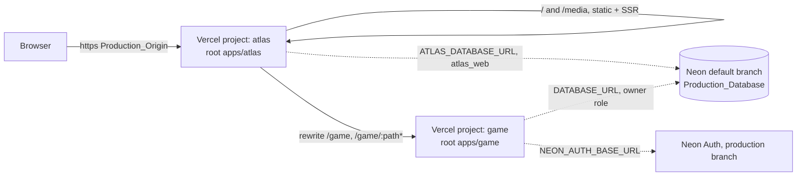
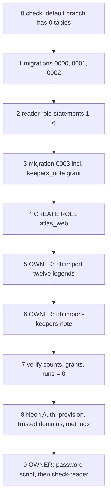

# Design Document

## Overview

Phase 5 takes the finished atlas and game from local builds to a live, fast, installable product with an old-book reading view and a Halloween mood layer. This document covers all 29 requirements. It changes no code; it fixes the choices the tasks file will follow.

**Smallest-setup choices (rationale in the sections named):**

| # | Decision | Requirements | Section |
|---|---|---|---|
| D1 | Two Vercel projects (atlas, game). The atlas project owns the domain and forwards `/game` to the game project with an external rewrite. Vercel Services (one project) is an approved fallback only. Switching to it is a Stop: the agent tells the Owner why and exactly what changes, and waits for approval (see Hosting). | 4 | Hosting |
| D2 | The Nitro Vite plugin is added to both apps, loaded only when the `VERCEL` environment variable is set, so local builds and `serve-build.mjs` stay as they are. | 4, 9 | Hosting |
| D3 | Security headers and cache headers live in each app's `vercel.json`. A CSP is sent, with `'unsafe-inline'` for script and style. | 4, 8, 12 | Headers |
| D4 | Production database is built from the migration files and the role statements through the Neon MCP (`run_sql_transaction`). Content imports and the password script run on the Owner's machine because they need a connection string, which the agent must not read. | 5, 6 | Production database |
| D5 | Rate limit is a small in-memory fixed-window limiter in server code, 429 on excess. A request with no visitor address header is not limited (fail open); there is no shared fallback key. | 10 | Rate limit |
| D6 | Scene image first: a React context holds "scene loaded"; secondary images render no `src` until then. | 11 | Image deferral |
| D7 | Phone hero copy (1000 px) made at build time with `sharp` (one new build-time dev dependency in the atlas) and served by a `picture` element with a width media query. | 13 | Hero images |
| D8 | Book view is one DOM tree. CSS columns paginate it, a CSS transform turns pages, "Read as one page" only switches a class. Anchors therefore exist once in both views. | 15–18 | Book component |
| D9 | Mood layer is CSS and DOM only, with static fallbacks under reduced motion. | 19 | Mood layer |
| D10 | Manifest for both apps, no service worker (not required by current install criteria). Icons (PNG 192, 512, maskable 512, and a 180 px apple-touch-icon) are listed in the Needs_File and never created; the manifest and an apple-touch-icon link point at their PNG paths from the start. | 20 | Installable app |

**Order of work.** The task order follows the Owner's order (production, speed, book, mood, install, leftovers, README, Kiro log), with one change that the Owner should confirm: the three security-relevant Phase 4 leftovers (Requirements 9, 10 and 23) move into the first group, so the site is not live without the rate limit and the tutorial lock. The remaining leftovers (Requirement 22 and the hotspot corrections of Requirement 7.4) stay late. See "Task groups and skill gating".

**Facts read for this design** (all read on the date of this document; "unverified" items are collected in the last section):

- Vercel: [TanStack Start on Vercel](https://vercel.com/docs/frameworks/full-stack/tanstack-start) (Nitro plugin, Fluid compute), [serving multiple projects under one domain](https://vercel.com/kb/guide/how-can-i-serve-multiple-projects-under-a-single-domain), [rewrites](https://vercel.com/docs/routing/rewrites) (external rewrites forward `x-forwarded-host`, `x-real-ip`; honor upstream `Cache-Control` for projects created after 2026-04-06), [Deployment Protection](https://vercel.com/docs/deployment-protection), [Services](https://vercel.com/docs/services) (Beta), [WAF rate limiting](https://vercel.com/docs/vercel-firewall/vercel-waf/rate-limiting).
- Neon: [trusted domains](https://neon.com/docs/auth/guides/configure-domains), [OAuth setup](https://neon.com/docs/auth/guides/setup-oauth), [auth production checklist](https://neon.com/docs/auth/production-checklist), Neon MCP tool catalogue in this workspace.
- Web: [install criteria](https://web.dev/install-criteria) (manifest with `name` or `short_name`, `start_url`, `display`, 192 px and 512 px icons; no service worker listed).
- Local: the five steering files, `docs/phase-4-handover.md`, `docs/phase-3-handover.md`, `docs/tech-decisions.md`, `docs/planning/15-look-and-feel-brief.md`, `skeleton/drizzle/*.sql`, `apps/*/vite.config.ts`, `apps/*/scripts/serve-build.mjs`, `skeleton/scripts/*`.

## Architecture



The browser sees one origin. The game's cookies are set by responses that come back through the rewrite, so they are host-only cookies on the Production_Origin (first-party, Requirement 4.5). The game keeps loading images from `/media` on the same origin because `ATLAS_ORIGIN` stays empty (Requirements 4.8, 4.9).

### Hosting (Requirements 4, 8, 9, 12)

**Why two projects.** Vercel allows a production domain on one project only. The documented way to put two apps under one domain is a project with rewrites to the other. The Owner named rewrites as the approach. Services (one project, `services` block) is Beta and its install and build behaviour for a pnpm workspace is not documented in the pages read, so it is the fallback, not the first choice.

**Switching to Services is a Stop (Requirements 3.3, 4.12).** If a check in this design shows the rewrite setup cannot work (U1 to U4 fail and no setting fixes them, or Neon sign-in keeps refusing the origin), the agent makes no Vercel or repo change for Services. It stops and tells the Owner (a) the check that failed and what it showed, and (b) exactly what would change, then waits for approval. The change list the agent gives is: the two projects become one project; its Root Directory and install and build commands (read from the current Services page at that time); one `vercel.json` with a `services` block that maps the atlas app to `/` and the game app to `/game`, replacing the two per-app `vercel.json` files and removing the two `/game` rewrites (the `git` key and the header rules move into the new file); the environment variables of both projects are merged into the one project (names as in the table below; no name clashes, `FEATURE_ARABIC` is the same in both); Deployment Protection and the domain stay on the one project; the game alias origin is dropped from the Neon trusted domains. The exact `services` syntax is not given here because it is Beta and unverified. No part of this runs before the Owner says yes.

| Item | Atlas project | Game project |
|---|---|---|
| Root Directory | `apps/atlas` | `apps/game` |
| "Include source files outside of the Root Directory" | on (needs `skeleton/`) | on |
| Install command | `cd ../.. && pnpm install --frozen-lockfile` (in `vercel.json`) | same |
| Build command | `pnpm build` (the app's `vite build`) | same |
| Framework preset | auto-detect, check on first build | auto-detect, check on first build |
| Node.js version | 24.x (matches local 24.13.1; `engines >=22`) | same |
| Domain | the Production_Origin | none of its own; its `<project>.vercel.app` production alias is the rewrite target |
| Deployment Protection | default | **off for production** (so the rewrite can reach it; see below) |
| Git | `main` only, via `vercel.json` | same |

**Routing.** `apps/atlas/vercel.json` carries two rewrites, listed before anything else, because the first match wins:

```json
{ "source": "/game", "destination": "https://<game-project-alias>/game" },
{ "source": "/game/:path*", "destination": "https://<game-project-alias>/game/:path*" }
```

`<game-project-alias>` is not a secret. It is known only after the Owner creates the game project, so the task writes it into the file after the Owner gives it. The atlas app answers `/game/**` with its own 404 by design (Phase 3), so a wrong rewrite order is visible at once: `/game/` would return the atlas 404.

**Why Deployment Protection is off on the game project.** With the default "Standard Protection" the generated production URL of a project is restricted, and a rewrite that targets a protected deployment fails. The project alias is a production domain and should stay open under Standard Protection, but the page does not say so for the alias. The first deploy therefore includes a check: open the game alias in a private window. If it asks for a Vercel login, the Owner sets Deployment Protection to off for that project. The game app has its own CSRF check and auth, so an open alias adds no new access path.

**Host and origin through the rewrite.** The game receives its own host in `Host` and the visitor's host in `x-forwarded-host`. Two game components look at origins: Start's CSRF middleware (`createCsrfMiddleware`, checks `Sec-Fetch-Site`, then `Origin`, then `Referer`) and the Neon auth toolkit. Browsers send `Sec-Fetch-Site: same-origin` for same-origin calls, which passes the first check. Whether the Neon toolkit sends the visitor's origin or the alias origin to Neon is not known. Mitigation without code: the Neon trusted-domain list holds the Production_Origin and also the game alias origin. If `INVALID_ORIGIN` still appears, the agent stops under the Services fallback rule (D1).

**Nitro (D2).** Both `vite.config.ts` files add `nitro()` after `tanstackStart()`, only when `process.env.VERCEL` is set:

```ts
plugins: [serverEnvFromEnvDir(), /* … */ tanstackStart(/* … */), ...(process.env.VERCEL ? [nitro()] : []), viteReact(), tailwindcss()]
```

Without the guard the local build output would change and `serve-build.mjs`, `smoke.mjs` and `browser-check.mjs` would stop working. `nitro` is pinned exactly in both apps. Its npm `latest` tag was `3.0.261103-rc` when this was written (a release candidate); the task records the version it pins. The `/media` copy (`vite.media.ts`) writes into `dist/client/media` during the client build; whether Nitro includes that folder in the deployment's static files is verified on the first build (a `HEAD` on one `/media` file).

**Local Vercel-style build before the first push (Requirement 4.13).** In G1, after the Nitro plugin and `vercel.json` files exist, the agent runs the normal build of each app with `VERCEL=1` set: `VERCEL=1 pnpm --filter @kiroween/atlas build` and `VERCEL=1 pnpm --filter @kiroween/game build`. Nitro build errors then show before the first push. It fixes each error it finds. The output (`.output/`, `.vercel/`, `.nitro/`) is already listed in `.gitignore`; the agent checks that with a read-only `git status` and, after the check, adds any of the three that is missing to `.gitignore`, and does not delete them. A normal build without `VERCEL` is run again afterwards to confirm `dist/` and the local servers (`serve-build.mjs`) still work. This does not prove the deploy (U1 to U7 stay open), it only removes build-time errors.

**`vercel.json` files (Requirement 4.10).** Three files exist or will exist. Every one keeps exactly `{"git":{"deploymentEnabled":{"*":false,"main":true}}}` as its `git` key.

| File | Content |
|---|---|
| `/vercel.json` (repo root) | unchanged. No project uses the repo root as its Root Directory. |
| `/apps/atlas/vercel.json` | `git`, `installCommand`, the two `/game` rewrites, `headers` (below). |
| `/apps/game/vercel.json` | `git`, `installCommand`, `headers` (below). |

**Headers (D3, Requirements 4.6, 4.7, 8, 12).**

| Rule (`source`) | Headers | Where |
|---|---|---|
| all paths except `/game` and below: `/:path((?!game(?:/\|$)).*)` | `X-Content-Type-Options: nosniff`; `Referrer-Policy: strict-origin-when-cross-origin`; `X-Frame-Options: DENY`; `Content-Security-Policy` (below) | atlas |
| `/game/:path*` | the same four headers | game |
| `/media/:path*` | `Cache-Control: public, max-age=31536000, immutable` | atlas |
| `/assets/:path*` (atlas build files, content-hashed) | same | atlas |
| `/game/assets/:path*` (game build files, content-hashed) | same | game |

The negative lookahead keeps the atlas rule from adding a second copy of each header to responses that come from the game. Whether Vercel applies `headers` to responses of an external rewrite at all is not documented in the pages read; the smoke check looks at `/game/` headers directly (Requirement 8.5).

CSP value (one string per app, same content): `default-src 'self'; script-src 'self' 'unsafe-inline'; style-src 'self' 'unsafe-inline'; img-src 'self' data:; font-src 'self'; connect-src 'self'; manifest-src 'self'; object-src 'none'; base-uri 'self'; frame-ancestors 'none'`.

- Start's server rendering puts inline scripts in the page, so `script-src` needs `'unsafe-inline'` unless every script gets a nonce, which is code work the requirements do not ask for. This is recorded in the Decisions_File as the resource that blocked a strict CSP (Requirement 8.3). Inline `style` attributes (theme variables) need `'unsafe-inline'` in `style-src`.
- `form-action` is left out on purpose: Chrome applies it to redirects that follow a form post, which could block the sign-in return trip.
- Google sign-in is a top-level navigation to Neon's address, which a CSP does not restrict. The Owner checks it once by hand after the deploy.
- Compression: Vercel's CDN compresses text responses for clients that send `Accept-Encoding`. This is expected, not proven for rewritten responses. The smoke check reads `Content-Encoding` for one JS file of each app (Requirement 12.2); if it is missing, the fix is in Vercel settings and the check repeats (Requirement 12.3).
- `immutable` on `/media`: the files are named by asset id, not by content hash. A replaced image keeps its URL, so a changed image needs a new asset id. Recorded as a risk; Requirement 4.6 allows a shorter value only when recorded, and the assets are final.

**Atlas local server crash (Requirement 9).** `apps/atlas/scripts/serve-build.mjs` ends with `Readable.fromWeb(response.body).pipe(res)`. `pipe` does not forward errors. When the response stream errors (Start ends a never-finished SSR stream with "Stream lifetime exceeded") the source emits `error` with no listener and Node exits. Fix: move the response copy into `apps/atlas/scripts/pipe-response.mjs` (so a test can import it) and use `stream.pipeline(Readable.fromWeb(body), res, (err) => { /* ignore ERR_STREAM_PREMATURE_CLOSE and the lifetime error */ })`, plus `res.on('close', () => body.cancel())` for clients that leave early. Reproduction first (Requirement 9.1): open a page with a client that reads the headers and stalls, wait about 120 s, expect exit before the fix and survival after. Whether the stream really never finishes with a normal client (a loader that hangs) or only with a tab that is left open is part of the explanation. On Vercel the handler is Nitro's, not ours; the task reads the Nitro and Vercel pages on stream errors and aborts a request mid-stream against the Production_Site, then checks the next request still succeeds (Requirement 9.3). The game's `serve-build.mjs` is changed in one place: `listen(port, 'localhost')` (Requirement 23.5), kept only if `scripts/smoke.mjs` still passes. The game's `URIError` problem noted in Phase 3 is already handled by `static-file.mjs` and needs no change.

### Production database (Requirements 5, 6)

Project `kiroween-2026` (id in `docs/tech-decisions.md`), default branch, database `neondb` (name unverified for the default branch; the task confirms it with `list_postgres_databases` before the `GRANT CONNECT` statement).



**Why this order.** Migration `0003` ends with `GRANT SELECT ON "keepers_note" TO atlas_reader;`. The role must exist before it, and the role's other grants need the tables from `0000` to `0002`. Statements 1 to 6 therefore sit between `0002` and `0003`.

**Which tool does which step (verified names from the Neon MCP catalogue; parameter shapes are read from the tool schemas at task time).**

| Step | Who | Tool or command |
|---|---|---|
| 0 | agent | `list_projects`, `list_branches`, `describe_branch` (default branch id), `get_database_tables` (expect none), `list_postgres_databases` |
| 1, 3 | agent | `run_sql_transaction` with the statements of each file, split on `--> statement-breakpoint`, in file order. One call per file. |
| 2 | agent | `run_sql_transaction` with the six statements below |
| 4 | agent | `run_sql` with `CREATE ROLE atlas_web LOGIN IN ROLE atlas_reader;` |
| 5 | Owner | copy the production **direct** connection string from the Neon Console to the clipboard, then in a terminal at the repo root: `DATABASE_URL_UNPOOLED="$(pbpaste)" pnpm --filter @kiroween/skeleton db:import`. The script loads `.env` with `dotenv`, which does not override a variable that is already set, so the inline value wins over the dev value. |
| 6 | Owner | the same prefix with `db:import-keepers-note` |
| 7 | agent | `run_sql`: counts and catalog checks below |
| 8 | agent | `provision_neon_auth`, `get_neon_auth_config`, `add_auth_trusted_domain`, `update_auth_email_and_password`, `update_auth_plugins_organization`, `update_auth_allow_localhost` (see Neon Auth) |
| 9 | Owner | password script, then `db:check-reader` |

The agent never calls `get_connection_string`, `create_credential` or `reset_postgres_role_password`, because their results are secrets (Requirement 2.1). It never uses `prepare_database_migration` (it creates a temporary branch) or `delete_*` tools on production.

The migration files were generated by `drizzle-kit`, so the production database has no `drizzle.__drizzle_migrations` rows. A later `db:migrate` against production would try to run `0000` again. The Handover_File says so; future migrations on production are applied the same way (MCP, by file).

**Step 2 statements (from `docs/tech-decisions.md`, exact):**

```sql
CREATE ROLE atlas_reader NOLOGIN;
GRANT CONNECT ON DATABASE neondb TO atlas_reader;
GRANT USAGE ON SCHEMA public TO atlas_reader;
GRANT SELECT (id, title, region, map_lat, map_lng, era, scare_level, reading_time_min, one_line_hook, cold_open, documented_closing, theme) ON legends TO atlas_reader;
GRANT SELECT ON chapters, versions, documented_told, sources, anchors TO atlas_reader;
GRANT SELECT (legend_id, id, usage, size) ON assets TO atlas_reader;
```

Step 3 (migration `0003`) adds `GRANT SELECT ON "keepers_note" TO atlas_reader;`. Step 4 is the seventh statement of the list. Together these are the "seven role statements" plus the `keepers_note` grant of Requirement 5.1. There is no `ALTER DEFAULT PRIVILEGES`.

**Step 7 checks (Requirement 5.5).**

```sql
select (select count(*) from legends) as legends, (select count(*) from keepers_note) as keepers_note, (select count(*) from runs) as runs;
select has_table_privilege('atlas_web', t, 'SELECT') from unnest(array['runs','keepers_note_details','player_flags','facts']) as t;   -- expect all false
select has_column_privilege('atlas_web', 'legends', 'model', 'SELECT');                                                          -- expect false
select has_table_privilege('atlas_web', 'keepers_note', 'SELECT');                                                               -- expect true
```

Expect 12, 1, 0 and the privilege answers above. The MCP session runs as the owner role, so it cannot show an SQLSTATE `42501` refusal. The refusal itself is proven by `db:check-reader` run as `atlas_web` in step 9, which prints yes or no for 18 privilege checks (including the `runs`, `keepers_note_details`, `player_flags` and `legends.model` refusals as `42501`) and 14 read checks.

**Neon Auth for production (Requirement 5.7 to 5.10).** Neon says each branch has its own auth base URL, trusted domains, providers and settings. On the default branch:

1. `provision_neon_auth` (creates the `neon_auth` schema and the production base URL).
2. `get_neon_auth_config` to read the state. Secrets are redacted by the server. The base URL and JWKS URL are not secrets; the Owner copies them from the Console into Vercel (the design holds no values, Requirement 6.7).
3. `add_auth_trusted_domain` for the Production_Origin, and again for the game project's alias origin (the mitigation under "Host and origin").
4. Sign-in methods on: **email and password** (so the Owner can create the judge account at the site's sign-up page; the agent never creates or signs in to it, Requirement 5.10) and **Google**. Email verification stays off: Neon's shared mail sender does not support verification links, and the game's sign-up does not wait for one. Organization plugin off (as in Phase 2).
5. Google: Neon's shared credentials work without setup on any branch. Neon says the consent screen then shows Neon's name and logo, and recommends your own credentials for production. Decision: use the shared credentials, since they work now and the Owner needs a working site first. If the Owner wants his own app later, the exact steps are in the Handover_File: create a Google OAuth client of type Web application; add the redirect URI `{NEON_AUTH_BASE_URL}/callback/google` (from the Console dialog); add the Production_Origin as an authorized JavaScript origin; paste the client id and secret into Console, Settings, Auth, OAuth providers. The agent cannot click through Google, so the Owner signs in with Google once on the live site as acceptance.
6. At the end of the Production_Smoke: `update_auth_allow_localhost` to turn localhost access off for the production branch (Neon production checklist).

**Password script (Requirement 6).** `skeleton/scripts/set-atlas-web-password.ts`, run by the Owner. Input: the production direct connection string, from the environment variable `DATABASE_URL_UNPOOLED` (set inline from the clipboard, as above).

1. Parse the string with `new URL`. Build the child environment for `psql` from it: `PGHOST`, `PGPORT`, `PGUSER`, `PGPASSWORD`, `PGDATABASE`, `PGSSLMODE`. No argument carries a secret, so `ps` shows none.
2. Generate the password: `randomBytes(24).toString('base64url')` (URL-safe, so no escaping in the connection string).
3. Run `psql -v ON_ERROR_STOP=1 -q` and write `ALTER ROLE atlas_web WITH PASSWORD '<password>';` to its standard input.
4. If psql exits with 0: build `ATLAS_DATABASE_URL` as a `postgresql` URL with user `atlas_web`, the new password, the pooled host, the database and `sslmode=require` (pooled host: the endpoint id plus `-pooler`, Neon's convention), write it to `pbcopy` standard input, and print `password set: yes` and `copied to clipboard: yes`.
5. On any failure print `password set: no` and nothing else; copy nothing (Requirement 6.4).

The script never prints, logs or writes the password or the string, and does not use a SCRAM hash or the Console reset (both failed on the dev branch). Whether `psql` is installed on the Owner's machine is unverified; the task checks it and, if it is missing, uses the `pg` driver in the same script with `select set_config('kw.pw', $1, true)` followed by a `DO` block that runs `EXECUTE format('ALTER ROLE atlas_web PASSWORD %L', current_setting('kw.pw'))`.

### Environment variables (Requirement 6.5, 6.6, 6.7)

Names only. "New" means a production value that is not the local one. "Secret" values are set by the Owner in the Vercel dashboard as sensitive variables; the agent never sees them.

| Variable | Atlas project | Game project | New for production |
|---|---|---|---|
| `ATLAS_DATABASE_URL` | yes (pooled `atlas_web` string from the password script) | no | new, secret |
| `PUBLIC_ORIGIN` | yes, the Production_Origin as an https origin with no path | no | new |
| `DATABASE_URL` | no | yes (pooled, owner role) | new, secret |
| `NEON_AUTH_BASE_URL` | no | yes | new (production branch URL) |
| `NEON_AUTH_JWKS_URL` | no | yes (not read by code; kept for the later JWT check) | new |
| `NEON_AUTH_COOKIE_SECRET` | no | yes, 32 or more random characters | **new, secret** |
| `GAME_TOKEN_KEY` | no | yes, base64 of 32 random bytes | **new, secret** |
| `GUEST_WORLD` | no | yes, set to `banshee` | production setting named here |
| `FEATURE_ARABIC` | yes, off (`false`; the Arabic catalog is empty) | yes, off (`false`) | production setting named here |
| `ATLAS_ORIGIN` | no | left unset (empty), so the Hall's links and `/media` stay on the same origin | n/a |
| `DATABASE_URL_UNPOOLED` | not set on Vercel | not set on Vercel | local only, for the imports |

The Owner generates the two new secrets in a terminal (`openssl rand -base64 32` for both is enough; the cookie secret only needs 32 or more characters). They must differ from the local values (Requirement 6.6).

### Rate limit (Requirement 10, decision D5)

The WAF can count requests per path, but every game server function lives at `/game/_serverFn/<hashed id>`, so a path rule cannot single out the tutorial answer. Vercel's firewall rate limit SDK needs a new dependency and an Owner-made firewall rule. The smallest working choice is code: a fixed-window counter in server memory.

- `skeleton/src/play/rateLimit.ts`: `createRateLimiter({ limit, windowMs, maxKeys, now })` returns `{ hit(key): { ok: true } | { ok: false, retryAfterSeconds: number } }`. Fixed window per key; when the map exceeds `maxKeys` the oldest windows are dropped.
- Values: 30 answers per 60 s per key, `maxKeys` 5000. Constants sit in one place (`skeleton/src/play/rateLimit.ts`) with a comment on how to change them.
- Key (`visitorKey(headers)`): the first entry of `x-forwarded-for`, trimmed, else `x-real-ip`, trimmed; an empty value or one longer than 64 characters counts as absent. If neither header gives a key, `visitorKey` returns `null` and the middleware **does not limit** that request (fail open, Requirement 10.6). There is no shared fallback such as `unknown`, so two visitors never share one bucket (Requirement 10.7). The first time a request without a key is seen, the task records the fail-open choice in the Decisions_File; the runtime does not log it. Vercel overwrites `x-forwarded-for` with the visitor address and forwards it on external rewrites, so on Vercel a key is always present. The key is held in memory only and never logged.
- Applied as a server-function middleware on `tutorialAct` only (`apps/game/src/server/middleware.ts`). On excess it sets status 429 and throws the fixed text "Too many tries. Wait a moment." (new Catalog key `error.tooManyTries` in the game catalog; the server constant is the same words). Nothing else changes, so fear amounts and tutorial rules are untouched (Requirement 10.5).
- Limit of this choice: counts are per server instance and reset on a cold start, so it slows a script, it does not stop a determined one. The residual risk was already low (a guess only marks the tutorial done). Upgrade path, not built: a WAF rule plus `@vercel/firewall`.

### Tutorial lock (Requirement 23)

- `skeleton/src/play/service.ts` `startWorld`: for a signed-in visitor, before the run is read or created, `await deps.store.tutorialDone(visitor.id)`; if false throw `PlayError('tutorial-required')`. New code in `errors.ts`, status 403, message "Do the tutorial first." No run row is created.
- The Hall already shows a locked-door message when `tutorialDone` is false. `StartRetry` and the Hall map the new error code to that existing message instead of a generic error (Requirement 23.4).
- Guests: the tutorial receipt is an encrypted token the browser holds. `startWorld` takes no receipt, and adding one would change the Phase 4 play schema (Requirement 1.10). Decision: for guests the Hall check stays the only check; recorded with this reason in the Decisions_File (Requirement 23.3). Impact: a guest who calls the server function directly can enter the guest world without the tutorial; guest runs store nothing.

### Image deferral (Requirement 11, decision D6)

`apps/game/src/components/ScenePaint.tsx` provides a context `{ firstSceneLoaded: boolean, loadedSceneId: string | null, onSceneSettled(id: string): void }`, provided once by `WorldPlay`, `TutorialRoom` and `Hall`.

- `SceneViewer` calls `onSceneSettled(layout.assetId)` from the scene image's `onLoad` and `onError`, and once after mount if `imgRef.current?.complete` is already true (the image can finish before hydration, so no event would fire).
- Sprites (`scene-sprite` images) render their `img` only when `loadedSceneId === layout.assetId`. Until then the same sized `span` is rendered, so no box or position changes (Requirement 11.6). The hotspot button, its accessible name and its tap box are untouched.
- Spirit figure (`SpiritPanel`) and fear-meter frame (`FearMeter`) render their `img` only when `firstSceneLoaded` is true.
- Server markup holds the scene `src` and no secondary `src` (Requirement 11.4). Error case: `onError` also settles, so the extras still load (Requirement 11.3).
- Tests changed: `viewer.test.ts`, `fear-ui.test.ts`.

### Hero images (Requirement 13, decision D7)

- **Dependency.** `sharp`, exact version, `devDependencies` of `apps/atlas`. It is the only way to resize a WebP at build time without a hand-made decoder; the npm `latest` was 0.35.5 (Node `>=20.9`) when this was written. Justified in the Decisions_File and `docs/tech-decisions.md`. Whether it installs and runs on Vercel's build image with Node 24 is unverified; it ships prebuilt binaries and has no install script as far as known, so no pnpm build-script approval is expected.
- **Build.** `apps/atlas/vite.media.ts` `writeBundle` additionally, for each canonical file whose id contains `-hero-`, writes `dist/client/media/<same folder>/<id>-w1000.webp` resized to width 1000 (height by aspect ratio). Output goes to the build folder only (Requirement 13.6). The id `<id>-w1000` passes `assetUrl`, so the dev middleware serves it the same way (it resizes on the fly in dev through the same function) and no new URL rule is needed.
- **Markup.** `Img` gains `heroSmall?: { id, width, height }`. For the hero it renders:

```html
<picture>
  <source media="(max-width: 1000px)" srcset="/media/…/<id>-w1000.webp" width="1000" height="563">
  .webp" width="2400" height="1350" fetchpriority="high" …>
</picture>
```

The `source` carries `width` and `height` of the small copy, so layout does not shift (Requirement 13.5). There is no `x` or `w` descriptor, so a phone at device pixel ratio 1, 2 or 3 selects the 1000 px copy by viewport width alone (Requirement 13.8). The preload `<link>` in the legend route gets the same `media` split so the phone does not preload the 2400 px file.
- A viewport wider than 1000 CSS px gets the full image (Requirement 13.4). Copies that cannot be made without writing into the Protected_Paths go to the Needs_File (Requirement 13.7); none are expected.

### Speed re-measurement (Requirement 14, 21)

`apps/game/scripts/browser-check.mjs` already has the Slow 4G `timing` scenario (1.6 Mbps, 750 kbps, 150 ms RTT, 4x CPU, cache off, 390 px, three runs, median) and accepts `--game` and `--atlas` origins. It is run with both set to the Production_Origin, `--only timing`, `--json docs/phase-5-notes/timing-production.json`. The report lists per screen (Hall, Tutorial_Room, Banshee scene 1) the three paint values, median, total and image transfer, pass or fail against 3000 ms, and the Phase 4 numbers next to them (5845, 4883, 10436 ms). A miss is reported with the measured cause; the budget and the images are not changed (Requirements 14.4, 14.5). The paper texture and the mood layer are measured the same way later (Requirements 18.6, 19.13).

The Layout_Overlay screenshots (Requirement 21) come from a new `--only layout` scenario of the same script, run against the local production build (the overlay is compiled out of production builds, so it cannot run on the Production_Site; the dev server serves `?layout=1`). Output goes to the Debug_Folder `.debug/screens/` (added to `.gitignore`), one file per scene for the Hall, the Tutorial_Room and each World, and the paths are listed in the Decisions_File and at the Mid_Phase_Stop beside the guessed placements from `layout-open-matches.md`. A test that fails when `scene-outline` appears in built client JS is added (Requirement 21.5).

### Book component (Requirements 15 to 18, decision D8)

**Where it lives.** `skeleton/src/book/` with a new package export `@kiroween/skeleton/book` (React component, CSS, pure helpers). `react` becomes a `peerDependency` and a `devDependency` of the skeleton at the same pin the apps use (19.3.1), and the skeleton `tsconfig` gets `jsx: react-jsx`. The CSS tokens are in `skeleton/src/book/book.css` (custom properties `--book-*`), imported by both apps like `design/tokens.css`.

**One DOM tree.** The server renders the reading content once, in normal flow, wrapped as

```
<div class="book" data-view="scroll">
  <div class="book-viewport" tabindex="0" role="region" aria-roledescription="book" aria-label="…">
    <div class="book-flow"> …existing chapter / version markup, unchanged… </div>
  </div>
  <div class="book-controls" hidden> prev · "page n of m" · next · toggle </div>
</div>
```

Without JavaScript, or with the toggle on, the page is the current Scroll_View. A tiny inline script in `<head>` (allowed by the CSP) reads `kiroween.book.v1` from `localStorage` and sets `document.documentElement.dataset.book = 'on' | 'off'` before first paint (Requirement 17.4); the default is `on` when the value is absent or not one of ours. CSS under `html[data-book='on']` turns `.book-flow` into columns. Because "Read as one page" only flips that attribute, the same nodes are shown in the same order with the same headings (Requirement 17.3), and every Anchor exists once in both views (Requirement 16.4). Print rules (`@media print`) force the scroll layout (Requirement 17.5).

**Pagination (plain DOM and CSS, Requirement 15.5).**

- `.book-viewport { overflow: clip; block-size: <page height> }`; `.book-flow { block-size: 100%; column-width: …; column-gap: var(--book-gutter); column-fill: auto; transform: translateX(calc(var(--book-page) * (-100% - var(--book-gutter)))) ; transition: transform 300ms ease-out }`. With a fixed height, text that does not fit creates further columns to the inline end; the viewport clips them. One page is one column. At 1024 px and wider two columns are shown at once, with a gutter shadow drawn on a pseudo-element between them. The page unit is one view: 1 column on a phone, 2 on a spread.
- Each chapter section has `break-before: column`; the frontispiece (hero) has `break-after: column`; headings `break-after: avoid`; plates `break-inside: avoid; max-block-size` of the page. Text-heavy cards (version cards) are allowed to break, because an unbreakable block taller than a phone page would be clipped.
- Page count: `ceil((flow.scrollWidth + gap) / (viewportWidth + gap))`, computed by a pure helper. Page of an element: the helper `pageOfOffset(offset, viewWidth, gap, columnsPerView)` on `el.getBoundingClientRect().left - flow.getBoundingClientRect().left` (independent of the current transform).
- Recompute on `ResizeObserver` and `document.fonts.ready` (Requirement 15.13). Before recomputing, the component remembers the first block (`[data-block]`, set on paragraphs and headings) whose page equals the current page; after, it goes to the page of that block. If the URL hash names an Anchor, the hash wins (Requirement 16.6).
- Turn: buttons; `ArrowRight`/`ArrowLeft` (swapped in `dir=rtl`), `Home`, `End`, `PageUp`, `PageDown` on the focused viewport; pointer swipe (threshold 40 px, `touch-action: pan-y` on the viewport so vertical scroll of the page still works). Controls sit in a flex row that follows the UI direction (logical properties only, Requirements 15.11, 15.12). The indicator is a polite live region "page n of m" from the Catalog.
- Focus: off-page links stay in the DOM. A `focusin` handler turns to the page of any element that receives focus, so keyboard users never focus something that is out of view (Requirement 15.9).
- Motion: the turn is a 300 ms transform transition (at most 400 ms, no 3D curl, Requirement 18.3). Under Reduced_Motion (`prefers-reduced-motion: reduce` or `html[data-motion='reduce']`, which the game's motion setting will also set on the root element) the transition is `none` (Requirement 18.4).

**Anchors and hash (Requirement 16).** The Book owns hash landing in both views. The atlas router sets `defaultHashScrollIntoView: false` so it no longer scrolls on its own (a browser scroll would move the clipped columns). On load and on `hashchange` the Book looks up the element, sets the page, then focuses its `[data-anchor-heading]` with `preventScroll: true`, and in Scroll_View calls `scrollIntoView()` itself. `AnchorFocus` (which only moved focus and set `data-landed` for two seconds) is folded into the Book and keeps the `data-landed` behaviour. `/anchor/<anchor>` and Hint_2_Link keep working through the existing redirect to the legend page's hash; `atlasUrl` is untouched (Requirement 16.5). `/anchor/keepers-note--ch-1` opens the Keeper's Note page at that Anchor (Requirement 16.7).

**Reading surfaces.** Atlas legend pages and the Keeper's Note page use the full Book. The Keeper's Note "Fiction" label stays outside the paginated flow, above the book, so it is always visible (Requirement 19.12). In the game the same component wraps the spirit panel and tutorial question text; there the flow fits one page, so no controls show (Requirement 15.1 "where it fits"). The game's `lib/motion.ts` also sets `document.documentElement.dataset.motion` (a small addition; the game currently sets `data-motion` only on the fear overlay).

**Paper and ink (Requirements 15.2, 18).** Paper: the existing `shared-atlas-paper-01` as a repeating `background-image` via `assetUrl`, under a warm multiply tint (`background-blend-mode: multiply`), a darker inline-edge gradient, two faint radial "foxing" gradients and an inset vignette. No new image file. `skeleton/src/book/bookColors.ts` exports `PAPER_BASE`, `PAPER_FLOOR` (the darkest colour any text can sit on, edges and foxing included), `BOOK_INK` (dark brown) and `bookColors(theme)`, which returns `{ ink, accent }`: the pack's ink and accent if each reaches 4.5:1 against `PAPER_FLOOR`, otherwise `BOOK_INK` and a fixed dark accent. Pack display fonts and heading colours that reach 4.5:1 stay; the rest fall back (Requirement 18.5). The existing contrast test is extended to run this for all twelve packs, the base theme and the Keeper's Note page.

### Mood layer (Requirement 19, decision D9)

All of it in `skeleton/src/design/mood.css` plus a small `Mood` wrapper component; no image, sound or library.

| Effect | Implementation | Reduced_Motion |
|---|---|---|
| Vignette (dark surfaces) | fixed `::after` with `radial-gradient`, `pointer-events: none` | same (static) |
| Candlelight | radial warm gradient behind lit areas; `opacity` keyframes with a period of 8 s and 7 keyframes, so a change at most every ~1.1 s | static glow at the mid value |
| Fog | one `aria-hidden` layer along the bottom of scenes and the Hall, below the hotspot layer in z-order, `pointer-events: none`; slow horizontal drift, 60 s linear loop | static low-opacity band |
| Torn or burnt edges | `mask-image` on image frames and panels: `shared-atlas-paper-01` as a luminance mask (`mask-mode: luminance`) combined with an edge gradient (`mask-composite: intersect`), plus a thin ink border | same (static) |
| Hotspot glow | `:hover` and `:focus-visible` drop-shadow on the existing hotspot button | no transition |
| Loading line | the existing loading placeholders show a Catalog line in the story's voice (new keys in both catalogs) | same |

Limits that are checked: hotspot tap boxes stay at least 44 by 44 CSS px; no mood layer element captures pointer events; text contrast stays at Requirement 18 levels. The torn-edge mask is the least certain effect (a texture used as a luminance mask may not give a ragged edge); the task looks at screenshots and, if it fails, falls back to the ink border and inner shadow. The effect on load and paint time is measured with the Slow 4G profile (Requirement 19.13).

### Installable app (Requirement 20, decision D10)

- Install criteria read: HTTPS; manifest with `name` or `short_name`, `start_url`, `display` of `fullscreen`, `standalone`, `minimal-ui` or `window-controls-overlay`, and icons that include 192 px and 512 px; no `prefer_related_applications`; the page links the manifest. The page does not list a service worker as required, so none is added (Requirement 20.9 does not trigger). Recorded with the date in the Decisions_File.
- Game manifest: a server route `apps/game/src/routes/manifest[.]webmanifest.ts` answering `/game/manifest.webmanifest`: `name` and `short_name` from the Catalog title key, `start_url` `/game/`, `scope` `/game/`, `display` `standalone`, `theme_color` and `background_color` from the hub palette, `icons` from the Icon_Asset_Ids. The root route links it and sets `theme-color` (already set in the atlas).
- Atlas manifest: same shape with `scope` `/`, `start_url` `/`, served from the same kind of route (one file and one link).
- Icons (Requirement 20.5, 20.6): PNG only. Four Icon_Asset_Ids: `icon-192` (192 px), `icon-512` (512 px), `icon-maskable-512` (512 px, safe zone inside the inner 80 %), `apple-touch-180` (180 px, no transparency). Each app serves its own copy from its `public/icons/` folder, so the paths are `/icons/<id>.png` in the atlas and `/game/icons/<id>.png` in the game (Vite `base`). The Owner places the same artwork in both folders; the agent creates no icon file. The game manifest lists the first three. Both root routes add `<link rel="apple-touch-icon" href="…/apple-touch-180.png">`. Until the files exist the manifest and the link still name the paths (Requirement 20.7). No WebP is used, so the Chrome WebP-icon question no longer applies.
- Both apps are served on one origin, so each manifest's `scope` is a path inside that origin; the game icons live under `/game/icons/`, inside the game scope.

### Phase 4 polish (Requirement 22)

| Item | Change |
|---|---|
| `resolveTheme` glow on surface | In `skeleton/src/theme`, panel headings use the pack glow only if it reaches 4.5:1 on the surface as well as on the background; otherwise the base glow, then the ink. spring-heeled-jack (2.8:1) falls back. |
| Hall reward slot | Remove the "An empty slot." text. Tutorial reward reads as a sentence from a Catalog key. |
| Impeccable list | Fix bugs and AA failures: `.spirit-panel-body` and `.spirit-caption` get an explicit order (one selector wins by specificity, not bundle order); Hall ending dialog closes on Escape and traps focus until closed. Left open and recorded with a reason: the `‹` `›` pan glyphs (low priority), fear meter fill contrast against the background pairing (the 3:1 pairing is met), text over the painted frame (visual judgement). |
| Tests | One test per fixed item that fails if the fix is removed. |

### README and Kiro log (Requirements 24, 25)

README: replace the TODO; what the project is; the two production URLs; commands to run both apps and the tests (from `docs/tech-decisions.md`); a short "How Kiro was used" with a link to `docs/kiro-usage.md`; the existing disclosure paragraph unchanged in meaning; credits (22 Fontsource families under OFL-1.1, "Made with Natural Earth.", and the licence of each shipped package that task 24 finds by reading `package.json` licence fields, including `sharp` only if it ships at runtime, which it does not); MIT statement. Product names stay behind `app.title` and the game title key. A new test scans `apps/*/src` for product-name literals outside the Catalog files and fails on a hit (Requirement 24.10); the placeholder name is read from the Catalog so the test follows a rename.

`docs/kiro-usage.md` gets a Phase 5 section: the spec, steering, hooks in use, every Neon MCP call (tool name, statement, no secret) in the Decisions_File with a pointer, powers (Neon is published as a Kiro power by Neon and Kiro; the task checks the installed powers and the Kiro powers page, uses a Vercel or Neon power only if one is installed or installable and fits, and records the result either way, Requirement 25.2), and each skill with what it found.

## Components and Interfaces

New or changed files, by area. Paths are relative to the repo root.

| Area | Path | Change |
|---|---|---|
| Hosting | `apps/atlas/vercel.json`, `apps/game/vercel.json` | new (content above) |
| Hosting | `apps/atlas/vite.config.ts`, `apps/game/vite.config.ts`, both `package.json` | `nitro` plugin behind `VERCEL`; exact pin |
| Local servers | `apps/atlas/scripts/pipe-response.mjs` (new), `apps/atlas/scripts/serve-build.mjs`, `apps/game/scripts/serve-build.mjs` | stream error handling; `localhost` binding |
| Database | `skeleton/scripts/set-atlas-web-password.ts` (new) | Password_Script |
| Database | `skeleton/scripts/check-production.ts` is **not** added; checks run as SQL through the MCP | – |
| Rate limit | `skeleton/src/play/rateLimit.ts` (new), `apps/game/src/server/middleware.ts`, `apps/game/src/server/functions.ts`, game catalogs | limiter, middleware on `tutorialAct`, new Catalog key |
| Tutorial lock | `skeleton/src/play/service.ts`, `errors.ts`, `apps/game/src/components/StartRetry.tsx`, `Hall.tsx` | check and message |
| Deferral | `apps/game/src/components/ScenePaint.tsx` (new), `SceneViewer.tsx`, `SpiritPanel.tsx`, `FearMeter.tsx`, `WorldPlay.tsx`, `TutorialRoom.tsx`, `Hall.tsx` | context and conditional images |
| Hero | `apps/atlas/vite.media.ts`, `apps/atlas/src/components/Img.tsx`, `LegendPage.tsx`, the legend route's preload link, `skeleton/src/assets/heroCopy.ts` (new, `heroSmallId`, `heroSource`) | small copies and `picture` |
| Book | `skeleton/src/book/{Book.tsx,book.css,pagination.ts,bookColors.ts,bookPref.ts,index.ts}` (new), `skeleton/package.json` export, atlas `LegendPage.tsx`, `KeepersNotePage.tsx`, `router.tsx`, `AnchorFocus.tsx` (folded in), game panels | shared component |
| Mood | `skeleton/src/design/mood.css`, `Mood.tsx` (new), both root routes | effects |
| Install | `apps/game/src/routes/manifest[.]webmanifest.ts`, `apps/atlas/src/routes/manifest[.]webmanifest.ts` (new), both root routes (manifest link, `theme-color`, `apple-touch-icon` link), `docs/phase-5-notes/content-and-assets-needed.md` (new) | manifest and icon list |
| Polish | `skeleton/src/theme/*`, game `Hall.tsx`, `SpiritPanel` CSS, ending dialog | fixes above |
| Tests | see Testing Strategy | new files |
| Scripts | `apps/game/scripts/browser-check.mjs` | `--only layout`, `--only book`, origin from `--game`/`--atlas`; `skeleton/scripts/smoke-play.ts` takes an https base |
| Docs | `README.md`, `docs/kiro-usage.md`, `docs/tech-decisions.md`, `docs/phase-5-notes/*`, `docs/phase-5-handover.md`, `.gitignore` | text |

Key interfaces (TypeScript):

```ts
// skeleton/src/play/rateLimit.ts
export interface RateLimiterOptions { limit: number; windowMs: number; maxKeys: number; now?: () => number }
export type Hit = { ok: true } | { ok: false; retryAfterSeconds: number };
export function createRateLimiter(o: RateLimiterOptions): { hit(key: string): Hit };
export function visitorKey(headers: Headers): string | null;   // null means: do not limit

// skeleton/src/book/pagination.ts  (pure)
export function pageCount(scrollWidth: number, viewWidth: number, gap: number): number;
export function pageOfOffset(offset: number, viewWidth: number, gap: number, columnsPerView: 1 | 2): number;
export function pageAfterReflow(firstVisibleBlockId: string | null, blockOffsets: ReadonlyMap<string, number>, viewWidth: number, gap: number, columnsPerView: 1 | 2): number;
export function keyToDelta(key: string, dir: 'ltr' | 'rtl'): -1 | 1 | 'first' | 'last' | null;

// skeleton/src/book/bookPref.ts
export type BookPref = 'pages' | 'scroll';
export function readBookPref(s: Pick<KeyValueStore, 'getItem'>): BookPref;     // default 'pages'
export function writeBookPref(s: Pick<KeyValueStore, 'setItem'>, v: BookPref): void;

// skeleton/src/book/bookColors.ts
export function bookColors(theme: ResolvedTheme | typeof BASE_PALETTE): { ink: string; accent: string };

// skeleton/src/assets/heroCopy.ts
export const HERO_SMALL_WIDTH = 1000;
export function heroSmallId(id: string): string;                                  // `${id}-w1000`
export function heroSource(viewportCssWidth: number, devicePixelRatio: number): 'small' | 'full';

// skeleton/src/play/errors.ts: PlayErrorCode adds 'tutorial-required' (403)
```

`heroSource` is the pure model of the browser's `source media` choice, used by the test of Requirement 13.9. It ignores the pixel ratio on purpose; the test passes ratios 1, 2 and 3 to prove that.

### Task groups and skill gating (Requirements 1, 3, 25)

Tasks run one at a time in the Thread. `agent-guard` runs after every group. `agent-security` runs only after a group that touches deployment config, secrets, headers, the rate limit, database roles, auth or the tutorial lock (marked S). `impeccable` runs in the Thread after groups with UI changes (marked U). `read-the-damn-docs` runs before groups with outside-doc facts. `agent-tester` runs after groups that add tests. `verify-and-stop` runs at the end of each group that has acceptance conditions. `ponytail` applies throughout.

| Group | Content | Requirements | Skills | Stops |
|---|---|---|---|---|
| G1 | Hosting config, headers, Nitro, local `VERCEL=1` build of both apps, serve-build fixes, rate limit, tutorial lock | 4, 8, 9, 10, 12, 23 | docs, S, tester | Owner creates the two Vercel projects and gives the Production_Origin and game alias (3.2) |
| G2 | Production database and Neon Auth, Password_Script | 5, 6 | docs, S, tester | One Stop: Owner runs the imports, the password script and `check-reader`, pastes `ATLAS_DATABASE_URL`, then sets the other environment variables (3.2) |
| G3 | First deploy and early production check (headers, `/media`, `/game/`, compression, stream abort) | 4, 8.5, 9.3, 12.2 | S | Owner pushes to `main` (3.2) |
| G4 | Image deferral, hero copies, hotspot screenshots, production timing | 11, 13, 14, 21 | docs, tester, U | Owner pushes again; then **Mid_Phase_Stop** (7) |
| G5 | Book component and anchors; `test:browser` run at the end of the group (result in `docs/phase-5-notes/book-check-g5.json`) | 15–18, 28.8 | U, tester | – |
| G6 | Mood layer | 19 | U | – |
| G7 | Manifests and Needs_File | 20 | docs | – |
| G8 | Polish, hotspot corrections, product-name test | 22, 7.4, 24.8–24.10 | U, tester | – |
| G9 | README, Kiro log | 24, 25 | – | – |
| G10 | Mutation checks, full test run, `test:browser` (local build and Production_Site, `book-check-g10.json`), final deploy, Production_Smoke including the burst check, browser checks, handover | 26–29 | S, tester, verify | Owner pushes; then Handover stop (3.7) |

If more than two tasks end blocked the work stops (3.6). A blocked task is marked after two real fix attempts (1.7).

## Data Models

**`vercel.json` (atlas), shape:**

```json
{
  "git": { "deploymentEnabled": { "*": false, "main": true } },
  "installCommand": "cd ../.. && pnpm install --frozen-lockfile",
  "rewrites": [ { "source": "/game", "destination": "https://<game-project-alias>/game" },
                { "source": "/game/:path*", "destination": "https://<game-project-alias>/game/:path*" } ],
  "headers": [ { "source": "/:path((?!game(?:/|$)).*)", "headers": [ /* 4 security headers */ ] },
               { "source": "/media/:path*", "headers": [ { "key": "Cache-Control", "value": "public, max-age=31536000, immutable" } ] },
               { "source": "/assets/:path*", "headers": [ /* same Cache-Control */ ] } ]
}
```

The game file has `git`, `installCommand` and `headers` for `/game/:path*` and `/game/assets/:path*`.

**Manifest (game), shape:**

```json
{ "name": "<Catalog title>", "short_name": "<Catalog title>", "start_url": "/game/", "scope": "/game/",
  "display": "standalone", "theme_color": "#0E0B10", "background_color": "#0E0B10",
  "icons": [ { "src": "/game/icons/icon-192.png", "sizes": "192x192", "type": "image/png" },
             { "src": "/game/icons/icon-512.png", "sizes": "512x512", "type": "image/png" },
             { "src": "/game/icons/icon-maskable-512.png", "sizes": "512x512", "type": "image/png", "purpose": "maskable" } ] }
```

**Needs_File (`docs/phase-5-notes/content-and-assets-needed.md`)**, one table row per item: `id | location | size | format | used by | status`. First rows: the four icon ids above, once for `apps/game/public/icons/` and once for `apps/atlas/public/icons/` (eight rows, all PNG). The manifest test reads this file and fails when a manifest icon id or the apple-touch id has no row.

**Browser storage:** `kiroween.book.v1` = `pages` or `scroll` (any other value reads as `pages`). The existing `kiroween.motion.v1` is unchanged.

**Database:** no schema change. Production gets migrations `0000` to `0003`, the role statements, and rows from the imports. `player_flags` is read by the tutorial lock.

**Result files** (all under `docs/phase-5-notes/`): `decisions.md`; `timing-production.json` (per screen: three paint values, median, total and image bytes, pass or fail, Phase 4 values); `smoke-production.md`; `browser-production.json`; `book-check-g5.json`; `book-check-g10.json`; `mutations.md` (mutation, file, failing test name); `content-and-assets-needed.md`; `docs-read.md` (page, date). Screenshots only in `.debug/`.

**Production_Smoke records:** step name, pass or fail, and for headers the header name with a yes or no. No cookie, password, token or connection string is ever written (Requirements 2.4, 27.8).

## Correctness Properties

*A property is a characteristic or behavior that should hold true across all valid executions of a system-essentially, a formal statement about what the system should do. Properties serve as the bridge between human-readable specifications and machine-verifiable correctness guarantees.*

Reflection result: the hero-choice criteria (13.3, 13.4, 13.9) collapse into one property; the three anchor-landing criteria (16.1 to 16.3) into one; the reflow and hash-priority criteria (15.13, 16.6) into one; the two contrast criteria of the book (18.1, 18.2) into one; the deferral criteria (11.1, 11.2, 11.4) into one; the four Password_Script criteria (6.1 to 6.4) into one. Criteria that are platform behaviour, process or documentation have no property and are covered under the Testing Strategy.

### Property 1: Rate limiter counts per key and window

*For any* limit, window length, key and sequence of call times, the number of calls the limiter answers with `ok` for that key inside one window never exceeds the limit; the first `limit` calls of a window are `ok`; calls for a different key are not affected; and a call after the window has passed is `ok` again. When the number of keys exceeds `maxKeys`, the number of stored keys stays at or below `maxKeys`.

**Validates: Requirements 10.2, 10.3**

### Property 2: Hero copy is chosen by viewport width only

*For any* viewport width in CSS pixels and *any* device pixel ratio (including 1, 2 and 3), `heroSource` returns the small copy when the width is 1000 or less and the full image when it is more, and the small copy's width is at most 1000. At a width of 390 the small copy is chosen for every ratio.

**Validates: Requirements 13.3, 13.4, 13.8, 13.9**

### Property 3: Hero copy keeps the aspect ratio

*For any* full hero width and height, the small copy's declared height equals `round(height * 1000 / width)` and its declared width is 1000, so the layout box of the small and the full image have the same ratio within one pixel.

**Validates: Requirements 13.5**

### Property 4: An anchor's page makes the anchor visible

*For any* page width, gutter, columns per view (1 or 2) and anchor offset inside the flow, the page returned by `pageOfOffset` lies inside `[0, pageCount)`, and the anchor's offset minus that page's start lies in `[0, view width)`, so the anchor is inside the visible view after turning to that page. Offsets are monotone: a larger offset never gives a smaller page.

**Validates: Requirements 16.1, 16.2, 16.3**

### Property 5: Reflow keeps the reader on the same text, and the hash wins

*For any* set of block offsets before and after a resize, *any* choice of first visible block and *any* new width, `pageAfterReflow` returns the page that contains that block in the new layout. When an anchor named by the URL hash is given, it returns the page that contains the anchor instead.

**Validates: Requirements 15.13, 16.6**

### Property 6: Page keys move within bounds in either direction

*For any* key from the supported set, *any* text direction and *any* current page and page count of at least 1, `keyToDelta` plus clamping yields a page in `[0, pageCount - 1]`; `ArrowRight` and `ArrowLeft` move in opposite senses and swap when the direction is right-to-left; `Home` and `End` reach the first and last page from any page; unsupported keys change nothing.

**Validates: Requirements 15.8, 15.9, 15.11**

### Property 7: The reading-mode preference round-trips

*For any* `BookPref` value, `readBookPref` after `writeBookPref` returns that value. *For any* other stored string, a missing value, or a storage that throws, `readBookPref` returns the default `pages` and does not throw.

**Validates: Requirements 17.4**

### Property 8: Book ink and accent reach 4.5:1 on the paper

*For any* theme ink and accent colours (random hex pairs, plus the twelve packs, the base theme and the Keeper's Note page), `bookColors` returns an ink and an accent whose contrast ratio against `PAPER_FLOOR` is at least 4.5.

**Validates: Requirements 18.1, 18.2**

### Property 9: Panel headings reach 4.5:1 on the surface

*For any* pack colours (random hex sets, plus the twelve packs), the heading colour that `resolveTheme` returns reaches 4.5:1 against the surface and against the background.

**Validates: Requirements 22.1, 22.2**

### Property 10: Every stored anchor appears once in the rendered page

*For any* legend of the twelve and the Keeper's Note, in both reading modes, each stored anchor id appears exactly once as an element `id` in the server-rendered page, and the set of ids in the page equals the set of stored anchors.

**Validates: Requirements 16.4**

### Property 11: Secondary images wait for the scene

*For any* scene layout, hotspot set and sprite set, the server-rendered viewer markup contains the scene image `src`, contains no `src` for any sprite, spirit figure or meter frame, and still contains every hotspot with its accessible name and tap box. After the scene is marked settled (loaded or failed), every secondary image has its `src` and the hotspot boxes are unchanged.

**Validates: Requirements 11.1, 11.2, 11.3, 11.4, 11.6**

### Property 12: The tutorial lock decides starts for signed-in players

*For any* signed-in visitor, legend id and `tutorial_done_at` state, `startWorld` refuses with `tutorial-required` and creates no run when the flag is not set, and starts or resumes the run exactly as before when it is set.

**Validates: Requirements 23.1, 23.2**

### Property 13: The Password_Script prints no secret and copies only on success

*For any* generated password, connection string and failure mode of `psql` or `pbcopy` (exit code, empty output, long output), the script's standard output and standard error contain none of the password, the connection string, its host or its user; on a failed `ALTER ROLE` the clipboard receives nothing and the output says `no`; on success the output has only the yes lines.

**Validates: Requirements 6.2, 6.3, 6.4**

### Property 14: The local server survives stream errors

*For any* response stream that errors after any number of chunks, or whose client closes early at any point, the pipe helper completes without an unhandled `error` event and without throwing.

**Validates: Requirements 9.2**

### Property 15: The rate-limit key is the visitor address, or nothing

*For any* request headers, `visitorKey` returns the trimmed first entry of `x-forwarded-for` when it is present and valid, else the trimmed `x-real-ip` when valid, else `null`; it never returns a constant. *For any* two requests with different keys, hits on one never change the answer for the other; *for any* request whose key is `null`, the middleware lets the call through however many such requests come.

**Validates: Requirements 10.6, 10.7**

## Error Handling

| Situation | Behaviour | Requirement |
|---|---|---|
| Request without a visitor address header | not limited (fail open); no shared key; choice recorded in the Decisions_File | 10.6, 10.7 |
| Rate limit exceeded | HTTP 429 with the fixed text "Too many tries. Wait a moment."; no answer, count or limit value in the body; the key is not logged | 10.2, 10.4 |
| Signed-in player starts a World before the tutorial | `PlayError('tutorial-required')`, HTTP 403, no run row; the Hall shows its existing locked-door message | 23.1, 23.4 |
| Scene image fails to load | secondary images start after the `error` event; the viewer stays usable | 11.3 |
| Hero small copy missing in a build | the `source` is only emitted when the copy was generated (the build writes a list of generated ids that the markup reads); otherwise the full image is used | 13.7 |
| Book cannot measure (no layout, old browser) | the page stays in Scroll_View: `data-book` is only set to `on` by the inline script when `CSS.supports('break-before', 'column')` and `ResizeObserver` exist | 15.5, 17 |
| `localStorage` blocked | `readBookPref` returns `pages`; `writeBookPref` ignores the failure; the choice lasts for the page only | 17.4 |
| Hash names no anchor | the page opens at the first page; no focus move | 16.3 |
| Password_Script `ALTER ROLE` fails | prints `password set: no`, copies nothing, exits non-zero; no error text from psql is shown (it can carry the host) | 6.4 |
| Production migration statement fails | the `run_sql_transaction` rolls back that file; the agent stops and reports the file and the statement number; no retry with changed SQL without Owner approval | 3.3, 5.2 |
| A database change not listed here is needed | Stop before making it | 3.3 |
| Neon MCP unreachable | the agent writes the exact statements into the handover and stops at an Owner step | 1.6, 3.2 |
| Docs site unreachable | installed types and package files are used; the gap and fallback go in the Decisions_File | 1.6 |
| Rewrite sends `/game` to the atlas 404 | rewrite order is fixed (rewrites first, specific to general); if the platform still routes to the atlas, stop and propose the Services fallback to the Owner (D1, Requirement 4.12); no switch before approval | 4.4 |
| `INVALID_ORIGIN` from Neon on sign-in | add the game alias origin as a trusted domain; if it persists, stop and propose the Services fallback to the Owner (D1) | 5.7 |
| Missing production header (`Cache-Control`, `Content-Encoding`, security headers) | fix the Vercel setting, deploy, check again | 12.3, 8.5 |
| Production smoke step fails | record step and cause; fix and rerun only that step when the fix is in scope; the temporary user is deleted by exact id either way | 27.4, 27.9 |
| Budget missed on a screen | report the miss and the measured cause; do not change the budget or any image | 14.4, 14.5 |
| `test:browser` fails | counts as a failing test; fix and rerun, blocked after two real attempts | 28.8, 1.7 |
| Sub-agent or task fails twice after real fixes | mark blocked, record the reason, go to the next independent task; more than two blocked tasks is a Stop | 1.7, 3.6 |
| A secret is needed | stop and name the variable and where it goes; never ask for the value | 2.3 |

## Testing Strategy

**Approach.** Property-based tests (fast-check 4.10.3, already installed) for the pure logic named in the Correctness Properties; example tests for fixed behaviour, markup and config; integration checks (live platform, real browser) for everything that depends on Vercel, Neon or layout. UI rendering is checked with server-render snapshots of markup and with headless Chrome, not with properties.

**Property tests.** Each of the 15 properties is one test, run for at least 100 iterations, with the tag `Feature: launch-and-polish, Property N: <text>`. Properties 10 and 11 range over a finite set (twelve legends, the layouts of the Hall, Tutorial_Room and Worlds) and add generated hotspot and sprite sets on top. Existing Phase 1 to 4 property tests are not touched. They are rerun after any change that touches the generator, RNG or lead logic, which Phase 5 does not make (Requirement 26.13); after the `resolveTheme` change the theme tests and the atlas and game tests that use it are rerun (Requirement 26.14).

| Property | File |
|---|---|
| 1, 15 | `skeleton/test/rate-limit.property.test.ts` |
| 2, 3 | `skeleton/test/hero-copy.property.test.ts` |
| 4, 5, 6, 7 | `skeleton/test/book-pagination.property.test.ts` |
| 8 | `skeleton/test/book-colors.property.test.ts` (extends the existing contrast test for the real themes) |
| 9 | `skeleton/test/theme-surface.property.test.ts` |
| 10 | `apps/atlas/test/anchors-once.test.tsx` |
| 11 | `apps/game/test/scene-deferral.property.test.tsx` (replaces expectations in `viewer.test.ts`, `fear-ui.test.ts`) |
| 12 | `skeleton/test/tutorial-lock.property.test.ts` |
| 13 | `skeleton/test/password-script.property.test.ts` |
| 14 | `apps/atlas/test/pipe-response.property.test.ts` |

**Example and config tests.**

- `vercel.json` files: the `git` key of all three is deep-equal to `{"deploymentEnabled":{"*":false,"main":true}}`; the all-paths atlas rule and the game rule hold `X-Content-Type-Options`, `Referrer-Policy` and a CSP with `frame-ancestors` (Requirements 4.10, 8.1, 8.4). This reads configuration, not responses: Vercel applies the headers, so a local test cannot see them on a built server. Requirement 8.4 says "built output"; this design reads that as the files the build uses, and the real check is Requirement 8.5. The Owner should confirm this reading.
- Rate limit HTTP layer: the 429 text, no answer in the body, the key not written to the log (Requirements 10.2, 10.4).
- Tutorial lock message mapping in the Hall (Requirement 23.4).
- Hero markup: one `picture`, one `source` with `media="(max-width: 1000px)"`, no `x` or `w` descriptors (Requirement 13.8); after a build, each `-w1000.webp` header reads width 1000 (extends the existing WebP-header test).
- Book markup: toggle label from the Catalog, identical content subtree for both preferences, hero before chapter 1, "Fiction" label outside the paginated flow, `@media print` resets columns, the only asset id in `book.css` is `shared-atlas-paper-01`, turn transition at most 400 ms and `none` under reduced motion (Requirements 15.2, 15.7, 17, 18.3, 18.4, 19.12).
- Mood CSS: candle keyframes divided by duration give at most 3 changes a second; every mood layer has `pointer-events: none`; every animation is `none` under reduced motion (Requirements 19.3, 19.8, 19.10).
- Logical CSS: the existing `logical-css` test is extended to `skeleton/src/book` and `skeleton/src/design/mood.css` (Requirement 15.12).
- Manifest: fields, scopes, names from the Catalog, every icon id and the apple-touch id has a row in the Needs_File, every icon path ends in `.png`, the `apple-touch-icon` link is present in both root routes, no icon file created, no service worker file (Requirements 20.1 to 20.9).
- `scene-outline` absent from `dist/client/**/*.js` after a build (Requirement 21.5).
- Product names: no literal of the Catalog title strings in `apps/*/src` outside the Catalog files (Requirement 24.10).
- README: contains the MIT statement, both URLs, the link to `docs/kiro-usage.md` and the credit strings (Requirement 24).
- Existing: secret scan (6 of 6), layout test, atlas links test, contrast test.

**Browser test (not part of `pnpm -r test`).** Layout needs a real browser. `apps/atlas/scripts/book-check.mjs`, driven over the DevTools protocol like `browser-check.mjs` (no new dependency), runs against a built atlas and, for Requirement 28, the Production_Site. It is run by `pnpm --filter @kiroween/atlas test:browser`. For each of the twelve legends and the Keeper's Note, at 390 px and at 1280 px: open every stored anchor by hash, check the anchor's heading is inside the book viewport and focused; check each chapter heading starts at a page boundary; check no horizontal page scroll; check page controls, arrow keys, swipe, indicator and the toggle (same text, same chapter). This is the test of Requirement 26.2; Property 4 and 10 test the same rule without a browser. `pnpm -r test` must pass with no database, no network and no browser (Requirement 26.1). `test:browser` runs twice (Requirement 28.8): in G5 against the local built atlas, right after the Book tasks, and in G10 against the local build and the Production_Site. Results are saved to `docs/phase-5-notes/book-check-g5.json` and `docs/phase-5-notes/book-check-g10.json`. A failure counts like a failing test: the group is not done until it passes or the task is blocked under Requirement 1.7.

**Mutation checks (Requirement 26.12).** Each mutation is made by hand, the named test is run and must fail, then the change is undone by hand and the file compared with its saved copy. The Decisions_File records mutation, file and failing test name.

| Test (Requirement) | Mutation |
|---|---|
| Anchors land on the right page (26.2) | `pageOfOffset` ignores the gutter; or the Book drops the hash handler |
| Same text in both views (26.3) | render a chapter only when the view is `pages` |
| Reduced motion (26.4) | remove the `reduce` rule that sets the transition and animations to `none` |
| Images after scene (26.5) | render sprites without the `loadedSceneId` check |
| Tutorial lock (26.6) | remove the `tutorialDone` check in `startWorld` |
| Rate limit (26.7) | raise the limit to 10000 or skip the middleware |
| Headers (26.8) | delete `nosniff` from the atlas rule |
| Manifest and icons (26.9) | rename an icon id in the manifest; delete its Needs_File row |

Also mutated: Hero copy (swap the media query to `min-width`), Password_Script (print the password on failure), pipe helper (remove the error callback), `resolveTheme` (revert the surface check), Escape handler (remove).

**Production smoke (Requirement 27).** Extends `skeleton/scripts/smoke-play.ts` and `apps/game/scripts/smoke.mjs` to take an https base. Steps, in order:

1. Headers: read (names only, yes or no) `Cache-Control` of one `/media` image, `Content-Encoding` of one JS file of each app, and the four security headers on `/` and `/game/`.
2. Guest: load the Hall, finish the tutorial, win one Banshee run. The scripts read `content/legends/*.md` as a player would read the atlas, so no answer comes from the server.
3. Temporary user: sign up on the Production_Site with a throw-away address on `example.com` (for example `kw-smoke-<random>@example.com`; the domain is reserved, so no mail reaches a real person) and a password generated in memory (never written). Start a World before the tutorial and expect the lock refusal; finish the tutorial; win one World other than Banshee; compare the stored score row (read by `run_sql` with the user's exact id) with the run's score.
4. `/anchor/keepers-note--ch-1`: open it and count the element with that id (one).
5. Leak check: in every response of an unfinished run, search for `correctIndex`, hotspot role names, the true version id, the true lead, the seed, an unearned Hint 2 anchor, and the tutorial drawer answer.
6. Burst check (Requirement 27.10): wait 60 s so the window is fresh, then send up to 40 tutorial answers from one client (a throw-away guest session, wrong answers, one client address), stopping at the first 429. Pass: a 429 arrives within the first 40 answers, with the fixed text and no answer in the body. The limit is per server instance, so the burst can spread over instances; if no 429 arrives in 40 answers, record a finding with this reason. The finding does not block the task. Then wait 60 s again so the window is clear before the next step.
7. Cleanup: look up the user's id by exact email with `run_sql`; `delete_auth_user`; `run_sql` deletes from `runs` and `player_flags` where `user_id` equals that id; a count query returns 0 for the id in all three places. Then `update_auth_allow_localhost` off.

Results go to `docs/phase-5-notes/smoke-production.md` as step and pass or fail, never a cookie, password or token.

**Production browser checks (Requirement 28).** `browser-check.mjs` against the Production_Site: keyboard-only play from the Hall to a broken curse; 390 px touch pass over the Hall, the Tutorial_Room and one World; reduced-motion pass; Book view at 390 px and 1280 px through `book-check.mjs`; Slow 4G timing. Output JSON in `docs/phase-5-notes/`, screenshots only in `.debug/`. The Owner's Google sign-in click-through and a screen-reader pass are not automated and stay Owner actions.

**Owner actions in order.**

1. Approve this design, then the tasks file.
2. Create the game Vercel project (Root Directory `apps/game`, source files outside the root included, Node 24.x, Deployment Protection off) and the atlas project (Root Directory `apps/atlas`, same settings, the domain). Give the agent the Production_Origin and the game alias. (Stop 3.2.)
3. In one Stop, in this order: copy the production direct connection string and run the two imports with the inline prefix; run the password script; run `db:check-reader` with the clipboard value; paste the same clipboard value into Vercel as `ATLAS_DATABASE_URL` for the atlas project before copying anything else; then set the remaining environment variables of both projects (names, places and production settings are in the Handover_File; values come from the Console and from `openssl rand`). Report the yes and no lines. (Stop 3.2.)
4. (Merged into step 3.)
5. Push to `main`; check the game alias opens without a Vercel login. (Stop 3.2.)
6. After the speed and hotspot work: push again; review the screenshots; send corrections (Mid_Phase_Stop).
7. After the final group: push, create the judge account at the live sign-up page with a password from the Owner's password manager, sign in with Google once, put the judge credentials only in the private Devpost field, decide the product names before 2026-12-01, supply the four PNG icon files (192, 512, maskable 512, apple-touch 180) in both `public/icons/` folders.

**Handover wording section (Requirement 29.2).** The Handover_File ends with a section listing every Catalog key that Phase 5 added or changed (both apps, both languages where present), each with its English text, so the Owner can review the wording. The agent collects the keys by comparing the catalogs with the Phase 4 state (read-only git) and records the list while it works.

## Facts not verified

| # | Fact | How it is settled |
|---|---|---|
| U1 | Vercel applies `vercel.json` `rewrites` of the atlas project before the Nitro catch-all route, so `/game/**` reaches the game project | First deploy: `GET /game/` must not return the atlas 404. Fallback: Services, only after the Owner approves (Stop). |
| U2 | The game project's `<project>.vercel.app` alias is reachable by a rewrite under default protection | Open it in a private window; else set protection off. |
| U3 | The Neon auth toolkit and Start's CSRF check accept the visitor's origin when the game sees its own `Host` | Trusted domains hold both origins; smoke signs in. Fallback: Services, only after the Owner approves (Stop). |
| U4 | `headers` of `vercel.json` apply to responses that come through an external rewrite | Smoke reads headers on `/game/`. The game project also sets them itself. |
| U5 | Nitro (`3.0.261103-rc` on npm `latest`) builds both apps on Vercel, including `base: '/game/'` and the copied `/media` folder | First build log and a `HEAD` on one `/media` file. |
| U6 | `installCommand` with `cd ../.. && pnpm install --frozen-lockfile` works with Root Directory set and outside source files included | First build log. |
| U7 | `sharp` installs and runs on Vercel's build image | First build log. If not, the Needs_File lists the small copies as assets. |
| U8 | Vercel compresses text responses that come through a rewrite | Smoke reads `Content-Encoding`. |
| U9 | The PNG icon files are supplied by the Owner before submission | Needs_File lists them; the manifest names them either way. |
| U10 | A paper texture used as a luminance mask gives a usable torn edge; `break-before: column` works in the target browsers (Safari support was not checked) | Screenshots and the browser test; fallbacks named above. |
| U11 | The production default branch database is named `neondb`; `psql` is installed on the Owner's machine | `list_postgres_databases`; script falls back to `pg`. |
| U12 | A Vercel or Neon Kiro power is installed or installable and fits | Checked at task time, recorded either way. |
| U13 | The Neon MCP `run_sql_transaction` accepts every statement of the migration files unchanged | First call; failures roll back and are reported. |
| U14 | Hash scrolling by the router is the only thing that scrolls the clipped columns | Browser test over all anchors. |
