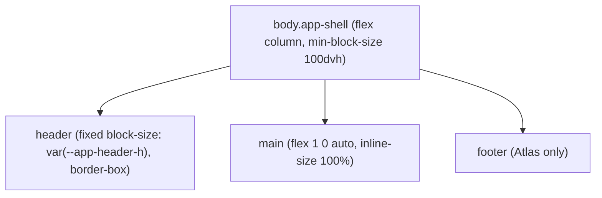
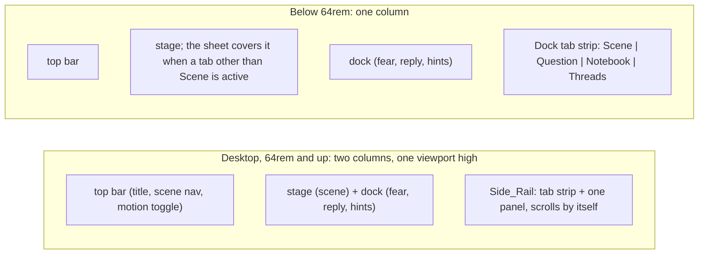

# Design Document

## Overview

Phase 7, Batch A is layout and CSS work plus one small state fix. It has seven parts, A1 to A7, which map to Requirements 1 to 7. Requirements 8 and 9 cover scope, verification and the handover.

The root cause of A1 to A3 is that the shell does not own the viewport. The Header_Token is `3.5rem` (56 px), but the two headers render at different heights, and both app roots use `min-h-screen` (100vh) while sections use `dvh`. The design fixes this once, in the shell:

- The skeleton gets the token and one small class, `.app-shell`. The class makes the body a column with a fixed-height Header row and a main region that fills the rest.
- The token value stays `3.5rem`. Both headers are made to render at exactly that height. This is the cheaper direction, because `skeleton/test/book-height.test.ts` pins the token at 56 px and the book height and scroll margins already use it.
- The World_Screen becomes one grid that is one viewport high. The Question, Notebook and Leads panels, which today stack below the scene and cause page scroll, move into a Side_Rail (desktop) or a Dock with a bottom sheet (phone).

Everything else is local: the Book controls move to the top and become sticky (A4), the hero images show whole on wide screens (A5), the fear caption gets a static visible state under reduced motion (A6), and the Hint 1 state is keyed by Run (A7).

Out of scope, per Requirement 8: game logic, the puzzle generator, the seeded RNG, content, assets, the database, merging the two headers, and any new test except the A7 unit test.

### Design decisions at a glance

| Part | Decision | Reason |
| --- | --- | --- |
| A1 | Keep `--app-header-h: 3.5rem`. Add `.app-shell` to `skeleton/src/design/ui.css`. Fix both headers to the token height. | The book-height test pins 56 px. The Atlas header is 61 px and the Game header is 45 px today. |
| A2 | One grid. Desktop: Side_Rail with tabs. Phone: Dock tab strip plus a bottom sheet over the scene only. | Three stacked panels do not fit 800 px. Tabs keep each one readable. The sheet keeps the fear meter and hints visible. |
| A3 | Both overlays use `.hall-ending` as a fixed full-viewport container, with one action each and a Tab trap. | Reuses the Hall's dialog pattern and `dialogKeyAction`. |
| A4 | Controls first in the DOM, sticky with an offset variable that defaults to `0`. | The Atlas header scrolls away, so a token offset would leave a gap. See Contradictions. |
| A5 | Two columns from 40rem (home) and 64rem (legend). No scrim. | Painting whole, copy on the plain page background. |
| A6 | Caption is `opacity: 1` whenever animations are off. | The base `opacity: 0` relies on an animation that `ui.css` turns off. |
| A7 | A tiny pure helper in `apps/game/src/lib/world.ts` plus a `run` prop. | Testable without layout. |

## Code check

Each reference in the requirements was compared with the current code. Line numbers below are the actual current lines.

### References that matched

| Reference in requirements | Current location | Result |
| --- | --- | --- |
| `--app-header-h` is `3.5rem` | `skeleton/src/design/tokens.css:59` | Matches. |
| `ui.css` ~14-33 (reduced-motion `animation: none !important`) | `skeleton/src/design/ui.css:14-33` (system block 14-24, `html[data-motion='reduce']` block 25-33) | Matches. |
| Atlas root uses `min-h-screen` | `apps/atlas/src/routes/__root.tsx:49` (`<body ... className="min-h-screen">`) | Matches. |
| Game root uses `min-h-screen` | `apps/game/src/routes/__root.tsx:48` | Matches. |
| `scene.css` ~271, `min-block-size: 30rem` | `apps/game/src/components/scene.css:271-278`, the floor is line 277 | Matches. |
| `.hall-panel` | `scene.css:202-218` (`position: fixed`, bottom sheet, `max-block-size: 60dvh`, `z-index: 40`) | Matches. |
| `.hall-ending` | `scene.css:242-269` (`.hall-ending` 242-253, `-image` 254-261, `-text` 262-269) | Matches. |
| `WorldPlay.tsx` ~82-92 (Hint 1 state) | `WorldPlay.tsx:82-93` (texts 82, highlights 84, asked ref 85, effect 86-93) | Matches. |
| `WorldPlay.tsx` ~166-193 | `WorldPlay.tsx:167-193` (restart 167-180, Ending 181, Question 182, Notebook and Leads 183-188, error 189-193) | Matches. |
| `WorldPlay.tsx` ~167-181 | `WorldPlay.tsx:167-181` (restart notice 167-180, Ending 181) | Matches. |
| `world.$target.tsx` ~71-76 (`restarted`) | `apps/game/src/routes/world.$target.tsx:71-76` | Matches. |
| `Book.tsx` ~289-302 (controls) | `skeleton/src/book/Book.tsx:289-302`. The controls are after the viewport (viewport 273-288). | Matches. |
| `--book-page-height` | `skeleton/src/book/book.css:17`, `clamp(30rem, calc(100dvh - var(--app-header-h) - 9rem), 52rem)` | Matches. |
| `styles.css` ~95-136 (home hero) | `apps/atlas/src/styles.css:95-137` (scrim at 129-137) | Matches. |
| `styles.css` ~107-114 (legend hero) | `apps/atlas/src/styles.css:107-114` | Matches. |
| `.fear-overlay-caption` | `apps/game/src/components/fear.css:22-38` (base 22-32, `full` 33-35, `reduced` 36-38) | Matches. |
| Atlas `LegendPage.tsx` hero | `LegendHeader` at `LegendPage.tsx:63-76`, hero `` at line 66 | Matches. |
| Atlas home hero | `apps/atlas/src/components/HomeView.tsx:17-36` (the route `routes/index.tsx` only loads data) | Matches. |
| Hall component | `apps/game/src/components/Hall.tsx` (panel at 137, ending at 159). `TutorialRoom.tsx:174` and `:227` also use `.hall-panel`. | Matches. |

### References that moved

None moved beyond a line or two. Two statements in the requirements point at the wrong file:

- Requirement 1.6 says to remove the comment that calls the Atlas header sticky. The comment is not in `__root.tsx`. It is at `apps/atlas/src/styles.css:53` ("a landed section clears the sticky header (height + 1rem)"). The `scroll-margin-block-start` rule it describes stays.
- The home route (`routes/index.tsx`) holds no hero markup. The hero is in `HomeView.tsx`.

### Real header heights

| Header | Markup | Rendered block size | Token |
| --- | --- | --- | --- |
| Atlas `SiteHeader.tsx:7-8` | `border-b` plus `nav` with `py-2` (0.5rem x 2) and `min-h-11` (2.75rem) items, and `flex-wrap` | 0.5 + 2.75 + 0.5 rem = 3.75rem (60 px) plus a 1 px border = **61 px** | 56 px |
| Game `GameHeader.tsx:16-17` | `border-b` plus `nav` with no vertical padding and `.nav-item` of `min-block-size: 2.75rem` | 2.75rem (44 px) plus a 1 px border = **45 px** | 56 px |

Consequences: the Game menu popover (`styles.css:27`, `inset-block-start: var(--app-header-h)`) opens 11 px below the real header, the Atlas header is 5 px taller than the token, and `.scene-screen` (`scene.css:276`) is sized from the wrong header height.

### Contradictions and findings

1. **Requirement 4.2 conflicts with Requirement 1.6.** R1.6 says the Atlas header scrolls away. R4.2 says the controls are sticky "directly below the Header, using the Header_Token". When the header has scrolled away, a sticky offset of `3.5rem` leaves an empty 56 px strip above the controls. The same controls inside the game's scrolling sheet would have the same gap. The design uses `inset-block-start: var(--book-controls-top, 0)`. The Atlas does not set the variable, so the controls stick at the top of the viewport. When the page is at the top, the controls sit directly below the header in normal flow, which is what R4.2 describes. If the owner wants the header always visible instead, the alternative is a sticky Atlas header plus `--book-controls-top: var(--app-header-h)`. This is a one-line change, but it contradicts R1.6. **Needs owner confirmation.**
2. **Requirement 4.8 (print) is already written but does not work.** `book.css:149-151` hides `.book-controls` inside `@media print`, but the base rule `.book-controls { display: flex }` at `book.css:159` comes later with the same specificity and wins. The fix is to move the base control rules above the print block. `apps/atlas/test/anchors-once.test.tsx:59` slices the CSS from `@media print` and expects `.book-controls { display: none`, which still holds after the move.
3. **Requirement 4.3 is already true.** `toggleState` (`Book.tsx:31-33`) already shows the target view in the label. A4 changes only DOM order, stickiness, height and print.
4. **`.hall-panel` is a fixed bottom sheet** (`position: fixed`, 60dvh, `max-inline-size: 40rem`). It is reused with a `.world-sheet` modifier that makes it absolute inside the scene area (see A2).
5. **`.hall-ending` is bottom-aligned and its `-text` child is a one-sentence card** (`font-size: 1.5rem`). The win content is a stack (heading, curse text, relic, score, seed, button). A modifier `.world-overlay` centres the content and lets it scroll.
6. **`.scene-viewport` also has a floor**: `min-block-size: 14rem` at `scene.css:376`. At 667x375 the scene cell is about 190 px, so this floor is lowered together with the `30rem` floor on `.scene-screen`.
7. **The Game main region has `p-4` and `max-w-6xl`** (`__root.tsx` game, line 59). The world screen needs the same padding in its height formula, so padding becomes a variable.
8. **`MotionToggle` renders below `WorldPlay`** (`world.$target.tsx:146`). It adds about 60 px under the scene and would cause page scroll. It moves into the top bar through a slot prop.
9. **Existing tests pin old structure.** They are listed under "Test pins to update" and go into the Handover_Doc, as R8.5 requires. One of them (two source-string pins in `world.test.ts:152-153`) pins old state code rather than layout. It is listed separately.
10. **Flex column and `mx-auto`.** In a column flex container an item with `margin-inline: auto` shrinks to its content width. Atlas `main` and `footer` use `mx-auto max-w-6xl`, so `.app-shell` gives its `main` and `footer` children `inline-size: 100%`.

## Architecture

### A1: the shell owns the viewport



`.app-shell` goes in `skeleton/src/design/ui.css`, which both apps already import. Both apps' `styles.css` already import `tokens.css`, so the token has one definition.

### A2: the world screen grid



Grid areas for `.scene-screen.world-grid`:

- Below 64rem: rows `auto minmax(0, 1fr) auto auto`, areas `"top" "stage" "dock" "tabs"`. The panel container uses `grid-area: stage` and sits over the stage cell.
- From 64rem: columns `minmax(0, 1fr) minmax(18rem, 26rem)`, rows `auto minmax(0, 1fr) auto`, areas `"top rail" "stage rail" "dock rail"`. The rail wrapper is `grid-area: rail`, a flex column with the tab strip on top and the panel below. The panel scrolls (`overflow-y: auto`, `min-block-size: 0`).

The rail wrapper has `display: contents` below 64rem, so its two children (the panel container and the tab strip) are placed by the phone areas. The wrapper has no role, so `display: contents` causes no accessibility problem.

### A3: overlays

Both overlays are rendered as children of `.world-play` with `position: fixed; inset: 0` (the `.hall-ending` rule). No ancestor of `.world-play` has a transform or `contain`, so fixed positioning covers the viewport.

## Components and Interfaces

### A1: Shell owns the viewport (Requirement 1)

**Approach.**

1. `skeleton/src/design/ui.css`: add `.app-shell` (about 12 lines), inside `@layer ui`:

   ```css
   .app-shell { display: flex; flex-direction: column; min-block-size: 100dvh; }
   .app-shell > header { flex: none; box-sizing: border-box; block-size: var(--app-header-h); }
   .app-shell > main { flex: 1 0 auto; }
   .app-shell > :is(main, footer) { inline-size: 100%; }
   ```

   The token stays in `tokens.css` unchanged (`3.5rem`).
2. `apps/atlas/src/routes/__root.tsx:49` and `apps/game/src/routes/__root.tsx:48`: replace `min-h-screen` with `app-shell`. The Atlas `Shell` and the Game body already render `header` and `main` as direct children of `body`. The skip link is `sr-only` (absolute) and `Mood` is `position: fixed`, so neither takes a flex row.
3. `apps/atlas/src/components/SiteHeader.tsx:8`: on the `nav`, drop `py-2` and `flex-wrap`, add `block-size: 100%` (`h-full`) and `flex-nowrap`. The header row is 3.5rem with a 1 px border, so 55 px remain for 44 px targets, which fits. The Game header needs no markup change, because its `nav` already has `items-center` and the shell class fixes the header height.
4. `apps/atlas/src/styles.css:53`: reword the comment to "a landed section clears the header (height + 1rem)". Do not touch the rule (R1.6).
5. The two headers stay two components in their own apps (R1.8).

**Narrow phones (R1.9).** `header-check.mjs` already passes "one row" at 360, 375 and 390 with the short "Play" label. With `flex-nowrap` the logo text must not push the row wider. The logo link gets `min-w-0` and `truncate`. If the 360 px check still overflows, the "All legends" link is hidden below 40rem (`hidden min-[40rem]:inline-flex`) and stays reachable from the home page. This fallback is applied only if the visual check shows overflow.

**Files.** `skeleton/src/design/ui.css`; `apps/atlas/src/routes/__root.tsx`; `apps/atlas/src/components/SiteHeader.tsx`; `apps/atlas/src/styles.css`; `apps/game/src/routes/__root.tsx`.

**Key decision: token stays 3.5rem.** Raising it to 3.75rem would match the Atlas header but would change the book height, every scroll margin and a pinned test, and the Game header would then be 15 px too short anyway. Fixing both headers to the token is one rule.

### A2: World screen fits the viewport (Requirement 2)

**Approach.**

*Sizing.*
- The Game `main` padding becomes a variable: `--game-pad: var(--space-4)`, set to `var(--space-2)` in `@media (max-block-size: 30rem)`. The `main` uses `padding: var(--game-pad)` instead of `p-4`.
- `ThemeRoot` in `world.$target.tsx` gets `className="world-root"`. In `world.css` (components layer): `.world-root { block-size: calc(100dvh - var(--app-header-h) - 2 * var(--game-pad)); min-block-size: 0; }`. Header (3.5rem) + padding + root = exactly 100dvh, so the page does not scroll.
- `.world-play` becomes the full-size container: `block-size: 100%; position: relative`. Its `flex` column rule is removed. The `.scene-screen` grid is placed inside it with an added `world-grid` class: `<div className="scene-screen world-grid">`. The tutorial keeps plain `.scene-screen` and is unaffected by the `world-grid` rules.
- In `scene.css`, line 277 `min-block-size: 30rem` becomes `min-block-size: 0`, and `.scene-screen .scene-viewport` `min-block-size: 14rem` (line 376) becomes `8rem` (R2.6). The block-size formula on `.scene-screen` stays for the tutorial; `.world-grid` overrides it with `block-size: 100%`.

*Panels and tabs.*
- Question, Notebook and Leads are moved inside the grid, after the dock, in a wrapper `<div className="world-rail">`. Order inside the wrapper: the panel container first, then the tab strip on phone; on desktop CSS (`order`) puts the tab strip above the panel. Visual order on desktop matches DOM order only after `order`, so the tab strip is placed first in the DOM and the phone layout places it last using the grid area (areas, not `order`, so it is a layout-only change). This keeps focus order: top bar, scene, dock, tabs, panel. See "Focus order" below.
- A new component `apps/game/src/components/WorldTabs.tsx` renders the strip: `role="tablist"`, four buttons (`role="tab"`, `aria-selected`, `aria-controls`), arrow keys, Home and End. Arrow direction follows `document.dir`. The Scene tab is hidden from 64rem up. A new hook `useDesktop()` (in `apps/game/src/lib/useMediaQuery.ts`, SSR default `false`, corrected on mount, same pattern as `useReducedMotion`) tells the component which breakpoint is active, so `aria-selected` is correct on both layouts.
- State in `WorldPlay`: `const [tab, setTab] = useState<'scene' | 'question' | 'notebook' | 'leads'>('scene')`. The effective tab is `desktop && tab === 'scene' ? 'question' : tab`.
- All three panels stay in the DOM, with the `hidden` attribute on the inactive ones. This keeps their state, keeps the SSR markup that the existing `world.test.ts` checks, and shows exactly one at a time (R2.4). Each panel is wrapped in `role="tabpanel"` with `aria-labelledby` pointing at its tab.
- Choosing "Show" on a Notebook puzzle sets the chosen slot and switches to the Question tab. A fear restart and a win reset the tab to `scene`.

*Tabs vs stacked (decision).* Tabs. Question (SpiritPanel with four options), Notebook and Leads together are taller than an 800 px viewport, and stacking them would put the rail's own scroll in charge of finding the panel the player needs. With tabs, each panel fills the rail.

*Dock vs bottom sheet (decision).* The phone Dock is a tab strip at the bottom (thumb reach). A tab other than Scene opens its panel as a sheet that covers **only the stage**, using the existing `.hall-panel` look (R2.7): `className="hall-panel world-sheet mood-worn"`. `.world-sheet` overrides the fixed position: `position: relative; inset: auto; grid-area: stage; z-index: 41; max-block-size: none; max-inline-size: none; margin: 0; overflow-y: auto`. The dock (fear meter, reply, Hint 1 and Hint 2) stays visible under the sheet, so the player can ask for a hint while reading the question. The scene stays mounted, so pan position is kept (`SceneViewer` is not hidden with `display: none`, which would break its width measurement).

*Short landscape (667x375).* At `max-block-size: 30rem` the grid is compacted: padding `var(--space-2)`; the scene-nav tab row and title share one row (the existing `.scene-nav { display: contents }` rule already allows this); `.scene-reply` and `.scene-pending` drop their reserved rows to one line; the fear meter uses `inline-size: 8rem`. The sheet then has about 190 px and scrolls by itself. This is a known tight spot. If the visual check shows the sheet is unusable, the fallback is `grid-row: stage / dock` so the sheet also covers the dock in short landscape only. Record the result in the Handover_Doc.

*Panel content in a narrow container.* `.spirit-panel` uses a two-column grid with a figure column and `padding-inline: 2.5rem`. Inside `.world-rail` and `.world-sheet` it gets one column, `padding-inline: 1.5rem`, and `.spirit-close { display: none }`, the same rules the file already applies at `max-width: 30rem`.

*Top bar.* The `MotionToggle` moves from `world.$target.tsx:146` into the top bar through a new optional prop `motion?: ReactNode` on `WorldPlayProps`, rendered with `margin-inline-start: auto`. The route passes `motion={<MotionToggle .../>}`.

*Targets, RTL, focus order.*
- Every tab, panel button and the sheet Close button is at least 44 px in both dimensions (`.world-button`, `.scene-button` and `.btn` already set `min-block-size` and `min-inline-size` of 44 px).
- All new rules use logical properties (`inline-size`, `block-size`, `inset-inline`, `margin-inline-start`, `padding-inline`). The grid columns mirror in RTL because grid tracks follow `dir`. The scene itself stays `direction: ltr` as today.
- DOM order is: top bar, stage, dock, rail (tab strip, panels). On desktop that is visual order (scene left, rail right, tabs above the panel). On phone the tab strip is at the bottom and the sheet is above it, so the sheet takes focus when it opens (`panelRef.current?.focus()`, the pattern `Hall.tsx:88` uses with `usePanelOpener`). Escape closes the sheet and returns focus to the tab that opened it.

**Files.** `apps/game/src/components/WorldPlay.tsx`; `apps/game/src/components/WorldTabs.tsx` (new); `apps/game/src/lib/useMediaQuery.ts` (new); `apps/game/src/components/world.css`; `apps/game/src/components/scene.css`; `apps/game/src/components/fear.css` (spirit panel inside the rail); `apps/game/src/styles.css` (`--game-pad`); `apps/game/src/routes/__root.tsx` (padding variable); `apps/game/src/routes/world.$target.tsx` (`world-root` class and `motion` prop); `apps/game/src/i18n/en.ts` (keys below).

**New catalog keys** (no hardcoded strings): `world.tabs.label` (the tablist name), `world.tab.scene`, `world.sheet.close`, `world.question.none` (shown in the Question panel when no puzzle is open). Existing keys `world.question`, `world.notebook` and `world.leads` label the other tabs.

### A3: Win and fear restart over the scene (Requirement 3)

**Approach.**

- `Ending` (`WorldPlay.tsx:333`) renders `<div className="hall-ending world-overlay" role="dialog" aria-modal="true" aria-labelledby="world-win-title">` containing a `.world-panel world-ending` card with the existing content. The card gets `max-block-size: 100%; overflow-y: auto` so a tall win screen scrolls inside the overlay at 667x375. `.world-overlay` sets `justify-content: center` over the bottom alignment of `.hall-ending`.
- The restart notice (`WorldPlay.tsx:167-180`) becomes the same container with `role="alertdialog"`, `aria-labelledby="world-restart-title"` and `aria-describedby` on the body paragraph. Its one action is the existing "Try again" button (`restart.again`).
- **Focus trap (decision).** Each overlay has exactly one control, so the trap is the same one the Hall ending uses: `onKeyDown` calls `dialogKeyAction` from `apps/game/src/lib/focus.ts`; on `'trap'` it calls `preventDefault()` and refocuses the button. Escape does not close either overlay, because R3.5 keeps focus inside until the player chooses an action. No new focus code is needed.
- **Scroll position (R3.6).** On mount the overlay focuses its button with `focus({ preventScroll: true })`. The overlay is fixed, so nothing in the page moves.
- **Try again (R3.7).** The server has already started the new Run when the restart response arrives, and the route has reset `chosen` and the fear events. The button calls `onDismissRestart()`, which closes the overlay, then focuses the scene heading, as it does today.
- **Reduced motion (R3.8).** Neither overlay animates or transitions, so there is nothing to swap. Any later addition must use `calc(var(--motion) * Nms)`.
- The dock's `FearMeter` is not covered, because the overlay is for the end of a Run and the fear meter is meaningless during it.

**Files.** `apps/game/src/components/WorldPlay.tsx`; `apps/game/src/components/scene.css` (`.world-overlay` modifier next to `.hall-ending`).

### A4: Book controls on top and sticky (Requirement 4)

**Approach.**

- `skeleton/src/book/Book.tsx`: move the `book-controls` block (lines 289-302) before the `book-viewport` div (line 273). The hidden rules (`hidden={!supported || single}`), handlers and labels do not change. This applies to both book mode and one-page mode because the markup is shared.
- `skeleton/src/book/book.css`:
  - `.book-controls` gets `position: sticky; inset-block-start: var(--book-controls-top, 0); z-index: 5; background: var(--color-bg); border-block-end: 1px solid var(--color-rule, var(--color-muted));`. See Contradictions item 1 for why the offset is a variable that defaults to `0` and not the token.
  - Controls rules (lines 159-186) move above the `@media print` block so the print rule `.book-controls { display: none }` wins (R4.8, Contradictions item 2).
  - `--book-page-height` floor: `clamp(14rem, calc(100dvh - var(--app-header-h) - 9rem), 52rem)`. At 1280x800 the value stays 600 px. At 667x375 it is 14rem (224 px); with the 60 px sticky controls the page and controls take 284 px of the 375 px viewport. At 375x667 it is 467 px. Both fit (R4.6).
  - The indicator and the toggle already sit in a wrapping row with `gap: var(--space-3)`. At 375 px wide the row is arrows (2 x 44 px), indicator (6rem) and the toggle, which fits on one row; if it wraps, the extra row is allowed because the page height formula already reserves `9rem`.
- RTL (R4.7): the row is `display: flex` and follows `dir`, so it mirrors. The chevron is already mirrored by `[dir='rtl'] .book-chevron`. No change.
- Targets (R4.9) and logical properties (R4.10) already hold for the existing rules. The new rules use `inset-block-start` and `border-block-end`.
- Anchor landing: `scroll-margin-block-start: calc(var(--app-header-h) + 1rem)` on `.book-viewport` and `[id]` stays. The sticky controls are 3.75rem tall, so a landed heading clears them with that margin.

**Files.** `skeleton/src/book/Book.tsx`; `skeleton/src/book/book.css`. Both are saved once each (R8.8), and `Book.tsx` is `.tsx`, which the skeleton test hook does not match.

### A5: Show hero images whole (Requirement 5)

**Legend hero (wide layout decision).** From 64rem, the hero is a two-column header: the painting in the larger column and the title, hook and meta list beside it. The painting is shown whole (16:9 at its column width), so the cap is lifted and the copy moves instead of covering it.

- `LegendPage.tsx:65`: `className="legend-header flex flex-col gap-6"`. The copy block (line 67) gets `legend-intro`. Mobile markup is unchanged.
- `styles.css`, new block after `.legend-hero`:

  ```css
  @media (min-width: 64rem) {
    .legend-header { display: grid; grid-template-columns: minmax(0, 3fr) minmax(0, 2fr); align-items: center; gap: var(--space-6); padding-inline: var(--space-4); }
    .legend-header .legend-hero { max-block-size: none; object-fit: contain; }
    .legend-header .legend-intro { margin-inline: 0; padding-inline: 0; max-inline-size: none; }
  }
  ```

  At 1280 px the main region is 1152 px, so the painting column is about 672 px wide and 378 px tall, and the title is on the first screen. At 1024 px it is about 595 x 335 px. The base `.legend-hero` rule (cap `min(46dvh, 28rem)`, `cover`) is untouched below 64rem, so the phone and tablet pages and `legend-hero.test.tsx` stay as they are. Grid columns mirror in RTL.

**Home hero.** From 40rem the hero is two columns: the painting whole in the inline-start column, the copy on the plain page background in the other. The phone block (`max-width: 39.999rem`, `styles.css:139-155`) is not edited (R5.6).

- `.home-hero` base rule: `display: grid; grid-template-columns: minmax(0, 1fr) minmax(0, 1fr); align-items: center; gap: var(--space-5); min-block-size: 0`.
- `.home-hero-frame` base rule: `position: static; aspect-ratio: 16 / 9; overflow: clip`.
- Delete the `::after` scrim rules (lines 120-128, including the `[dir='rtl']` one) and the copy scrim `background: color-mix(...)` (line 136); `.home-hero-copy` gets `align-self: center; padding-inline: var(--space-4)`.
- The DOM order (frame, then copy) already puts the painting first, so the columns mirror in RTL.
- Contrast (R5.5): ink and glow text on `--color-bg`, which is the base palette pairing used across the site, so AA holds without a scrim. The visual pass checks it.

**Files.** `apps/atlas/src/styles.css`; `apps/atlas/src/components/LegendPage.tsx`.

### A6: Fear caption visible with reduced motion (Requirement 6)

**Root cause.** `.fear-overlay-caption` has `opacity: 0` (`fear.css:31`) and becomes visible only through an animation. Under reduced motion, `ui.css:14-33` sets `animation: none !important` (system setting and `html[data-motion='reduce']`), so the caption stays at opacity 0 and is never seen. The `fear-fade` rule at `fear.css:36-38` never gets to run.

**Fix (in `fear.css` only; `ui.css` is untouched, R6.5).** Add a static visible state wherever animations are off:

```css
.fear-overlay[data-motion='reduced'] .fear-overlay-caption { opacity: 1; }
@media (prefers-reduced-motion: reduce) { .fear-overlay-caption { opacity: 1; } }
html[data-motion='reduce'] .fear-overlay-caption { opacity: 1; }
```

The three selectors cover the in-app toggle, the system setting, and the short moment before the effect in `useReducedMotion` sets the attribute. The caption element exists only while `FearOverlay` shows it (`EVENT_SHOW_MS`), so the caption is visible for the whole time it is mounted and appears and disappears by mounting, with no fade and no movement. The flash element keeps `opacity: 0` with no animation (the existing `@media` rule at lines 60-62 plus `ui.css`). With reduced motion off, the `full` rule and `fear-caption-full` animation are unchanged (R6.3). The existing `fear-fade` keyframes and rule stay because `fear-ui.test.ts` pins them. When the Motion_Toggle is on and a fear event occurs, `world.$target.tsx` already calls `play()` and `FearOverlay` shows the caption (R6.4); the CSS fix is what makes it visible.

**Files.** `apps/game/src/components/fear.css`.

### A7: Hint 1 state does not survive a fear restart (Requirement 7)

**Cause.** `WorldPlay.tsx:82-93` stores the Hint 1 text and highlight ids by slot id. A restart creates a new Run with the same slot ids, so the old text and marks show again in the new room.

**Approach.** The Run identity is a number. `world.$target.tsx` already counts Runs in `runNo` (a ref, incremented at line 73 on `r.ended?.status === 'restarted'`). The route adds `const [run, setRun] = useState(0)` and calls `setRun(runNo.current)` next to the increment, then passes `run` to `WorldPlay` (new prop `run: number`). The ref stays for `play()` and `played`.

In `apps/game/src/lib/world.ts`, a pure helper, with no React and no DOM:

```ts
/** What the screen remembers from Hint 1 replies, for one Run. */
export interface Hint1Store {
  run: number;
  texts: Readonly<Record<string, string>>;
  highlights: Readonly<Record<string, readonly string[]>>;
}
export const emptyHint1 = (run: number): Hint1Store => ({ run, texts: {}, highlights: {} });
/** The store to read for `run`: the given one if it is for that Run, otherwise an empty one. */
export const hint1For = (store: Hint1Store, run: number): Hint1Store => (store.run === run ? store : emptyHint1(run));
```

In `WorldPlay`:

- `const [store, setStore] = useState(() => emptyHint1(p.run)); const hint1 = hint1For(store, p.run);` Reads (`hint1.texts[slot.slotId]`, `hint1Marks(view, hint1.highlights)`) always use `hint1`, so on the very first render after a restart the old Run's text and marks are gone (R7.1, R7.2), with no stale frame and no effect.
- The reply effect writes with `setStore((prev) => { const cur = hint1For(prev, p.run); return { ...cur, texts: { ...cur.texts, [asked]: text }, highlights: { ...cur.highlights, [asked]: highlight } }; })`, so a Hint 1 requested in the new Run shows that Run's text (R7.4).
- `hint1Asked.current` is set to `null` when `p.run` changes (inside the same effect), so a reply that was in flight for the old Run cannot be written into the new Run.

Fear meter rules, hint gating, the seeded RNG and the generator are not touched (R7.5).

**Files.** `apps/game/src/lib/world.ts`; `apps/game/src/components/WorldPlay.tsx`; `apps/game/src/routes/world.$target.tsx`.

## Data Models

No database, content or API shape changes. New client-side shapes:

| Shape | Where | Fields |
| --- | --- | --- |
| `Hint1Store` | `apps/game/src/lib/world.ts` | `run: number`, `texts: Record<slotId, string>`, `highlights: Record<slotId, string[]>` |
| `WorldTab` | `WorldPlay.tsx` / `WorldTabs.tsx` | `'scene' \| 'question' \| 'notebook' \| 'leads'` |
| `WorldPlayProps` additions | `WorldPlay.tsx` | `run: number`, `motion?: ReactNode` |
| CSS variables | `ui.css`, `book.css`, game `styles.css` | `--app-header-h` (unchanged, `3.5rem`); `--book-controls-top` (default `0`); `--game-pad` (`1rem`, `0.5rem` in short landscape) |
| CSS classes | `ui.css`, `scene.css`, `world.css`, `styles.css` | `.app-shell` (skeleton); `.world-root`, `.world-grid`, `.world-rail`, `.world-sheet`, `.world-overlay` (game); `.legend-header`, `.legend-intro` (atlas) |

Because `WorldPlayProps` gains a required `run`, the type change triggers one `pnpm -r typecheck` during the work (R8.7). The existing test helper that builds `WorldPlay` props (`apps/game/test/world.test.ts:49`) needs `run: 0` added; that is a prop addition, not a weakening of any assertion.

## Error Handling

- **Narrow header (A1).** If the Atlas header cannot fit one row at 360 px, the logo truncates first; if it still overflows, the secondary "All legends" link is hidden below 40rem (R1.9). Nothing wraps.
- **Short viewports (A2).** The scene floors are lowered (`0` and `8rem`) and the panels scroll inside their own container, so a very small viewport degrades to inner scroll, never to page scroll or overlapping content.
- **SSR and hydration (A2).** `useDesktop()` starts `false` on the server, so the server markup is the phone layout, and it corrects on mount. The panels are all in the markup, so nothing is lost before hydration.
- **Overlay focus (A3).** If the overlay button is not yet mounted when the effect runs, `focus` is a no-op (optional call), and the overlay is still modal because it covers the viewport. Escape is intentionally ignored; the only exit is the action button.
- **Stale Hint 1 reply (A7).** A reply that arrives after a restart is written under the new `run`, and `hint1Asked` is cleared on `run` change, so an old request cannot attach text to a new Run's slot.
- **Reduced motion (A6).** Both reduced-motion mechanisms (system setting and `html[data-motion='reduce']`) have an explicit visible rule, so the caption never depends on an animation that is switched off.
- **Print (A4).** The controls are hidden in print because the print rule is moved after the base rule.

## Testing Strategy

This batch follows Requirement 8 exactly.

- **One new test only:** a small unit test for A7 in `apps/game/test/world.test.ts` (an `it` block next to the existing `hint1Marks` tests, which already import from `../src/lib/world.ts`). It asserts, on the pure helper, that a store filled in Run 0 is not visible from Run 1: `hint1For(store, 1)` returns an empty store (`texts` and `highlights` both empty), and `hint1Marks(view, hint1For(store, 1).highlights)` marks nothing, while `hint1For(store, 0)` still returns the stored text. It needs no DOM and no layout.
- **No layout tests.** No test measures layout, pixel sizes, CSS values, class names, copy strings or snapshots (R8.3). No Playwright or browser test is added.
- **No other new tests, and no Correctness Properties section.** Property-based testing does not apply: the work is layout, CSS and one small state fix, and none of it has a cheap "for all inputs" statement (the pure A7 helper is covered by the one unit test). The existing generator property tests (fast-check) are not touched: the batch does not edit the puzzle generator, the seeded RNG or the lead logic, so the rule "run the property tests after any change to the generator, RNG or lead logic" is not triggered. They still run inside `pnpm -r test` in the Verify_Task.
- **Existing tests stay green.** If an existing test fails only because it pinned the old layout, the pin is updated and listed in the Handover_Doc (R8.5). No test that covers game rules is weakened (R8.6).
- **During the work** (R8.7, R8.13): look at the dev server only, save no screenshots, and run `pnpm -r typecheck` only after the `WorldPlay` props change.

### Test pins to update (expected, to list in the Handover_Doc)

| Existing test | Pin | Why it changes |
| --- | --- | --- |
| `apps/atlas/test/book-component.test.tsx:33` | `flow()` regex ends at `</div></div><div class="book-controls"` | Controls come before the viewport (A4). The regex is rewritten to read the flow without relying on what follows it. |
| `apps/atlas/test/home.test.tsx:114-117` | "hero copy on a dark scrim" | R5.4 removes the scrim above 40rem. The test is changed to check that the phone block still has no scrim and the base rule has none. |
| `skeleton/test/book-height.test.ts` (`stays inside the clamp`, `30 * REM`) | Floor of 30rem | R4.6 lowers the floor to 14rem. The two floor expectations change; the 1280x800 expectations (600 px, at least 480 px, taller than 576 px) and `headerPx === 56` stay as they are. |
| `apps/game/test/world.test.ts:152-153` | Source strings `setHint1Highlights((prev) => ({ ...prev, [asked]: highlight }))` and `hint1Marks(view, hint1Highlights)` | These pin the old Hint 1 state code, not layout. A7 replaces that code. The pins are updated to the new store calls and the helper name. **Needs owner awareness**, because R8.5 only speaks of layout pins. |
| `apps/game/test/world.test.ts:49` (helper) | `WorldPlay` props | Adds `run: 0`. |

Tests that should pass unchanged: `fear-ui.test.ts` (caption rule, `fear-fade`, overlay inside the stage; the `.scene-screen .world-stage` rule stays), `legend-hero.test.tsx` (base `.legend-hero` rule stays), `anchors-once.test.tsx:59` (print rule), `header.test.tsx` for both apps, `pending-row.test.ts` and `hint-area.test.tsx` (the base rules stay; compaction is in a separate media block), and the logical-CSS tests (all new CSS is logical).

## Verification

One Verify_Task runs once, after every other task is complete (R8.4, R8.9):

1. `pnpm -r typecheck`
2. `pnpm -r test`
3. `pnpm --filter @kiroween/atlas test:browser -- --base http://localhost:3001` (this runs `scripts/book-check.mjs`; it may need pins updated if it measures old positions, which are then listed in the Handover_Doc)
4. **One screenshot pass.** One screenshot per affected screen, once, at 390x844, 667x375, 768x1024 and 1280x800, saved under `.debug/phase-7/`, using the existing CDP scripts in `apps/atlas/scripts/` where they cover a screen and one throwaway script under `.debug/phase-7/` for the game screens. The script is not a test and is not added to any test directory.

Screens and what each is checked against ("Done when" of Requirements 1 to 6):

| Screen | Checked for |
| --- | --- |
| Atlas home | Header one row at its token height; no page scroll when content fits; hero two columns from 40rem with no scrim; phone hero unchanged at 390x844. |
| Atlas legend page, book mode and one-page mode | Controls first and sticky; toggle label and one-tap switch; page, indicator and arrows fit at 667x375 and 375x667; hero whole at 1024 and 1280 with the title on the first screen. |
| Atlas 404 or a short page | No page scroll when content fits. |
| Game hall | Header one row at its token height; menu popover opens flush under the header. |
| Game world, Scene tab | One viewport high, no page scroll; scene fits at 667x375; rail present from 64rem. |
| Game world, each of Question, Notebook, Leads | One panel at a time; puzzle readable and answerable without page scroll; sheet leaves the dock visible. |
| Game world, win overlay and restart overlay | Cover the viewport; one action; focus on the button. The restart overlay is reached in play by asking Hint 2 repeatedly. If the win overlay cannot be reached without solving a world by hand, it is recorded as not captured in the Handover_Doc rather than adding a preview flag to the code. |
| Game world, fear caption with reduced motion on | Caption visible for its whole time and gone after; no flash. |

The pass also confirms, by looking, that no page scrolls horizontally, that targets are 44 px or larger, and that RTL mirrors the grid and the hero columns (one RTL screenshot of the world and of the home hero is enough). Screenshots taken are listed in the Handover_Doc, together with the results of steps 1 to 3, the test pins updated, the files touched and anything not done (R9).

### Open items for the owner

1. **R4.2 vs R1.6** (Contradictions item 1): controls stick at the top of the viewport (design default) or the Atlas header becomes sticky.
2. **`world.test.ts:152-153`** pins old state code; it is updated as part of A7.
3. **Short landscape sheet height** (A2): about 190 px at 667x375. The fallback of covering the dock there is described in A2 and used only if the visual check requires it.
