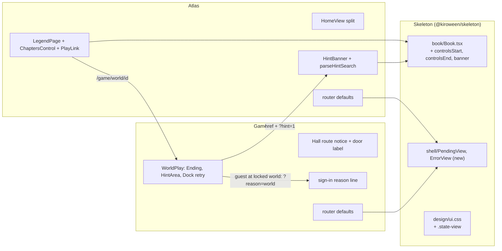
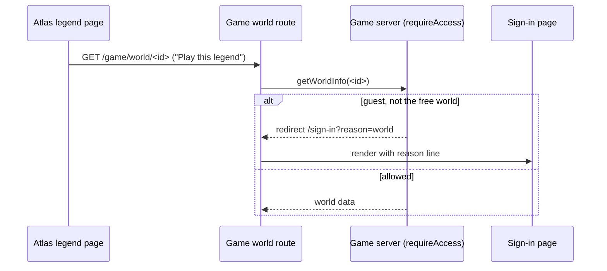
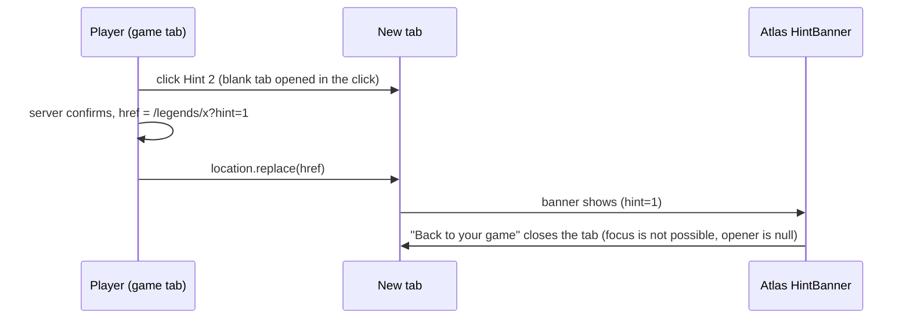

# Design Document

## Overview

Phase 7 Batch B is UI work on top of the Batch A shell. It has seven parts, B0 to B6, which map to Requirements 1 to 7. Requirement 8 covers verification, handover and scope control.

The design touches layout, links and UI states only. It does not touch game logic, the puzzle generator, the play engine, the legend parser, legend content, `content/`, `assets/` or the database. The one server file that changes, `apps/game/src/server/functions.ts`, changes only the target and search of an existing redirect.

### Decisions at a glance

| Part | Decision | Reason |
| --- | --- | --- |
| B0 | Delete the `curseText` paragraph from `Ending`. Add one catalog line, a primary "Back to the hall" and a quiet "Read the full legend" link. Export `Ending` for the one unit test. | `curseText` is `world.finalPuzzle.description`, a design spec, not player text. |
| B1 | The Contents list becomes a `ChaptersControl` (native popover) inside the Book control row. `Book` gets three small slots. | The row is already sticky (Batch A). A popover costs no page height. |
| B2 | Home body is a two-column grid from 64rem (map 2fr, list 1fr). The list is a keyboard-focusable scroll region with compact rows. Phone stays stacked. | CSS only, and the markup is shared with the phone. |
| B3 | A plain `<a href="/game/world/<id>">` in the control row and after the Book. | The apps are separate deployments on one domain, like the header "Play" link. |
| B4 | A pure `hallNotice()` helper picks the line. The route renders it under the heading. The door label gets a guest-only "Free for guests" state. The server redirect and the client redirect add `?reason=world`. | Reuses `hallDoorState` and `doorReasonKey`. No access rule changes. |
| B5 | Shared `PendingView` and `ErrorView` in the skeleton. Each router sets `defaultPendingComponent`, `defaultErrorComponent` and `defaultPendingMs: 200`. The Dock gets a Retry that replays the last action. | One place for both apps. The loaders already throw, so defaults catch them. |
| B6 | `HintArea` shows "Hint 1 / Free" and "Hint 2 / Adds 6 fear". The cost is read from `FEAR.hint2`. Hint 2 URLs get `?hint=1`. The atlas shows a banner. | `FEAR.hint2` is a constant (6), so the cost is known at build time. |

## Code check

Each file named in the requirements was read. Findings that shape the design:

| Finding | Location | Consequence |
| --- | --- | --- |
| The win card renders `ended.curseText` through `Marked`. The button is `btn-secondary`. | `WorldPlay.tsx` `Ending` (end of file) | B0 removes the paragraph, makes the button primary, adds a link. `Ending` is not exported, so it is exported for the test. |
| The Contents list is a full `<nav aria-labelledby="contents-title">` above `Book`. Page sections use Tailwind `gap-16`. | `LegendPage.tsx` `Contents`, `LegendPage` | B1 replaces it. `legend-header` already has the Batch A two-column grid at 64rem. |
| `.book-controls` is already sticky (`--book-controls-top`, default 0). The whole row has `hidden={!supported \|\| single}`. | `Book.tsx`, `book.css:129-146` | Content added to the row would be hidden on the server, before hydration, and when the book fits one page. B1 moves the `hidden` test onto the page buttons and the toggle (see B1). |
| `Book` is used by `LegendPage` and `KeepersNotePage` only. | grep | New `Book` props are optional, so the Keeper's Note is unchanged. |
| The Home body is `flex flex-col gap-14` with a hero, a map section and a grouped card list (`legend-cards`, auto-fill 16rem). | `HomeView.tsx`, `LegendList.tsx`, `styles.css` | B2 is a wrapper grid plus compact-row rules scoped to the desktop split. |
| `hallDoorState(tutorialDone, mayEnter)` and `doorReasonKey(state)` are pure. For a guest, `d.open` is true only for the guest world (`functions.ts:88`, `canEnter`). | `apps/game/src/lib/hall.ts` | The Free_World is "the door with `open === true`" for a guest. No new access code. |
| `requireAccess` throws `redirect({ to: '/sign-in' })` for a guest. The client also calls `navigate({ to: '/sign-in' })` when a play call returns a redirect. | `functions.ts:156`, `world.$target.tsx` `run` | B4 adds `search: { reason: 'world' }` in both places. |
| `sign-in.tsx` has no search validation. | `routes/sign-in.tsx` | B4 adds `validateSearch`, the same pattern as `world.$target`'s `layout`. |
| Atlas router: `defaultPendingComponent` is a local `Pending`, with the default 1 s delay. Game router has none. Atlas root has its own `errorComponent` that renders a full `Document`. Game root has a loader (`getShell`) and no `errorComponent`. | `router.tsx` (both), `__root.tsx` (both) | B5 sets 200 ms, swaps in the shared views, and adds `defaultErrorComponent`. The atlas root keeps its own fallback for failures of the root itself. The game root gets an `errorComponent` in B5 that uses the shared `ErrorView`. |
| Both `NotFound` views already render inside the shell (game root `notFoundComponent`, atlas `NotFoundInShell`). | `__root.tsx` | R6.5 needs no change. The Verify task checks it. |
| The dock shows `error.generic` as a bare `role="alert"` paragraph when `view && failed`. `StartRetry` covers a failed first start only. | `WorldPlay.tsx` dock | B5 adds a Retry button and a handler. |
| `FEAR.hint2 = 6`, exported from `@kiroween/skeleton/client`. `FEAR.tutorialHint2 = 10` is separate. | `skeleton/src/play/fear.ts` | The Hint 2 cost is a known number for the world. Where a caller cannot give one, the line falls back to "Raises fear". |
| `HintArea` labels are `hint.1` "Hint 1 (free)" and `hint.2` "Hint 2 (raises fear): opens the atlas". The aria-labels are `hint.1.named` and `hint.2.named`. | `HintArea.tsx`, `en.ts` | The visible labels shorten. The aria-label keys stay as they are, so the full wording remains (R7.5). |
| `openBlankTab` sets `w.opener = null`. | `lib/hintTab.ts` | The atlas tab cannot call `window.opener.focus()`. The banner button closes its own tab (see B6). |
| `atlasHref(origin, anchor)` returns `origin + /legends/<id>#<anchor>`. | `lib/world.ts:64` | A marker must go between the path and the hash. |

## Architecture



### Cross-app links





## Components and Interfaces

### B0: Win screen without design notes (Requirement 1)

**Change in `apps/game/src/components/WorldPlay.tsx` (`Ending`):**

- Delete the `ended?.curseText` paragraph. `PlayView.ended.curseText` stays in the type and the engine (R1.8); nothing reads it.
- Render, in order: heading `world.win`, one paragraph `world.win.line`, the relic figure, score, seed, then an actions row.
- Actions row: the existing `ref` button becomes `btn btn-primary` (still takes initial focus, still the only Tab stop trapped by `dialogKeyAction`). Beside it, a quiet link `<a className="btn btn-ghost" href={legendHref}>` with `world.win.read`.
- `legendHref = mediaBase.replace(/\/+$/, '') + legendUrl(legendId)`. `mediaBase` is the atlas origin (the same value `atlasHome` and `atlasHref` use). `legendUrl` is already exported from `@kiroween/skeleton/client`. `Ending` receives a new `legendId` prop from `WorldPlay` (`p.legendId`).
- The link opens in the same tab, as a normal navigation. It leaves the game; the player can return through the hall.
- The dialog trap in `onKey` only handles one control today. With two controls, `dialogKeyAction` returns `'trap'` for Tab, which pins focus on the primary button. The design changes the trap to cycle between the two controls: on Tab, move to the other control, and on Shift+Tab the same. A small local helper (`focusables = [primary, link]`) does this; `dialogKeyAction` itself is unchanged.
- Fit (R1.7): the existing `.world-ending` card has `max-block-size: 100%; overflow-y: auto` (Batch A). With the curse paragraph gone, the card is a heading, one line, a 256 px relic, two lines and a button row. Height is about 560 px at the 390 px width, less than the 844 px viewport, and about the same at 1280x800. The check is the visual pass. If the relic pushes it over at 390x844, `.world-ending .world-relic img` gets `max-block-size: 30dvh` (CSS only).
- The Banshee case (R1.6): the leaked identifiers came from `curseText`. Removing the paragraph removes them. The relic name already goes through `stripMarks`.

**New catalog keys (game `en.ts`):** `world.win.line` ("The archive is quieter tonight." for owner review), `world.win.read` ("Read the full legend"). `world.hall` stays.

**Unit test (the one for B0):** `apps/game/test/win-screen.test.tsx`. It mocks `useT` the same way `hint-area.test.tsx` does, renders `Ending` with a `PlayView` whose `ended.curseText` is a marker string (`'DESIGN NOTE slot-3 *x*'`) and asserts the output does not contain it, does contain the heading, the catalog line, the score and seed, and a link to `/legends/<id>`.

### B1: Legend page reaches the story faster (Requirement 2)

**`Book` slots (`skeleton/src/book/Book.tsx`).** Three optional props, all `ReactNode`, none with strings:

```ts
export interface BookProps {
  labels: BookLabels;
  hero?: ReactNode;
  /** Rendered first in the control row (inline start). */
  controlsStart?: ReactNode;
  /** Rendered last in the control row (inline end). */
  controlsEnd?: ReactNode;
  /** Rendered above the control row, inside the Book. */
  banner?: ReactNode;
  children: ReactNode;
}
```

The control row today is `hidden={!supported || single}` as a whole. With app content in the row that would hide the Chapters control on the server render, in browsers without CSS columns, and when the book fits one page. The change:

- The row is `hidden` only when it has no slot content and `!supported || single` (so the Keeper's Note and the game keep their current behaviour).
- The three Book buttons get their own `hidden`: previous, indicator and next already use `hidden={!paged}`. The toggle gets `hidden={!supported || single}`.
- The row keeps `flex-wrap`, so the slot items wrap on a phone. The row order is `controlsStart`, previous, indicator, next, toggle, `controlsEnd`.

**`ChaptersControl` (`apps/atlas/src/components/ChaptersControl.tsx`, new).**

- A button `btn btn-secondary` with `popoverTarget={id}` and the label `legend.chapters`, plus a `popover="auto"` panel. This is the pattern the header menu and the world map cards already use. The browser supplies Escape, light dismiss and focus return.
- The panel holds `<nav aria-label={t('legend.contents')}>` with the same `<ol>` of links the old `Contents` rendered (every chapter, then versions, then sources, each `nav-item contents-link`, 44 px high).
- Clicking a link calls `panelRef.current?.hidePopover()` so the panel closes and the Book lands on the hash (the Book already handles `hashchange`).
- Panel CSS (`apps/atlas/src/styles.css`, `components` layer): `max-inline-size: min(26rem, calc(100vw - 2 * var(--space-3)))`, `max-block-size: min(70dvh, 32rem)`, `overflow-y: auto`, `inset-block-start: var(--space-4)`, `inset-inline-start: var(--space-3)`, `margin: 0`. All logical, so it mirrors in RTL. The links list keeps `border-inline-start` markers.
- Keyboard: the button is a native button, Enter and Space open the popover, Tab walks the links, Escape closes. RTL needs no extra code.

**`LegendPage.tsx`.**

- Remove `Contents`. The `<nav aria-labelledby="contents-title">` moves into the popover.
- Page-level sections stack in a `legend-page` class instead of `flex flex-col gap-16`. `styles.css` defines `.legend-page { display: flex; flex-direction: column; gap: var(--legend-gap); }` and `--legend-gap: var(--space-6)` (the Spacing_Step, a token from `tokens.css`). Tailwind's `gap-*` uses Tailwind's own scale, not the `--space-*` tokens, which is why a class is used.
- `Book` is called with `controlsStart={<ChaptersControl .../>}` and `controlsEnd={<PlayLink variant="quiet" .../>}` (B3).
- Inside the Book the inter-section gap `gap-16` (4rem) becomes `gap-[var(--space-7)]` (3rem), and chapters keep `gap-5`. Per-section spacing inside the book is not page level, so the change is only to bring the one-page height down.

**Height targets.**

| Check | Expected | Why |
| --- | --- | --- |
| 1280x800, first Book line within one scroll | The header is 56 px, the hero row is about 380 px (Batch A), then `--space-6` (32 px), then the 60 px control row. The first line of text is near 560 px, on the first screen. | The Contents list (about 12 rows x 44 px) is gone. |
| 390x844, title and Chapters control on screen 1 | Header 56 px, hero 220 px, h1 and hook about 190 px, then the meta list. The control row follows the meta list. | Needs the visual check. |
| Banshee one-page height < 22000 px | Not known from code. The Contents list and the larger gaps are gone. | Measured in the Verify task with `.debug/phase-7/legend.mjs`. |

If the 390x844 check puts the control row below the fold, the fallback is CSS only: show `MetaList` as two columns below 40rem. If Banshee is still above 22000 px, the fallback is to set the one-page `.book-chapter` gap to `var(--space-6)`. Both go in the handover as decisions.

### B2: Atlas home is shorter (Requirement 3)

**`HomeView.tsx`.** The hero stays. The map section and the list section go inside one wrapper:

```tsx
<div className="home-split">
  <section aria-labelledby="map-title" className="home-map">...</section>
  <section id="legends" aria-labelledby="list-title" className="home-list">
    <h2 id="list-title">...</h2>
    <div className="home-list-scroll" ...><LegendList .../></div>
  </section>
</div>
```

`id="legends"` stays on the list section because the header "All legends" link uses `hash="legends"`.

**CSS (`apps/atlas/src/styles.css`, `components` layer).**

- Phone and tablet (below 64rem): `.home-split { display: flex; flex-direction: column; gap: var(--space-6); }`, padding `var(--space-4)`. The page wrapper's `gap-14` becomes `gap: var(--space-6)` through a `.home-page` class. The list shows the existing full cards.
- Desktop (64rem and up): `.home-split { display: grid; grid-template-columns: minmax(0, 2fr) minmax(0, 1fr); gap: var(--space-5); align-items: start; padding-inline: var(--space-4); }`. Both columns are logical grid tracks, so they mirror in RTL.
- `.home-list-scroll` at 64rem and up: `max-block-size: calc(100dvh - var(--app-header-h) - var(--space-8)); overflow-y: auto; overscroll-behavior: contain;`. The wrapper gets `tabIndex={0}`, `role="region"` and `aria-label` from the catalog (`home.listRegion`), so a keyboard user can scroll it. Scroll containers without focusable content need the tab stop; here the card links are focusable, but the region label also names it for screen readers.
- Compact rows at 64rem and up, scoped with `.home-list-scroll`: `.legend-cards { grid-template-columns: 1fr; gap: var(--space-2); }`, `.legend-card-img` and the hook line hidden (`display: none`), the card body padding reduced, the continent `h3` kept. The stretched `::after` link target still covers each row (at least 44 px high). Hiding a decorative `alt=""` image and a hook line removes nothing a screen reader needs.
- Height at 1280x800: header 56 px, hero about 380 px, then the split. The list region is capped at `100dvh - 56 px - 64 px` = about 680 px; the map column is about 750 px wide, about 400 px high. The split is about 700 px. Total about 1140 px, which is about 1.4 screens (limit 2.5). All 12 rows are reachable inside the list region, and the continent headings are visible in the first two screens.

`LegendList` and `WorldMap` do not change (R3 touches layout only).

### B3: Play this legend from the atlas (Requirement 4)

- New small component `apps/atlas/src/components/PlayLink.tsx`: `<a href={'/game/world/' + legendId} className="btn btn-ghost | btn btn-primary">{t('legend.play')}</a>`. The path is a plain anchor, like the header's `/game/` link, because the game is a separate app (`trailingSlash: 'preserve'` and the `/game` proxy). `legendId` comes from the loader (`legend.id`), which `legendIdOf` already validated as a slug.
- Two uses on `LegendPage`: `variant="quiet"` in `controlsEnd` of the Book row (`btn-ghost`, 44 px), and `variant="primary"` in a closing section after `Sources` inside the Book children, so it sits at the end of the Book in both views.
- The Keeper's Note page does not get it (it is not a legend with a world).
- Guests at a Locked_World: nothing atlas-side. The game redirects them (B4). The atlas does not know who is signed in.
- Catalog key: `legend.play` ("Play this legend").

### B4: Guests know which world is free (Requirement 5)

**Pure helper (`apps/game/src/lib/hall.ts`):**

```ts
export type HallNotice = { kind: 'study' } | { kind: 'guest'; freeTitle: string } | null;
/** The one state line under the Hall heading. Reads the same inputs as `hallDoorState`; adds no access rule. */
export function hallNotice(signedIn: boolean, tutorialDone: boolean, doors: readonly { title: string; open: boolean }[]): HallNotice {
  if (!tutorialDone) return { kind: 'study' };
  if (signedIn) return null;
  const free = doors.find((d) => d.open);
  return free ? { kind: 'guest', freeTitle: free.title } : null;
}
```

For a guest the server sets `open` only on the guest world (`functions.ts:88`), so the first open door is the Free_World.

**Hall route (`routes/index.tsx`).** Under the `h1` it renders the notice:

- `study`: `<p>{t('hall.study.line')}</p>`.
- `guest`: `<p>{t('hall.guest.line', { title })}</p>` and a `<Link to="/sign-in" className="btn btn-secondary">{t('nav.signIn')}</Link>` (44 px).
- `null`: nothing. The signed-in greeting line stays as it is.
- The old `hall.guest` line ("You are visiting as a guest...") is replaced by this notice for guests, so a guest never sees two lines about access. The key `hall.guest` is removed from `en.ts`; if a test pins it, that pin is updated and listed.

**Door labels.**

- `doorReasonKey(state, guest = false)` returns `'hub.door.reason.free'` when `state === 'open' && guest`, otherwise the current result. The default keeps every existing caller and test unchanged.
- `HallView` gets an optional `guest?: boolean` prop (default `false`), passed by the route as `!signedIn`. It is used for the hotspot label: a guest's Free_World reads "Name. Free for guests", a Locked_World reads "Name. Sign in to open" (already `hub.door.reason.signin`). The door panel (`PanelBody`, `case 'door'`) shows the same state text as a visible line above the buttons, so the label is visible text and not only an accessible name. `SceneViewer`'s `badge` union gains `'free'` (decorative, a drawn mark like the lock) so sighted users see it on the scene. The badge CSS is one rule next to the existing two.
- The signed-in and not-yet-tutorial labels do not change.

**Redirect with a reason.**

- `functions.ts` `requireAccess`: `throw redirect({ to: visitor.kind === 'user' ? '/' : '/sign-in', search: visitor.kind === 'user' ? undefined : { reason: 'world' } })`. The access rule (`canEnter`) is not touched.
- `world.$target.tsx` `run`: `navigate({ to: '/sign-in', search: { reason: 'world' } })` in the `isRedirect` branch.
- `routes/sign-in.tsx`: `validateSearch: (s: Record<string, unknown>): { reason?: 'world' } => (s.reason === 'world' ? { reason: 'world' } : {})`. When `Route.useSearch().reason === 'world'`, render `<p role="note">{t('signIn.reason')}</p>` above the form. `routeTree.gen.ts` is regenerated by the build tooling and is not edited by hand.
- Catalog keys: `hall.study.line` ("Start in the study to open the doors"), `hall.guest.line` ("{title} is free for guests. Sign in to open the other worlds."), `hub.door.reason.free` ("Free for guests"), `signIn.reason` ("Guests can play the tutorial and one world. Sign in to open this one.").

### B5: Loading and error states (Requirement 6)

**Shared views (skeleton, new `skeleton/src/shell/`).** The skeleton has no UI strings, so every text is a prop.

```ts
// PendingView.tsx
export interface PendingViewProps { label: string }
// ErrorView.tsx
export interface ErrorViewProps {
  title: string;
  body: string;
  retryLabel: string;
  onRetry: () => void;
  /** The "back home" link, rendered by the app so it uses the app's own router Link. */
  home: ReactNode;
}
```

- `PendingView`: `<section className="state-view" role="status" aria-live="polite"><span className="state-view-mark" aria-hidden="true" /><p>{label}</p></section>`. The mark is a small pulsing candle dot.
- `ErrorView`: `<section className="state-view" role="alert" aria-labelledby=...><h1>{title}</h1><p>{body}</p><div><button className="btn btn-primary" onClick={onRetry}>{retryLabel}</button>{home}</div></section>`. The body is generic text from the catalog. `error.message` is never shown (the atlas has a rule not to leak it).
- Export both from a new entry `./shell` in `skeleton/package.json` (`"./shell": "./src/shell/index.ts"`). Styles are added to `design/ui.css`, which both apps already import: `.state-view` (centered column, `min-block-size: 40dvh`, `padding: var(--space-6) var(--space-4)`) and `@keyframes state-pulse` on `.state-view-mark` using `animation: state-pulse calc(var(--motion) * 1400ms) ease-in-out infinite`. `ui.css` already sets `animation: none !important` for reduced motion (system and the in-app toggle), so the mark is a static dot then (R6.10). Only logical properties.

**Routers.**

- `apps/atlas/src/router.tsx` and `apps/game/src/router.tsx` set:
  `defaultPendingMs: 200`, `defaultPendingMinMs: 300` (a pending view that appeared stays long enough to read, no flash), `defaultPendingComponent`, `defaultErrorComponent`.
- Both wrappers (`DefaultPending`, `DefaultError`) live in each app, a few lines each, and read text with `translate('en', key)`, not `useT`. This is the rule the existing atlas `Pending` documents: the shell, and with it the loader data `useT` reads, may be what is loading or failing. The game wrappers have the same constraint.
- `DefaultError` gets `{ reset }` from the router. Retry calls `reset()` and `router.invalidate()` (through `useRouter()`), which reruns the failed loader. The exact reset behaviour of the installed `@tanstack/react-router` version is confirmed in the task, because the pair differs slightly between versions.
- The home link: atlas `<Link to="/" className="link">{t('error.home')}</Link>`; game `<Link to="/" className="link">{t('notFound.hall')}</Link>`.
- In the atlas, the local `Pending` and its comment move into this wrapper. The atlas root keeps its own `errorComponent` for a failure of the root itself (R2.7 there), since the shell cannot render in that case.
- Game root fallback (owner addition). `apps/game/src/routes/__root.tsx` has a loader (`getShell`) and no `errorComponent`, so a failed root load shows the router's built-in error page. The root gets `errorComponent: RootError`:
  - `RootError` receives `{ reset }`, calls `useRouter()`, and renders a minimal document: `<html lang="en" dir="ltr"><head><HeadContent /></head><body className="app-shell bg-bg font-body text-ink">`, then `<main id="main" className="mx-auto max-w-6xl p-[var(--game-pad)]">` containing the shared `ErrorView`, then `<Scripts />`. It is a full document because the root component, which normally supplies it, is the thing that failed. `Scripts` is kept so Retry works after hydration. `head` is static (it reads no loader data), so `HeadContent` is safe.
  - It does not call `Route.useLoaderData()` or `useT()`, because both read the root loader data that failed. There is no `GameHeader` (it needs `name` and `mediaBase`), no `Mood`, and no `ImageBaseContext`. `lang` and `dir` are fixed to `en` and `ltr`, as in the atlas root fallback.
  - Text comes from `translate('en', key)` with the same keys as `DefaultError` (`error.view.title`, `error.view.body`, `error.view.retry`). `ErrorView` shows no error text.
  - Retry calls `reset()` then `router.invalidate()`, the same pair as `DefaultError`, which reruns `getShell`. The home link is `<Link to="/" className="link">{translate('en', 'notFound.hall')}</Link>`.
  - Layout is `ErrorView`'s own `.state-view` class from `ui.css`, which the game styles already import. `RootError` and `DefaultError` share the view and differ only in the document wrapper.
- The account page needs no extra code: it is a child route with a loader (`getAccount`), so both defaults apply (R6.8). The Verify task checks it with the network blocked.
- Not found: unchanged (R6.5). Both root `notFoundComponent`s already render inside the shell.

**Catalog keys.** Game: `loading.page`, `error.view.title`, `error.view.body`, `error.view.retry`. Atlas: `error.retry` (the existing `loading.page`, `error.title`, `error.body`, `error.home` are reused).

**Dock retry (R6.6, R6.7).**

- `world.$target.tsx` keeps `const last = useRef<(() => void) | null>(null)`.
  - `act(action)` sets `last.current = () => void act(action)` before the call.
  - `onHint2(slotId)` sets `last.current = () => onHint2(slotId)` after calling `act`, so retrying Hint 2 goes through the click handler again and opens a new tab inside the Retry click (a plain `act` replay would not open one).
  - The route passes `onRetryAction={() => last.current?.()}` to `WorldPlay`.
- `WorldPlay` adds the prop `onRetryAction: () => void`. The existing `view && p.failed` paragraph becomes:

  ```tsx
  <div role="alert" className="scene-error">
    <p className="text-danger-ink">{t('error.generic')}</p>
    <button type="button" className="world-button btn btn-secondary" onClick={p.onRetryAction}>{t('play.retry')}</button>
  </div>
  ```

- The first-start failure keeps `StartRetry` (it already has a Retry).
- Placement: `.scene-dock > .scene-error { order: 0; flex: 1 1 100%; display: flex; flex-wrap: wrap; align-items: center; gap: var(--space-2); }`. Order 0 puts it before the fear meter, which is `order: 1`. In the Batch A grid the dock is a row of the one-viewport screen, so at 390x844 it is on the first screen. In the short-landscape rule the dock scrolls (`overflow-y: auto`), and the error is its first child, so it is visible at 667x375.
- Retry replays the player's last action. If the first attempt reached the server but the reply was lost, the second attempt is sent to the same `act` endpoint. The server's own rules (queueing, once-per-slot fear) decide the result. This design adds no client-side deduplication and changes no server code.

### B6: Hint 2 shows its cost and a way back (Requirement 7)

**`HintArea.tsx`.**

- New optional prop `fear?: number` (the Hint 2 cost). `WorldPlay` passes `FEAR.hint2` imported from `@kiroween/skeleton/client`. The tutorial's room, if it renders `HintArea`, passes `FEAR.tutorialHint2` or nothing. Nothing gives the fallback line "Raises fear" (R7.3).
- Button content becomes label plus a cost line:

  ```tsx
  <span className="hint-label">{t('hint.1')}</span>
  <span className="hint-cost text-muted">{t('hint.cost.free')}</span>
  ```

  and for Hint 2 `{t('hint.2')}` plus `{fear === undefined ? t('hint.cost.raises') : t('hint.cost.fear', { n: new Intl.NumberFormat(lang).format(fear) })}`.
- `aria-label` keeps its keys (`hint.1.named`, `hint.2.named`, `hint.2.again.named`) and their full wording ("Hint 2 (raises fear): opens the atlas, {puzzle}"). The visible text "Hint 2" is a prefix of that name, so label-in-name holds.
- CSS (`scene.css`, next to `.hint-buttons`): `.hint-buttons .btn { display: inline-flex; align-items: baseline; gap: var(--space-2); white-space: nowrap; }`, `.hint-cost { font-size: var(--type-small, 0.8125rem); }`. The two buttons are "Hint 1 Free" (about 7 rem) and "Hint 2 Adds 6 fear" (about 10 rem). Together with the 0.5 rem gap they fit the 22.4 rem content width of a 390 px screen on one row each, and `flex-wrap` on `.hint-buttons` is the fallback on narrower screens. The "Open the chapter again (free)" link stays as it is.
- Catalog: `hint.1` becomes "Hint 1", `hint.2` becomes "Hint 2" (they were "Hint 1 (free)" and "Hint 2 (raises fear): opens the atlas"; `hint.1` is also the sheet region label, which stays correct). New: `hint.cost.free` ("Free"), `hint.cost.fear` ("Adds {n} fear"), `hint.cost.raises` ("Raises fear").

**Marker on the URL.**

- `apps/game/src/lib/world.ts` gains `hintHref(origin, anchor)`: it calls `atlasHref` and inserts `?hint=1` before the `#`. If `atlasHref` returns null, so does this.
- It replaces `atlasHref` for the Hint 2 paths only: `hint2Href` in `WorldPlay`, and the `hrefOf` in `world.$target.tsx` `onHint2` (the same function feeds the blocked-tab link and the reuse link). The dead-end proof links in `Leads` keep plain `atlasHref`, because they are not hints. The tutorial's Hint 2 path, if it uses the same helper, is changed the same way in the task; the grep for `atlasHref(` in the task lists every call.
- Result: `https://<origin>/legends/banshee?hint=1#banshee--ch-2`.

**Atlas side.**

- `apps/atlas/src/lib/hintMarker.ts` (new, pure): `export const parseHintSearch = (search: Record<string, unknown>): { hint?: 1 } => (search.hint === 1 || search.hint === '1' ? { hint: 1 } : {})`. This is the URL marker parser (R7.11).
- `routes/legends.$legendId.tsx` adds `validateSearch: parseHintSearch`. The optional return type does not force a `search` prop on other `Link`s to this route (the game route uses the same pattern for `layout`).
- `Legend()` reads `Route.useSearch().hint` and passes `showHintBanner` to `LegendPage`, which passes `banner={<HintBanner t={t} />}` to `Book`. The banner renders in the Book above the control row, so it is at the top of the chapter reading area in both views, and it is server-rendered with the marker (no flash).
- `HintBanner` (`apps/atlas/src/components/HintBanner.tsx`, new): a `role="note"` slim bar, `<p>{t('hint.banner.text')}</p>` and `<button className="btn btn-secondary">{t('hint.banner.back')}</button>` ("Back to your game"). Text: "You came here for a hint." plus the button label.
- The button handler: `window.opener?.focus()` first (null in practice, because the game cuts `opener`), then `window.close()`. If the tab is still open after a short delay (`setTimeout` 150 ms, `window.closed` is not reliable for the current window, so the test is that the handler's own `visibilityState` has not changed), it shows a second line `hint.banner.closeFailed` ("You can close this tab to go back to your game.") in a `role="status"`. Browsers allow `window.close()` on tabs a script opened, and `openBlankTab` is a script open. A tab opened by the blocked-tab fallback link is not script-opened and the close can be refused, which is what the second line covers.
- The existing chapter highlight (`data-landed`, set by the Book on the hash) is not touched (R7.10), and the marker is a query, so `window.location.hash` is unchanged and the `hashchange` and landing code do not see it.
- Catalog keys: `hint.banner.text`, `hint.banner.back`, `hint.banner.closeFailed`.

**Unit test (the one for B6):** `apps/atlas/test/hint-marker.test.ts` asserts `parseHintSearch({ hint: '1' })` and `{ hint: 1 }` give `{ hint: 1 }`, and `{}`, `{ hint: '0' }`, `{ hint: 'yes' }`, `{ hint: ['1'] }` give `{}`.

## Data Models

No database, content or engine type changes. The only new types are UI-side:

```ts
// apps/game/src/lib/hall.ts
export type HallNotice = { kind: 'study' } | { kind: 'guest'; freeTitle: string } | null;

// apps/game/src/components/WorldPlay.tsx (WorldPlayProps additions)
onRetryAction: () => void;          // replays the Last_Action
// HintAreaProps addition
fear?: number;                       // Hint 2 cost; undefined means "Raises fear"

// apps/game/src/components/Hall.tsx (HallViewProps addition)
guest?: boolean;                     // default false

// apps/atlas/src/lib/hintMarker.ts
type HintSearch = { hint?: 1 };

// skeleton/src/book/Book.tsx (BookProps additions)
controlsStart?: ReactNode; controlsEnd?: ReactNode; banner?: ReactNode;

// skeleton/src/shell
PendingViewProps { label: string }
ErrorViewProps { title: string; body: string; retryLabel: string; onRetry: () => void; home: ReactNode }
```

URL contracts (all new, all optional):

| URL | Meaning |
| --- | --- |
| `/game/sign-in?reason=world` | A guest was sent away from a Locked_World. Only the value `world` is accepted. |
| `/legends/<id>?hint=1#<anchor>` | The atlas was opened from Hint 2. Only the value `1` is accepted. |

## Error Handling

| Case | Behaviour |
| --- | --- |
| A route loader fails (either app) | After 200 ms the Pending_View shows (held at least 300 ms). On failure the Error_View shows in the shell with a generic message, Retry and a home link. No error text is shown. |
| Retry fails again | The Error_View shows again. |
| The game root loader (`getShell`) fails | The root `errorComponent` shows the `ErrorView` in a minimal document (no header, fixed `en` and `ltr`), with Retry and a home link. It reads no root loader data. |
| A Dock action fails | The alert and a Retry button appear first in the dock. Retry replays the last action. |
| First `start` fails | Unchanged: `StartRetry`. |
| Hint 2 fails | Unchanged: the blank tab is closed, no link shows. Retry reopens through the click handler. |
| `atlasHref` returns null (bad anchor) | `hintHref` returns null, and the existing no-link path runs. |
| `?hint=` has any other value | `parseHintSearch` drops it. No banner. |
| `?reason=` has any other value | `validateSearch` drops it. No line. |
| The tab cannot be closed from the banner | The `hint.banner.closeFailed` line shows. |
| Popover API missing | `ChaptersControl` is a native button for `popover`. All supported browsers have it, and the repo's header menu and map cards depend on it already. Not a new risk. |
| A guest who has not done the tutorial opens the free world | Unchanged: `StartRetry` sends them to the study. |

## Testing Strategy

Property-based testing does not apply to this batch. It is layout, links, copy and UI states, with no new function whose output varies meaningfully with input. The one pure helper with branches (`hallNotice`) is three cases. Per the owner's constraint (R8) there are no per-feature test tasks, so the Correctness Properties section is omitted. The generator, RNG and lead logic are not touched, so the `tech.md` rule to rerun the generator's property tests after changing them does not trigger; the full `pnpm -r test` in the Verify task covers them anyway.

**New tests (the only two allowed):**

| Test | File | Covers |
| --- | --- | --- |
| Win screen omits the Curse_Text | `apps/game/test/win-screen.test.tsx` | R1.2, R1.9 |
| `parseHintSearch` accepts only `hint=1` | `apps/atlas/test/hint-marker.test.ts` | R7.11 |

**Verify task (once, after B0 to B6):**

1. `pnpm -r typecheck`, `pnpm -r test`, `pnpm --filter @kiroween/atlas test:browser -- --base http://localhost:3001 --out .debug/phase-7b/book-check.json`.
2. Screenshots at 390x844, 667x375, 768x1024 and 1280x800 into `.debug/phase-7b/`, each with `scrollWidth <= innerWidth`. Screens: win card (Banshee), legend page (book and one-page, popover open), atlas home, Hall (guest before and after the tutorial, signed in), sign-in with reason, pending view, error view (network blocked), Dock error, Hint area, atlas page with the hint banner. Reuse `.debug/phase-7/lib.mjs`, `dock.mjs`, `legend.mjs`, `overlays.mjs` and `overflow.mjs`.
3. Manual checks the scripts cannot do: block the network and open each game route, the account page and a legend page; make `getShell` fail in the game (block its request) and check the root Error_View shows, Retry recovers once the network is back, and the home link works; keyboard through the Chapters popover and the win card; RTL (`dir="rtl"`) on the legend page, home and hall line.
4. Existing tests that pin old layout or copy are updated, not weakened, and listed in the handover. Likely ones (found by reading the tests, confirmed by running them): `apps/game/test/hint-area.test.tsx` and `hint-area.property.test.tsx` (visible labels "Hint 1 (free)" and "Hint 2 (raises fear)..."), `apps/atlas/test/contents.test.tsx` (the stacked Contents nav), `apps/atlas/test/book-component.test.tsx` and `book-integration.test.tsx` (row `hidden`), `apps/atlas/test/home.test.tsx` and `legend-render.test.tsx` (markup), and the i18n key tests of both apps. Tests that cover game rules (`hall.test.ts`, `world.test.ts`, the generator and engine suites) are not edited, other than the additive default of `doorReasonKey`, which they do not notice.
5. The `docs/phase-7-batch-b-handover.md` and `docs/kiro-usage.md` entries follow (R8.7, R8.8).

## Rules applied

- **i18n:** every string above is a catalog key. New keys are listed in the handover for owner review. The skeleton views take strings as props. Router wrappers use `translate('en', ...)` because the loader data `useT` reads may be what failed.
- **RTL and CSS:** logical properties only in every new rule (`inline-size`, `block-size`, `inset-inline-start`, `padding-inline`, `border-inline-start`). Grid tracks and flex rows follow `dir`. The chevrons are unchanged. No `left`, `right`, `ml-*`, `pl-*`.
- **Touch targets:** the Chapters button and links, the Play link, the banner button, the Dock Retry, the error Retry and the Sign in button are all 44 px (`.btn`, `.nav-item`, `.world-button`).
- **Accessibility:** the pending view is `role="status"`, the error view and the Dock error are `role="alert"`, the home list region has a name and a tab stop, the popover has native Escape and focus return, and the win card keeps a dialog with a two-control focus cycle.
- **Motion:** the only new animation is the pending dot, driven by `--motion` and switched off by the existing `animation: none !important` rules.
- **Skeleton:** the shared views and the `Book` slots live in the skeleton. Apps do not redefine tokens.
- **Scope:** nothing in `content/`, `assets/`, the engine, the generator, the parser or the database changes. If a task would need that, the implementer stops and reports (R8.9). Changes stay uncommitted and unpushed (R8.10).

## Open points for the owner

1. The Hint 2 cost reads "Adds 6 fear" from `FEAR.hint2`. If the owner prefers the vaguer "Raises fear" everywhere, `fear` is simply not passed.
2. The banner cannot focus the game tab. The browser gives the atlas tab no handle on it, because the game cuts `opener` on purpose. The button closes its own tab. A same-origin `BroadcastChannel` could ask the game tab to call `window.focus()`, but browsers usually block that too, so it is left out.
3. Decided by the owner: the game root gets an `errorComponent` (B5) that renders the shared `ErrorView` in a minimal document with no root loader data. A failed root load no longer shows the router's built-in error page.
4. Three new English lines need owner review: `world.win.line`, `hall.guest.line`, `signIn.reason` (plus the other keys listed above).
