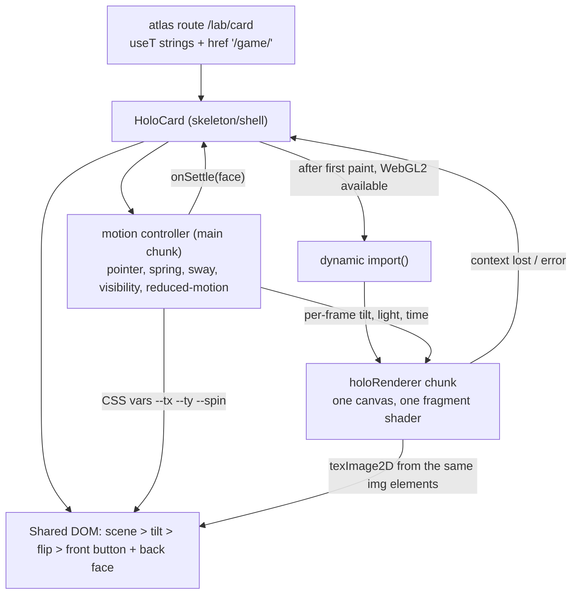
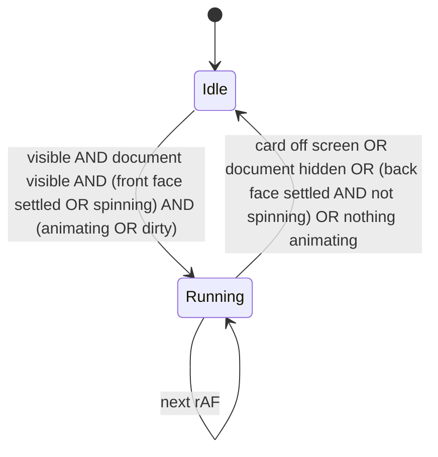

# Design Document

## Overview

This design builds the "True" card as a reusable component, `HoloCard`, in `skeleton/src/shell/`, and shows it on a hidden atlas page at `/lab/card`. It follows `requirements.md` and was written against the code as it is today.

The card has two renderers that share one DOM and one motion controller:

1. **HTML renderer.** Server-rendered `` layers, CSS transforms driven by custom properties (hover tilt and a free spin angle). It is the first paint and the permanent fallback.
2. **WebGL renderer.** A lazily loaded chunk that draws the same layers, plus embers, fog, metal gold, foil, sparkles, sweep, rim light and vignette, into one `<canvas>` using WebGL2 and one fragment shader. No three.js.

The visible word "True", the back face text, the link and the buttons are always HTML. They are never drawn in the canvas.

### Findings from the repo that shape the design

| Finding | Where | Consequence |
|---|---|---|
| `assetUrl` has no `shell-` branch. A `shell-card-…` id falls into the `<legend>-<surface>-` regex and throws `AssetIdError`. | `skeleton/src/assets/assetUrl.ts` | Add one branch: `shell-*` → `/media/shell/<id>.webp`. |
| The build copy walks every `.webp` under `assets/` and copies only files whose path equals `assetUrl(id)`. Other files are skipped with a warning. | `apps/atlas/vite.media.ts` (`writeBundle`, `mediaFile`) | Once `assetUrl` knows `shell-`, `assets/shell/` is copied by the existing code. No change to `vite.media.ts` (R1.4). The dev middleware serves it the same way. |
| `imageUrl(id, base, {axis, n})` and `responsiveImage({id, base, axis, steps, width, height, sizes})` exist. With an empty base `responsiveImage` returns `null` and `imageUrl` returns `assetUrl`. | `skeleton/src/assets/imageCdn.ts` | The card uses `responsiveImage` for the CDN case and `assetUrl` for the plain case. No new CDN code. |
| The CDN base reaches components through `ImageBaseContext` / `useImageBase()`. The atlas root provides it from the root loader. | `skeleton/src/assets/imageBaseContext.ts`, `apps/atlas/src/routes/__root.tsx` | `HoloCard` calls `useImageBase()`. No prop for it. |
| CSP is `img-src 'self' data: https://ik.imagekit.io` and `connect-src 'self'`. | `skeleton/src/deploy/vercelRules.ts` | Textures must come from `` elements, never `fetch`/`createImageBitmap(url)`. R11.8 holds. |
| The shared shell entry is `@kiroween/skeleton/shell` (browser-safe). The main entry `.` also exports database and parser code. Both apps already import `PendingView`/`ErrorView` from `/shell`. | `skeleton/package.json`, `skeleton/src/shell/index.ts`, `apps/*/src/router.tsx` | `HoloCard` is exported from `@kiroween/skeleton/shell`, not from the main entry (see Design Decisions, D1). |
| Reduced motion has two sources in the codebase: `@media (prefers-reduced-motion: reduce)` and `html[data-motion='reduce']`. `ui.css` sets `--motion: 0` and `animation: none !important` for both, but does not touch `transition`. The game writes the attribute; the atlas has no toggle yet but honours the attribute in CSS. | `skeleton/src/design/ui.css`, `apps/game/src/lib/motion.ts` | The card reads both sources. The reduced-motion crossfade is a CSS `transition` on opacity, so it survives `ui.css`. The spin itself is driven by JavaScript through `--spin`, not by a transition, and is switched off by the reduced-motion hook and by CSS. |
| Skeleton source test bans `Math.random`, `Date.now`, `new Date(` and `crypto.random` in `skeleton/src/**/*.ts`. | `skeleton/test/rng.test.ts` | Timing uses the rAF timestamp. Embers and sparkles use a hash in the shader. No ambient randomness. |
| Atlas tests scan `apps/atlas/src` for physical CSS (`left:`, `ml-*`, …) and for hard-coded UI text in `.tsx`. `ui-import.test.ts` requires the `@layer` line first and `ui.css` imported once. A save hook (`physical-css-check`) reports physical left/right CSS in `apps/` and `skeleton/`. | `apps/atlas/test/*`, `.kiro/hooks` | New CSS uses logical properties only. New atlas text goes through the catalog. The new CSS import is added after `ui.css` and does not change the first line. |
| `assets/shell/shell-card-frame-01.webp` is 1,047,750 bytes. Background 199,056, subject 426,430, back 347,092. | `assets/shell/` | Without the CDN the front layers alone are about 1.67 MB. The 350 KB and 600 KB budgets can only hold with the CDN on (see Risks, K1). |
| `vercelRules.ts` has no `/lab` rule and the atlas has no `robots.txt` or sitemap. | `skeleton/src/deploy/vercelRules.ts`, `apps/atlas/public` | `noindex` is a `<meta name="robots">` from the route's `head()`. Nothing links to the page, so there is no sitemap entry to remove (R13.2, R13.3). |

## Architecture



### Layer and box geometry

The card's visible shape is the opaque outline of the frame, not the full 1000×1400 image. The frame image is opaque from about x 22 to 978 and y 41 to 1360. The component box (the "stage") is that outline rectangle, and the images are positioned larger than the stage and clipped by it.

Constants (one `geometry.ts` module, used by CSS-in-TSX and by the shader uniforms):

| Name | Value |
|---|---|
| Art size | 1000 × 1400 (frame, subject, back), 1200 × 1680 (background, same 5:7 ratio) |
| Outline | x 22 to 978, y 41 to 1360, so 956 × 1319 |
| Stage aspect ratio | 956 / 1319 |
| Art box inside the stage | inline offset −2.3013%, inline size 104.6025%, block offset −3.1085%, block size 106.1410% |
| Cartouche text box (art units) | x 410 to 590, y 1215 to 1300, so inline start 41%, width 18%, block start 86.79%, height 6.07% of the art box |

All three offsets are symmetric left to right, so `inset-inline-start` gives the same picture in RTL. The painted card is never mirrored.

`--u` is defined on the card root as `calc(100cqw / 956)` (one outline unit). Descendants use `calc(N * var(--u))` for sizes. Because `--u` is an unregistered custom property, `cqw` resolves at the point of use, inside the container, which is what is wanted. The outline corner radius is `--holo-radius`, default `calc(var(--radius-ui) * 2)`, tuned against the screenshots in Verify.

### DOM structure

```
div.holo-scene            container-type: inline-size; perspective: 1400px; aspect-ratio: 956/1319; cursor: grab; user-select: none
 └ div.holo-tilt          preserve-3d; rotateX/rotateY from --tx --ty
    ├ div.holo-shadow     aria-hidden; sized to the stage; box-shadow from --shadow-sheet
    └ div.holo-flip       preserve-3d; data-face="front|back" (settled face); rotateY(var(--spin))
       ├ button.holo-front.holo-face        aria-label = strings.name; inert when back shown
       │   ├ span.holo-art                  the three  layers + effect overlay (HTML renderer)
       │   ├ canvas.holo-canvas             added by the WebGL chunk, aria-hidden
       │   └ span.holo-title                "True" engraved text over the cartouche
       └ div.holo-back.holo-face            inert when front shown
           ├ img (Back_Layer)               alt=""
           └ div.holo-back-body             plate + h2 title, p line, a.btn link, button.btn "Turn back"
```

- The clip (`overflow: hidden; border-radius: var(--holo-radius)`) is on each face, not on the button's outline path, so the focus ring is not clipped. The ring is the shared `:focus-visible` rule from `ui.css`, applied to the front button, which is the stage-sized box.
- `.holo-shadow` is a separate sibling because `filter: drop-shadow` on a parent of a `preserve-3d` element would flatten the flip.
- Layer images inside `.holo-art`, back to front: background, subject, frame, effect overlay. Fog, embers, foil, sparkles, sweep, rim light and vignette exist only in the WebGL renderer, so the HTML overlay has only the inner shadow and a fixed soft vignette.
- Server-rendered, so first paint is complete without JavaScript apart from hydration.

## Components and Interfaces

### Files

| File | Change |
|---|---|
| `skeleton/src/assets/assetUrl.ts` | Add `shell-` branch and update the doc comment. |
| `skeleton/src/shell/HoloCard.tsx` | New. The component. |
| `skeleton/src/shell/holoCard.css` | New. Layout, flip, tilt, inner shadow, title, back face, reduced motion. Logical properties and tokens only. |
| `skeleton/src/shell/holo/geometry.ts` | New. Constants above, layer sizes, steps, `sizes` attribute. |
| `skeleton/src/shell/holo/motion.ts` | New. Pointer handling, spring, sway, visibility, reduced-motion source, rAF loop. |
| `skeleton/src/shell/holo/useReducedMotion.ts` | New. `useSyncExternalStore` over both reduced-motion sources. |
| `skeleton/src/shell/holo/renderer.ts` | New, lazy chunk. WebGL2 setup, textures, uniforms, draw. |
| `skeleton/src/shell/holo/shader.ts` | New, same lazy chunk. Vertex and fragment source as string constants. |
| `skeleton/src/shell/index.ts` | Export `HoloCard` and its prop types. |
| `skeleton/package.json` | Add export `"./shell/holo-card.css": "./src/shell/holoCard.css"`. |
| `apps/atlas/src/routes/lab.card.tsx` | New. Hidden route. |
| `apps/atlas/src/i18n/en.ts` | Add the card string keys. `ar.ts` stays empty (falls back to English). |
| `apps/atlas/src/styles.css` | Import `holo-card.css` after `ui.css`. Add a few page rules for `.lab-card-page`. |
| `apps/atlas/src/routeTree.gen.ts` | Regenerated by the TanStack plugin on the next dev or build run. Not hand-edited. |
| `docs/shell-1-handover.md`, `docs/kiro-usage.md` | Written at the end of Verify (R16.8, R16.9). |

No change to `vite.media.ts`, `vercelRules.ts`, `client.ts`, `content/`, `assets/`, the database or any game code.

### `assetUrl` change

```ts
// after the hub/tutorial line:
if (id.startsWith('shell-')) return `${MEDIA_PREFIX}shell/${id}.webp`;
```

The branch comes before the `<legend>-<surface>-` regex. `shell-card-true-bg-01` becomes `/media/shell/shell-card-true-bg-01.webp`. The `-w1000` hero-copy rule matches only `-hero-` ids, so shell ids get no extra copy.

### `HoloCard` props

```ts
export interface HoloCardStrings {
  title: string;     // "True"
  line: string;      // "The answers live only in the atlas. Find them before dawn."
  link: string;      // "Play the game"
  name: string;      // "True: play the game"  (accessible name of the front button)
  turnBack: string;  // "Turn back"
}
export interface HoloCardLayers {
  background: string; // asset id, e.g. 'shell-card-true-bg-01'
  subject: string;    // 'shell-card-true-subject-01'
  frame: string;      // 'shell-card-frame-01'
  back: string;       // 'shell-card-back-01'
}
export interface HoloCardProps {
  layers: HoloCardLayers;
  strings: HoloCardStrings;
  href: string;       // '/game/'
  className?: string;
}
export function HoloCard(props: HoloCardProps): JSX.Element;
```

The component has no other inputs and imports nothing from `play/`, `generator/`, `model/` or `db/` (R2.3). It imports only `../assets/assetUrl.ts`, `../assets/imageCdn.ts` and `../assets/imageBaseContext.ts`. The card art geometry (sizes, outline) is a constant of the card art, so image sizes are not props.

### Image requests (R1.2, R1.3, R12)

For each layer, `HoloCard` builds `` attributes:

- CDN on: `responsiveImage({ id, base, axis: 'w', steps: HOLO_STEPS, width, height, sizes: HOLO_SIZES })` gives `src`, `srcSet`, `sizes`. `HOLO_STEPS = [360, 420, 480, 560, 640, 800, 1000, 1200]`. `HOLO_SIZES` is `min(100vw, 28rem)` scaled for the art box (about 1.1 times the stage width).
- CDN off: `src = assetUrl(id)`, no `srcset`.
- `crossOrigin="anonymous"` is set on all layer images when a base exists, so the same elements can be uploaded as WebGL textures without tainting. It is harmless on same-origin URLs.
- `alt=""`, `decoding="async"`, explicit `width`/`height` attributes, `draggable={false}`.
- The three front layers load eagerly. The Back_Layer `` gets no `src` until the card is armed (first `pointerenter`, `focus` or `pointerdown` on the scene), then it loads. The back face has a `--color-surface` background until the image arrives, so a tap that flips immediately is not blank. Verify reports payload both "at load" and "after first flip".

### Tilt, spin, spring, sway (R4, R8)

`motion.ts` owns two independent states: the hover tilt `{ x, y, vx, vy }` in normalised units (−1 to 1 equals ±12° of rotation, and `y` may reach ±5/3, which is ±20°, while a drag is in progress) and the spin (see "Free spin" below).

- **Hover pointer.** A mouse `pointermove` over `.holo-scene` with no button pressed sets the tilt target to the pointer's position relative to the card centre, clamped to [−1, 1], as before (R8.1). `pointerleave` and `pointercancel` set the target to the sway value (zero when reduced).
- **Press.** `pointerdown` on the scene starts a press for mouse, pen and touch. For touch it calls `setPointerCapture` (R8.11); mouse and pen capture too once the drag starts so the drag survives leaving the card. The faces have `touch-action: none`, so only a touch that starts on the card is kept from scrolling the page (R8.7). The press records the start position and the current spin state.
- **Tap versus drag.** The pointer path length is tracked. If it exceeds the 10 px Drag_Threshold, an `onClickCapture` handler on the scene swallows the click that follows `pointerup`, so a drag never flips the card or activates the link (R8.10). A press whose path stays within 10 px produces the normal button click and flips (R8.4).
- **Drag tilt.** While a drag is in progress the tilt target is `x = 0` (the vertical-axis rotation belongs to the spin) and `y = clamp(py · 5/3, −5/3, 5/3)`, where `py` is the pointer's vertical offset from the card centre in [−1, 1]. This gives a little rotation around the horizontal axis, at most 20° (R8.3, R8.13). Parallax and shader inputs use the tilt clamped to [−1, 1].
- **Spring.** Semi-implicit Euler, stiffness 170, damping 24 (slightly under critical), `dt` clamped to 1/30 s. `step(state, target, dt)` is a pure function in `motion.ts`.
- **Sway.** Target while idle is `(sin(t·0.35)·0.18, cos(t·0.27)·0.14)`, so about ±2° with periods near 18 and 23 seconds. `t` is the rAF timestamp in seconds. Zero when reduced (R8.5, R10.1).
- **No sensors.** No `deviceorientation` or `devicemotion` listener anywhere (R8.6).
- **Output.** Each frame writes `--tx`, `--ty` (the tilt state) on `.holo-tilt` and `--spin` (the spin angle in degrees, as a `<n>deg` string) on `.holo-flip`. CSS does the rest:

```css
.holo-tilt { transform: rotateX(calc(var(--ty) * -12deg)) rotateY(calc(var(--tx) * 12deg)); }
.holo-flip { transform: rotateY(var(--spin, 0deg)); } /* no transition */
.holo-layer-bg      { transform: translate(calc(var(--tx) * -3.5cqw), calc(var(--ty) * -3.5cqw)) scale(1.08); }
.holo-layer-subject { transform: translate(calc(var(--tx) *  1cqw),   calc(var(--ty) *  1cqw)); }
```

The rotation signs are chosen so the card's surface turns toward the pointer; the corner screenshots in Verify confirm them. The pan maths uses physical x on purpose: the card is a fixed painted image and does not mirror in RTL (comment in the CSS, as the i18n rule allows). The frame layer has no transform (R4.3). The background is scaled 1.08 so a 3.5 cqw shift never exposes an edge (R4.4).

### Free spin (R8, R9)

The spin is one angle `θ` in degrees on the vertical axis with no limit (it grows past ±360 as the user keeps turning). `motion.ts` keeps `{ angle, velocity, mode, target }`, where `mode` is `rest | drag | inertia | settle | step`. All timing uses the rAF timestamp or `event.timeStamp`; there is no `Date.now` or `Math.random`.

- **Drag (R8.3).** Once the path exceeds 10 px the mode becomes `drag`. `angle = angleAtThreshold + (x − xAtThreshold) · SPIN_DEG_PER_PX`, so the card does not jump when the threshold is crossed. `SPIN_DEG_PER_PX = 180 / stageWidthPx` (dragging across one card width is a half turn); the stage width is read from the scene's `ResizeObserver`. The rotation follows the physical pointer direction, so it is the same in LTR and RTL. The sign is chosen so the front surface follows the pointer, and is confirmed in the Verify screenshots.
- **Velocity.** An exponentially smoothed estimate of `Δangle / Δt` over the last pointer samples (time constant about 60 ms, using `event.timeStamp`), clamped to ±1440°/s. A pointer that stopped for more than 80 ms before release gives zero velocity.
- **Release (R8.8).** On `pointerup` the mode becomes `inertia`: `velocity *= exp(−FRICTION · dt)` with `FRICTION = 3.2 /s`, `angle += velocity · dt`. When `|velocity|` falls below 60°/s, or at once if the release velocity is already below it, the mode becomes `settle`.
- **Settle.** The target is `round(angle / 180) · 180`. A spring with stiffness 120 and damping 20 (slightly under critical, so no visible overshoot beyond about 2°) pulls `angle` to the target. The motion ends when `|angle − target| < 0.05°` and `|velocity| < 1°/s`; the angle is then set exactly to the target and the loop reports settled.
- **Grab (R8.12).** A `pointerdown` while the mode is `inertia`, `settle` or `step` sets `velocity = 0`, enters `drag` for the angle, and marks the press as a grab. On release a grab always settles on the nearest face and its click is swallowed, so grabbing a spinning card never flips it.
- **Tap flip.** A click on the front button (including Enter and Space) calls `turnTo(settledIndex + 1)`; Escape and "Turn back" call `turnTo(settledIndex − 1)`, where `settledIndex = round(angle / 180)`. `turnTo(i)` sets the settle target to `i · 180` with the same settle spring starting from rest, so it takes about 0.7 s and uses the same code path as a released drag (R9.2).
- **Arrow keys (R9.11, R9.12).** `keydown` on `.holo-scene` handles `ArrowLeft` and `ArrowRight` (no modifier keys, `preventDefault`). Each press adds a 60° step to the target angle (`mode = step`, spring toward `target`). Key repeat keeps adding steps. 700 ms after the last step the mode becomes `settle` (target = nearest multiple of 180°). 60° was chosen so one press shows the other side of the card turning but returns to the same face after the pause, while two presses reach 120° and land on the other face. Direction follows the visual direction: `ArrowRight` moves the near surface toward the visual right, which is the same sign as dragging to the right, for both `dir="ltr"` and `dir="rtl"`. The handler never reads `dir` and never uses `ArrowLeft` as "next".
- **Reduced motion (R10.1).** When `useReducedMotion()` is true the drag handler does not rotate, there is no inertia, arrow keys are ignored, and the angle stays at the multiple of 180° of the settled face. The press still produces the click and flip by crossfade. If reduced motion turns on while the card is spinning, the angle snaps to the nearest multiple of 180° and the mode becomes `rest`.
- **Hidden document.** On `visibilitychange` to hidden while the mode is not `rest`, the controller jumps to the settle target and reports settled, because rAF does not run. This keeps focus and inert state correct.
- **Output.** Each frame writes `--spin` on `.holo-flip`. While `mode` is not `rest`, `.holo-scene` also gets `data-spinning="true"`; it is used for `cursor: grabbing` and nothing else.

**Settled face and callbacks.** `faceOf(angle) = (round(angle / 180) mod 2 === 0) ? 'front' : 'back'`, evaluated only when the mode returns to `rest`. `motion.ts` then calls `onSettle(face)`. React state `face` changes only in `onSettle`. So inert attributes, focus moves, the render pause and Escape handling all follow the settled angle (R9.13). While the card spins, neither face is made inert and focus does not move.

**Back face visible past 90°.** Both faces use `backface-visibility: hidden`, and the back face is pre-rotated 180° inside `.holo-flip`. The browser therefore hides the front face and shows the back face as soon as the spin angle passes 90° from the front (and the reverse at 270°), without any JavaScript or state change (R8.9). The visible face is a geometric fact of the 3D transform; the React `face` is the settled face.

### Flip, focus, inertness (R9)

State: `face: 'front' | 'back'` (React state, the settled face).

- Both faces are always in the DOM. The face that is not the settled face has the `inert` attribute, which removes it from the accessibility tree and the tab order (R9.6, R9.7). React 19 supports `inert` as a boolean prop. It is set in server markup, so first paint is correct.
- The front button's `onClick` handles click, tap, Enter and Space (a native button). It calls `turnTo(settledIndex + 1)` in `motion.ts`; it does not set `face` itself.
- 3D turn: `.holo-flip { transform: rotateY(var(--spin, 0deg)) }`, back face pre-rotated 180°, both faces `backface-visibility: hidden`. There is no CSS transition on `transform`, because JavaScript drives the angle every frame. This replaces the earlier discrete `data-face='back'` rotation and its 700 ms transition.
- **Focus after the turn.** When `onSettle(face)` reports a different face than before, `HoloCard` moves focus once: to the "Play the game" link when the new face is the back, to the front button when it is the front. This applies to taps, Enter, Space, drag releases, arrow steps and Escape (R9.3, R9.5). In the reduced-motion crossfade path a `transitionend` listener on `.holo-flip` (for `opacity`) with a 900 ms timer as a safety net does the same.
- **Escape / Turn back.** A `keydown` handler on `.holo-scene` calls `turnTo(settledIndex − 1)` on Escape while the settled face is the back. The "Turn back" button does the same. Both end with focus on the front button through `onSettle`.
- **Targets.** The front button is the whole card. The link and "Turn back" are `.btn` elements (`min-block-size: var(--target)` from `ui.css`, 44 px). All use the shared focus ring (R9.8).
- **Reduced motion (R9.9).** Under `@media (prefers-reduced-motion: reduce)` and `html[data-motion='reduce']` the `rotateY(var(--spin))` rule is replaced: `.holo-flip { transform: none }`, the faces stack, `data-face` selects which one has `opacity: 1`, and `opacity` changes with `transition: opacity 200ms`. In this mode a tap calls `turnTo` and `motion.ts` sets the settled face immediately instead of animating the angle, so `onSettle` fires on the next frame and the crossfade runs. This is a plain duration, not scaled by `--motion`, because `--motion` is 0 in these modes and the crossfade must still happen. It is a fade, not movement.

### Back face and contrast (R9.4, R9.10)

The title, line and link sit on a plate: `background: color-mix(in oklab, var(--color-bg) 82%, transparent)`, text in `--color-ink`, link as `.btn .btn-primary`. Worst case, if the image under the plate were pure white, the plate composites to about `#3b2f3b` (relative luminance about 0.04). Ink `#E9E1D3` (about 0.76) against that is about 9:1, above 4.5:1 by a wide margin. The link text is `--color-bg` on `--color-accent`, as every `.btn-primary` already is. The title is an `h2` in the display font. Back text uses `text-align: start` and logical padding.

### Engraved title on the front (R3.4)

`.holo-title` is a `span` positioned in the art box at the cartouche coordinates, `font-family: var(--font-display)`, `font-size: calc(62 * var(--u))`, `line-height: 1`, `white-space: nowrap`, colour `--color-bg`, `text-shadow: 0 calc(1.2 * var(--u)) 0 color-mix(in oklab, var(--color-glow) 55%, transparent)` for the light lower edge. It is inside the button, so it is part of the name already given by `aria-label` (name starts with "True"). It is `aria-hidden` because the label supplies the name. The size is tuned in Verify against the cartouche.

### Inner shadow of the frame (R3.3)

`.holo-frame { filter: drop-shadow(0 calc(0.6 * var(--u)) calc(1.4 * var(--u)) color-mix(in oklab, var(--color-bg) 70%, transparent)) }`. The frame is transparent in the window, so the shadow of its opaque part falls inward onto the picture. One element, no extra request. The WebGL shader reproduces the effect from the frame alpha (see Shader).

### WebGL renderer (R5, R6, R7, R11)

**Loading.** After hydration and once the three front images have `complete` and `decode()` resolved, `HoloCard` schedules `import('./holo/renderer.ts')` with `requestIdleCallback` (fallback `setTimeout`). Vite emits a separate chunk because the import is dynamic. The check `canvas.getContext('webgl2', { alpha: true, premultipliedAlpha: true, antialias: false, powerPreference: 'low-power' })` runs inside the chunk. A `null` context, a shader compile or link error, or a texture upload error (for example a CORS failure) leaves the HTML renderer in place with no visible change (R3.5).

**Surface.** One canvas, `position: absolute; inset: 0`, inside the front face, so it takes the same box, the same clip and the same 3D tilt as the HTML layers. When the first frame is drawn, `data-renderer="webgl"` is set on `.holo-scene` and CSS hides `.holo-art` with `visibility: hidden` (kept in the DOM so it can come back). The title span stays above the canvas.

**Resolution (R11.4).** Canvas size is the displayed CSS size times `min(devicePixelRatio, cap)`, with `cap = 1` when `(pointer: coarse)` matches and `1.5` otherwise. A `ResizeObserver` on the scene updates it.

**Textures.** Each layer `` is uploaded with `texImage2D` (premultiplied alpha, `UNPACK_PREMULTIPLY_ALPHA_WEBGL` on, mipmaps generated, `LINEAR_MIPMAP_LINEAR`). The renderer reuses the elements already loaded for the HTML layers, so there is no second download. It reads `img.currentSrc`'s decoded bitmap, whatever width step the browser chose.

**Single pass.** One full-screen triangle, one fragment shader, uniforms: `uRes`, `uTime`, `uTilt` (vec2), `uLight` (vec2), `uReduced`, `uSweep`, `uSpin` (radians, the spin angle modulo a full turn; added to the foil view-angle term and to the sweep position so the gold glints while the card turns), `uEmber1`, `uEmber2` (read from the computed `--color-accent` and `--color-glow` at start, so no hex in code), `uOutline` (vec4 of the outline in art UV), `uRadius`.

Order inside the shader (R4.5):

1. Background texture with the parallax offset and scale, sampled at `uv - tilt * 0.035 * k`.
2. Fog: two octaves of value noise, masked to the bottom third, drifting with `uTime`, low alpha.
3. Embers: 48 embers in 8 lanes of 6 (inside the 30 to 60 range). Each lane has a hashed x-phase; each ember rises with `fract(uTime * speed + hash)`. A fragment checks only its own and neighbouring lanes, so the cost per pixel is bounded. Colours alternate between `uEmber1` (accent `#E0A84B`) and `uEmber2` (glow `#F4D58D`) by hash. No images (R5.4).
4. Subject texture with the +1 cqw offset, composited over.
5. Frame texture, then the gold treatment (below).
6. Foil, sparkles (on the Gold_Mask only).
7. Sweep (additive, whole card).
8. Rim light and vignette.

**Gold treatment (R6).**

- `lum = dot(rgb, vec3(0.299, 0.587, 0.114))` and `warm = rgb.r - rgb.b`.
- `gold = smoothstep(L0, L1, lum) * smoothstep(W0, W1, warm)`. Alpha is not used. Plum backing has low luminance and low warmth, so it falls outside the mask and stays matte (R6.1, R6.5). The four threshold numbers are shader constants tuned against the actual frame in Verify.
- Bevel normal from the luminance gradient: four taps at ±1 texel (`dx`, `dy`), `n = normalize(vec3(-(lumR - lumL), -(lumU - lumD), k))`.
- Light direction `L` comes from `uLight` (pointer or tilt). Blinn-Phong specular `pow(max(dot(n, H), 0.), shininess) * gold`. The specular is multiplied by `smoothstep(lo, hi, lum)` so dark recesses stay dark (R6.4).
- Reduced motion: `uLight` is a fixed value and `uTilt = 0`, one frame is drawn, no loop (R6.6, R3.7).

**Foil, sparkles, sweep, edges (R7).**

- Foil: thin-film palette `0.5 + 0.5 * cos(6.28318 * (phase + vec3(0., .33, .67)))`, `phase = view-angle term + lum`. Strength is `0.12 * smoothstep(0., 0.15, length(uTilt))`, so it is zero at rest (R7.6) and applied only where `gold > 0`.
- Sparkles: `h = hash(floor(uv * 220.))`; a cell lights when `fract(h + dot(uTilt, vec2(3.1, 2.3))) > 0.985`. They blink as the tilt changes and stay still at zero tilt. Gold mask only.
- Sweep: `d = dot(uv - 0.5, normalize(vec2(1., -0.6)))`, `band = exp(-pow((d - pos) / 0.12, 2.))`, `pos = clamp(uTilt.x * 0.6 + uTilt.y * 0.4, -1, 1) * 0.55 + uSweep`. `uSweep` runs from −0.9 to 0.9 once over about 1.4 s after the first frame while the card is on screen and not reduced (R7.4), then stays at 0.
- Rim light: signed distance to the rounded outline rectangle, `smoothstep` over about 1.5 outline units, scaled by the light direction. Vignette: radial darkening of about 18% at the corners.
- Inner shadow: for pixels with frame alpha below 1, eight alpha taps on a ring of radius about 1.4 units; the average darkens the picture by up to 0.45. This matches `drop-shadow` in the HTML path.

**Render policy (R11.5 to R11.7, R11.9).**



- Off screen: an `IntersectionObserver` on the scene. Document hidden: `visibilitychange`. Both stop the rAF loop and cancel the pending frame.
- Back face settled: rendering pauses when `onSettle('back')` fires, that is once the spin has stopped on the back. Frames keep being drawn while the spin runs, because the front canvas is visible until the angle passes 90°. Rendering resumes with a dirty frame as soon as the spin starts again (drag, arrow step or turn back), and the front face is drawn when it settles.
- "Animating" means any of: the tilt spring not settled (`|pos| + |vel|` above 0.002), the spin mode not `rest`, a sweep running, sway enabled, embers enabled, a resize or texture update pending. In reduced mode only the first and last apply, so a still card renders no frames.
- With embers and sway on, the loop runs continuously. When the pointer is idle for 1 s the loop drops to 30 fps (it skips every second rAF). Pointer activity restores 60 fps. This keeps idle battery cost low while the embers are visible.
- The motion loop and the render loop share one rAF. The renderer registers a `draw(state, time)` callback with `motion.ts`; the callback is removed when the renderer is destroyed.

**Context loss and cleanup (R3.6).** `webglcontextlost` calls `preventDefault()`, destroys the renderer, removes the canvas, clears `data-renderer`, and the HTML layers show again. The renderer is not restored automatically. On unmount the observers, listeners and the rAF are removed and the GL resources are deleted.

### Reduced-motion source (R10)

`useReducedMotion()` is a `useSyncExternalStore` over two inputs:

1. `matchMedia('(prefers-reduced-motion: reduce)')` with a `change` listener.
2. `document.documentElement.dataset.motion === 'reduce'`, watched with a `MutationObserver` on the `data-motion` attribute of `<html>`.

The result is `system || attribute`. The server snapshot is `false`, and the hook only affects JavaScript behaviour (tilt, sway, embers, sweep, whether the loop runs). The visual choice between 3D flip and crossfade is made by CSS from the same two sources, so server markup never mismatches. Changes apply without a reload (R10.2, R10.3). The atlas has no toggle today, and none is added in this phase. Verify exercises the attribute path by setting `data-motion` from the script.

### Atlas route `/lab/card` (R13, R14)

`apps/atlas/src/routes/lab.card.tsx`:

```tsx
export const Route = createFileRoute('/lab/card')({
  head: () => ({ meta: [{ name: 'robots', content: 'noindex, nofollow' }] }),
  component: LabCard,
});
function LabCard() {
  const t = useT();
  return (
    <section className="lab-card-page">
      <HoloCard
        layers={{ background: 'shell-card-true-bg-01', subject: 'shell-card-true-subject-01', frame: 'shell-card-frame-01', back: 'shell-card-back-01' }}
        strings={{ title: t('shell.card.true.title'), line: t('shell.card.true.line'), link: t('shell.card.true.link'), name: t('shell.card.true.name'), turnBack: t('shell.card.turnBack') }}
        href="/game/"
      />
    </section>
  );
}
```

- The page is a plain `<a>`-targeted `/game/` link (not a router `Link`), the same way `HomeView` and `SiteHeader` reach the game.
- No link, header entry, footer entry, sitemap or `robots.txt` Disallow line is added. A Disallow line would publish the path.
- Layout, in `styles.css`, logical properties only:

```css
.lab-card-page {
  display: grid;
  place-items: center;
  min-block-size: calc(100dvh - var(--app-header-h));
  padding-block: var(--space-4);
  padding-inline: var(--space-4);
}
.lab-card-page > .holo-scene {
  inline-size: min(100%, 26rem, calc((100dvh - var(--app-header-h) - 2 * var(--space-4)) * 956 / 1319));
}
```

  At 390×844 the card is 358 px wide and about 494 px high. At 1280×800 the height limit gives about 502 px wide by 692 px high, capped at 26 rem (416 px wide, 574 px high). Both fit the first screen with no horizontal overflow. The body already uses `--color-bg` (the hub background), so the card is centred on it (R13.4).
- The root `Shell` (skip link, `SiteHeader`, footer) still wraps the page. The `Mood` candle and fog overlay are also present and appear in the screenshots.

### Strings (R14)

New keys in `apps/atlas/src/i18n/en.ts` (for owner review; `ar.ts` falls back to English per key):

| Key | English |
|---|---|
| `shell.card.true.title` | True |
| `shell.card.true.line` | The answers live only in the atlas. Find them before dawn. |
| `shell.card.true.link` | Play the game |
| `shell.card.true.name` | True: play the game |
| `shell.card.turnBack` | Turn back |

`HoloCard` renders only strings it is given. The only literal text in its source is the (empty) image alt.

### Fixes after review (R17 to R21)

These notes change the sections above where they conflict.

- **Back face (R17).** Replaces "Back face and contrast". The full-width plate is removed. The back text is one centred block (`h2`, line, link, "Turn back") with logical padding, placed in the empty lower half of the back image and kept inside the inner edge of the gold border by an inline inset measured in `--u` units from the art (tuned against `back-390.png` and `back-1280.png`). Contrast comes from a soft dark glow behind the block only: a `radial-gradient` or `text-shadow` using `color-mix(in oklab, var(--color-bg) …, transparent)`, with no `background` on any element that spans the card width. The block never reaches the border, so the border and corner ornaments stay uncovered. Buttons keep `min-block-size` and `min-inline-size` of 44px. The 4.5:1 check uses the glow's darkest-to-lightest case rather than the old plate figure.
- **Cartouche word (R18).** Replaces the `font-family: var(--font-display)` choice in "Engraved title on the front". The display face has a swash T that reads as "I". `.holo-title` uses the body serif (`var(--font-body)`), `font-variant-caps: all-small-caps` (or uppercase if the face lacks small caps), `letter-spacing` of about `0.18em`, and is centred in the cartouche box with a flex or grid centre. The engraved colour and light lower edge stay. The accessible name is unchanged (`aria-hidden` word, name from `aria-label`). Font size is tuned so the word fits the box at x 410 to 590.
- **Never empty (R19).** Each layer `` carries `data-ready`, set when `decode()` resolves, or at hydration when `img.complete` is already true. CSS shows a layer when it is ready (`opacity` 0 to 1, short fade, none under reduced motion). The renderer sets `data-renderer="webgl"` only after (1) all three front textures are uploaded, (2) one full frame is drawn, and (3) that frame has been presented, which is two `requestAnimationFrame` ticks after the draw. If `document.hidden`, steps (2) and (3) wait for `visibilitychange`, so the HTML layers stay. The canvas is shown first and the HTML art is hidden on the following frame, so the canvas always covers the art during the swap. On failure or context loss the HTML layers stay or return, as before.
- **Fit (R20).** `.lab-card-page` reserves a bottom gap of at least `--space-6` (24px or more) under the card in the height formula, in addition to the existing block padding, so the card shrinks by height first at 1024×768. Only `apps/atlas/src/styles.css` changes, in `@layer ui`.
- **Verify fixes (R21).** A closing task that runs typecheck and tests once and takes only the new screenshots listed in R21.3, using the existing `.debug/shell-1/` script setup. No new tests.

## Data Models

There is no database or server data. The only models are in-memory.

```ts
// geometry.ts
export const ART = { w: 1000, h: 1400 } as const;
export const BG_ART = { w: 1200, h: 1680 } as const;
export const OUTLINE = { x0: 22, x1: 978, y0: 41, y1: 1360 } as const;
export const HOLO_STEPS = [360, 420, 480, 560, 640, 800, 1000, 1200] as const;
export const TILT_MAX_DEG = 12;
export const DRAG_TILT_MAX_DEG = 20;       // horizontal-axis rotation while dragging
export const DRAG_THRESHOLD_PX = 10;
export const SPIN_FRICTION = 3.2;          // 1/s, inertia decay
export const SPIN_MAX_VELOCITY = 1440;     // deg/s
export const SPIN_SETTLE_BELOW = 60;       // deg/s, inertia hands over to the settle spring
export const SPIN_SETTLE_SPRING = { stiffness: 120, damping: 20 } as const;
export const ARROW_STEP_DEG = 60;
export const ARROW_IDLE_MS = 700;
export const PARALLAX = { background: 3.5, subject: 1.0 } as const; // percent of card width at full tilt

// motion.ts
export interface TiltState { x: number; y: number; vx: number; vy: number } // x,y in [-1, 1]
export type Face = 'front' | 'back';
export type SpinMode = 'rest' | 'drag' | 'inertia' | 'settle' | 'step';
export interface SpinState { angle: number; velocity: number; mode: SpinMode; target: number } // degrees, unbounded
export type RendererKind = 'html' | 'webgl';
```

Image ids are the existing `assets/shell/*.webp` files. Nothing is written to `assets/` or `content/`.

## Error Handling

| Situation | Behaviour |
|---|---|
| Invalid asset id passed in `layers` | `assetUrl` throws `AssetIdError` during render. The page's error boundary shows the shared `ErrorView`. The route passes constants, so this is a programming error. |
| `IMAGE_CDN_URL` invalid | Already rejected by the atlas server env with `EnvError`; unchanged. |
| No WebGL2, shader error, texture upload error | HTML renderer stays. No message, no console noise. |
| CDN images blocked by CORS for texture upload | Same as above. The card looks like the HTML version. Recorded as a finding in the handover (K2). |
| WebGL context lost | Canvas removed, HTML renderer shown (R3.6). |
| Layer image fails to load | The `` is empty, the stage shows `--color-surface` behind it. The card stays usable (flip, link). |
| `transitionend` never fires | A 900 ms timer moves the focus. |
| `localStorage` / sensors | Not used. |
| Hydration | Server markup and first client render are identical (all faces and inert attributes are derived from initial state; reduced-motion differences are CSS only). |
| Back image not yet loaded when flipping | Plate and text show on `--color-surface`; the image fades in when decoded. |

## Testing Strategy

**No tests are written in this phase** (requirements R16.1, R16.11; owner instruction). Property-based testing does not apply anyway. The work is DOM layout, CSS and a fragment shader, whose behaviour is visual and does not reduce to "for all inputs P(x)". The pure helpers (`step`, `assetUrl`'s `shell-` branch) are small and are covered by the existing suites running once in Verify. For that reason this document has no Correctness Properties section and the prework step was not run.

Existing suites that this change touches, all run once by `pnpm -r test`:

- `skeleton/test/asset-url.test.ts` (refusal cases stay refused; no shell id is in them).
- `skeleton/test/rng.test.ts` (no banned calls in `skeleton/src/**/*.ts`).
- `apps/atlas/test/logical-css.test.ts`, `i18n.test.ts`, `boundaries.test.ts` (the route adds no physical CSS, no literal text and no `/game` route), `ui-import.test.ts`.

**Verify task** (the only final task, R16.2 to R16.9). A throwaway Playwright script in `.debug/shell-1/`, run against a production build (`pnpm --filter` atlas build, then `apps/atlas/scripts/serve-build.mjs`, with the env set in the shell because that script does not read `.env`):

1. `pnpm -r typecheck` and `pnpm -r test`, once.
2. Screenshots at 390×844 and 1280×800: still, tilted to each corner (four), back face, a mid-spin frame (card dragged to about 120° with the back visible), reduced motion (system emulation and `data-motion='reduce'`), and WebGL off (context creation blocked).
3. A 5 s video per size: pointer movement, a mouse drag spin released with speed (showing inertia and settle on a face), a flip, a flip back. At 390×844 the drag spin is a touch-pointer drag.
3a. An RTL run (`dir="rtl"` on `<html>`) at both sizes covering a drag to the right and to the left (the card follows the physical pointer direction), `ArrowRight` and `ArrowLeft` (each rotates toward its visual direction), and the screenshots showing both faces unmirrored (R16.12).
4. rAF sampling for 5 s during pointer movement, unthrottled and with 4× CPU throttle, reporting median and slowest 5% frame times, against the 22 ms target.
5. A list of every network request of the page with transfer size, at load and after the first flip, at both sizes, at device pixel ratio 1.
6. Keyboard run: Tab reaches the card, Enter flips, focus is on the "Play the game" link, Escape flips back and focus returns to the front button. Also `ArrowRight` and `ArrowLeft` steps, settling after 700 ms (one press returns to the same face, two presses land on the other face and move focus to the link), plus a check that a drag that settles on the back moves focus to the link and sets `inert` on the front face.
7. Chunk size: gzip the emitted lazy chunk from `apps/atlas/dist/client/assets`.
8. `docs/shell-1-handover.md` and a short `docs/kiro-usage.md` entry. No commit and no push (R16.10).

## Design Decisions

| # | Decision | Reason |
|---|---|---|
| D1 | Export `HoloCard` from `@kiroween/skeleton/shell`, not from the main `@kiroween/skeleton` entry. | R2.4 says "exported from `@kiroween/skeleton`". The existing browser-safe entry for shared components is the `/shell` subpath; the main entry also exports database and parser code and is not safe to import in browser components. The package is the same. **The owner should confirm this reading of R2.4.** |
| D2 | The stage is the frame's opaque outline (956×1319), with art positioned larger and clipped. | The card's real shape is the outline. A focus ring, clip, rim light and page sizing all line up with it without extra masks. |
| D3 | Reuse the HTML `` elements as WebGL texture sources. | No second download, so the payload budget counts each image once, and CSP `connect-src 'self'` is not involved. |
| D4 | WebGL2 only, with the HTML renderer as the answer to everything else. | Smaller shader and chunk (mipmaps and derivatives are built in); WebGL1-only browsers get the full fallback. |
| D5 | The reduced-motion WebGL path draws one lit still frame. | R3.7 allows HTML or a still lit frame. A still frame keeps the metal look for these users at the cost of one draw. |
| D6 | The Back_Layer is not requested until the card is armed (hover, focus or pointer down). | Keeps the at-load payload to three images. |
| D7 | Idle rendering drops to 30 fps. | Embers and sway never stop while the card is visible, so the standing cost is cut in half. |
| D8 | `noindex` by meta tag only; no `X-Robots-Tag` rule and no `robots.txt` entry. | A header rule would change `vercelRules.ts` (shared deploy config with its own tests) and a Disallow line would publish the path. The meta tag meets R13.2. |
| D9 | No in-app reduced-motion toggle is added. | Out of scope. The card observes the existing `data-motion` attribute. |
| D10 | The spin angle is a JavaScript-driven CSS variable, not a CSS transition. The settled face (not the visible face) drives inert, focus and the render pause. | A drag, inertia and a tap flip then share one code path and one angle. The visible face during a spin is decided by `backface-visibility`, which is exact at 90°, and accessibility state changes once, when the card stops. |
| D11 | Arrow keys step by 60° and settle after 700 ms; they do nothing under reduced motion. | 60° is visible but returns to the same face on a single press, and two presses cross 90°. Reduced-motion users keep Enter, Space and tap, which flip by crossfade. |
| D12 | Drag rotation follows the physical pointer direction in RTL; arrow keys follow the visual direction. | The card is a painted object that is never mirrored, so physical and visual directions are the correct reference. |

## Risks and open points

- **K1. Payload budgets depend on the CDN.** The original files sum to about 2.0 MB (frame alone about 1.05 MB), and they may not be resized in the repo (R1.5). The 350 KB (390 px) and 600 KB (1280 px) budgets can only be met through ImageKit width transforms. The CDN fetches from the deployed `/media/` origin, so it cannot be exercised from a local build. Verify will report the CDN-off numbers from the local build, which will exceed the budgets, and mark the budgets as measured only on a deployment with `IMAGE_CDN_URL` set, or as unmeasured if none is available. My estimate with the CDN on at 390 px and DPR 1 is roughly 250 to 330 KB for the three front layers, which is close to the limit. The levers inside the rules are the step list and the deferred back image. Changing JPEG/WebP quality would need a change to shared `imageCdn.ts` and is not planned.
- **K2. CORS for CDN textures.** Uploading CDN images as textures needs the CDN to send CORS headers for `crossOrigin="anonymous"` requests. I have not verified this for ImageKit. If it fails, the card falls back to the HTML renderer on the CDN and the WebGL look is not seen there. Verify cannot detect this locally.
- **K3. Gold mask thresholds and the cartouche size are tuned, not derived.** I have not sampled the frame's pixels in this design. The constants (`L0`, `L1`, `W0`, `W1`, shininess, `--holo-radius`, title font size) are set during implementation and checked in the screenshots.
- **K4. 22 ms at 4× CPU throttle** is a CPU measurement. The fragment shader cost (48 embers, 8 gold taps, 8 shadow taps) is bounded per pixel and the canvas is capped at 1 DPR on phones, but the final number is only known after Verify. If the budget fails, the first cuts are the inner-shadow taps and the fog octave.
- **K5. Touch drag on the card blocks scroll** for touches that start on it (R8.7), and now also spins the card. At 390×844 the card covers most of the width, so scrolling starts from the page margin or below the card.
- **K6. Spin tuning.** `SPIN_DEG_PER_PX`, `SPIN_FRICTION`, the settle spring and the 60° arrow step are starting values. They are tuned against the Verify video and recorded in the handover. A spin of several turns is possible (no limit), so inertia from a hard fling can run for about 1 to 2 s at the 1440°/s cap.
- **K7. Hit testing during a spin.** While the card is between faces, pointer events land on whichever face the browser considers front-facing. Taps during a spin are handled as grabs (R8.12), so this has no visible effect, but the handover should record any case where a tap activates the wrong control.
