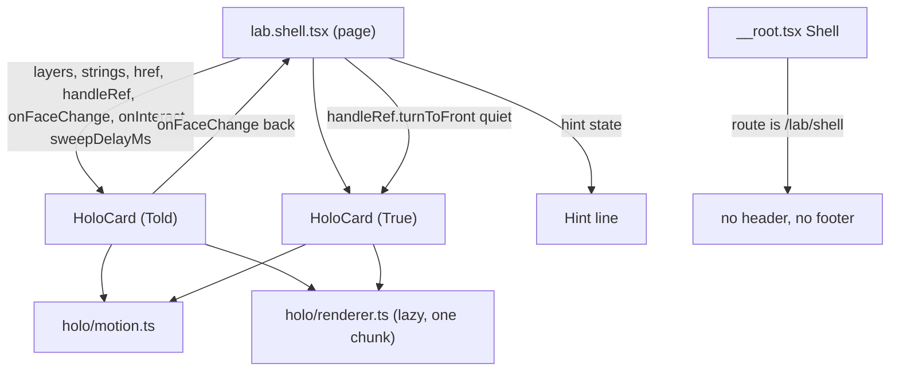

# Design Document

## Overview

The entry page is one new route, `apps/atlas/src/routes/lab.shell.tsx`, that renders two `HoloCard` instances. All card behaviour stays in `skeleton/src/shell/`. The page owns layout, the heading, the hint, the entrance and the "one back face at a time" rule. `HoloCard` gains a small set of optional props and two production fixes. No server call, no new storage, no new dependency.

Decisions:

- **D1. Fixes first.** Both production fixes touch `HoloCard.tsx` and `geometry.ts`; they land before the new props so the later tasks build on the fixed code.
- **D2. Card pair coordination lives in the page**, through two optional props on `HoloCard` (`onFaceChange`, `handleRef`) and no shared store. The skeleton keeps no knowledge of a second card.
- **D3. Entrance lives in the page** (a wrapper per card animated with CSS). `HoloCard` only gets `sweepDelayMs` to stagger the one-time sweep.
- **D4. Preview lives in `HoloCard`**, derived from `layers.background`, so `/lab/card` benefits too.
- **D5. "Continue" is skipped.** The game keeps `kiroween.guest.runs.v1` (finished runs), `kiroween.guest.tutorial.v1` and `kiroween.guest.tutorial.play.v1` in local storage. None holds a last-world value, and the legend name needs `getHome` (a database read). Building it needs a game change, which this phase may not make.
- **D6. Header and footer are hidden** on `/lab/shell` in `Shell` of `__root.tsx` by route, since the request says no site header and the footer would force vertical scroll at 667x375.
- **D7. Cap is 800 px.** With the art box at most 30.8 rem (493 px at 16 px root), 1.5 times is 739 px and the next step is 800. This is stricter than the "w1000 on desktop" upper bound in the request and still within it. The canvas is at most 1.5 DPR times about 480 px, so the texture is not undersampled in a visible way; the Verify task checks the look.
- **D8. Subject fit.** The Told subject spans roughly x 225 to 775 and y 660 to 1150 of a 1000x1400 canvas, which is lower and smaller than True and ends above the cartouche (y 1215). No scale or shift lever is added. If the screenshot check fails, the fix needs a new asset, which is a blocker for the handover.

## Architecture



The motion controller already registers pointer listeners on its own scene element and runs one shared rAF loop with an IntersectionObserver per card. That gives the "hovered card full effect, other card sway only" and "idle only on screen" behaviour without change; the HoloCard task confirms it and changes nothing there.

## Components and Interfaces

### Fix 1: cold-load renderer start

New file `skeleton/src/shell/holo/imageReady.ts`:

```ts
export const IMAGE_WAIT_MS = 10_000;
/** Resolves when the image has a decoded size. Rejects on `error` or after `timeoutMs`. */
export function waitForImage(img: HTMLImageElement, timeoutMs?: number): { promise: Promise<void>; cancel(): void };
```

Rules: if `img.complete && img.naturalWidth > 0`, resolve after `decode()` (a rejecting `decode()` still resolves). If `img.complete && img.naturalWidth === 0` or not complete, wait for `load` (then check `naturalWidth > 0`, else keep waiting for the next `load`) or `error` (reject) or the timer (reject). `cancel()` removes listeners and the timer. `ready()` in `HoloCard.tsx` is replaced by `waitForImage`, and its `cleanups` array calls `cancel`.

The `data-ready` effect keeps its own `load` listener (it must stay attached past the 10 s limit so a late image still shows) and treats `complete && naturalWidth === 0` as "not yet", which it already does by falling through to the listener. Its `load` handler is the same as today; the change is that the effect re-attaches nothing on timeout and never marks a zero-width image.

### Fix 2: capped srcset

In `skeleton/src/shell/holo/geometry.ts`:

```ts
/** Widest shown art box in CSS px: HOLO_SIZES cap, 30.8rem at a 16 px root. */
export const HOLO_MAX_SHOWN_PX = 493;
/** Renderer DPR cap on fine pointers. Requests stop at this multiple of the shown width. */
export const HOLO_REQUEST_FACTOR = 1.5;
export function capSteps(steps: readonly number[], shownPx: number, factor: number): number[];
export const HOLO_STEPS_CAPPED: number[]; // capSteps(HOLO_STEPS, HOLO_MAX_SHOWN_PX, HOLO_REQUEST_FACTOR) = 360 ... 800
```

`capSteps` keeps every step up to and including the smallest step that is at least `shownPx * factor`; if none is large enough it returns all steps. `layerAttrs` passes `HOLO_STEPS_CAPPED` to `responsiveImage`. The `src` fallback in `imageCdn.ts` picks the largest step at or below 1200 and so becomes w800 without a change there. `HOLO_SIZES` stays. The same `sizes` and steps go to every layer of every card, so both cards pick the same candidate for the frame and the back image and the browser fetches each once.

Payload estimate through ImageKit (measured: three front layers 95 KB at w480, 118 KB at w560, 290 KB at w1000): about 200 KB per card at w800 on a DPR 3 phone, and the frame is shared, so the pair is near 330 KB, under the 500 KB budget. The back image (58 to 216 KB) loads on first arm and is shared.

### HoloCard additions (all optional, defaults keep `/lab/card` unchanged)

```ts
export interface HoloCardHandle {
  /** Turn to the front. `quiet` leaves keyboard focus where it is. No-op when already on the front. */
  turnToFront(options?: { quiet?: boolean }): void;
}
export interface HoloCardProps {
  // existing: layers, strings, href, className
  onFaceChange?: (face: Face) => void;     // called when the settled face changes
  onInteract?: () => void;                  // first drag start or first flip, once per mount
  handleRef?: Ref<HoloCardHandle>;          // React 19 ref prop, filled with useImperativeHandle
  sweepDelayMs?: number;                    // delay before the one-time sweep, default 0
}
```

- `onFaceChange` is called from the existing `onSettle` path, after `setFace`.
- `turnToFront({ quiet })` sets a `quietNext` ref; `settleFocus` skips `focus()` once when it is set, clears it, and still clears `pendingFocus`. It calls `motion.turnBy(-1)` or `turnTo(0)` only when the settled face is the back.
- `onInteract` is fired by `motion.ts` through a new `MotionOptions.onInteract` callback: once when a drag passes the 10 px threshold, and once on `turnTo`/`turnBy`. `HoloCard` guards with a ref so the prop is called once.
- `sweepDelayMs` goes to `createHoloRenderer`; the renderer starts accumulating `sweepElapsed` after the delay, counted in the same `dt` it already uses. Reduced motion keeps `sweepDone = true`.
- The pointer, the IntersectionObserver and the rAF loop need no change.

### Preview

`HoloCard` renders `<span className="holo-preview" aria-hidden="true" style={...} />` as the first child of `.holo-art`, under the layers.

- CDN base set: `style={{ backgroundImage: `url(${imageUrl(layers.background, base, { axis: 'w', n: 32 })})` }}`. CSS applies `background-size: cover`, `filter: blur(calc(6 * var(--u)))` and `transform: scale(1.2)` so the blur edge stays inside the clip.
- CDN base empty: no inline style; CSS paints `linear-gradient` from `--color-surface` through `--color-bg` with a faint `--color-accent` mix.
- The Preview is plain CSS, with no JavaScript needed, so it shows in the server HTML. It gets `visibility: hidden` under `data-renderer="webgl"` with the HTML art. Layers fade in over it by the existing Ready_Marker rule, and the fade is already off under reduced motion; the task confirms the Preview has no transition.
- One 32 px request per card (a few hundred bytes), served by the Image_CDN. It is counted in the budget numbers.

### Page: `apps/atlas/src/routes/lab.shell.tsx`

```tsx
export const Route = createFileRoute('/lab/shell')({ head: ..., component: LabShell });
```

- `head()` returns `title`, `description` and `robots: noindex, nofollow`, with text from the Catalog through the plain `translate('en', key)` helper that the legend route already uses.
- Markup:

```html
<section class="shell-page">
  <header class="shell-head"><h1 class="shell-name">Trick or Told</h1><p class="shell-tagline">…</p></header>
  <div class="shell-cards">
    <div class="shell-slot" data-enter style="--enter-delay:0ms"><HoloCard Told/></div>
    <div class="shell-slot" data-enter style="--enter-delay:120ms"><HoloCard True/></div>
  </div>
  <p class="shell-hint shell-hint-pointer">…</p>
  <p class="shell-hint shell-hint-touch">…</p>
</section>
```

- State: `hintGone` (boolean) set by the first `onInteract` of either card; kept in a module variable so client navigation in the same visit does not show it again. The module variable is read only in an initial-state function guarded for the client and is written only in handlers, so the server never sets it.
- Pair rule: `onFaceChange` of card A with `'back'` calls `handleB.current?.turnToFront({ quiet: true })`, and the same for B. When a card turns to the front, nothing happens to the other.
- Entrance: `const [enter] = useState(() => !entrancePlayed)`; an effect sets `entrancePlayed = true` after mount. The module variable is only written in an effect, so the server stays `false`. When `enter` is true the slots carry `data-enter`, and CSS runs `shell-rise` (opacity 0 to 1, `translate` 2 rem block-start to 0, 600 ms ease-out, `animation-delay: var(--enter-delay)`, `animation-fill-mode: both`) on first paint, so server HTML is not hidden and no flash occurs. `sweepDelayMs` is 0 for Told and 120 for True and passed only when `enter` is true. Under `@media (prefers-reduced-motion: reduce)` and `html[data-motion='reduce']` the animation is `none`.
- Strings come from `useT()` and the Catalog. Both Hint lines are in the DOM; CSS shows one with `@media (hover: hover) and (pointer: fine)` and the other otherwise, and `display: none` removes the hidden one from the accessibility tree. When `hintGone` is true neither is rendered.

### Root shell: `apps/atlas/src/routes/__root.tsx`

`Shell` reads the pathname with `useRouterState({ select: (s) => s.location.pathname })` and, for `/lab/shell`, renders the skip link and `<main>` only (no `SiteHeader`, no footer, no `max-w-6xl` cap on main).

### Styles: `apps/atlas/src/styles.css`, in `@layer ui`

Logical properties and tokens only. `--shell-card-i`: inline size of one card.

- Common: `.shell-page { min-block-size: 100dvh; display: grid; justify-items: center; align-content: start; gap: var(--space-4); padding: var(--space-4); }`. The heading uses `font-family: var(--font-display)`, about `1.5rem`; the line is `font-ui`-size small in `--color-muted`... contrast checked against `--color-bg` (muted `#9C9285` on `#0E0B10` is above 4.5:1).
- Side by side when `(min-width: 700px), (orientation: landscape)`: `.shell-cards { display: flex; justify-content: center; gap: var(--space-6); }`. Card inline size is the smaller of the width share and the height share: `min((100% - gap) / 2, (100dvh - head - hint - paddings - 24px) * 956 / 1319)`. The 24 px gap and head and hint heights are custom properties (`--shell-head-h`, `--shell-hint-h`), set from rem so no measuring script is needed. At 667x375 the head is compacted (tagline hidden is not allowed; reduce type size and gap) so the cards fit with no vertical scroll.
- Stacked below that: `flex-direction: column`. Card inline size `min(100% - 2 * pad, (100dvh - head - peek - gaps) * 956 / 1319)` with `--shell-peek: 4.5rem` (72 px, above the 48 px requirement). The page scrolls vertically.
- Hide `data-enter` effects under reduced motion as above. `overflow-x: clip` on the page.
- The scene inside each slot keeps `inline-size: 100%` of the slot; the slot sets the inline size. The existing `.lab-card-page` rules are not reused.

### Catalog keys (`apps/atlas/src/i18n/en.ts`; `ar.ts` unchanged)

| Key | English |
|---|---|
| `shell.card.told.title` | Told |
| `shell.card.told.line` | Twelve legends, every version, with their sources. |
| `shell.card.told.link` | Read the legends |
| `shell.card.told.name` | Told: read the legends |
| `shell.entry.title` | Trick or Told |
| `shell.entry.tagline` | Twelve legends. Read them, then prove you did. |
| `shell.entry.description` | Read twelve scary legends from around the world, then play the investigation game. |
| `shell.entry.hint.pointer` | Drag a card to turn it. |
| `shell.entry.hint.touch` | Drag a card to turn it, tap to flip. |

The cartouche word is `strings.title` uppercased by the existing small-caps style, so "TOLD" needs no new key.

## Data Models

No stored data. Module-level booleans `entrancePlayed` and `hintGone` in `lab.shell.tsx` live for one page load. No local storage, cookie, server call or database access is added.

## Error Handling

- Image error or 10 s timeout before the renderer starts: HTML layers stay; the Preview remains under them until each layer shows.
- A late image after the timeout still sets its Ready_Marker; the renderer is not started for that load (a reload restarts it).
- WebGL unavailable or context lost: existing paths return to the HTML layers; the Preview hides only while `data-renderer="webgl"` is set.
- `turnToFront` on a card that is already front, unmounted or mid-spin: no-op; during a spin the call waits for the next settle by checking the settled face in the settle callback, which is the same path as a normal pair rule.
- CDN base set but the 32 px request fails: the Preview shows the surface colour under the layers for a moment; the gradient is also the CSS `background-color` fallback of the same element.

## Testing Strategy

No tests are written in this phase and no layout, pixel, CSS, class-name, copy or snapshot test is added. The existing suites run once, in the final Verify task: `pnpm -r typecheck` and `pnpm -r test`. The generator, RNG and lead logic are untouched, so the property tests are not re-targeted.

The Verify_Script `.debug/shell-2/` produces the evidence: screenshots at six sizes in five states, two videos, frame rate with both cards (normal and 4x throttle), the network table with a check that each Shared_Image loads once, the keyboard flow, a Slow 4G run every 3 seconds, a cold-cache CDN-on run (or the deployed build if reachable) for fix 1, and the 800 px request cap for fix 2. The chunk size is read from the built asset. This design has no Correctness Properties section, so no property tests apply.
