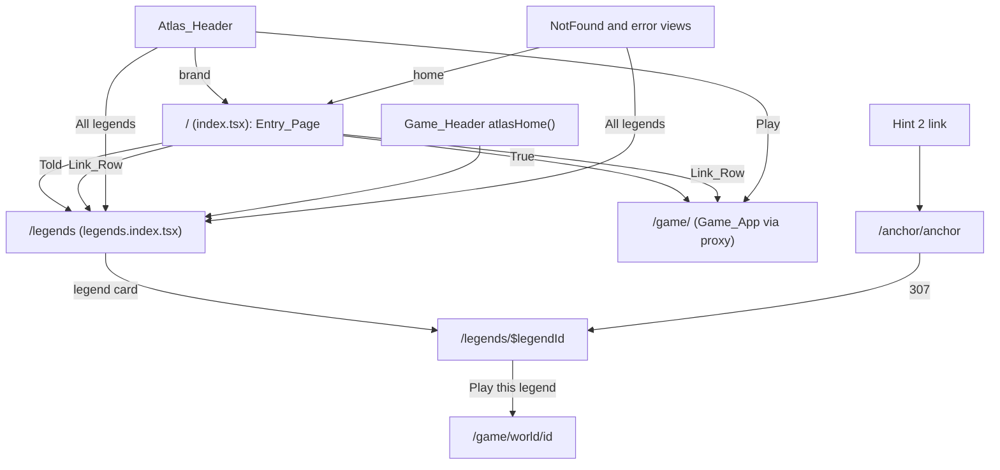

# Design Document

## Overview

Phase 3 is a route move plus a link audit, with two small `HoloCard` fixes. The entry page file `lab.shell.tsx` becomes `apps/atlas/src/routes/index.tsx`. The old `index.tsx` content moves to a new `apps/atlas/src/routes/legends.index.tsx`. The two lab routes are deleted. No server function, schema or content changes. `routeTree.gen.ts` is generated and is never edited by hand; the atlas build regenerates it.

Decisions:

- **D1. Move by copy, then replace.** `legends.index.tsx` is created first from the current `index.tsx` (loader `getHome`, `heroPreloads`, `HomeView`), then `index.tsx` is rewritten with the entry page. `HomeView` and its `id="legends"` section stay untouched, so `home.test.tsx` still holds.
- **D2. `/` is chromeless by exact pathname.** `__root.tsx` replaces `CHROMELESS_PATH = '/lab/shell'` with a check `pathname === '/'`. The old trailing-slash strip would turn `/` into an empty string, so the comparison is on the raw pathname. Unknown paths keep the header and footer.
- **D3. Preview is an `img` only when a CDN_Base exists.** With no base there is no 32 px copy to request, so the existing gradient `span` stays. Both carry the class `holo-preview`, so the blur, hiding and stacking rules are shared.
- **D4. Cartouche word uses a container query, not a viewport query.** `.holo-scene` is already `container-type: inline-size`, and `.holo-title` is a descendant, so `@container` works on the card's own width. Two constants: a small-card letter-spacing tweak and a hide threshold. Verify measures the word box and tunes only these two numbers.
- **D5. Head tags use the root loader's `publicOrigin`.** The same pattern as the legend route: `matches[0].loaderData.publicOrigin`. With no origin, canonical is the relative `/` or `/legends` and no `og:url` is set.
- **D6. Two new link texts for the not-found and error views.** `home` goes to `/` with new text "Back to the start"; the new "See every legend" link goes to `/legends`. The router's `DefaultError` passes a single node to `ErrorView`'s `home` slot, so it keeps one link, to `/`.
- **D7. No Vercel change expected.** `atlasRouteRules` names `/**`, `/media/**`, `/game` and `/game/**` only; both `vercel.json` files hold `git` and install settings only. Verify confirms with `rg`; the files are not edited unless that search finds a rule.
- **D8. The game header keeps the function name `atlasHome()`** and returns `<origin>/legends`. The name is kept so no import changes; the doc comment says what it points to.
- **D9. Back navigation needs no new code.** Every move is a router `Link` (history push) or a plain anchor. No code reads `document.referrer` or calls `history.back()`, and no route redirects to `/`. A shared `/legends/<id>` link loads that page directly. Entry page module state (`entrancePlayed`, `hintGone`) lives for the page session, so a client return to `/` does not replay the entrance.

## Architecture



## Components and Interfaces

### HoloCard: Preview image (`skeleton/src/shell/HoloCard.tsx`, `holoCard.css`)

- With `base` set, the first child of `.holo-art` is ``. React 19 passes `fetchPriority` through as `fetchpriority`. No `crossOrigin`: the Preview is never read by WebGL.
- With no `base`, the first child stays `<span className="holo-preview" aria-hidden="true" />` (gradient from CSS).
- CSS: the existing `.holo-preview` rule (blur, scale 1.2, gradient) stays. Add `img.holo-preview { inline-size: 100%; block-size: 100%; object-fit: cover; max-inline-size: none; }`. The `data-renderer='webgl'` hiding rule already targets the class.
- The `data-ready` effect lists only layer and back images, so the Preview needs no change there.

### HoloCard: Cartouche word (`skeleton/src/shell/holoCard.css`)

Current box: `inline-size: 18.83%` of the card, font `50u`, letter spacing `0.18em`, `overflow: hidden`. Four wide letters with that spacing fill the box almost exactly, so a few pixels of rounding clip the last letter at small sizes. Change:

- `@container (max-inline-size: 320px)`: `letter-spacing: 0.08em` and `padding-inline-start: 0.08em`, so the word has slack.
- `@container (max-inline-size: 200px)`: `.holo-title { display: none; }`.
- Both thresholds are starting values. Verify measures `scrollWidth <= clientWidth` at 667x375, 390x844 and 1280x800, and tunes only these two numbers.
- The front button's `aria-label` is untouched, so hiding the word loses no name.

### Atlas routes

| File | Route | Content |
|---|---|---|
| `routes/index.tsx` | `/` | Entry page (from `lab.shell.tsx`), head tags, Link_Row |
| `routes/legends.index.tsx` | `/legends` | Former home: loader `getHome`, `heroPreloads`, `HomeView`; new head |
| `routes/lab.shell.tsx`, `routes/lab.card.tsx` | deleted | |
| `routes/legends.$legendId.tsx`, `routes/anchor.$anchor.tsx` | unchanged | |

`trailingSlash: 'preserve'` is set in `router.tsx`. The index route's full path is `/legends/`; the router matches `/legends` to it. Links use `to="/legends"`. If the generated route types reject that form, use `to="/legends/"` and check that the rendered `href` is still `/legends` (Verify checks the href).

### Entry page (`routes/index.tsx`)

- Head: `meta` title, description, `og:title`, `og:description`, and `og:url` when `publicOrigin` is set; `links` canonical. No `robots` tag. Text from the existing keys `shell.entry.title` and `shell.entry.description`.
- Told `href="/legends"`, True `href="/game/"`. The cards use `href` with a plain anchor in `HoloCard`, which is a full navigation for both. Told therefore reloads the app shell; this keeps `HoloCard` free of the router. Back from `/legends` returns to `/` with the browser's history, and the entrance state is lost on a full load, so the entrance replays on that return. The requirement on client navigation (13.5) applies to router links such as the header brand.
- Link_Row after the hint paragraphs: `<nav className="shell-links" aria-label={t('shell.entry.links')}>` with `<Link to="/legends" className="shell-link">{t('nav.home')}</Link>` and `<a href="/game/" className="shell-link" aria-label={t('nav.play')}>{t('nav.playShort')}</a>`. The accessible name "Play Trick or True" contains the visible "Play".
- Tab order: skip link, Told, True, All legends, Play.

### Root shell (`routes/__root.tsx`)

- `chromeless = pathname === '/'`.
- `ErrorPage`: `<a href="/">{error.home}</a>` and `<a href="/legends">{error.legends}</a>`, both with `min-h-11` inline-flex.
- Root `head()` is unchanged: its title, description, `og:title` and `og:description` remain the fallback for pages that do not set their own.

### Atlas header (`components/SiteHeader.tsx`)

- Brand: `Link to="/"` with `activeOptions={{ exact: true }}` (unchanged).
- "All legends": `Link to="/legends"` with `activeOptions={{ exact: true }}`; the hash and `includeHash` are removed.
- "Play" unchanged. The three links keep the `nav-item` class and `min-h-11`.

### Not found and error views

- `NotFound.tsx`: two links, `Link to="/"` with `notFound.home` and `Link to="/legends"` with `notFound.legends`, in one row that wraps (`flex flex-wrap gap-x-4`), each `min-h-11 inline-flex items-center`.
- `router.tsx` `DefaultError`: `home` stays one `Link to="/"`, text from `error.home`.

### Game header (`apps/game/src/components/GameHeader.tsx`)

```ts
/** The atlas legend list. `ATLAS_ORIGIN` unset (empty) means same origin, so the href is `/legends`. */
export function atlasHome(atlasOrigin: string): string {
  return `${atlasOrigin.replace(/\/+$/, '')}/legends`;
}
```

### Catalog keys (`apps/atlas/src/i18n/en.ts`; `ar.ts` unchanged)

| Key | Text |
|---|---|
| `shell.entry.links` | More ways in |
| `page.legends` | `All legends · {app}` |
| `page.legends.description` | Every legend in the atlas on one map and one list, grouped by continent. Open one to read its chapters, its versions and its sources. |
| `notFound.home` (changed) | Back to the start |
| `notFound.legends` | See every legend |
| `error.home` (changed) | Back to the start |
| `error.legends` | See every legend |

The Entry_Page description reuses `shell.entry.description`. `nav.home` ("All legends") and `nav.playShort` ("Play") are reused for the Link_Row.

### Styles (`apps/atlas/src/styles.css`, `@layer ui`)

- Add `.shell-links` (flex, wrap, centered, `gap: var(--space-4)`, `margin-block-start: var(--space-1)`) and `.shell-link` (`display: inline-flex; align-items: center; justify-content: center; min-block-size: var(--target); min-inline-size: var(--target); padding-inline: var(--space-3); color: var(--color-muted); text-decoration: underline; text-underline-offset: 0.2em`; hover colour `--color-ink`; `:focus-visible` outline with the accent token).
- Add `--shell-links: var(--target)` to `.shell-page`. In the side-by-side rule, subtract it from the card height: `(var(--shell-avail-block) - var(--shell-hint) - var(--shell-links))`. In the short-landscape rule, `--shell-hint` is 0 and the Link_Row stays, so 667x375 still has no vertical scroll; the cards get smaller and the Cartouche_Word hides there.
- Stacked layout needs no budget: the row follows the second card, below the fold.
- Remove the `/lab/card` block (`.lab-card-page`) and fix the comment of the entry page block ("Entry page (/)").
- No new physical properties; the file's `logical-css.test.ts` keeps passing.

### Existing pins and scripts to update (no new tests)

| File | Pin | New value |
|---|---|---|
| `apps/atlas/test/header.test.tsx` | `byText('nav.home')?.href` is `/#legends`; `html.replace('href="/#legends"', ...)`; test title | `/legends` |
| `apps/atlas/test/helpers/renderInRouter.tsx` | only if the test router needs a `/legends` route for the header link to render its `href` | add the route |
| `apps/atlas/test/home.test.tsx` | comment mentions `/#legends` | comment says `/legends` |
| `apps/game/test/header.test.tsx` | atlas link `href` is `/`; `atlasHome('https://atlas.example/')` is `https://atlas.example/` | `/legends`; `https://atlas.example/legends` (also the `href="https://atlas.example/"` assertion) |
| `apps/atlas/scripts/header-check.mjs` | navigates `/`, waits for the header, Tab order `['/', '/#legends', '/game/']` | navigate `/legends`; `['/', '/legends', '/game/']` |
| `apps/atlas/scripts/screens-check.mjs` | atlas home at `${BASE}/` | `${BASE}/legends` |
| `apps/atlas/scripts/smoke.ts` | home checks fetch `/` | fetch `/legends` |
| `README.md` | "Owns `/` and `/media`" | adds `/legends` |

`skeleton/scripts/smoke-prod.ts` fetches `/` for security headers only; `/` still answers 200, so it stays.

## Data Models

No data model changes. New Catalog keys are listed above. No database, content or asset change.

## Error Handling

- CDN_Base set but the 32 px request fails: the Preview `img` shows nothing and the element's `background-color` and gradient from the CSS rule stay visible, so the card is not a flat box.
- `PUBLIC_ORIGIN` unset: canonical is relative and no `og:url` is emitted.
- A visitor opens `/lab/shell` or `/lab/card`: the router has no match, and the root not-found view shows with its two links.
- A visitor opens `/legends/<unknown>`: unchanged atlas 404.
- Root loader fails: `ErrorPage` renders fixed text with plain anchors to `/` and `/legends` and reads no loader data.
- `/game` forwarding: untouched; the atlas still answers anything under `/game` with 404 when it is served alone (local run), so the Verify_Script forwards `/game/**` from the atlas origin to the game server the way the production proxy does.

## Testing Strategy

Property-based testing does not apply: this phase is routing, link targets, head tags and CSS, with no pure logic that varies with input. The puzzle generator, RNG and lead logic are untouched, so the fast-check suites are not re-targeted; they run once in Verify with the rest of the suites.

No test files are added. Existing tests that pinned the old targets are updated (table above) and listed in the handover. The final Verify task runs once: `pnpm --filter @kiroween/atlas build` (regenerates `routeTree.gen.ts`), `pnpm -r typecheck`, `pnpm -r test`, and `pnpm --filter @kiroween/atlas test:browser -- --base http://localhost:3001 --out .debug/shell-3/book-check.json`.

The Verify_Script in `.debug/shell-3/` gives the evidence:

- Screenshots at 390x844, 667x375 and 1280x800 of `/`, `/legends`, one Legend_Page, the game hall and the atlas 404.
- Click-through: `/` Told to `/legends` to a legend to "Play this legend" to the game world (or its sign-in, with the reason) to the Game_Header atlas link to `/legends`; and `/` True to `/game/`. Also browser back from the legend to `/legends`, a direct load of a legend (history length and referrer show no step through `/`), and the header brand and "All legends" from a legend.
- Slow link, 1.2 Mbps, 390x844: a screenshot every 500 ms for the first 3 s of `/`, with the simulated image CDN stand-in used in `.debug/shell-2/` (CDN base set in the shell only). No card may be a flat box.
- Every internal link on `/`, `/legends` and one Legend_Page answers 200.
- Cartouche_Word box measured at the three sizes.
- `rg` checks: no `/lab` route or file, no `/#legends` link, no `/` or `/lab` rule in the Route_Rules.
- Game side: the game server runs with `ATLAS_ORIGIN` set to the atlas origin, variables set in the shell only.
