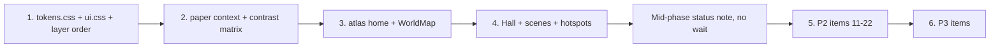

# Design Document: ui-rework (Phase 6)

## Overview

Phase 6 reworks the interface of the atlas (Trick or Told, `apps/atlas`) and the game (Trick or True, `apps/game`). It changes CSS, markup, catalog text and tests. It does not change content, assets, the parser, the generator, the audit, auth, the access rule, the score formula, play rules, the token format, fair-play secrecy, rate limits, `vercelRules.ts`, the database schema or data (Requirement 1).

The review in `docs/planning/phase-6-review/00-fix-list.md` names three root causes. The design fixes each one at its source and lets the screen fixes follow.

| Root cause | Source | Design answer |
|---|---|---|
| No UI component layer | `skeleton/src/design/tokens.css` holds colours and fonts only; the game has five button systems | New `skeleton/src/design/ui.css` (section 3.2) and new scale tokens (3.1), imported once by each app |
| Global `a` rule | `apps/atlas/src/styles.css:30-38` | Delete it; `.link` for running text, `.nav-item` and `.btn` for everything else (3.7) |
| Paper context re-points four colours | `skeleton/src/book/book.css` `.book-paper` | Re-point surface, bg, rule, link and ring as well, and pin every pair in a contrast matrix (3.5, 3.6) |

Key decisions (each goes into `docs/phase-6-notes/decisions.md` when built):

1. **Steering wins over `design-direction.md`** (Requirement 4.2). Headings keep `IM Fell English SC`, the hub palette is not touched, the pinned book ink `#2b1d12` and accent `#4a1c12` stay, and the extra pages in the direction (strips, featured legend, crossover band, chapter rail, door grid from panorama crops) are out of scope.
2. **One map: remove the Painted_Strip, keep `WorldMap`.** The atlas spec (`.kiro/specs/atlas/design.md:230`) forbids markers on the painted map, and the painted map is not geographically accurate, so pins cannot sit on it. The strip goes; the interactive map stays and gets a phone layout.
3. **Cascade layers decide the fight between old and new classes.** The new `.btn` rules live in a layer that sits after the legacy game CSS, so a pinned class such as `.scene-button` can stay in the markup beside `.btn` without winning (3.3).
4. **Derived colour tokens are not defined on `:root`.** A legend theme pack sets its variables inline on `<body>` (atlas) or on the world root (game). A token such as `--color-link: var(--color-glow)` declared on `:root` would be resolved before the pack applies and would ignore it. So `ui.css` reads `var(--color-glow)` directly, and only the paper context declares `--color-link`, `--color-ring` and `--color-rule` (3.5).
5. **Reduced motion has one switch**: `--motion` on the root, set by one block in `ui.css` (3.4).
6. **Hint 2 opens a blank tab inside the click**, then navigates it after the server confirms (3.12).

### Sources read for this design

`requirements.md`; `docs/planning/phase-6-review/` (fix list, design direction, code review, impeccable, tester); `docs/phase-5-handover.md`; `docs/planning/15-look-and-feel-brief.md`; steering `design.md`, `content.md`, `i18n-rtl.md`, `product.md`, `tech.md`; the code listed in each section. Contrast ratios below were computed with the WCAG formula used by `skeleton/src/theme/contrast.ts`. No outside research was needed: every technique used (CSS cascade layers declared before `@import`, native `popover`, `window.open` returning `null` when blocked, `:focus-visible`, `prefers-reduced-motion`) is baseline web platform behaviour.

## Architecture

### Where things live

```
skeleton/src/design/tokens.css      + new tokens (scales, paper, raised, rule, ember, shadows)
skeleton/src/design/ui.css          NEW: .btn .link .nav-item .panel .field, focus ring, --motion, glint helpers
skeleton/src/book/book.css          .book-paper block re-points more tokens; book height; control states
skeleton/src/book/bookColors.ts     + BOOK_CARD, BOOK_TINT constants (kept equal to book.css by test)
skeleton/src/book/Book.tsx          toggle label by mode; .btn classes on controls
apps/atlas/src/styles.css           @layer order line, import ui.css, delete global `a` rule
apps/atlas/src/routes/__root.tsx    header nav items, game link, aria-current
apps/atlas/src/routes/index.tsx     hero, one map, cards
apps/atlas/src/components/          LegendList.tsx -> cards; WorldMap.tsx; LegendPage.tsx (paper fixes)
apps/game/src/styles.css            @layer order line, import ui.css
apps/game/src/styles/theme.css      link rule moves into a layer
apps/game/src/components/scene.css  wrapped in @layer components; glint; scene-screen grid
apps/game/src/components/world.css  wrapped in @layer components; option states
apps/game/src/routes/__root.tsx     header menu, atlas link, wider main
apps/game/src/components/Hall.tsx   three door states, h1, primary action
apps/game/src/components/HintArea.tsx  NEW: one hint area
apps/game/src/lib/hintTab.ts        NEW: blank-tab flow, pure outcome function
apps/game/src/lib/hall.ts           + doorReasonKey (pure)
apps/game/src/lib/world.ts          + replyLine, isHintable (pure)
```

Nothing under `content/` or `assets/` is touched, no image is added, no `package.json` gains a dependency (Requirements 2, 3).

### Order of work



Group 1 comes first because every later group uses `.btn`, `.link` and the ring. Group 2 comes before the screens because the screens read paper colours. Group 5 writes a status note and the run continues straight into group 6; the Owner may write feedback in `owner-feedback.md`, which is read at each checkpoint (Requirement 5.3 to 5.5).

## Components and Interfaces

### 3.1 Tokens (`skeleton/src/design/tokens.css`)

New tokens are added inside the existing `@theme` block, below the base palette. No base value changes (Requirement 4.4; `apps/game/test/theme.test.ts` and `skeleton/src/theme/hub.ts` keep passing).

Names avoid Tailwind's own namespaces where a collision would change utilities: spacing uses `--space-*` (not `--spacing-*`), type uses `--type-*` (not `--text-*`).

| Group | Tokens |
|---|---|
| Colour (dark) | `--color-surface-raised: #261e2b`, `--color-rule: #3a3040` (decorative lines only), `--color-ember: #a8431f` |
| Paper values | `--book-card: #f6ecd2`, `--book-tint: #f0e2bc` (already in `book.css` as `--book-paper-tint`; the new name is an alias, the old one stays), `--book-ember: #a8431f` |
| Space (8 px grid) | `--space-1: 0.25rem`, `-2: 0.5rem`, `-3: 0.75rem`, `-4: 1rem`, `-5: 1.5rem`, `-6: 2rem`, `-7: 3rem`, `-8: 4rem` |
| Type | `--type-kicker: 0.75rem`, `--type-ui: 0.9375rem`, `--type-small: 0.875rem`, `--type-body: 1.0625rem`, `--type-lead: 1.25rem`, `--type-h3: 1.25rem`, `--type-h2: clamp(1.5rem, 1.5vw + 1rem, 2rem)`, `--type-h1: clamp(2rem, 3vw + 1rem, 3rem)`, `--type-display: clamp(2.6rem, 6vw + 1rem, 4.5rem)` |
| Radius | `--radius-ui: 4px` (one radius) |
| Shadow (warm black) | `--shadow-plate: 0 2px 0 rgb(14 11 16 / 0.5)`, `--shadow-lift: 0 0.5rem 1.25rem -0.5rem rgb(14 11 16 / 0.55)`, `--shadow-sheet: 0 1.25rem 3rem rgb(14 11 16 / 0.55)` |
| Size | `--target: 2.75rem` (44 px), `--app-header-h: 3.5rem` |

The `--type-*` scale is the target for P3 item "unify sizes" (8 sizes today). Components adopt it as they are touched; the sweep in P3 finishes the rest. `ember` is defined because Requirement 4.4 names it and the dead-end and "tried" marks use it on paper card fills; it is never body text on the textured paper (see matrix, section 3.6).

### 3.2 `skeleton/src/design/ui.css`

The file has no hex colour and no `var(--x, #hex)` fallback (Requirement 10.8); it reads tokens only. All rules use logical properties (Requirement 7.1). It contains these parts.

**Button** (works on `<button>` and `<a>`; Requirement 10.3, 10.4):

```css
@layer ui {
  .btn {
    display: inline-flex; align-items: center; justify-content: center; gap: var(--space-2);
    min-block-size: var(--target); min-inline-size: var(--target);
    padding-inline: var(--space-4);
    border: 1.5px solid transparent; border-radius: var(--radius-ui);
    font-family: var(--font-ui); font-size: var(--type-ui); font-weight: 600; letter-spacing: 0.02em;
    line-height: 1.2; text-align: center; text-decoration: none; cursor: pointer;
    transition: background-color calc(var(--motion) * 120ms), transform calc(var(--motion) * 80ms);
  }
  .btn-primary   { background: var(--color-accent); color: var(--color-bg); border-color: var(--color-accent);
                   box-shadow: var(--shadow-plate); }
  .btn-primary:hover  { background: var(--color-glow); border-color: var(--color-glow); }
  .btn-primary:active { transform: translateY(1px); box-shadow: none; }
  .btn-secondary { background: transparent; color: var(--color-glow); border-color: var(--color-accent); }
  .btn-secondary:hover { background: color-mix(in oklab, var(--color-accent) 14%, transparent); }
  .btn-ghost     { background: transparent; color: var(--color-ink); }
  .btn-ghost:hover { text-decoration: underline; text-underline-offset: 0.25em; }
  .btn-icon      { padding-inline: 0; inline-size: var(--target); }
  .btn :is(.icon-dir) { }               /* direction icons: see below */
  [dir='rtl'] .btn .icon-dir { transform: scaleX(-1); }
  .btn:disabled, .btn[aria-disabled='true'] { opacity: 1; background: transparent; border-style: dashed;
                   border-color: var(--color-muted); color: var(--color-muted); cursor: not-allowed; box-shadow: none; }
  .btn[aria-pressed='true'] { background: color-mix(in oklab, var(--color-accent) 22%, transparent); border-color: var(--color-accent); }
}
```

Notes on the choices:

- Colours come from `--color-accent`, `--color-bg`, `--color-glow`, `--color-ink`, `--color-muted`. Inside the paper context those are re-pointed (3.5), so the same rules give a dark-brown primary button with paper-coloured text on paper, and no second set of paper rules is needed.
- A disabled button is a dashed outline in muted colour, not 50% opacity. Opacity-based disabling produced the four different values (0.45, 0.5, 0.55, 0.6) the code review lists. A `.btn[aria-disabled='true']` also covers the game's "busy" buttons, which use `aria-disabled` so keyboard focus is kept.
- A tried answer option is a disabled state plus a visible mark and the word "Tried" (3.11), not `line-through` alone (Requirement 13.3).
- `aria-pressed='true'` has its own look, so the book toggle shows its state without relying on the label.

**Link** (running text only; Requirement 11.2, 11.6):

```css
  .link { color: var(--color-link, var(--color-glow));
          text-decoration: underline; text-decoration-thickness: 1px; text-underline-offset: 0.2em;
          text-decoration-color: color-mix(in oklab, currentColor 60%, transparent); }
  .link:hover { text-decoration-thickness: 2px; text-decoration-color: currentColor; }
  /* no :visited rule on purpose: a visited link keeps its colour */
```

**Nav item** (header, contents list, footer link; Requirement 11.3, 11.5):

```css
  .nav-item { display: inline-flex; align-items: center; min-block-size: var(--target); padding-inline: var(--space-3);
              color: var(--color-ink); text-decoration: none; font-family: var(--font-ui); font-size: var(--type-ui); }
  .nav-item:hover { box-shadow: inset 0 -2px 0 var(--color-muted); }
  .nav-item[aria-current='page'] { box-shadow: inset 0 -2px 0 var(--color-accent); font-weight: 600; }
```

`aria-current` gets a 2 px bar plus weight, so the state is not colour alone. TanStack Router's `<Link>` sets `aria-current="page"` on an active link when `activeOptions` match, so the header uses `<Link className="nav-item">` and only adds `activeOptions={{ exact: true }}`.

**Panel** (the one card surface; Requirement 10.1):

```css
  .panel { background: var(--color-surface); color: var(--color-ink);
           border: 1px solid var(--color-muted); border-radius: var(--radius-ui); padding: var(--space-4); }
  .panel-raised { background: var(--color-surface-raised); box-shadow: var(--shadow-lift); }
```

The panel border is `--color-muted` (5.79:1 on the surface), not `--color-rule`, because the border is a meaningful edge. `--color-rule` is for decorative dividers.

**Field** (inputs and the `Field.tsx` form): `.field` gives min height 44 px, border `--color-muted`, background `--color-bg`, ring on focus; `Field.tsx` button strings get `.btn` classes (Requirement 10.7).

**Reduced-motion and glint helpers**: see 3.4.

Apps add the classes beside the old ones, in the same order in the markup: `class="scene-button btn btn-secondary"` (Requirement 6.1). Pinned class strings are unchanged. These rows of Requirement 10.7 are mapped here:

| Element | Old class (kept) | Added |
|---|---|---|
| Scene buttons (`SceneNav.tsx`, `TutorialRoom.tsx`, `Hall.tsx`) | `scene-button` | `btn btn-secondary`; the current scene tab adds `aria-current` and `aria-pressed`-style fill from `.btn[aria-current='true']` |
| World buttons (`WorldPlay.tsx`) | `world-button`, `world-button world-option` | `btn btn-secondary`; options `btn btn-secondary` plus full width |
| Book controls (`Book.tsx`) | none on the buttons; the wrapper keeps `book-controls` | `btn btn-secondary` (previous, next as `btn-icon`) |
| Map pin card actions (`WorldMap.tsx`) | none | "Read the legend" `btn btn-primary` (it is a `<Link>`), close `btn btn-ghost` |
| `Field.tsx` buttons | existing | `btn btn-primary` |

### 3.3 Cascade layers

Tailwind v4 already uses `@layer theme, base, components, utilities`. The order is fixed by the first statement the browser sees, so each app's `styles.css` starts with a line that adds `ui`:

```css
@layer theme, base, components, ui, utilities;
@import 'tailwindcss';
@import '@kiroween/skeleton/design/tokens.css';
@import '@kiroween/skeleton/design/ui.css';
@import '@kiroween/skeleton/design/mood.css';
@import '@kiroween/skeleton/book/book.css';
```

An `@layer` statement may precede `@import`. The result: `components` (app and legacy rules) < `ui` (`.btn`, `.link`) < `utilities` (Tailwind classes).

Unlayered CSS beats any layer. The game's `scene.css`, `world.css` and `styles/theme.css` are unlayered today, so a `.scene-button` colour would beat `.btn` colour. The design wraps those files' rules in `@layer components { ... }`. Effects and checks:

- `scene.css` and `world.css`: wrap the whole body in `@layer components`. The duplicate `:focus-visible` rules and the colour, border and radius lines of `.scene-button` and `.world-button` are deleted, because `.btn` supplies them; layout lines (`min-inline-size`, `inline-size: 100%` on `.world-option`) stay.
- `styles/theme.css`: the rule `.hub-theme a, .world-theme a { color: var(--color-accent) }` moves into `@layer base`, so a `.btn` link in the game is not recoloured. The rest of the file is plain variables and heading rules and stays as is. `apps/game/test/theme.test.ts` is run after the move; it reads token declarations, not the layer wrapper.
- `book.css` is not wrapped. The `.book-paper` block must stay a plain top-level block with no nested braces, because `book-foundations.test.ts` reads it with a regex anchored at line start (Requirement 6.5). Variables declared there win over layered rules anyway.
- Tailwind utilities now beat the wrapped legacy rules. The only utility strings that fought them are the focus utilities on the Hall link list (`focus-visible:outline-2 focus-visible:outline-glow`), which are removed with the Hall rewrite. A browser pass (section 7.4) checks that no button changed in a way not intended.
- **The layer move can change appearance.** Once `scene.css` and `world.css` are inside `@layer components`, Tailwind utilities win over rules that used to be unlayered, so some elements may look different. In the same task as the layer move, screenshots of the Hall, the tutorial and one world scene (Banshee scene 1) are taken before the move and after it, at 390 px and 1280 px, and saved in `.debug/` (git-ignored, none under `docs/`). Every visual difference found is described in `docs/phase-6-notes/decisions.md`, and each is either accepted with a reason or fixed. "No visible change" is also recorded if that is the result.

### 3.4 Focus ring and the motion switch

**One focus ring**, in `ui.css`, in `@layer base` so a deliberate utility can still override it:

```css
@layer base {
  :focus-visible {
    outline: 3px solid var(--color-ring, var(--color-glow));
    outline-offset: 3px;
  }
}
```

Dark context: glow on bg is 13.73:1, on surface 12.45:1, on raised 11.32:1 (all ≥ 3:1). Paper context: `--color-ring` is the book ink (3.3). The 3 px offset leaves a gap that shows the page behind, so the ring is judged against the surrounding colour. Then the other focus rules go:

- `apps/atlas/src/styles.css:25-29` (2 px glow rule) is deleted.
- `scene.css` (`.scene-viewport:focus-visible, .scene-hotspot:focus-visible, ...`), `world.css`, `world-button:focus-visible`, `hall-panel:focus-visible` are deleted.
- `book.css` rule `.book-controls button:focus-visible, .book-viewport:focus-visible { outline: 2px solid currentColor }` is deleted.
- Tailwind `focus-visible:outline-*` strings in game components are removed.

A test (section 7.1) fails if any stylesheet other than `ui.css` declares an `outline` inside a `:focus-visible` selector. `:target` and `[data-landed]` outlines are a different feature (landing mark) and stay.

**One motion switch.** Today reduced motion is scattered over `mood.css`, `book.css` and `scene.css` in separate `@media` and `html[data-motion='reduce']` blocks. `ui.css` adds one block that is the source of truth:

```css
:root { --motion: 1; }
@media (prefers-reduced-motion: reduce) { :root { --motion: 0; } }
html[data-motion='reduce'] { --motion: 0; }

/* animations cannot be scaled by a number, so the same two conditions switch them off */
@media (prefers-reduced-motion: reduce) {
  *, *::before, *::after { animation: none !important; scroll-behavior: auto !important; }
}
html[data-motion='reduce'] *, html[data-motion='reduce'] *::before, html[data-motion='reduce'] *::after {
  animation: none !important; scroll-behavior: auto !important;
}
```

Transitions in new rules are written `calc(var(--motion) * 120ms)`, so they become 0 ms with the switch. The one allowed exception is an opacity cross-fade of at most 100 ms: a fading element uses `transition: opacity calc(var(--motion) * 20ms + 100ms)`, which is 120 ms normally and 100 ms in reduced mode.

The game already sets `html[data-motion='reduce']` from the in-app toggle (`lib/motion.ts` `applyMotionAttribute`), so a toggle change takes effect with no reload (Requirement 7.7). Existing blocks in `mood.css` and `book.css` stay; they are harmless duplicates and the book's `transition: none` is pinned by `book-foundations`.

Allowed motion in this phase is the existing candle and fog, and one new slow hotspot glint (3.11). Glint pulse: 6 s cycle, opacity 0.35 to 0.7 in three steps, which is far under 3 brightness changes per second (Requirement 7.6).

### 3.5 Paper context re-pointing (P1 item 3)

Inside `.book-paper` today only four variables are re-pointed. The fix adds the rest in the same plain block, and adds the contract values to `bookColors.ts` so the CSS and TypeScript cannot drift (Requirement 6.6).

```css
:root {
  --book-card: #f6ecd2;   /* flat fill for cards on paper: no texture, so text is measured against it directly */
  --book-ember: #a8431f;
}
.book-paper {                              /* existing four, unchanged */
  --color-ink: var(--book-ink);
  --color-muted: var(--book-ink);
  --color-glow: var(--book-accent);
  --color-accent: var(--book-accent);
  /* new in Phase 6 */
  --color-bg: var(--book-paper-tint);      /* "page" colour: what text on a .btn-primary becomes */
  --color-surface: var(--book-card);
  --color-surface-raised: var(--book-card);
  --color-rule: var(--book-ink);
  --color-link: var(--book-accent);
  --color-ring: var(--book-ink);
  --color-danger-ink: var(--book-ember);
}
```

Why each one:

| Variable | Paper value | Fixes |
|---|---|---|
| `--color-surface` | `--book-card` | Versions cards (`LegendPage.tsx:41`, `bg-surface`) were a dark `#1c1620` fill under dark brown ink, about 1.1:1 |
| `--color-bg` | paper tint | `.world-button` background and the text of `.btn-primary`: oxblood answer buttons on dark were 1.25:1 |
| `--color-rule` | book ink | table rules (`border-surface`, `border-muted`) were dark teal on parchment |
| `--color-link` | book accent | one link colour in the whole paper context (Requirement 12.2) |
| `--color-ring` | book ink | focus ring readable on paper |
| `--color-danger-ink` | ember | error text on a paper card |

Because `.link`, `.btn` and `.panel` read these variables, they need no paper-specific rules. The Versions card keeps `bg-surface` in the markup and is correct automatically (Requirement 12.7).

Markup changes in `LegendPage.tsx` (class additions only, no id or anchor changes):

- `Version`: `bg-surface` stays; add `panel`; label cells `text-muted` stay (muted maps to ink on paper).
- `DocumentedTold`: `border-surface` rules become `border-rule`-equivalent via a small utility alias `border-[var(--color-rule)]`; to avoid arbitrary-value noise, a component class `.rule-b` in `styles.css` (`border-block-end: 1px solid var(--color-rule)`) is added and used by `cell` and `head`.
- `Sources`: links get `.link` (underline plus colour), `min-block-size: 1.5rem; display: inline-block; padding-block: 0.25rem` (24 px), `margin-block-end: 0.5rem` between items (Requirement 30), plus the external marker `↗` in an `aria-hidden` span with a visually hidden "opens an external site" label from a catalog key.
- In Scroll_View the section sits on the dark page, so the same classes give glow links on the dark surface (Requirement 12.5).

The `.plate` frame and `.dramatization` tag (`styles.css`) read `--color-muted` and `--color-surface`, so they follow the context with no change (Requirement 12.6). Names stay.

**The paper in the game.** `SpiritPanel.tsx` uses `spirit-panel-body spirit-caption book-paper`, so it gets all of the above. The dark-theme override `.spirit-panel-body.spirit-caption { color: var(--book-ink) }` in `theme.css` stays. Answer options inside it use `btn btn-secondary`: ink text and ink border on the paper tint, so 12.67:1 for text and the same for the border. The focus ring is the book ink.

Theme packs: `bookColors(theme)` already lets a pack's ink and accent through only when they reach 4.5:1 on `PAPER_FLOOR`, otherwise the book's. The new re-points use `--book-*` names only, so a pack cannot make paper unreadable.

### 3.6 Contrast pair matrix

The Contrast_Test (`skeleton/test/book-foundations.test.ts` plus a new `skeleton/test/ui-contrast.test.ts`) reads colours from `tokens.css`, `book.css` and `bookColors.ts` and resolves `var()` references; it holds no colour literal (Requirement 14.2). Each row is one pair with its role, minimum and the size and weight it is used at. Ratios are as computed for this design; the test recomputes them.

**Dark context** (page, game, Scroll_View):

| # | Foreground | Background | Role and size | Min | Ratio |
|---|---|---|---|---|---|
| D1 | ink `#e9e1d3` | bg `#0e0b10` | body text 17 to 18 px, 400 | 4.5 | 15.06 |
| D2 | ink | surface `#1c1620` | card text 17 px | 4.5 | 13.65 |
| D3 | ink | raised `#261e2b` | hover card text | 4.5 | 12.41 |
| D4 | muted `#9c9285` | bg | meta text 14 px, 400 | 4.5 | 6.39 |
| D5 | muted | surface | meta text 14 px | 4.5 | 5.79 |
| D6 | muted | raised | meta text 14 px | 4.5 | 5.27 |
| D7 | glow `#f4d58d` | bg | link in text, 18 px, 400 | 4.5 | 13.73 |
| D8 | glow | surface | link in card text | 4.5 | 12.45 |
| D9 | bg | accent `#e0a84b` | primary button label, 15 px, 600 | 4.5 | 9.19 |
| D10 | bg | glow | primary button label on hover | 4.5 | 13.73 |
| D11 | glow | bg | secondary button label, 15 px, 600 | 4.5 | 13.73 |
| D12 | accent | bg | secondary button border (non-text) | 3 | 9.19 |
| D13 | accent | surface | panel and card border, selected tab fill | 3 | 8.33 |
| D14 | muted | surface | panel border (non-text) | 3 | 5.79 |
| D15 | glow | bg, surface, raised | focus ring (non-text) | 3 | 13.73, 12.45, 11.32 |
| D16 | danger-ink `#e06b6b` | surface | error text 16 px | 4.5 | 5.47 |
| D17 | muted | land fill (`color-mix(muted 66%, bg)` = `#6c645d`) | n/a: land is a shape | | |
| D18 | land `#6c645d` | bg (map card surface) | land shape against the map card (non-text) | 3 | 3.37 |
| D19 | glow | land | pin dots and lines on land (non-text) | 3 | 4.08 |
| D20 | ink | accent-14% on bg (hover) | hover secondary label | 4.5 | ≥ 9 (test computes the mix) |

**Paper context** (`.book-paper`; text over texture is judged on `PAPER_FLOOR #a89368`, text on a flat card on `--book-card`):

| # | Foreground | Background | Role and size | Min | Ratio |
|---|---|---|---|---|---|
| P1 | book ink `#2b1d12` | PAPER_FLOOR | body 18 px, any text on paper | 4.5 | 5.47 |
| P2 | book ink | paper tint `#f0e2bc` | body | 4.5 | 12.67 |
| P3 | book ink | card `#f6ecd2` | card body 16 px | 4.5 | 13.87 |
| P4 | book accent `#4a1c12` | PAPER_FLOOR | link and heading on paper | 4.5 | 4.80 |
| P5 | book accent | card | link in card, table | 4.5 | 12.17 |
| P6 | book ink (muted) | card | label text 14 px | 4.5 | 13.87 |
| P7 | paper tint | book accent | primary button label, 15 px, 600 | 4.5 | 11.13 |
| P8 | paper tint | book ink | answer option label on selected state | 4.5 | 12.67 |
| P9 | book ink | card, tint | rule, table border, secondary button border (non-text) | 3 | 13.87, 12.67 |
| P10 | book ink | PAPER_FLOOR | focus ring (non-text) | 3 | 5.47 |
| P11 | ember `#a8431f` | card | dead-end and "Tried" label, 14 px, 600 | 4.5 | 5.12 |
| P12 | ember | tint | same, on tint | 4.5 | 4.68 |
| P13 | book accent | card | tried-option mark | 3 | 12.17 |

Ember on `PAPER_FLOOR` is 2.02:1 and is therefore forbidden on textured paper; the test names the rule "ember only on a flat fill" and a source scan in the test confirms `--color-danger-ink` is used only inside a `.panel` or card (a fixed list of selectors).

**Theme packs** (Requirement 14.4): for each of the 12 legend packs (loaded the way `apps/game/test/theme.test.ts` loads them, via `resolveTheme`) the test checks accent, glow and ink on the pack background and surface at 4.5, and pairs D9 (bg on accent), D11 (glow on bg) and D15 (glow ring on bg and surface at 3). `resolveTheme` already falls back to the base token when a role fails, so the property is expected to hold; the test proves it for the three new uses.

**Why a test and not only a browser scan:** the Phase 6 failures came from variables that were never re-pointed, which a variable-level test catches without rendering. The browser scan (7.4) then confirms the rendered result on two legends (Requirement 12.8).

### 3.7 Header, link rule and nav items

`apps/atlas/src/styles.css`: delete `a { color; text-decoration... }` and `a:hover` (lines 30-38). Add nothing global for `a`. Consequences and where each link kind goes:

| Place | Today | After |
|---|---|---|
| Header logo, "All legends" | underlined gold | `.nav-item` (logo `.nav-item font-display`) |
| New header item "Play Trick or True" | none | `.btn btn-secondary` at ≥ 640 px, `.nav-item` below |
| Legend card title | underlined | stretched `::after` link, no underline (3.8) |
| Contents list | underlined wall | `.nav-item` rows in a one-column list (3.9) |
| Footer Keeper's Note link | underlined | `.nav-item` |
| Map pin card "Read" | underlined link | `.btn btn-primary` |
| Source titles in the Sources list, links in `StoryText` | underlined | `.link` |
| `ErrorPage` home link, `NotFound` link | bare `a` | `.link` |
| Skip link | bare | keeps its classes; it is a `a` with `sr-only` utilities |

`InlineText`/`StoryText` render links inside prose; they get `.link`. Header `<Link>` elements receive `aria-current="page"` from the router when active. The check "number of underlined links outside running text is zero" (Requirement 11.4) is a browser script that walks `a` elements, ignores those inside `.story` and `.measure p`, and asserts `getComputedStyle(a).textDecorationLine === 'none'`.

Atlas header (new):

```tsx
<nav aria-label={t('nav.label')} className="mx-auto flex max-w-6xl items-center gap-1 px-4" style={{ minBlockSize: 'var(--app-header-h)' }}>
  <Link to="/" className="nav-item font-display text-lg me-auto" activeOptions={{ exact: true }}>{t('app.title')}</Link>
  <Link to="/" hash="legends" className="nav-item">{t('nav.home')}</Link>      {/* "All legends": href /#legends */}
  <a href="/game/" className="nav-item sm:btn sm:btn-secondary">{t('nav.play')}</a>
</nav>
```

(`sm:btn` is not valid Tailwind for a component class; the implementer writes two small component rules in `styles.css` under `@layer components`: `.nav-play` as `nav-item` below 40rem and as `.btn.btn-secondary` above. The point of the design is the behaviour, not the spelling.) The logo link keeps `href="/"`; "All legends" has `href="/#legends"`, which is not `/` (Requirement 23.1, 23.4). The list section gets `id="legends"`; the existing `[id] { scroll-margin-block-start: 1.5rem }` keeps its heading in view (Requirement 23.2).

Game header (`apps/game/src/routes/__root.tsx`), one row at 390 px (Requirement 18.8). Five items do not fit in 390 px, so the design collapses the secondary ones into a native `popover` menu:

```tsx
<nav className="mx-auto flex max-w-6xl items-center gap-1 px-3" aria-label={t('app.title')}>
  <Link to="/" className="nav-item font-display text-lg me-auto">{t('app.title')}</Link>
  <a href={atlasHome} className="nav-item">{t('nav.atlas')}</a>
  <button type="button" className="btn btn-ghost nav-menu-button" popovertarget="app-menu">{t('nav.menu')}</button>
  <div id="app-menu" popover="auto" className="nav-menu panel panel-raised">
    <Link to="/" className="nav-item">{t('nav.hall')}</Link>
    <Link to="/account" className="nav-item">{t('nav.account')}</Link>
    {name === null ? <Link to="/sign-in" ...>{t('nav.signIn')}</Link> : <button type="button" className="nav-item" ...>{t('nav.signOut')}</button>}
  </div>
</nav>
```

At ≥ 40rem, CSS shows the menu inline (`.nav-menu { display: contents }`) and hides the menu button; below that the UA's popover rules apply. The atlas link uses `atlasUrl`'s origin rule: `ATLAS_ORIGIN` unset means same origin, so the href is `/` (Requirement 22.4). The popover menu is approved by the Owner and recorded in the Decisions_File (Requirement 18.8). A browser test (`apps/game/scripts/ui-check.mjs`, with a unit test of the markup in `apps/game/test/header.test.tsx`) covers both layouts:

- At 1280 px, with the menu closed, every menu item (Hall, Account, Sign in or Sign out) is visible and reachable by Tab in DOM order, and the menu button is hidden (`display: none`, so it is not in the tab order).
- At 390 px, the menu button is visible and opens the menu; Escape closes it and focus returns to the menu button. The `main` wrapper changes from `max-w-3xl` to `max-w-6xl`, and the text-only routes (account, sign-in, sign-up, not found) wrap their content in `.page-narrow { max-inline-size: 48rem; margin-inline: auto }`, so scenes can use the width while forms stay narrow (Requirement 18.5).

### 3.8 Atlas home and World_Map (P1 items 6, 7)

**Page order** (`apps/atlas/src/routes/index.tsx`): hero, "Where the legends are told" (the one map), "Every legend, by continent" (cards). The Painted_Strip `` and its `SHARED_ATLAS_IMAGES.map` import are removed from the route. The asset stays in the database and in `SHARED_ATLAS_IMAGES` (a test in `skeleton` pins that list against the content file, so it is not edited).

**Hero** (Requirement 15.2, 15.3, 15.6, 15.10):

```tsx
<header className="home-hero">
  <div className="home-hero-frame">                        {/* fixed box: its own colour shows until the image decodes */}
    
  </div>
  <div className="home-hero-copy measure">
    <h1>{t('app.title')}</h1>
    <p className="lead">{t('home.intro')}</p>
    <div className="flex flex-wrap gap-3">
      <Link to="/legends/$legendId" params={{ legendId: first.id }} className="btn btn-primary">{t('home.start', { title: first.title })}</Link>
      <a href="/game/" className="btn btn-secondary">{t('nav.play')}</a>
    </div>
  </div>
</header>
```

CSS (in `apps/atlas/src/styles.css`, `@layer components`):

```css
.home-hero { position: relative; display: grid; min-block-size: min(32rem, calc(100dvh - var(--app-header-h) - 2rem)); }
.home-hero-frame { position: absolute; inset: 0; background: linear-gradient(var(--color-surface), var(--color-bg)); overflow: clip; }
.home-hero-img { inline-size: 100%; block-size: 100%; object-fit: cover; }
.home-hero-frame::after { content: ''; position: absolute; inset: 0;
  background: linear-gradient(90deg, color-mix(in oklab, var(--color-bg) 92%, transparent), transparent 70%); }
[dir='rtl'] .home-hero-frame::after { background: linear-gradient(270deg, ...same stops); }
.home-hero-copy { position: relative; align-self: end; padding: var(--space-5) var(--space-4); display: grid; gap: var(--space-3); }
```

The frame has its final size from `min-block-size` and a gradient from two theme tokens, so first paint shows the surface tone, not an empty black box (Requirement 15.6). Text sits over the dark gradient end of the picture: ink on `color-mix(bg 92%)` is above 13:1 (the test checks the 92% mix against ink). `hero-markup.test.tsx` pins the legend hero (`LegendPage`), not the home hero, so it passes unchanged (Requirement 15.9). The primary button is in the first screen because the copy block is bottom-aligned inside a box no taller than `100dvh - header - 2rem` (Requirement 15.10). `first` is the legend with id `banshee` when present, else the first by title (a constant `RECOMMENDED_FIRST_LEGEND` in `home.ts`); it is a real path either way.

**Legend cards** replace the underlined list (`LegendList.tsx`). Grouping by continent stays (`CONTINENTS`, sorted titles) so the accessible list is the same; each item becomes:

```tsx
<li className="legend-card panel">
  {l.hero && }
  <div className="legend-card-body">
    <p className="kicker">{l.region}</p>
    <h4 className="font-display text-xl">
      <Link to="/legends/$legendId" params={{ legendId: l.id }} className="legend-card-link">{l.title}</Link>
    </h4>
    <p>{l.oneLineHook}</p>
    <p className="meta">{read time} · {scare level}</p>
  </div>
</li>
```

`.legend-card-link::after { content: ''; position: absolute; inset: 0 }` stretches the one link over the whole card, so the card is one link target with the accessible name of the title (Requirement 15.5); the title has no underline (a `.nav-item`-style reset, no `a` rule). Hover lifts the image 2 px (`transform` scaled by `--motion`); focus shows the ring on the card via `.legend-card:has(.legend-card-link:focus-visible)` plus the ring on the link itself. Grid: 1 column under 36rem, 2 up to 60rem, 3 above (`grid-template-columns: repeat(auto-fill, minmax(16rem, 1fr))`).

*Thumbnail source.* `AtlasSummary` (`skeleton/src/atlas/view.ts:116`) has `marker` but no hero. The design adds one optional field, `hero: AtlasImage | null`, filled in `listLegends` (`skeleton/src/db/atlasRead.ts:21`) by widening the existing assets query from `-atlas-marker-%`/`-shared-marker-%` to also select `%-atlas-hero-01` and using the `image(assets, heroId(id))` helper that `images()` already uses. This is a read of rows that already exist; it changes no schema, writes nothing, and touches none of the forbidden areas. The change is approved by the Owner. It is a read-only widening of the existing SELECT in `skeleton/src/db/atlasRead.ts` plus one optional field, `hero`, on `AtlasSummary`. Summary tests (`atlas-read.test.ts`, `view.test.ts`, wherever the exact summary shape is pinned) gain only that one key and nothing else; the change goes in the Decisions_File.

Conditions on the card image (all are tested or measured):

- It uses the existing phone copy (`heroSmall`, the same helper `Img` uses with `hero`), so cards load the 1000 px file, not the 2400 px one.
- `loading="lazy"` and `decoding="async"`.
- Explicit `width` and `height` attributes matching the copy's real size, plus CSS `aspect-ratio`, so the card has its final size before the image arrives (no layout shift).
- A `sizes` attribute that matches the grid (`(min-width: 60rem) 33vw, (min-width: 36rem) 50vw, 100vw`, adjusted to the final column widths).

A markup test (`home.test.tsx`) asserts each of the four attributes on every card image. A card with `hero: null` renders the `marker` image, so a missing image never breaks the grid.

*Timing gate.* Before the change, the atlas home is measured on Slow 4G (1.6 Mbps down, 750 kbps up, 150 ms RTT, 4x CPU, cache off, 390 px, median of three). The same measurement is repeated after the change. Both rows go into the timing table in the production-checks file and the handover. The "after" median must not be worse than the "before" median by more than 10%; if it is, the cause is recorded and the cards are changed (for example fewer eager requests or a smaller `sizes`) until it passes, or the thumbnails are dropped in favour of the marker fallback.

**World_Map** (`WorldMap.tsx`):

- The container drops `bg-surface` for `bg-bg` and the land becomes `color-mix(in oklab, var(--color-muted) 66%, var(--color-bg))` so land against the card is 3.37:1 (Requirement 16.4). The existing mix (45% on surface) was 2.19:1.
- Visible swipe text above the map, shown only when it scrolls: `<p className="map-hint">{t('home.mapSwipe')}</p>` with `display: none` at ≥ 60rem. The aria-label keeps its sentence.
- Start position: the scroll container's `scrollLeft` is set in a `useLayoutEffect` to centre the first recommended legend's pin (`place.button.x / BOX.width * scrollWidth - clientWidth / 2`). This is physical x on purpose, inside the `dir="ltr"` map box (steering exception for fixed painted geometry; the comment is already on the markers). Under RTL the map box is `dir="ltr"` so scroll maths is unchanged.
- Pins: the `button` is already `BUTTON` px; the test pins `BUTTON >= 44`. Each pin keeps `popoverTarget`; the accessible name is the legend title via `alt.marker` or the `sr-only` title (existing). Keyboard reachability of all 12 pins comes from them being buttons in DOM order; the scroll container is `tabIndex={0}` (existing), and focusing a pin off-screen scrolls it into view natively.
- Pin card: title, hook, `MetaList`, then `<Link className="btn btn-primary">{t('card.read')}</Link>` and `<button className="btn btn-ghost" popoverTarget=... popoverTargetAction="hide">`. Escape and focus return to the pin come from the native popover (Requirement 16.5). A unit test renders the card and asserts the two classes.
- `geo.test.ts` and `public/world-land.svg` are untouched (Requirement 16.6).

### 3.9 Legend page items

- **Contents list** (item 22, `Contents` in `LegendPage.tsx`): `<ol>` stays one column (`sm:grid-cols-2` removed). Each `<a>` becomes `.nav-item` with `min-block-size: 2.75rem`, number in `font-display`, no underline. Hover and focus: `box-shadow: inset 0.25rem 0 0 var(--color-accent)` marker plus `font-weight: 600` plus the ring. `href` values unchanged, so the anchor tests pass (Requirement 31.4).
- **Anchor landing** (item 20): the rule in `styles.css` `[id] { scroll-margin-block-start: 1.5rem }` is too small for a 56 px header plus a sticky element. Change to `[id], [data-anchor-heading] { scroll-margin-block-start: calc(var(--app-header-h) + 1rem); }` (header + 16 px). In book mode the heading is inside a clipped column, and `Book.tsx` already turns to the page of the heading; the margin there is harmless. The Anchor_Route stays untouched, including the 404 text (Requirement 29.6). A test reads `styles.css` and fails if the margin is smaller than `--app-header-h` + 1rem.
- **Hero first screen** (item 15): the hero is `aspect-video` and pushes the `h1` below 800 px at 1280. Change the image class to `aspect-video max-block-size: min(46dvh, 28rem); object-fit: cover` so the heading and the hook land inside the first 800 px. The `picture`/`source`/`img` markup is unchanged (`hero-markup.test.tsx` passes). The box gets the placeholder gradient of 3.8 (Requirement 24.4).
- **Book controls and toggle** (items 11, 12): in `Book.tsx` the toggle shows the mode it will switch to, and `aria-pressed` reflects Scroll_View:

  | Mode | Label | `aria-pressed` |
  |---|---|---|
  | Book_View (`pref === 'pages'`) | "Read as one page" (`book.readAsOnePage`) | `false` |
  | Scroll_View (`pref === 'scroll'`) | "Read as a book" (`book.readAsBook`, new) | `true` |

  `BookLabels` gains `toggleBook: string` (required). `bookLabels.ts` passes both. `aria-pressed` with a label that changes is a known double-signal; the requirements fix this pair (20.2, 20.3), so the design follows them and the test pins both.
  Control classes are added in `Book.tsx`: previous and next `btn btn-secondary btn-icon`, toggle `btn btn-secondary`. The wrapper keeps `book-controls`, the flow keeps `book-flow`, the frontispiece keeps `book-frontispiece`.
- **Book height** (item 12): `--book-page-height: min(72dvh, 44rem)` becomes `clamp(30rem, calc(100dvh - var(--app-header-h) - 9rem), 52rem)`. At 1280x800 that is 800 − 56 − 144 = 600 px (75% of the viewport, above the required 60% / 480 px). At 390x844 it is 644 px. **Measure first, then choose.** Before any change, the browser script records the real rendered height of the book page at 1280x800 and 390x844, and which ancestor limits it. The value is then chosen from that measurement: if the variable is the limit, the `clamp()` above is used; if a parent is the limit, the parent is fixed and the variable is chosen to meet 21.1. The measured numbers and the chosen value go in the Decisions_File. The existing measure rule (`measure`, `column-count: 2` at ≥ 1024 px) is unchanged. A taller page holds more lines, so the page count falls; the Phase 5 Banshee count of 22 is the bar to beat. The tester measured the page at about 405 px of 800, while the current variable gives `min(72dvh, 44rem)` = 576 px, so the browser script first records the real current height (some parent may be limiting it) and the new value is checked against Requirement 21.1 by measurement, not by this arithmetic, and the browser script prints the new count (Requirement 21.2). Pagination is measured by `Book.tsx`, so reflow on resize is existing behaviour (Requirement 21.3). A property test of `pageCount` already exists and is not changed.

### 3.10 Hall: three door states (P1 item 8)

The Hall reads door state from the existing pure function and nothing else.

```ts
// apps/game/src/lib/hall.ts (existing)
hallDoorState(tutorialDone, door.open)  // 'locked' | 'open' | 'signin'
```

`tutorialDone` comes from the route (`data.tutorialDone` for a signed-in player, the browser receipt for a guest) and `door.open` is the server's access answer. Neither is changed. The three states required by Requirement 17:

| State | Player | `tutorialDone` | `door.open` | `hallDoorState` | Reason shown |
|---|---|---|---|---|---|
| A | guest or signed in | false | any | `locked` (all 12) | "Opens after the study" |
| B | guest | true | true for one door | `open` (1), `signin` (11) | "Sign in to open" on the 11 |
| C | signed in | true | true for all | `open` (12) | none |

One new pure helper in `lib/hall.ts` maps a state to its reason; it contains no access logic:

```ts
export function doorReasonKey(state: DoorState): MessageKey | null {
  return state === 'locked' ? 'hub.door.reason.study' : state === 'signin' ? 'hub.door.reason.signin' : null;
}
```

Changes in `Hall.tsx` and the route (`routes/index.tsx`):

1. **Title and premise visible.** `<h1 className="sr-only">` becomes a visible `h1` (`--type-h1`, display font) with `t('hall.intro')` as the one-line premise. The greeting line moves below it as a calm note (`hall.guest` or `hall.greeting`, existing catalog text, Requirement 17.6).
2. **Primary action (approved departure from the original 17.2).** Before the tutorial is done: `<Link to="/tutorial" className="btn btn-primary">{t('hall.start')}</Link>` ("Start in the study"). After the tutorial is done, the same link is `.btn-secondary` with `hall.study.again` ("Visit the study again"), and the Hall then has no primary button; the doors are the way forward. This departs from the original wording of 17.2, which asked for "Start in the study" as the one primary action in every state, because after the study is done that action is no longer the next step. Requirement 17.2 is amended to match, and the departure is recorded in `docs/phase-6-notes/decisions.md` (options: keep the primary button always; secondary after the study, chosen). `hall.test.ts` asserts the primary class before the tutorial, the secondary class and the new label after it, and that the link target is `/tutorial` in both states.
3. **First screen.** A compact header strip (h1, premise, button in one row ≥ 40rem, stacked below) sits above the pan scene. The scene uses `--scene-h: min(52dvh, 28rem)` in the Hall so title, premise, button and the top of the scene fit inside 1280x800 and 390x844 (Requirement 17.1).
4. **Locked door click.** `activate()` today sends a locked door to the tutorial (`onNavigate({ to: 'tutorial' })`), the silent jump the review flagged. It now opens the existing door panel for locked doors too:
   ```ts
   if (!door) return;
   setPanel({ kind: 'door', id: legendId });   // for every state
   ```
   `PanelBody` case `door`: heading, then for `locked` the paragraph `t('hub.door.locked')` ("The door is locked. Find the key in the study.") and a primary button "Start in the study" (`onNavigate({ to: 'tutorial' })`); for `signin` the existing `hub.door.signin` text and a "Sign in" button; for `open` the "Enter" button. A "Read the legend" button is in all three. The tutorial route is reached only by an explicit press.
5. **Accessible names.** `hub.door.stateNamed` ("{title}. {state}") now receives the reason text (`doorReasonKey`) as `state`, so each locked door reads "Title. Opens after the study" or "Title. Sign in to open" (Requirement 17.3, 17.5). The visible badge (padlock or dashed ring) stays; the reason is also visible in the panel, so the state is never colour alone.
6. **Legends link list** under the scene (`nav aria-labelledby="hall-legends-title"`) becomes a row of `.btn btn-ghost` chips using the same `href`s and `aria-label`s (this is the P3 item that Requirement 32.6 allows; the underlined `underline underline-offset-4` classes are removed now because they are the same "link wall" the global `a` rule caused).

`WORLD_COUNT`, the pan scene, the lock objects, the guest receipt and the tutorial lock are untouched (Requirement 17.7, 17.8).

### 3.11 Scene layout, hotspots, reply, fear meter (P1 items 9, 10; P2 items 16, 19)

**Screen grid.** Both scene routes (tutorial and world) render one `.scene-screen`:

```css
@layer components {
  .scene-screen { display: grid; grid-template-rows: auto minmax(0, 1fr) auto; gap: var(--space-2);
    block-size: calc(100dvh - var(--app-header-h) - var(--space-4)); min-block-size: 30rem; }
  .scene-topbar { display: flex; flex-wrap: wrap; align-items: center; gap: var(--space-2); }
  .scene-viewer { min-block-size: 0; }                  /* heading, viewport, pan row */
  .scene-screen .scene-viewport { block-size: auto; flex: 1 1 0; min-block-size: 14rem; }
  .scene-dock { display: grid; gap: var(--space-2); grid-template-columns: auto 1fr auto; align-items: center; position: relative; }
}
```

`.scene-viewport` outside a `.scene-screen` (the Hall) keeps `block-size: var(--scene-h, min(70dvh, 36rem))`. `SceneViewer` already reads `clientHeight` through a `ResizeObserver` and scales the painted image from it (`scale = height / SCENE_HEIGHT`), so a flexible height needs no change in `pan.ts` or `SceneViewer` maths; pinned classes `scene-viewport mood-vignette-inset`, `scene-image`, `scene-sprite` stay (Requirement 18.7).

Top bar (one compact row): Hall button first (`.btn btn-ghost` with a direction arrow that flips in RTL), `h1` world title, then the scene tabs. `SceneNav` keeps its markup (pinned by tests) but its tab row becomes a single scrolling row so five Banshee scenes do not wrap into a lone button:

```css
.scene-tabs { flex-wrap: nowrap; overflow-x: auto; scroll-snap-type: x proximity; padding: 6px; }
.scene-tabs > * { flex: 0 0 auto; }
```

At 390 px the bar is the title row plus the tab row, so about 96 px; with the 56 px header the scene starts at about y = 160 (< 200, Requirement 18.3). At 1280x800: 56 header + about 48 top bar + pan row 44 + dock 52 + reply 44 + gaps 30 leaves about 520 px for the viewport, and everything ends above y = 800 (Requirement 18.2). The browser script measures these, not the estimate.

**Dock** (new `.scene-dock`, under the pan row): fear meter (label and bar) at the inline start, the Hint_Area buttons at the inline end, and the reply line on its own row below, with reserved height:

```tsx
<div className="scene-dock">
  <FearMeter value={view.fear} mediaBase={mediaBase} />   {/* visible text now */}
  <HintArea .../>
  <p role="status" className="scene-reply">{replyLine}</p>
</div>
```

At 390 px the three children stack, each at most 44 px high (pan row 44, fear 44, hints 44, reply 44), which stays within the "no more than one extra viewport" rule of Requirement 18.3.

**Hotspot glint** (item 10). `Hotspot.tsx` adds one class beside the existing ones: `className="scene-hotspot mood-hotspot-glow hotspot-glint"`. CSS in `scene.css` (inside `@layer components`):

```css
.hotspot-glint::before {
  content: ''; position: absolute; inset-block-start: 50%; inset-inline-start: 50%;
  inline-size: 0.875rem; block-size: 0.875rem; translate: -50% -50%; border-radius: 50%;
  background: radial-gradient(circle, color-mix(in srgb, var(--color-glow) 90%, transparent), transparent 70%);
  box-shadow: 0 0 0 1px color-mix(in srgb, var(--color-bg) 60%, transparent);
  opacity: 0.55; pointer-events: none;
  animation: hotspot-glint 6s ease-in-out infinite;
}
@keyframes hotspot-glint { 0%, 100% { opacity: 0.35; } 40% { opacity: 0.7; } 70% { opacity: 0.5; } }
```

Properties required by Requirement 19:

- The same rule applies to every hotspot, meaningful or decoy. Hotspot role is never in the DOM or the class list, so decoys stay indistinguishable (19.1).
- The glint is a `::before` of the button. It is absolutely positioned, has `pointer-events: none`, and does not change the button's box, its `min-inline-size: 44px` or the focus order (19.5).
- Reduced motion: the global `animation: none` block of 3.4 stops the pulse, and the base `opacity: 0.55` is the static mid value (19.2).
- A hotspot with a Hall `badge` keeps its badge; the glint sits under it (badge is a child with `z-index` via DOM order).
- Brightness changes: three opacity steps every 6 s, far below 3 per second.

**Reply** (item 10, part 2). Today a tap's sentence appears in a `world-panel role="status"` below the notebook, outside the first screen, and the page scrolls to it. The design moves the sentence into `.scene-reply` in the dock, which is always mounted so `role="status"` announces changes, with `min-block-size: 2.75rem` (two lines) so it never changes layout. A pure helper guarantees non-empty text:

```ts
// apps/game/src/lib/world.ts
export function replyLine(reply: Reply | null, t: (k: MessageKey) => string): string {
  if (!reply || reply.kind !== 'tap') return t('scene.reply.idle');           // "Tap anything that glints."
  return tapSentence(reply, t)?.trim() || t('tap.nothing');                    // server text, else its key, else "Nothing here."
}
```

The server response is not changed; only what the client prints when `text` and `key` are both absent or empty (Requirement 19.4). The old `world-panel` section for taps is removed; its `aria-label={t('world.result')}` is not pinned by a test (searched: no match in `apps/game/test`), so it can go, and `world.result` stays in the catalog unused. When a lead is followed, the existing `role="status"` blocks in `Leads` stay (dead end text, "true lead").

The viewer does not scroll the page after a hotspot click: the reply is already on screen, so the "page scrolls to the response panel" behaviour disappears with the panel (Requirement 18.6). `FearOverlay` and fear events are unchanged.

For the Hall and the tutorial, tapping a hotspot opens a panel region (existing `hall-panel`), which is itself the visible reply; `hall-panel` gets `scroll-margin` and is placed inside the dock area as an overlay sheet (`position: absolute; inset-inline: 0; inset-block-end: 100%`) so it does not push the scene.

**Fear meter** (item 16). `FearMeter.tsx` already renders text in an `sr-only` span. Change: the span becomes visible (`.fear-meter-text`, `--type-ui`, ink on bg 15.06:1) next to the bar, and gets `aria-hidden="true"` so the meter's `aria-label` is the only announcement. The `role="meter"`, `aria-valuemin`, `aria-valuemax`, `aria-valuenow` and `aria-label` stay. The text and the bar render in the same pass, so the value changes together (Requirement 25.4). The existing key `fear.meter` ("Fear: {n} of 100") is reused. `fear-ui.test.ts` asserts the `Fear: 24 of 100` string exists in the HTML; it still does.

**Tutorial goal** (item 16). A one-sentence goal appears in the top bar of the tutorial `scene-screen` from a new key `tut.goal`. The existing pan prompt `tut.pan` moves under it as a muted second line.

**No layout shift while a move is processed** (item 19). Today `Working on your last move…` is inserted above the scene and pushes it down about 25 px. The line moves into the dock row that already has reserved height, shown with `visibility` toggling, not insertion:

```tsx
<p role="status" className="scene-pending" data-pending={view && busy ? 'true' : undefined}>{view && busy ? t('play.pending') : '\u00a0'}</p>
```

`.scene-pending { min-block-size: 1.5rem }`. The scene, pan buttons and hint buttons are in other grid rows, so their positions cannot change (Requirement 28.2). The text appears without animation under reduced motion (no transition is applied). The existing test "shows none of it when idle" asserts `not.toContain('Working on your last move')`; with `&nbsp;` in the idle state the string is absent, so that test passes unchanged.

### 3.12 Hint area and hint 2 flow (P2 items 17, 18)

**One hint area** (`components/HintArea.tsx`, new). One pair of buttons per puzzle set (world and tutorial).

```tsx
interface HintAreaProps {
  slot: SlotView | null;          // the active puzzle (activeSlot(view, chosenSlot)), or null in the tutorial it is the one puzzle
  busy: boolean;
  blockedHref: string | null;     // set after a blocked tab, see below
  onHint1: () => void; onHint2: () => void;
}
```

- It shows the active puzzle's name (`t('world.slot', { n, type })`) as a label, so the picker is "the puzzle you opened in the notebook" (Requirement 26.1). With no active puzzle it shows `hint.area.pick` ("Open a puzzle in the notebook to ask for a hint.") and no buttons.
- It offers hints only when the slot state is `open`. `isHintable(slot)` in `lib/world.ts` is `slot.state === 'open'`; `hidden` ("Not opened yet"), `locked` and `solved` offer none (Requirement 26.3). Today the notebook's `hintable` is `!== 'locked' && !== 'solved'`, which also lets `hidden` ones through; this is the one behaviour change in the area and it follows the requirement.
- Buttons are `.btn btn-secondary`. Visible text stays `hint.1` and `hint.2` ("Hint 1 (free)", "Hint 2 (raises fear): opens the atlas"). The accessible name adds the puzzle: `aria-label={t('hint.1.named', { puzzle })}` where the template starts with the visible text, so the label contains the visible text.
- Busy state uses `aria-disabled` and no `disabled`, as today, so keyboard focus is kept (`world.test.ts` pins it). Idle renders no `aria-disabled` attribute, as the test "shows none of it when idle" requires.
- When `slot.hint2` exists (already used), the button is replaced by the free link `a.btn btn-secondary` with `hint.2.again`, `target="_blank" rel="noopener"`, as `world.test.ts` expects.
- Hint 1 text opens in a **sheet** over the bottom of the scene (`.hint-sheet`, absolute, `max-block-size: 40%`, scrolls inside, closes on Escape or its Close button). It does not push the page (Requirement 26.4). Highlighted hotspots (`marked`) are unchanged.
- The notebook (`Notebook` in `WorldPlay.tsx`) keeps the puzzle list and the "Show the question" buttons; it no longer renders hint buttons. Existing assertions that read slot-level hint output (`world.test.ts` lines 83 and 203-210) are updated in the same task and recorded (Requirement 6.3): the new tests assert exactly one "Hint 1" button and one "Hint 2" button for a five-puzzle world (Requirement 26.2), the text of the active slot's hint, and the free link for a used hint 2.

The tutorial already has one pair of hint buttons; it moves from `TutorialRoom.tsx` into the same `HintArea` with a fixed single slot, so both places share behaviour.

Fear cost, hint order and the `atlasUrl` construction are untouched; the component calls the same `onHint1`/`onHint2` handlers (Requirement 26.7).

**Hint 2 without a blocked pop-up** (item 18). Today `routes/tutorial.tsx:60-66` and `routes/world.$target.tsx:102-108` call `window.open` after the server round trip, outside the click, which every iOS browser and many desktop ones block. The design opens the tab first and fills it after.

`apps/game/src/lib/hintTab.ts` (new):

```ts
export interface HintTab { readonly opened: boolean; goTo(url: string): void; close(): void }

/** Called synchronously inside the click handler. */
export function openBlankTab(open: typeof window.open = window.open.bind(window)): HintTab {
  const w = open('about:blank', '_blank');            // no 'noopener' here: it would return null
  if (w) w.opener = null;                              // cut the link before anything else happens
  return {
    opened: w !== null,
    goTo: (url) => { if (w) w.location.replace(url); },
    close: () => { if (w && !w.closed) w.close(); },
  };
}

export type FailureCause = 'network' | 'guest-limit' | 'rate-limit' | 'refused' | 'other';
export type Hint2Server =
  | { kind: 'charged'; href: string | null }
  | { kind: 'free' }
  | { kind: 'failed'; cause: FailureCause };   // every way the call can fail or be refused
export type Hint2Outcome = { navigate: string | null; closeTab: boolean; showBlockedLink: string | null };

/** The whole decision, pure. Every `failed` cause, and `free`, closes the blank tab. */
export function hint2Outcome(tabOpened: boolean, server: Hint2Server): Hint2Outcome {
  if (server.kind === 'failed') return { navigate: null, closeTab: true, showBlockedLink: null };
  if (server.kind === 'free')   return { navigate: null, closeTab: true, showBlockedLink: null };   // the free link is already on screen
  if (tabOpened)                return { navigate: server.href, closeTab: server.href === null, showBlockedLink: null };
  return { navigate: null, closeTab: false, showBlockedLink: server.href };
}
```

The route handler becomes:

```ts
const onHint2 = (slotId: string) => {
  const tab = openBlankTab();                         // synchronous, inside the click
  void act({ kind: 'hint2', slotId }).then((r) => {
    const server = r?.reply?.kind === 'hint2' && r.reply.charged
      ? { kind: 'charged', href: worldHint2Href(r.reply.anchor, mediaBase) } as const
      : r?.reply?.kind === 'hint2' ? ({ kind: 'free' } as const)
      : ({ kind: 'failed', cause: failureCause(lastError.current) } as const);   // null reply, or a reply that is not a hint
    const out = hint2Outcome(tab.opened, server);
    if (out.navigate) tab.goTo(out.navigate);
    if (out.closeTab) tab.close();                     // same tick as the error is handled, before any await
    setBlockedHref(out.showBlockedLink);              // sentence + link, after fear is raised
  });
};
```

`lastError` is a ref that `run` sets in its `catch` block (and clears at the start of each call). `failureCause` maps the error `run` caught: the guest limit and tutorial rate limit (`isTooManyTries`, 429), a refusal (`PLAY_ERROR_MESSAGES`, for example the 403/409 texts) and a plain network error each get their own cause; anything else is `other`. The cause never changes the decision: every `failed` cause closes the blank tab in the same tick in which the failure is handled, with no `await` or timer between the failure and `close()`. A failed call also leaves fear unchanged and shows the existing error text.

What this guarantees (Requirements 27.1 to 27.5):

- The chapter URL is read only from the server reply (`r.reply.anchor`), so it cannot be revealed before fear is raised. Before the reply the tab shows `about:blank`, which holds no chapter text.
- A failed or refused call closes the blank tab in the same tick as the error is handled, leaves fear unchanged (the server did not charge), and sets no link. This covers every failure path: network error, guest limit, rate limit (429), any other server refusal, and a reply that is not a hint. `run`/`act` return `null` for all of them.
- A blocked tab (`opened === false`) after a charged reply shows `hint.2.blocked` ("Your browser blocked the new tab. Open the chapter here:") and a `.btn btn-secondary` link with `rel="noopener"`, minimum 44 px high, in the Hint_Area. The same link already appears through `slot.hint2` ("Open the chapter again (free)"), so for a blocked tab the sentence is the new part and the link is the existing free link restyled and placed in the Hint_Area.
- Target remains `<legend-id>--ch-<n>` from `atlasUrl` through the existing `worldHint2Href` / `tutorialHint2Href`.

`window.open('about:blank', '_blank')` without `noopener` hands the new tab a reference to the opener; setting `w.opener = null` immediately removes it, and the navigation then happens in a window with no opener. This matches what `noopener` does for a direct open. The route already uses `rel="noopener"` on the plain links.

### 3.13 P2 items not covered above

| # | Item | Design |
|---|---|---|
| 13 | Cross links | Atlas header `a[href="/game/"]` (3.7); game header `a[href=atlasHome]` using `ATLAS_ORIGIN` unset ⇒ `/` (3.7). Tests render each header and find the link by `href`. |
| 14 | "All legends" | `href="/#legends"` (3.7). |
| 15 | Legend hero | 3.9. |
| 16 | Fear label, tutorial goal | 3.11. |
| 21 | Source links 24 px | 3.5 (`Sources`); a stylesheet test fails if the 24 px minimum is removed; browser script measures `getBoundingClientRect` of every `#sources a` at 390 and 1280 in both view modes. |

### 3.14 P3 items

In order, when time remains (Requirement 32). Each is independent:

1. Page-turn clip: `html[data-book='on'] .book-viewport` already has `overflow: clip`; the mid-turn frame shows clipped text because the turning layer is wider than the page box. Add `contain: paint` and `clip-path: inset(0)` to `.book-viewport`; check with the browser script's mid-turn screenshot.
2. Size and gap unification onto `--type-*` and `--space-*`.
3. Hex fallbacks in `scene.css`, `world.css`, `tutorial.css` and `mood.css` become tokens; `--mood-ink: var(--color-bg)`; `theme.test.ts` re-run.
4. Banshee seam: not editable (asset); add the request to the Needs_File.
5. Motion toggle as a switch: styled `input[role=switch]`, same label, `checked` and storage (`MotionToggle.tsx`).
6. Hall legends row: done with 3.10 item 6.

## Data Models

No database model changes. UI data shapes that change:

**Design tokens** (3.1) and the paper block (3.5) are the main data. Summary table of new CSS custom properties:

| Property | Declared in | Dark value | Paper value |
|---|---|---|---|
| `--color-surface-raised` | `tokens.css` `@theme` | `#261e2b` | `--book-card` |
| `--color-rule` | `tokens.css` `@theme` | `#3a3040` | `--book-ink` |
| `--color-ember` | `tokens.css` `@theme` | `#a8431f` | same |
| `--color-danger-ink` | existing | `#e06b6b` | `--book-ember` |
| `--color-link` | only in `.book-paper` | unset (falls back to glow) | `--book-accent` |
| `--color-ring` | only in `.book-paper` | unset (falls back to glow) | `--book-ink` |
| `--book-card`, `--book-ember` | `book.css` `:root` | n/a | `#f6ecd2`, `#a8431f` |
| `--motion` | `ui.css` `:root` | `1` | `1`; `0` when reduced |
| `--app-header-h`, `--target` | `tokens.css` | `3.5rem`, `2.75rem` | same |

**TypeScript additions**

```ts
// skeleton/src/atlas/view.ts (additive)
export interface AtlasSummary { /* existing fields */ hero: AtlasImage | null }

// skeleton/src/book/bookColors.ts (additive constants kept equal to book.css by test)
export const BOOK_CARD = '#f6ecd2';
export const BOOK_TINT = '#f0e2bc';
export const BOOK_EMBER = '#a8431f';

// skeleton/src/book/Book.tsx
export interface BookLabels { /* existing */ toggle: string; toggleBook: string }

// apps/game/src/lib/hall.ts
export function doorReasonKey(state: DoorState): MessageKey | null

// apps/game/src/lib/world.ts
export function replyLine(reply: Reply | null, t: (k: MessageKey) => string): string
export function isHintable(slot: Pick<SlotView, 'state'>): boolean

// apps/game/src/lib/hintTab.ts   (3.12)
export function openBlankTab(...): HintTab
export function hint2Outcome(tabOpened: boolean, server: Hint2Server): Hint2Outcome
```

**New catalog keys** (English; Arabic falls back as today, Requirement 7.3). All are added to `apps/atlas/src/i18n/en.ts` or `apps/game/src/i18n/en.ts` as marked; no component prints a literal.

| Key | App | English text |
|---|---|---|
| `nav.play` | atlas | Play Trick or True |
| `home.start` | atlas | Start with {title} |
| `home.mapSwipe` | atlas | Swipe the map sideways to see every place. |
| `book.readAsBook` | atlas | Read as a book |
| `legend.sourceExternal` | atlas | opens an external site |
| `nav.atlas` | game | The atlas |
| `nav.menu` | game | Menu |
| `hall.start` | game | Start in the study |
| `hall.study.again` | game | Visit the study again |
| `hub.door.reason.study` | game | Opens after the study |
| `hub.door.reason.signin` | game | Sign in to open |
| `scene.reply.idle` | game | Tap anything that glints. |
| `tut.goal` | game | Goal: open the locked drawer by answering its question. |
| `hint.area.pick` | game | Open a puzzle in the notebook to ask for a hint. |
| `hint.1.named` | game | Hint 1 (free), {puzzle} |
| `hint.2.named` | game | Hint 2 (raises fear): opens the atlas, {puzzle} |
| `hint.2.blocked` | game | Your browser blocked the new tab. Open the chapter here: |
| `world.option.triedMark` | game | Tried |

`tut.goal` was checked against the tutorial content (`apps/game/src/i18n/en.ts` `tut.*` keys, `TutorialRoom.tsx`, `lib/tutorial.ts`). The tutorial's one objective is the locked drawer: tapping it asks the server for a question, the player enters a code, and the drawer gives the iron key that opens the hall. The earlier draft wording ("find what opens the drawer") implied a physical key or object to find, which the content does not say, so the wording is changed to state only what the content supports. The catalog text is exactly as in the table below; the implementer re-reads the `tut.*` keys before use, and if they changed, the sentence changes and the Decisions_File records it.

## Correctness Properties

*A property is a characteristic or behavior that should hold true across all valid executions of a system-essentially, a formal statement about what the system should do. Properties serve as the bridge between human-readable specifications and machine-verifiable correctness guarantees.*

PBT applies to the pure parts of this work: the Hall door-state mapping, the hint-2 outcome function, the reply-line function, the contrast matrix and the theme packs. It does not apply to layout, pixel positions, focus visibility or markup shape; those get example tests and the browser script (sections 7.3 and 7.4).


Reflection on the property list: the primary-button, link, ring, land and paper-card criteria (10.5, 12.3, 12.7, 13.1, 14.1 to 14.3, 16.4) are all rows of one matrix, so they form one property. The theme-pack criterion (14.4, 10.5 on packs) is a second property because its inputs differ (generated palettes). The paper constants property (6.6) is separate because it compares two files. The toggle label (20.2, 20.3, 20.5) has a two-value domain and is kept as an example test.

### Property 1: Every colour pair in the matrix meets its minimum

*For any* row of the contrast matrix (section 3.6), with its foreground and background resolved from `tokens.css`, `book.css` and `bookColors.ts` (following `var()` references, and for the paper context following the `.book-paper` re-points), `contrastRatio(foreground, background)` is at least the row's minimum (4.5 for text under 24 px, 3 for large text and non-text parts).

**Validates: Requirements 10.5, 12.3, 12.5, 12.7, 13.1, 13.2, 14.1, 14.2, 14.3, 16.4**

### Property 2: Theme packs keep the shared button, link and ring readable

*For any* legend theme pack, and *for any* generated palette accepted by `resolveTheme`, the resolved accent, glow and ink reach 4.5:1 against both the pack background and the pack surface, so the primary label (bg on accent), the secondary label and link (glow on bg), and the focus ring (glow on bg and surface at 3:1) meet their minimums; and *for any* palette `resolveTheme` rejects, it throws `ThemeError` rather than returning a failing colour.

**Validates: Requirements 4.6, 10.5, 14.4**

### Property 3: Paper constants agree between CSS and TypeScript

*For any* paper constant named in both `skeleton/src/book/book.css` and `skeleton/src/book/bookColors.ts` (ink, accent, card, tint, ember), the hex value in the CSS equals the value exported by TypeScript.

**Validates: Requirements 6.6**

### Property 4: Hall door state is the existing rule, with a reason for every closed door

*For any* tutorial flag, *for any* list of twelve door access flags, and *for any* signed-in or guest player, each door's rendered state equals `hallDoorState(tutorialDone, door.open)`; no door is `open` when the tutorial is not done; every `locked` or `signin` door has a non-empty reason (`doorReasonKey` is non-null, and its text appears in the door's accessible name); and `doorReasonKey` is null exactly when the state is `open`.

**Validates: Requirements 17.3, 17.4, 17.5, 17.8, 17.9, 17.10**

### Property 5: A reply line is never empty

*For any* reply (null, a non-tap reply, a tap with `text`, a tap with only `key`, a tap with neither, a tap with whitespace-only text, in any role), `replyLine(reply, t)` returns a string with at least one non-whitespace character, and equals the server's text when the server sent non-blank text.

**Validates: Requirements 19.3, 19.4, 19.7**

### Property 6: Hint 2 outcome never leaks or wastes a tab

*For any* combination of `tabOpened` (true or false) and server outcome (`charged` with an href or with none, `free`, or `failed` with any cause: `network`, `guest-limit`, `rate-limit`, `refused`, `other`), `hint2Outcome` satisfies all of: a chapter link is shown only when the server charged and no tab was opened; the tab is navigated only when the server charged and a tab was opened and an href exists; the tab is closed on `free` and on every `failed` cause; on `failed` nothing is navigated, no link is shown and no href appears in the outcome.

**Validates: Requirements 27.1, 27.2, 27.3, 27.6, 27.7**

### Property 7: One hint pair, offered only for an open puzzle

*For any* set of puzzle slots with any mix of states (`hidden`, `locked`, `open`, `solved`, with or without a used hint 2) and *for any* chosen slot, the rendered hint area contains exactly one "Hint 1" control and at most one "Hint 2" control (or the free link in its place), contains none when the active slot is not `open`, and the accessible name of each control contains the puzzle name.

**Validates: Requirements 26.1, 26.2, 26.3, 26.6**

### Property 8: Hotspots look the same whatever their role

*For any* hotspot box, label and marked flag, the rendered hotspot carries the glint class and the same class list as every other hotspot, and its box size is at least 44 by 44 pixels; no role or decoy flag is an input to the component, so none can appear in the markup.

**Validates: Requirements 19.1, 19.5**

### Property 9: The fear text matches the fear value

*For any* number given as fear (including negative, above 100, fractional and `NaN`), the visible fear text, the meter's `aria-valuenow` and the fill width all use the same clamped, rounded value in 0 to 100.

**Validates: Requirements 25.1, 25.2, 25.4**

## Error Handling

| Situation | Behaviour |
|---|---|
| `window.open` returns `null` (blocked tab) | `hint2Outcome` shows the blocked sentence and the free link only after the server reply says fear was raised. Fear is not refunded; the server already applied the rule. |
| Hint 2 server call fails or is refused (network error, guest limit, rate limit, other refusal) | `act()` returns `null`; the blank tab is closed in the same tick as the error is handled, no link is shown, the existing error text is shown (the rate-limit text for 429), fear is unchanged. |
| Hint 2 reply carries an anchor that `atlasUrl` rejects | `tutorialHint2Href` and `worldHint2Href` already return `null` for an invalid anchor; `goTo` is not called, the blank tab is closed. |
| `popover` unsupported (old browser) | Map pin cards and the game menu fall back to the pre-existing behaviour of `WorldMap` (the card is a `div[popover]`, hidden by default in browsers without support, so the list below the map and the header links remain the way in). Header items "Hall" and "Account" are also reachable from the Hall page. |
| Hero or card image fails to load | The frame's gradient shows; text stays readable because it sits on the gradient. Cards with `hero: null` show the marker image or none. |
| `hero` missing for a legend | `AtlasSummary.hero` is `null`; the card renders without a thumbnail and keeps its height from `min-block-size`. |
| Theme pack colour fails AA | `resolveTheme` already falls back to the base token; the new pairs use those resolved values (Property 2). |
| A pinned test must change | Changed in the same task and recorded in the Decisions_File with the reason (Requirement 6.3). The expected cases are the world hint-button assertions (3.12) and the Hall locked-door navigation assertion (3.10). |
| A change would touch a forbidden file (Requirement 1.2) | Stop that change and record it. Known near-miss: `skeleton/src/db/atlasRead.ts` is touched for `hero`. The Owner approved it: it is a read-only widening of an existing SELECT of existing asset rows, with no schema change and no write. |
| Browser check fails | Recorded in `docs/phase-6-notes/browser-checks.md` with the fix (Requirement 36.7). |
| A test still fails after two real attempts | Task marked blocked with test, both attempts and the error in the Decisions_File (Requirement 34.4). |

Reduced motion: if neither the system setting nor the in-app setting asks for reduced motion, nothing changes. If either does, `--motion` is 0 and every animation is off, so there is no state in which a pulse runs under reduced motion.

## Testing Strategy

Approach: unit and example tests for markup and stylesheet rules, property tests for the pure functions and the contrast matrix, browser scripts for anything that needs layout. All new tests run with no database and no network (Requirement 33.4). Runner: Vitest. Property library: `fast-check`, already a dependency of the skeleton and the game (no new dependency). Each property test runs at least 100 iterations (`fc.assert(..., { numRuns: 100 })`) and carries a tag comment:

`// Feature: ui-rework, Property N: <title>`

Each property above is implemented by a single property test. Data-driven tests (Properties 1 and 3) iterate their rows with `it.each` and also run a `fc.constantFrom` over the rows so the 100-run rule is satisfied.

### 7.1 Unit and example tests

| Area | Test | Where | Covers |
|---|---|---|---|
| UI layer | `ui.css` has no hex and no `var(--x, #hex)`; no physical-direction property; defines `.btn-primary`, `.btn-secondary`, `.btn-ghost`, `.link`, `.nav-item`, `.panel` | `skeleton/test/ui-layer.test.ts` | 10.1, 10.8, 10.9, 7.2 |
| UI layer | Each app's `styles.css` imports `ui.css` exactly once and starts with the `@layer` order line | `apps/*/test/ui-import.test.ts` | 10.2, 3.3 |
| Focus | No stylesheet except `ui.css` declares `outline` inside a `:focus-visible` selector; no `focus-visible:outline-*` Tailwind string in `apps/*/src` | `skeleton/test/ui-layer.test.ts` | 10.6 |
| Reduced motion | `ui.css` contains the `--motion` switch under both conditions and one universal `animation: none` block | same | 7.5, 7.7 |
| Link rule | `apps/atlas/src/styles.css` has no bare `a` selector that sets colour or underline | `apps/atlas/test/link-rule.test.ts` | 11.1 |
| Link classes | Rendered header has `nav-item`, one `aria-current="page"` on the active item, `href="/game/"` and `href="/#legends"`; logo `href="/"` | `apps/atlas/test/header.test.tsx` | 11.3, 11.5, 22.1, 22.3, 23.x |
| Game header | link to the atlas by `href` (same origin rule) | `apps/game/test/header.test.tsx` | 22.2, 22.4 |
| Paper | `.book-paper` block declares each of surface, bg, rule, link, ring, danger-ink; removing one fails | `skeleton/test/book-foundations.test.ts` (extended, old assertions kept) | 12.1, 12.7, 14.5 |
| Paper in the page | Versions card, table rules and Sources render with the paper classes; one link colour | `apps/atlas/test/legend-render.test.tsx` (extended) | 12.2, 12.3, 12.6 |
| Atlas home | exactly one map (`img` of `shared-atlas-map-01` count 0, `.land` count 1); hero has `h1`, one `.btn-primary`, `a[href="/game/"]`; cards are one link each, no underline class | `apps/atlas/test/home.test.tsx` | 15.1 to 15.8 |
| World map | pin card has `.btn-primary` and `.btn-ghost`; visible swipe text; pin size ≥ 44 | `apps/atlas/test/world-map.test.tsx` | 16.3, 16.5, 16.7 |
| Hall | three states render with the right reasons and a visible `h1`; primary "Start in the study" before the tutorial, secondary "Visit the study again" after; locked door opens a panel and does not navigate | `apps/game/test/hall.test.ts` (extended; the old "locked door goes to the tutorial" case is replaced, recorded) | 17.1 to 17.10 |
| Game header | at 1280 px with the menu closed every menu item is visible and reachable by Tab and the menu button is hidden; at 390 px the button opens the menu, Escape closes it and focus returns to the button | `apps/game/test/header.test.tsx` (markup) and `apps/game/scripts/ui-check.mjs` (layout) | 18.8, 18.9 |
| Atlas home cards | each card image has `loading="lazy"`, `decoding="async"`, `width`, `height` and `sizes`, and uses the phone copy | `apps/atlas/test/home.test.tsx` | 15.4, 15.11 |
| Scene | hotspot has `hotspot-glint`; removing the class fails; reply `role="status"` is always mounted | `apps/game/test/scene-glint.test.tsx`, `world.test.ts` | 19.1, 19.6 |
| Fear | visible text equals the meter value; `role="meter"` attributes kept | `apps/game/test/fear-ui.test.ts` (extended) | 25.x |
| Hint area | one pair per world; used hint 2 gives the free link; busy uses `aria-disabled` and no `disabled`; idle has no `aria-disabled` | `apps/game/test/world.test.ts` (updated), `hint-area.test.tsx` | 26.x |
| Hint 2 | with `window.open` returning `null` and a successful server call, the sentence and link appear only after fear is raised; with a failing call, no link, no href and `close()` was called. The failure case is an `it.each` table over every failure path: network error, guest limit, rate limit (429), another refusal, and a reply that is not a hint. Each row asserts `close()` was called exactly once, in the same tick as the error is handled (checked after one microtask flush, no timer advanced), and that no link and no href is shown, so a test that covers only network errors cannot pass | `apps/game/test/hint2-tab.test.tsx` | 27.2 to 27.7 |
| Book | toggle label and `aria-pressed` in both modes; buttons carry `btn`; pinned classes remain | `apps/atlas/test/book-component.test.tsx` (extended) | 20.x |
| Anchors | scroll margin ≥ header + 1rem in `styles.css`; `data-anchor-heading`, `tabIndex={-1}` kept; existing anchor tests unchanged | `apps/atlas/test/anchor-margin.test.ts` | 29.1, 29.4, 29.5 |
| Sources | link rule has `min-block-size` 1.5rem and 0.5rem gap; external marker has an accessible label | `apps/atlas/test/sources-tap.test.tsx` | 30.1, 30.3, 30.4 |
| Contents | one `<ol>`, `.nav-item`, hrefs unchanged | `apps/atlas/test/contents.test.tsx` | 31.x |
| Catalog | every new key exists in `en.ts`; no literal user-visible string in changed components (existing `i18n.test.ts` covers parity) | existing | 7.3 |
| Fonts | no `font-family` outside `KNOWN_FONTS` in new CSS | existing `fonts.test.ts` | 3.3 |
| Logical CSS | existing scans of both apps plus `skeleton/src/design/ui.css` | existing + `ui-layer.test.ts` | 7.2 |

Existing tests that must pass unchanged (Requirement 1.4, 8.2, 15.9, 16.6, 21.4): generator, play rules, token, rate limit, `vercel-config`, access rule, `hero-markup`, `geo`, `anchors-once`, `anchor`, `theme`, `mood`, `book-pagination`. Where a test file is named above as "extended", assertions are only added; where "updated" (`world.test.ts` hint-button cases, the Hall locked-door case), the old assertion is replaced because its behaviour was requested to change.

**Approved test changes (`world.test.ts`, `hall.test.ts`).** The Owner approved changing these two files in the same task as the behaviour they pin (the one hint area; the locked-door panel and the Hall primary action). The rules for the change:

- The reason for each change is written in the Decisions_File next to the old and new assertion.
- Each new assertion is at least as strict as the one it replaces (it checks the same thing or more, with no looser matcher, no wider tolerance, no `toContain` where there was `toBe`).
- No case is deleted without a replacement case in the same file that covers the same behaviour in its new form. A case count before and after, per file, is recorded in the Decisions_File, and the after count is not lower.

### 7.2 Property tests

| Property | File | Generators |
|---|---|---|
| 1 matrix | `skeleton/test/ui-contrast.property.test.ts` | rows read from the CSS and TS files; `fc.constantFrom(...rows)` |
| 2 theme packs | same file | the twelve loaded packs, plus `fc.record` of six `#rrggbb` colours through `resolveTheme` |
| 3 paper constants | `skeleton/test/paper-constants.property.test.ts` | `fc.constantFrom('ink','accent','card','tint','ember')` |
| 4 Hall | `apps/game/test/hall.property.test.tsx` | `fc.boolean()` for tutorial, `fc.array(fc.boolean(), { minLength: 12, maxLength: 12 })` for access, `fc.boolean()` for guest |
| 5 reply line | `apps/game/test/reply-line.property.test.ts` | `fc.oneof` of null, non-tap replies, tap replies with `fc.option(fc.string())` for text and key |
| 6 hint 2 outcome | `apps/game/test/hint-tab.property.test.ts` | `fc.boolean()` × `fc.constantFrom('charged-href','charged-none','free','failed')` |
| 7 hint area | `apps/game/test/hint-area.property.test.tsx` | `fc.array(fc.constantFrom('hidden','locked','open','solved'), { minLength: 1, maxLength: 5 })`, chosen index, used-hint flag |
| 8 hotspot | `apps/game/test/hotspot.property.test.tsx` | `fc.record` of box, label, marked |
| 9 fear text | `apps/game/test/fear-text.property.test.tsx` | `fc.oneof(fc.double({ noNaN: false }), fc.integer())` |

Property tests of the **generator, RNG and lead logic are not touched**, and the workspace rule "run property tests after any change to the generator, RNG or lead logic" is not triggered (no such change). The full `pnpm -r test` still runs at the end of every group.

### 7.3 Mutation checks (Requirement 35)

For each test added for items 3, 4, 5, 6, 11, 20, 26, 27, 29 and 30: apply one mutation, run the test, confirm it fails, restore, confirm `git diff` of the mutated lines is empty. Each row goes to `docs/phase-6-notes/mutations.md` with the failing test name.

| Item | Mutation | Test expected to fail |
|---|---|---|
| 3 | delete `--color-surface: var(--book-card)` from `.book-paper` | paper block test and Property 1 |
| 4 | set `.world-button` option colours back to `--color-accent` on `--color-bg` inside `.book-paper` (remove the `--color-bg` re-point) | Property 1 row P7/P8, answer-option pair test |
| 5 | change `--book-card` value to `#1c1620` | Property 1 and Property 3 |
| 6 | add `` back to the atlas home | `home.test.tsx` map count |
| 11 | make the toggle label constant | `book-component.test.tsx` |
| 20 | drop `aria-pressed` from the toggle | same |
| 26 | render the hint pair inside the slot loop again | Property 7 and hint-area test |
| 27 | call `window.open(href)` after the server reply again | `hint2-tab.test.tsx` (the blank tab is never opened synchronously) |
| 29 | set `scroll-margin-block-start` to `0` | `anchor-margin.test.ts` |
| 30 | delete `min-block-size: 1.5rem` from the Sources link rule | `sources-tap.test.tsx` |

If a mutation does not fail a test, the test is strengthened and the mutation repeated (Requirement 35.3).

### 7.4 Browser check plan (Requirement 36)

Scripts live in `apps/atlas/scripts/` (`ui-check.mjs`, extending `book-check.mjs` helpers) and `apps/game/scripts/` (`ui-check.mjs`, extending `browser-check.mjs`). They start nothing: the Owner or a background process runs `pnpm --filter @kiroween/atlas dev` on port 3001 and `pnpm --filter @kiroween/game dev` on port 3000, and the scripts connect (Requirement 36.8). Screenshots go to `.debug/phase-6/` named `<item>-<width>-<before|after>.png` (item numbers 1 to 10), results to `docs/phase-6-notes/browser-checks.md`. Viewports: 390x844 and 1280x800.

| Check | How it measures | Requirements |
|---|---|---|
| Atlas home | one map element; hero `h1` and primary button inside first 800 px at 1280; no opaque black box at first paint (screenshot at 0 ms of a throttled load) | 15 |
| World map at 390 | swipe text visible; all 12 pins scrolled into view by keyboard and touch; pin ≥ 44 px; popover opens and Escape returns focus | 16 |
| Legend page, Book_View and Scroll_View, Banshee and Naddaha | walk every text node, compute colour against the effective background (flatten alpha, sample the paper image fill by the PAPER_FLOOR rule), report font size and weight, fail below 4.5 (3 for large) | 12.8 |
| Underlined links | walk `a` outside prose, assert `text-decoration-line: none` | 11.4 |
| Anchor | `/anchor/banshee--ch-3` at 390x844: heading rect top ≥ header height, bottom ≤ 844; every anchor of one legend in both views visible and focused | 29 |
| Sources and contents | min link height ≥ 24 px (sources), ≥ 44 px (contents) | 30, 31 |
| Book | first, the current book page height and its limiting ancestor at 1280x800 and 390x844 (before any change, recorded in `decisions.md`); then, after the chosen change, Banshee page count at 1280x800 (< 22) and book page height ≥ 480 px; mid-turn screenshot | 21, 32.1 |
| Hall | h1, premise and primary action inside first screen at both sizes; three states reached by clearing/setting the guest receipt in `localStorage` (guest after tutorial) and by finishing the tutorial locally; locked door panel text | 17 |
| Scene (tutorial, Banshee scene 1) | scene image, pan buttons, fear meter, Hint 1 and Hint 2 bottoms ≤ 800 at 1280x800; scene top < 200 at 390; scene top equal before, during and after a move (3 samples); 5 Banshee scene buttons in one row | 18, 28 |
| Hotspots | glint pseudo-element present on every `.scene-hotspot`; reply text non-empty after clicking a meaningful, a decoy and a locked hotspot | 19 |
| Answer buttons (Banshee puzzle) | contrast of every option text and ring at both widths, with font size and weight | 13.5 |
| Hint 1 and Hint 2 | Hint 2 with the browser's pop-up blocker on (Playwright `--block-new-web-contents`) shows the sentence and link; without it opens the chapter; fear value after equals before + play-rule cost; with the server call failing (route aborted) and with a refusal (guest limit, rate limit) the blank tab is closed and no link shows | 26, 27 |
| Game header menu | at 1280 px every menu item is visible and reachable by Tab with the menu closed and the menu button is hidden; at 390 px the button opens the menu, Escape closes it and focus returns to the button | 18.8, 18.9 |
| Layer move (item 7) | before/after screenshots of the Hall, the tutorial and Banshee scene 1 at 390 px and 1280 px, saved in `.debug/` with `before` or `after` in the name; every visible difference is described in `decisions.md` | 36.9 |
| Fear meter, dead end, high fear, win | reached through the local game flow (follow a wrong lead, tap decoys to raise fear, answer correctly); the route used is written in the result file | 36.3 |
| Keyboard-only pass | Tab, Enter, Space, arrows, Escape from the Hall through the tutorial and Banshee; each focus ring recorded with its computed outline colour and width | 36.4 |
| Reduced motion | OS emulation (`reducedMotion: 'reduce'`) and the in-app toggle; glint, candle, fog and page turn have `animation-name: none` or no transition; toggle works without reload | 7.5, 7.7, 36.5 |
| RTL pass | `dir="rtl"` on the root: icons flip, header does not overflow, map still starts centred | 7.4 |

Before screenshots for items 1 to 10 are taken first, from the current code, before group 1 starts, and again after each group.

### 7.5 Mid-phase status and production checks

After group 4 passes its tests and browser checks, the work writes `mid-phase-status.md`, which lists the before and after screenshot paths at 390 and 1280 for the atlas home, one legend page with references in Book_View, the Hall and the Banshee scene, plus the local URLs (Requirement 5.2). The run does not wait: it continues into group 6 (5.3). The Owner may write feedback in `owner-feedback.md`; it is read at every checkpoint, each open item goes into the Decisions_File first, becomes a task right after the current group, and is marked "done in task N" (5.4, 5.5). Blocked tasks never stop the run unless every remaining task depends on one (34.5). Groups 6, 7 and 8 finish locally before the single Owner push at task 9.1 (34.6). `progress.md` is updated after every task so a restart resumes from `tasks.md` (Requirement 42).

After the Owner pushes, the same checks run against production as a guest only (Requirement 37, 9.2 to 9.4): no sign-in, no writes. Scene paint is measured on Slow 4G (1.6 Mbps down, 750 kbps up, 150 ms RTT, 4x CPU, cache off, 390 px, median of three) for the Hall, the tutorial and Banshee scene 1, and compared with the Phase 5 production run (3714, 3535 and 4521 ms). The atlas home is added to the same timing table, with a "before" row (current code, measured before the thumbnail change) and an "after" row (with thumbnails), each the median of three on Slow 4G at 390 px. Pass rule: the "after" median is at most 10% above the "before" median. The "before" run is taken locally on a production build before any change and repeated on production after the push; the local pair gates the work and the production pair goes into the handover. Speed risks of this design: `ui.css` adds a few kilobytes of CSS; the Hall gets no new image; home cards add up to twelve phone-size hero copies (`heroSmall`) with `loading="lazy"` and `decoding="async"`, but cards near the top of a 390 px screen can still be fetched at once, so the claim "same critical path" is not assumed: it is measured. The home hero stays the one `priority` image.

### 7.6 Records written

`docs/phase-6-notes/decisions.md` (the five conflicts of the Introduction, the map choice, the layer decision, the header menu, the Hall primary-action rule, the `hero` summary field and its Slow 4G before/after result, the departure from the original 17.2, the book height measurement and choice, the `tut.goal` wording check, each visual change caused by the layer move, each pinned-test change in `world.test.ts` and `hall.test.ts` with its reason and case counts), `mutations.md`, `content-and-assets-needed.md` ("none needed" unless the Banshee seam needs a new panorama), `browser-checks.md`, `production-checks.md`; then `docs/phase-6-handover.md` and the Phase 6 entry in `docs/kiro-usage.md`.
