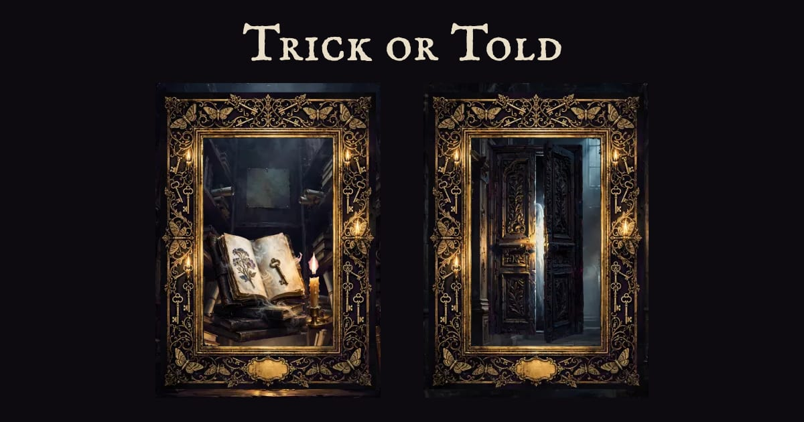

# Batch C (discover) handover
Spec: `.kiro/specs/batch-c-discover/`. Nothing is committed or pushed.
## What changed
- Atlas `/legends`: the legend list is the image-card grid again (1, 2, 3 columns at 390, 768, 1280) under the map. No inner scroll box. The map keeps its 46rem cap.
- `HoloCard`: a click on an empty part of the back turns the card to the front; the "Turn back" button is gone. Escape still works. A click on the back link navigates.
- Entry page `/`: link row removed; new tagline, description and hints.
- Favicon (`favicon.ico` with 16, 32, 48 px, `favicon-32.png`) and one share image, linked from atlas and game heads. One shared `shareTags()` in the skeleton.
- `robots.txt` and `sitemap.xml` as atlas server routes (15 URLs). `canonical` on legend pages and the game hall. `noindex` on game sign-in, sign-up, account and on both 404 pages.
## Files touched
Skeleton: `src/seo/share.ts` (new), `src/client.ts`, `src/shell/HoloCard.tsx`, `src/shell/holoCard.css`.
Atlas: `package.json`, `scripts/{gen-legend-ids,make-icons,make-share-image}.mjs` (new), `scripts/smoke.ts`, `public/favicon.ico`, `public/icons/favicon-32.png`, `public/og/trick-or-told-1200x630.jpg` (new), `src/seo/{sitemap.ts,legendIds.gen.ts}` (new), `src/routes/{robots[.]txt,sitemap[.]xml}.ts` (new), `src/routes/{__root,index,legends.index,legends.$legendId}.tsx`, `src/components/{HomeView,LegendList,NotFound}.tsx`, `src/i18n/en.ts`, `src/styles.css`, `src/routeTree.gen.ts` (generated).
Game: `src/i18n/en.ts`, `src/routes/{__root,index,sign-in,sign-up,account}.tsx`.
## Check results
- Builds: atlas (runs the id generator, regenerates the route tree) and game, both fine.
- `pnpm -r typecheck`: clean.
- `pnpm -r test`: skeleton 916 passed + 8 expected fail. Atlas first run: 2 failed in `test/image-cdn.test.tsx`, both old pins that task 10 missed (see below). After the fix: atlas 305 passed, game 401 passed (the recursive run stops at the first failing package, so I ran game after the fix).
- Book check against the served atlas: 303 passed, 0 failed, 2 skipped (Arabic flag off, Slow 4G flag). `.debug/batch-c/book-check.json`. I used port 3301 (free), not 3001.
- Setup: atlas and game builds, throwaway proxy forwarding `/game/**` (from `.debug/shell-3/proxy.mjs`), once with `PUBLIC_ORIGIN` set to the local origin and the CDN stand-in, once with `PUBLIC_ORIGIN` and CDN unset. `.env` was loaded into each server's shell only. All servers stopped. Script, results and screenshots: `.debug/batch-c/` (`verify.mjs`, `results-*.json`, `shot-*`).
- Layout: `/legends` has 1, 2, 3 columns at 390, 768, 1280. All 12 card images present, no `home-list-scroll`, no inner scroll box, no horizontal scroll, list below the map. Map width 736 px at 768 and 1280 (46rem cap; I had no old build to compare, so "same as before" rests on the cap from the design).
- First screen of `/`: cards and hint fit at 667x375, 1024x768 and 1280x800 with no vertical scroll. At 390x844 the cards stack, the second card runs below the fold and the hint is at y=1168, so it does not fit there (it did not before either: the stacked layout scrolls; see weak points).
- Flip (1280x800): front click turns to the back; empty-area click on the back turns to the front (also with `prefers-reduced-motion: reduce`); back link click goes to `/legends` and does not flip; a 25 px drag on the back stays on the back, a 260 px drag turns it to the front; Escape on the back returns to the front; no "Turn back" button in the DOM. Focus lands on the link after the flip; the front is `inert`; Tab inside the back reaches only the link. Tab order on `/`: skip link, Told, True. No `.shell-links` in the DOM.
- Files (`PUBLIC_ORIGIN` set): `/favicon.ico` 200 `image/x-icon`, images 16, 32, 48. `/icons/favicon-32.png` 32x32. Share image 1200x630, 89,524 bytes. `/robots.txt` has `User-agent: *`, `Allow: /` and `Sitemap: http://localhost:3300/sitemap.xml`. `/sitemap.xml` parses, 15 URLs equal the expected list, none under `/anchor/`, sign-in, sign-up or account.
- `PUBLIC_ORIGIN` unset: `/sitemap.xml` 404, no `Sitemap:` line, no image tags on atlas pages, no relative image URL.
- Head tags on `/`, `/legends`, `/legends/banshee`, `/game/` (DOM after hydration and raw HTML): title, description, canonical, `og:title`, `og:description`, all share tags with correct values; `twitter:title` and `twitter:description` equal the `og:` pair; no `robots` tag; the two icon links on atlas pages and on `/game/`.
- `noindex` on `/game/sign-in`, `/game/sign-up`, `/game/account`, atlas `/no-such-page` and game `/game/no-such-page`: present in `document.head` and in the raw HTML `<head>` for all five (404 status on both 404 pages).
- All 16 internal links on `/legends` return 200.
- `rg` for `home-list-scroll`, `shell-links`, `shell-link`, `turnBack`, `shell.entry.links`, `home.listRegion` under `apps`, `skeleton`, `README.md`: no matches. `git status` shows no change in `content/`, `assets/`, `apps/game/src/server`, the generator, either `vercel.json` or `skeleton/src/deploy`. `git.deploymentEnabled` is unchanged (root: `main` only).
## Test pins updated
- Task 10: `apps/atlas/scripts/smoke.ts` line 48: `og:image` now equals `<origin>/og/trick-or-told-1200x630.jpg`.
- Verify (missed by task 10): `apps/atlas/test/image-cdn.test.tsx` around line 80 (the old hero `og:image` source pin became "no hero og:image, uses `shareTags(`") and line 105 (card `sizes` is now `(min-width: 64rem) 22rem, (min-width: 40rem) 50vw, 100vw`).
## Share image

File: `apps/atlas/public/og/trick-or-told-1200x630.jpg`. Both cards whole, title readable, nothing clipped.
## Weak points
- `robots.txt` has no `Disallow` lines. Only `noindex` keeps the three game pages out of search; a crawler can read it because it may fetch the pages.
- Title font: sharp (Pango) could not load the IM Fell English SC WOFF here, so `make-share-image.mjs` draws the title in headless Chrome with the font file from `@fontsource/im-fell-english-sc` and composites it.
- 404 `noindex` comes from the hoisted `<meta>` that React renders in `NotFound`; it ends up in the head both after hydration and in the server HTML, so no root `head` fallback was needed.
- Game with `PUBLIC_ORIGIN` unset: the game builds its absolute URLs from `ATLAS_ORIGIN`, which was set in both runs, so `/game/` still has absolute image tags in the "unset" run. Absolute, never relative, but not "absent" as for the atlas pages.
- Requirement 3.5 (second card below the fold on `/` at 390x844): accepted by owner (Phase 2 stacked layout with a peek, unchanged by this batch). The hint is below the fold there for the same reason.
- Game share tags built from `ATLAS_ORIGIN` (when `PUBLIC_ORIGIN` is unset) are accepted by the owner.
- Task 13: the `.shell-tagline` was not shrunk by a parent. Its text is longer than its own `max-inline-size: 48ch`, so it wrapped at that cap and `text-wrap: balance` narrowed the lines to about 215 px. From 40rem up the cap is lifted and the line does not wrap; below 40rem it keeps the cap and balanced wrap. Card size is unchanged. Not re-measured (no checks run for this task).
- The local `serve-build.mjs` has no MIME entries for `.png` and `.jpg`, so those answer `application/octet-stream` locally (also the existing `icon-512.png`). I did not check the Vercel content types; the "right content type" check passed only for `.ico`, `.txt` and `.xml`. I left the script alone because the gap predates this batch.
- Legend images 404 in the CDN stand-in (it serves only `assets/shell/`), so screenshots of `/legends` show broken image boxes; the layout, not the pictures, was checked. Real ImageKit and production were not tested.
- Not driven: Arabic and RTL, a signed-in session, and the sitemap URL list against the live domain.
- `sitemap.xml` lists 15 URLs and leaves out `/legends/keepers-note`, which `/legends` links to, as the spec's list says.
